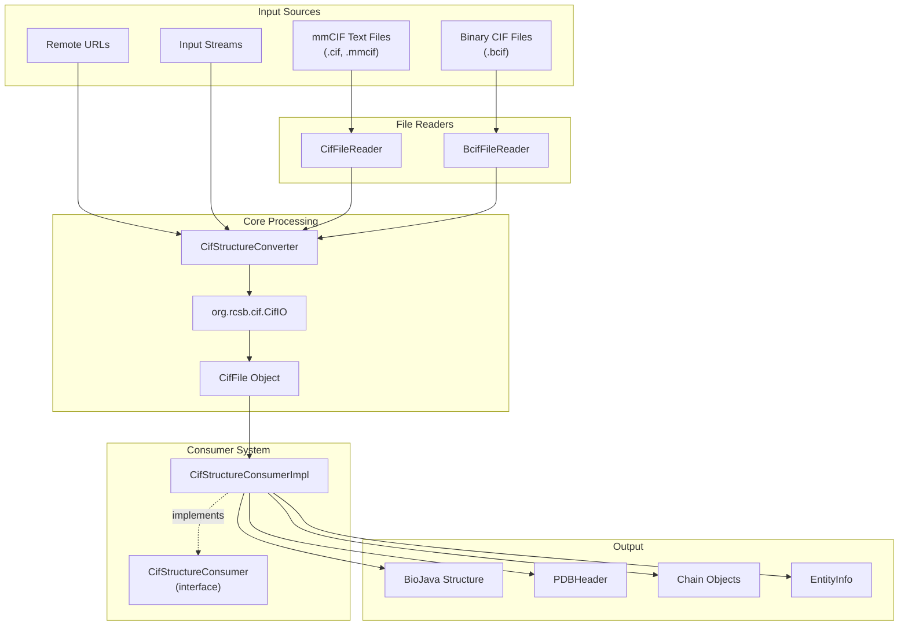
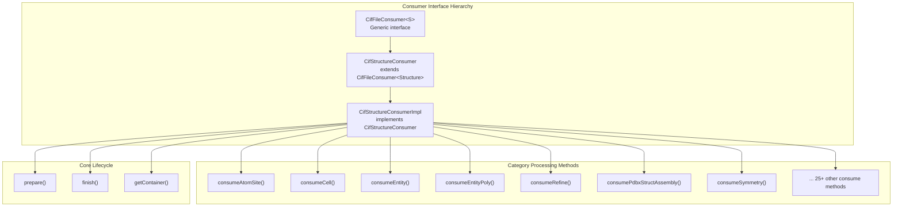
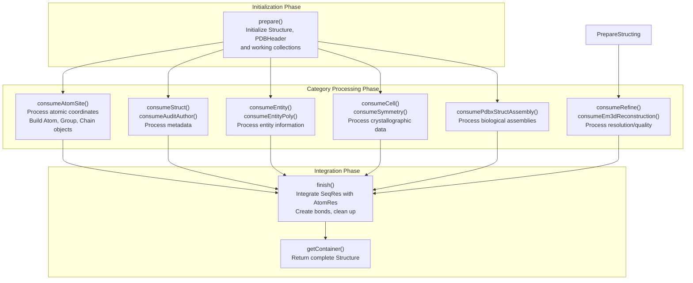
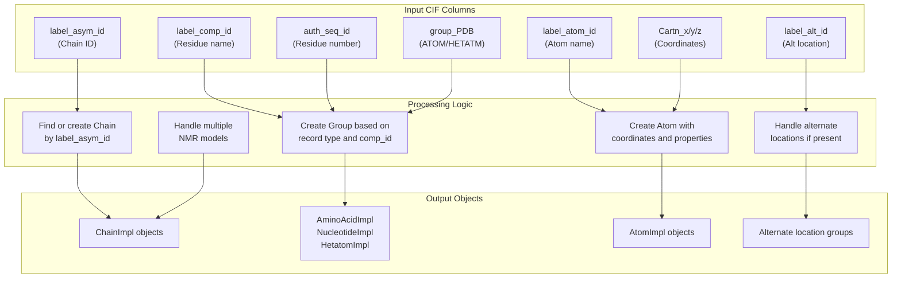
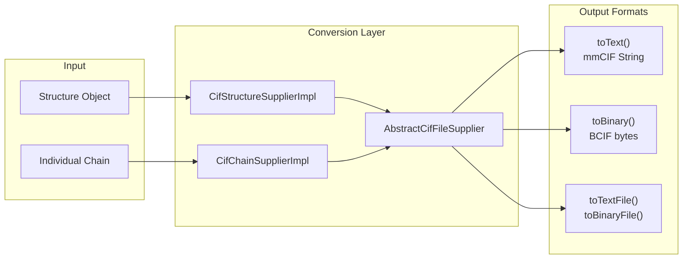

# CIF Data Processing

Relevant source files

The following files were used as context for generating this wiki page:

- [biojava-integrationtest/src/test/java/org/biojava/nbio/structure/test/io/cif/CifFileConsumerIntegrationTest.java](biojava-integrationtest/src/test/java/org/biojava/nbio/structure/test/io/cif/CifFileConsumerIntegrationTest.java)
- [biojava-integrationtest/src/test/java/org/biojava/nbio/structure/test/io/cif/CifFileSupplierIntegrationTest.java](biojava-integrationtest/src/test/java/org/biojava/nbio/structure/test/io/cif/CifFileSupplierIntegrationTest.java)
- [biojava-integrationtest/src/test/resources/1a4w.bcif](biojava-integrationtest/src/test/resources/1a4w.bcif)
- [biojava-integrationtest/src/test/resources/1fdo.bcif](biojava-integrationtest/src/test/resources/1fdo.bcif)
- [biojava-integrationtest/src/test/resources/1j59.bcif](biojava-integrationtest/src/test/resources/1j59.bcif)
- [biojava-integrationtest/src/test/resources/2kc9.bcif](biojava-integrationtest/src/test/resources/2kc9.bcif)
- [biojava-integrationtest/src/test/resources/5pti.bcif](biojava-integrationtest/src/test/resources/5pti.bcif)
- [biojava-structure/src/main/java/org/biojava/nbio/structure/PDBHeader.java](biojava-structure/src/main/java/org/biojava/nbio/structure/PDBHeader.java)
- [biojava-structure/src/main/java/org/biojava/nbio/structure/io/BcifFileReader.java](biojava-structure/src/main/java/org/biojava/nbio/structure/io/BcifFileReader.java)
- [biojava-structure/src/main/java/org/biojava/nbio/structure/io/CifFileReader.java](biojava-structure/src/main/java/org/biojava/nbio/structure/io/CifFileReader.java)
- [biojava-structure/src/main/java/org/biojava/nbio/structure/io/cif/AbstractCifFileSupplier.java](biojava-structure/src/main/java/org/biojava/nbio/structure/io/cif/AbstractCifFileSupplier.java)
- [biojava-structure/src/main/java/org/biojava/nbio/structure/io/cif/CifFileConsumer.java](biojava-structure/src/main/java/org/biojava/nbio/structure/io/cif/CifFileConsumer.java)
- [biojava-structure/src/main/java/org/biojava/nbio/structure/io/cif/CifFileSupplier.java](biojava-structure/src/main/java/org/biojava/nbio/structure/io/cif/CifFileSupplier.java)
- [biojava-structure/src/main/java/org/biojava/nbio/structure/io/cif/CifStructureConsumer.java](biojava-structure/src/main/java/org/biojava/nbio/structure/io/cif/CifStructureConsumer.java)
- [biojava-structure/src/main/java/org/biojava/nbio/structure/io/cif/CifStructureConsumerImpl.java](biojava-structure/src/main/java/org/biojava/nbio/structure/io/cif/CifStructureConsumerImpl.java)
- [biojava-structure/src/main/java/org/biojava/nbio/structure/io/cif/CifStructureConverter.java](biojava-structure/src/main/java/org/biojava/nbio/structure/io/cif/CifStructureConverter.java)
- [biojava-structure/src/test/java/org/biojava/nbio/structure/io/cif/CifFileConsumerImplTest.java](biojava-structure/src/test/java/org/biojava/nbio/structure/io/cif/CifFileConsumerImplTest.java)
- [biojava-structure/src/test/java/org/biojava/nbio/structure/io/cif/CifFileSupplierImplTest.java](biojava-structure/src/test/java/org/biojava/nbio/structure/io/cif/CifFileSupplierImplTest.java)

## Purpose and Scope

This document covers BioJava's modern CIF (Crystallographic Information Framework) data processing system, focusing on the `CifStructureConsumer` architecture and support for both text-based mmCIF and binary CIF (BCIF) formats. This system handles the conversion of CIF files into BioJava `Structure` objects through a category-based consumer pattern.

For general file format support across all biological data formats, see [File Format Support and Parsing](#2.2). For structure caching and retrieval mechanisms, see [Structure Caching and Retrieval](#2.3).

## CIF Format Architecture Overview

BioJava's CIF processing system supports both traditional text-based mmCIF files and the more efficient binary CIF (BCIF) format. The architecture is built around a consumer pattern that processes different CIF categories independently.

**Sources:** [biojava-structure/src/main/java/org/biojava/nbio/structure/io/CifFileReader.java:1-61](), [biojava-structure/src/main/java/org/biojava/nbio/structure/io/BcifFileReader.java:1-59](), [biojava-structure/src/main/java/org/biojava/nbio/structure/io/cif/CifStructureConverter.java:1-242]()

## CifStructureConsumer System

The core of BioJava's CIF processing is the `CifStructureConsumer` interface, which defines methods for consuming individual CIF categories. The main implementation `CifStructureConsumerImpl` processes these categories to build complete `Structure` objects.

**Sources:** [biojava-structure/src/main/java/org/biojava/nbio/structure/io/cif/CifFileConsumer.java:1-27](), [biojava-structure/src/main/java/org/biojava/nbio/structure/io/cif/CifStructureConsumer.java:1-333](), [biojava-structure/src/main/java/org/biojava/nbio/structure/io/cif/CifStructureConsumerImpl.java:111-1533]()

## Data Processing Pipeline

The CIF data processing follows a systematic pipeline that transforms CIF category data into BioJava's object model through the consumer pattern.

**Sources:** [biojava-structure/src/main/java/org/biojava/nbio/structure/io/cif/CifStructureConsumerImpl.java:160-174](), [biojava-structure/src/main/java/org/biojava/nbio/structure/io/cif/CifStructureConsumerImpl.java:1523-1533](), [biojava-structure/src/main/java/org/biojava/nbio/structure/io/cif/CifStructureConverter.java:102-163]()

## Key CIF Categories and Processing

The `CifStructureConsumerImpl` handles numerous CIF categories, each responsible for different aspects of molecular structure data. Here are the most critical categories:

| Category | Method | Purpose | Key Data Processed |
|----------|--------|---------|-------------------|
| `_atom_site` | `consumeAtomSite()` | Core atomic data | Coordinates, occupancy, B-factors, chain/residue IDs |
| `_cell` | `consumeCell()` | Unit cell parameters | a, b, c lengths and α, β, γ angles |
| `_symmetry` | `consumeSymmetry()` | Space group info | Space group symbol and crystallographic symmetry |
| `_entity` | `consumeEntity()` | Molecular entities | Entity types (polymer, non-polymer, water) |
| `_entity_poly` | `consumeEntityPoly()` | Polymer sequences | Sequence information for protein/DNA chains |
| `_refine` | `consumeRefine()` | Refinement statistics | Resolution, R-factors, refinement quality |
| `_struct` | `consumeStruct()` | Structure metadata | PDB ID, title, classification |
| `_pdbx_struct_assembly` | `consumePdbxStructAssembly()` | Biological assemblies | Quaternary structure information |

**Sources:** [biojava-structure/src/main/java/org/biojava/nbio/structure/io/cif/CifStructureConsumerImpl.java:177-370](), [biojava-structure/src/main/java/org/biojava/nbio/structure/io/cif/CifStructureConsumerImpl.java:538-577](), [biojava-structure/src/main/java/org/biojava/nbio/structure/io/cif/CifStructureConsumerImpl.java:892-913]()

## Atom Site Processing Details

The `consumeAtomSite()` method is the most complex part of CIF processing, handling the conversion of atomic coordinate data into BioJava's hierarchical Structure → Chain → Group → Atom model.

**Sources:** [biojava-structure/src/main/java/org/biojava/nbio/structure/io/cif/CifStructureConsumerImpl.java:177-370](), [biojava-structure/src/main/java/org/biojava/nbio/structure/io/cif/CifStructureConsumerImpl.java:412-460]()

## Binary vs Text CIF Processing

BioJava supports both text-based mmCIF and binary CIF formats through unified interfaces, with format-specific optimizations handled by the underlying RCSB CIF library.

| Aspect | Text CIF (mmCIF) | Binary CIF (BCIF) |
|--------|------------------|-------------------|
| **File Extensions** | `.cif`, `.mmcif`, `.cif.gz`, `.mmcif.gz` | `.bcif`, `.bcif.gz` |
| **Reader Class** | `CifFileReader` | `BcifFileReader` |
| **Processing** | Same `CifStructureConsumerImpl` | Same `CifStructureConsumerImpl` |
| **Performance** | Standard text parsing | Optimized binary parsing |
| **File Size** | Larger (human-readable) | Smaller (compressed binary) |
| **Encoding** | UTF-8 text | Binary with compression |

The key insight is that both formats converge to the same `CifFile` object representation after parsing, allowing the same consumer implementation to handle both formats transparently.

**Sources:** [biojava-structure/src/main/java/org/biojava/nbio/structure/io/CifFileReader.java:33-39](), [biojava-structure/src/main/java/org/biojava/nbio/structure/io/BcifFileReader.java:33-37]()

## CIF Writing and Export

BioJava also supports writing Structure objects back to CIF format through the `AbstractCifFileSupplier` system and `CifStructureConverter` utilities.

**Sources:** [biojava-structure/src/main/java/org/biojava/nbio/structure/io/cif/AbstractCifFileSupplier.java:30-137](), [biojava-structure/src/main/java/org/biojava/nbio/structure/io/cif/CifStructureConverter.java:171-241]()

## Integration with File Parsing Parameters

The CIF processing system integrates with BioJava's `FileParsingParameters` to control parsing behavior:

- **Header-only parsing**: When `params.isHeaderOnly()` is true, `consumeAtomSite()` returns early, processing only metadata
- **CA-only parsing**: When `params.isParseCAOnly()` is true, only CA atoms are processed for protein structures
- **SeqRes alignment**: The `params.isAlignSeqRes()` controls whether sequence alignment between SEQRES and ATOM records is performed

**Sources:** [biojava-structure/src/main/java/org/biojava/nbio/structure/io/cif/CifStructureConsumerImpl.java:156-158](), [biojava-structure/src/main/java/org/biojava/nbio/structure/io/cif/CifStructureConsumerImpl.java:178-180](), [biojava-structure/src/main/java/org/biojava/nbio/structure/io/cif/CifStructureConsumerImpl.java:321-325]()

---