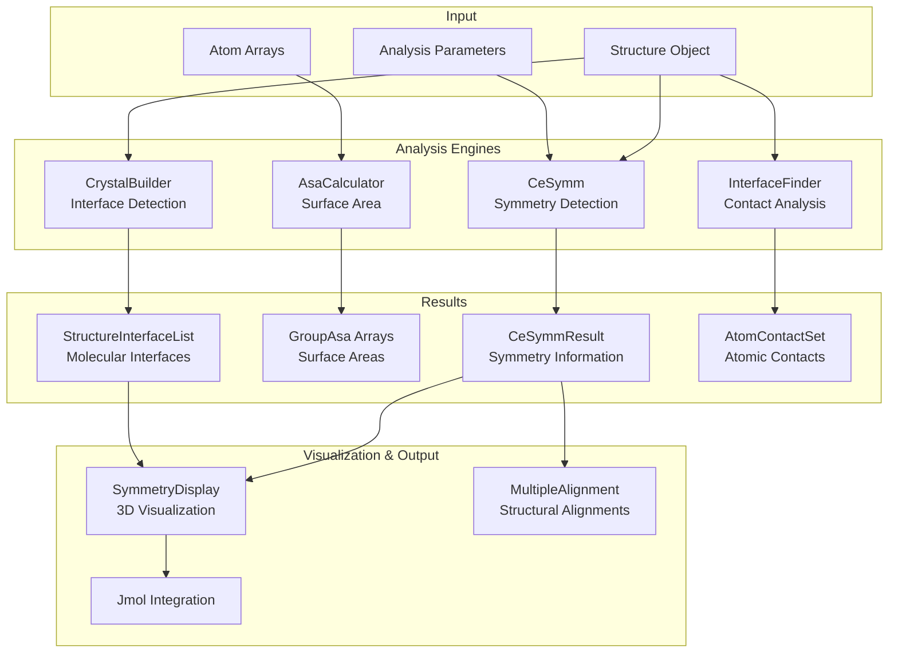
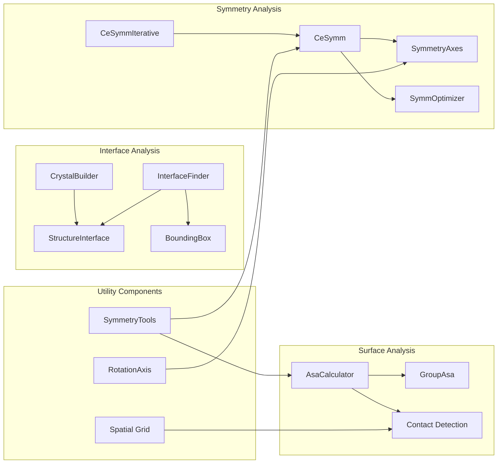
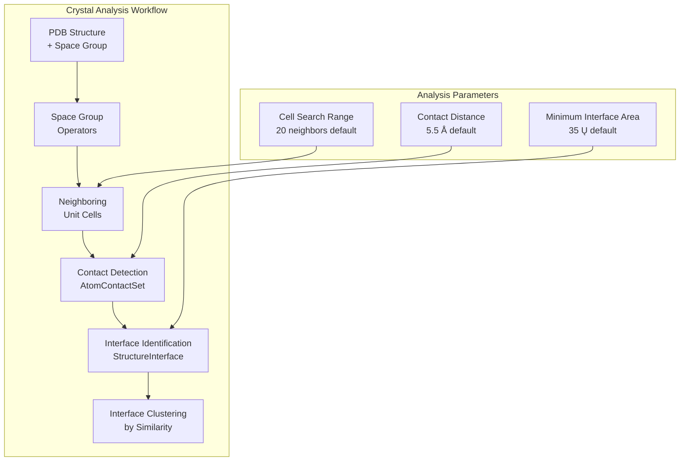

# Structural Analysis Tools

<details>
<summary>Relevant source files</summary>

The following files were used as context for generating this wiki page:

- [biojava-integrationtest/src/test/java/org/biojava/nbio/structure/test/StructureTest.java](biojava-integrationtest/src/test/java/org/biojava/nbio/structure/test/StructureTest.java)
- [biojava-integrationtest/src/test/java/org/biojava/nbio/structure/test/contact/TestInterfaceFinder.java](biojava-integrationtest/src/test/java/org/biojava/nbio/structure/test/contact/TestInterfaceFinder.java)
- [biojava-integrationtest/src/test/java/org/biojava/nbio/structure/test/xtal/TestCrystalBuilder.java](biojava-integrationtest/src/test/java/org/biojava/nbio/structure/test/xtal/TestCrystalBuilder.java)
- [biojava-structure-gui/src/main/java/demo/DemoCeSymm.java](biojava-structure-gui/src/main/java/demo/DemoCeSymm.java)
- [biojava-structure-gui/src/main/java/org/biojava/nbio/structure/symmetry/gui/SymmetryCalc.java](biojava-structure-gui/src/main/java/org/biojava/nbio/structure/symmetry/gui/SymmetryCalc.java)
- [biojava-structure-gui/src/main/java/org/biojava/nbio/structure/symmetry/gui/SymmetryDisplay.java](biojava-structure-gui/src/main/java/org/biojava/nbio/structure/symmetry/gui/SymmetryDisplay.java)
- [biojava-structure-gui/src/main/java/org/biojava/nbio/structure/symmetry/gui/SymmetryListener.java](biojava-structure-gui/src/main/java/org/biojava/nbio/structure/symmetry/gui/SymmetryListener.java)
- [biojava-structure/src/main/java/demo/DemoCeSymm.java](biojava-structure/src/main/java/demo/DemoCeSymm.java)
- [biojava-structure/src/main/java/org/biojava/nbio/structure/align/util/RotationAxis.java](biojava-structure/src/main/java/org/biojava/nbio/structure/align/util/RotationAxis.java)
- [biojava-structure/src/main/java/org/biojava/nbio/structure/asa/AsaCalculator.java](biojava-structure/src/main/java/org/biojava/nbio/structure/asa/AsaCalculator.java)
- [biojava-structure/src/main/java/org/biojava/nbio/structure/contact/BoundingBox.java](biojava-structure/src/main/java/org/biojava/nbio/structure/contact/BoundingBox.java)
- [biojava-structure/src/main/java/org/biojava/nbio/structure/contact/Contact.java](biojava-structure/src/main/java/org/biojava/nbio/structure/contact/Contact.java)
- [biojava-structure/src/main/java/org/biojava/nbio/structure/contact/Grid.java](biojava-structure/src/main/java/org/biojava/nbio/structure/contact/Grid.java)
- [biojava-structure/src/main/java/org/biojava/nbio/structure/contact/GridCell.java](biojava-structure/src/main/java/org/biojava/nbio/structure/contact/GridCell.java)
- [biojava-structure/src/main/java/org/biojava/nbio/structure/contact/InterfaceFinder.java](biojava-structure/src/main/java/org/biojava/nbio/structure/contact/InterfaceFinder.java)
- [biojava-structure/src/main/java/org/biojava/nbio/structure/contact/StructureInterface.java](biojava-structure/src/main/java/org/biojava/nbio/structure/contact/StructureInterface.java)
- [biojava-structure/src/main/java/org/biojava/nbio/structure/contact/StructureInterfaceCluster.java](biojava-structure/src/main/java/org/biojava/nbio/structure/contact/StructureInterfaceCluster.java)
- [biojava-structure/src/main/java/org/biojava/nbio/structure/contact/StructureInterfaceList.java](biojava-structure/src/main/java/org/biojava/nbio/structure/contact/StructureInterfaceList.java)
- [biojava-structure/src/main/java/org/biojava/nbio/structure/symmetry/internal/CESymmParameters.java](biojava-structure/src/main/java/org/biojava/nbio/structure/symmetry/internal/CESymmParameters.java)
- [biojava-structure/src/main/java/org/biojava/nbio/structure/symmetry/internal/CeSymm.java](biojava-structure/src/main/java/org/biojava/nbio/structure/symmetry/internal/CeSymm.java)
- [biojava-structure/src/main/java/org/biojava/nbio/structure/symmetry/internal/CeSymmIterative.java](biojava-structure/src/main/java/org/biojava/nbio/structure/symmetry/internal/CeSymmIterative.java)
- [biojava-structure/src/main/java/org/biojava/nbio/structure/symmetry/internal/CeSymmResult.java](biojava-structure/src/main/java/org/biojava/nbio/structure/symmetry/internal/CeSymmResult.java)
- [biojava-structure/src/main/java/org/biojava/nbio/structure/symmetry/internal/GraphComponentOrderDetector.java](biojava-structure/src/main/java/org/biojava/nbio/structure/symmetry/internal/GraphComponentOrderDetector.java)
- [biojava-structure/src/main/java/org/biojava/nbio/structure/symmetry/internal/GraphComponentRefiner.java](biojava-structure/src/main/java/org/biojava/nbio/structure/symmetry/internal/GraphComponentRefiner.java)
- [biojava-structure/src/main/java/org/biojava/nbio/structure/symmetry/internal/ResidueGroup.java](biojava-structure/src/main/java/org/biojava/nbio/structure/symmetry/internal/ResidueGroup.java)
- [biojava-structure/src/main/java/org/biojava/nbio/structure/symmetry/internal/SymmOptimizer.java](biojava-structure/src/main/java/org/biojava/nbio/structure/symmetry/internal/SymmOptimizer.java)
- [biojava-structure/src/main/java/org/biojava/nbio/structure/symmetry/internal/SymmetryAxes.java](biojava-structure/src/main/java/org/biojava/nbio/structure/symmetry/internal/SymmetryAxes.java)
- [biojava-structure/src/main/java/org/biojava/nbio/structure/symmetry/utils/SymmetryTools.java](biojava-structure/src/main/java/org/biojava/nbio/structure/symmetry/utils/SymmetryTools.java)
- [biojava-structure/src/main/java/org/biojava/nbio/structure/xtal/CrystalBuilder.java](biojava-structure/src/main/java/org/biojava/nbio/structure/xtal/CrystalBuilder.java)
- [biojava-structure/src/main/java/org/biojava/nbio/structure/xtal/UnitCellBoundingBox.java](biojava-structure/src/main/java/org/biojava/nbio/structure/xtal/UnitCellBoundingBox.java)
- [biojava-structure/src/test/java/org/biojava/nbio/structure/align/util/RotationAxisTest.java](biojava-structure/src/test/java/org/biojava/nbio/structure/align/util/RotationAxisTest.java)
- [biojava-structure/src/test/java/org/biojava/nbio/structure/asa/TestAsaCalc.java](biojava-structure/src/test/java/org/biojava/nbio/structure/asa/TestAsaCalc.java)
- [biojava-structure/src/test/java/org/biojava/nbio/structure/contact/TestInterfaceFinder.java](biojava-structure/src/test/java/org/biojava/nbio/structure/contact/TestInterfaceFinder.java)
- [biojava-structure/src/test/java/org/biojava/nbio/structure/redmine/Test1DARSeqAlign.java](biojava-structure/src/test/java/org/biojava/nbio/structure/redmine/Test1DARSeqAlign.java)
- [biojava-structure/src/test/java/org/biojava/nbio/structure/symmetry/internal/TestSymmetryAxes.java](biojava-structure/src/test/java/org/biojava/nbio/structure/symmetry/internal/TestSymmetryAxes.java)

</details>


## Purpose and Scope

BioJava's structural analysis tools provide comprehensive computational capabilities for analyzing protein structures, including symmetry detection, surface area calculations, interface analysis, and quaternary structure characterization. These tools enable researchers to identify structural patterns, measure molecular interactions, and understand the geometric properties of biological macromolecules.

For detailed information about data structures and I/O systems, see [Core Architecture](#2). For visualization capabilities, see [User Interfaces and Visualization](#5).

## Core Analysis Capabilities

BioJava's structural analysis framework is built around several specialized analysis engines that can be used independently or in combination to characterize different aspects of protein structure.

### Analysis Architecture Overview



**Analysis Pipeline Overview**
Sources: [biojava-structure/src/main/java/org/biojava/nbio/structure/symmetry/internal/CeSymm.java:355-406](), [biojava-structure/src/main/java/org/biojava/nbio/structure/asa/AsaCalculator.java:126-153](), [biojava-structure/src/main/java/org/biojava/nbio/structure/xtal/CrystalBuilder.java:200-212]()

### Key Analysis Components



**Core Analysis Classes and Relationships**
Sources: [biojava-structure/src/main/java/org/biojava/nbio/structure/symmetry/internal/](), [biojava-structure/src/main/java/org/biojava/nbio/structure/asa/](), [biojava-structure/src/main/java/org/biojava/nbio/structure/contact/]()

## Protein Symmetry Detection

The `CeSymm` algorithm is BioJava's primary tool for detecting internal structural symmetries in proteins. It identifies both closed symmetries (cyclic, dihedral) and open symmetries (helical, repeats) through self-alignment techniques.

| Analysis Type | Algorithm | Key Classes | Output |
|---------------|-----------|-------------|--------|
| Single-level Symmetry | `CeSymm.analyzeLevel()` | `CeSymm`, `CESymmParameters` | `CeSymmResult` |
| Hierarchical Symmetry | `CeSymm.analyze()` | `CeSymmIterative`, `SymmetryAxes` | Multi-level `CeSymmResult` |
| Symmetry Optimization | Monte Carlo | `SymmOptimizer` | Optimized `MultipleAlignment` |
| Axis Calculation | Transformation Analysis | `SymmetryAxes`, `RotationAxis` | Symmetry axis vectors |

The algorithm workflow:
1. **Self-alignment**: Align structure against itself with diagonal masking
2. **Order detection**: Determine number of symmetric repeats  
3. **Refinement**: Create consistent multiple alignment of repeats
4. **Optimization**: Monte Carlo optimization of alignment quality
5. **Axis calculation**: Derive symmetry axes from transformations

Sources: [biojava-structure/src/main/java/org/biojava/nbio/structure/symmetry/internal/CeSymm.java:170-344](), [biojava-structure/src/main/java/org/biojava/nbio/structure/symmetry/internal/CeSymmIterative.java:105-111]()

## Surface Area and Contact Analysis

The `AsaCalculator` implements the Shrake-Rupley rolling ball algorithm for computing Accessible Surface Areas (ASA) and identifying molecular contacts.

### ASA Calculation Features

- **Probe-based calculation**: Uses configurable probe radius (default 1.4 Å)
- **Sphere point sampling**: Configurable sphere point density (default 1000 points)
- **Parallel processing**: Multi-threaded calculation support
- **Spatial optimization**: Grid-based neighbor finding for performance
- **Chemical accuracy**: Element-specific van der Waals radii from Chothia

### Contact Detection

The framework provides multiple approaches for detecting atomic contacts:

| Method | Class | Use Case | Performance |
|--------|-------|----------|-------------|
| Grid-based | `Grid` | Large structures | O(n log n) |
| Bounding box | `BoundingBox` | Chain-level filtering | O(n) preprocessing |
| All-pairs | `AtomContactSet` | Small structures | O(n²) |

Sources: [biojava-structure/src/main/java/org/biojava/nbio/structure/asa/AsaCalculator.java:36-55](), [biojava-structure/src/main/java/org/biojava/nbio/structure/contact/Grid.java:37-67]()

## Crystal Interface Analysis

BioJava provides sophisticated tools for analyzing protein-protein interfaces in crystallographic structures through systematic crystal lattice reconstruction.

### Crystal Lattice Reconstruction

The `CrystalBuilder` reconstructs crystal neighbors by applying space group symmetry operations:



**Crystal Interface Detection Pipeline**
Sources: [biojava-structure/src/main/java/org/biojava/nbio/structure/xtal/CrystalBuilder.java:213-300]()

### Interface Characterization

Each `StructureInterface` provides detailed analysis:
- **Buried surface area**: ASA difference between complexed and uncomplexed states
- **Contact residues**: Atomic-level interaction mapping
- **Transformation matrices**: Crystal operators relating the two molecules
- **Geometric properties**: Interface size, shape, and chemical composition

For smaller, non-crystallographic analyses, `InterfaceFinder` provides a simplified interface detection workflow for structures with multiple polymer chains.

Sources: [biojava-structure/src/main/java/org/biojava/nbio/structure/contact/StructureInterface.java:147-278](), [biojava-structure/src/main/java/org/biojava/nbio/structure/contact/InterfaceFinder.java:59-81]()

## Analysis Workflows

### Basic Symmetry Analysis

```java
// Load structure and extract atoms
Structure structure = StructureIO.getStructure("1u6d");
Atom[] atoms = StructureTools.getRepresentativeAtomArray(structure);

// Configure analysis parameters  
CESymmParameters params = new CESymmParameters();
params.setRefineMethod(RefineMethod.SEQUENCE_FUNCTION);
params.setOptimization(true);

// Perform symmetry analysis
CeSymmResult result = CeSymm.analyze(atoms, params);

// Check if significant symmetry found
if (result.isSignificant()) {
    int order = result.getNumRepeats();
    String symmetryGroup = result.getSymmGroup();
}
```

### Surface Area Calculation

```java
// Calculate ASA for entire structure
AsaCalculator asaCalc = new AsaCalculator(structure, 
    AsaCalculator.DEFAULT_PROBE_SIZE, 1000, 4, true);

// Get per-residue ASA values
GroupAsa[] groupAsas = asaCalc.getGroupAsas();

// Get per-atom ASA values
double[] atomAsas = asaCalc.calculateAsas();
```

### Interface Detection

```java
// Find all crystal interfaces
CrystalBuilder builder = new CrystalBuilder(structure);
StructureInterfaceList interfaces = builder.getUniqueInterfaces();

// Calculate interface areas
interfaces.calcAsas();

// Filter by significance
interfaces.removeInterfacesBelowArea(35.0);
```

Sources: [biojava-structure-gui/src/main/java/demo/DemoCeSymm.java:73-90](), [biojava-structure/src/test/java/org/biojava/nbio/structure/asa/TestAsaCalc.java:53-86]()

## Integration with Visualization

The analysis tools integrate seamlessly with BioJava's visualization capabilities through `SymmetryDisplay` and Jmol integration. Results can be displayed as:

- **3D structure representations** with symmetric repeats colored distinctly
- **Multiple alignment views** showing structural superpositions  
- **Symmetry axis visualizations** with rotation axes and transformation matrices
- **Interface contact maps** highlighting interaction regions

For detailed visualization capabilities, see [Jmol Integration and Structure Visualization](#5.1).

Sources: [biojava-structure-gui/src/main/java/org/biojava/nbio/structure/symmetry/gui/SymmetryDisplay.java:111-152](), [biojava-structure-gui/src/main/java/org/biojava/nbio/structure/symmetry/gui/SymmetryListener.java:57-100]()

---