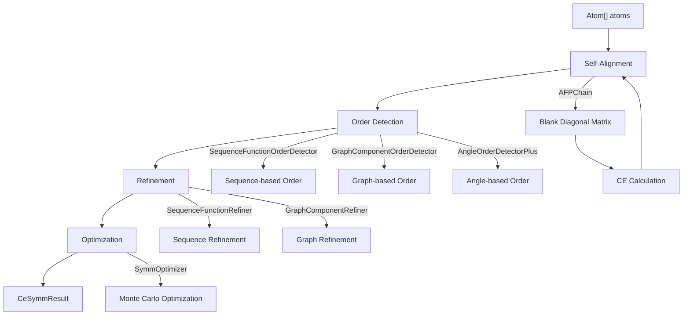
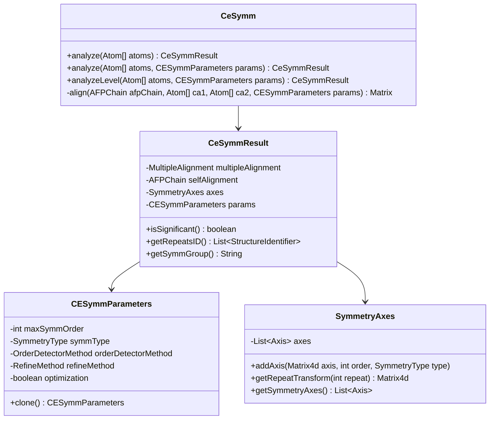
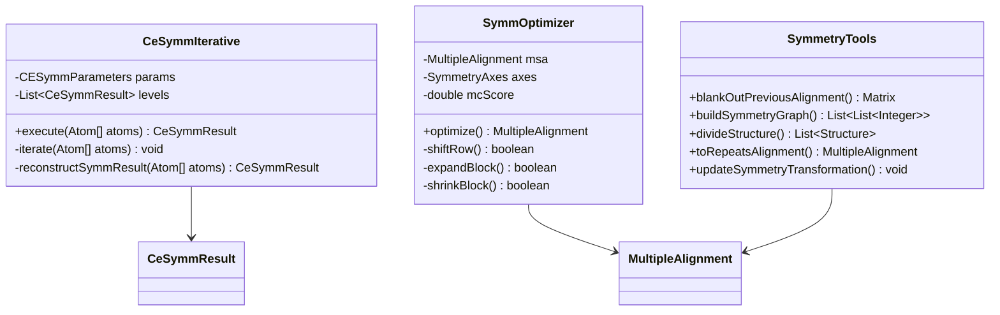
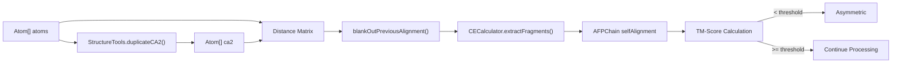
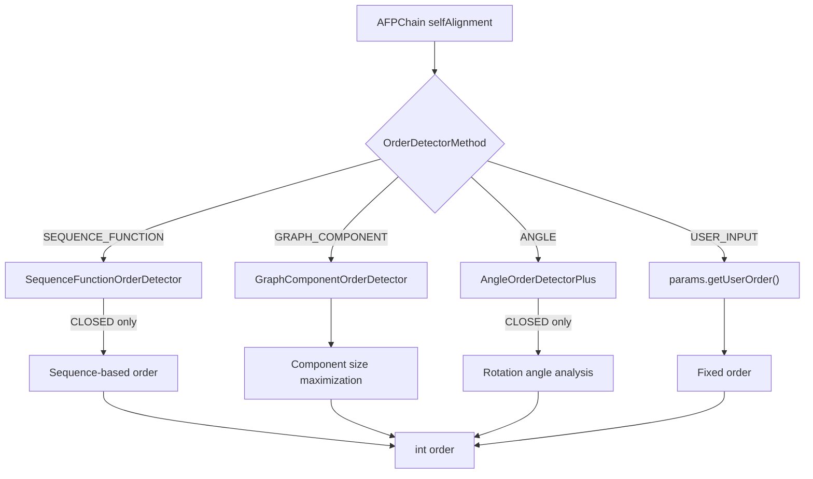
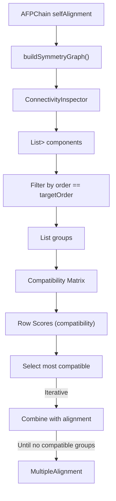
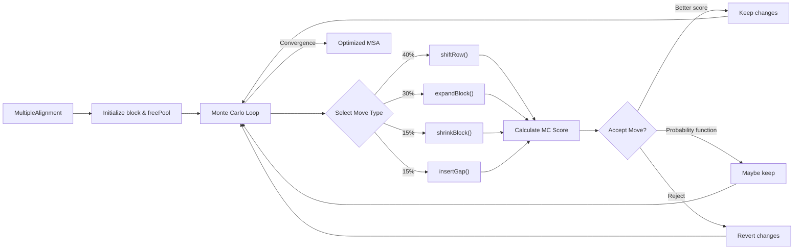
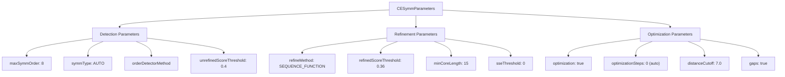
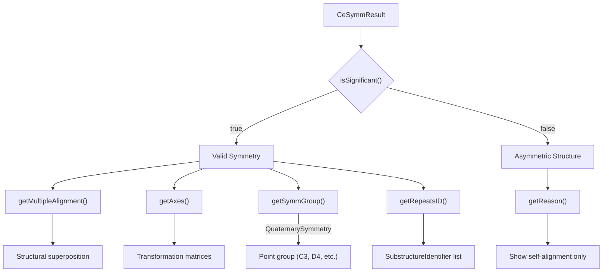
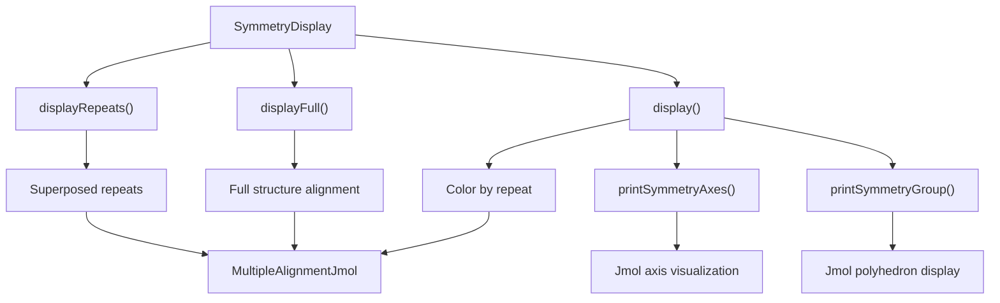

# Protein Symmetry Analysis

<details>
<summary>Relevant source files</summary>

The following files were used as context for generating this wiki page:

- [biojava-structure-gui/src/main/java/demo/DemoCeSymm.java](biojava-structure-gui/src/main/java/demo/DemoCeSymm.java)
- [biojava-structure-gui/src/main/java/org/biojava/nbio/structure/symmetry/gui/SymmetryCalc.java](biojava-structure-gui/src/main/java/org/biojava/nbio/structure/symmetry/gui/SymmetryCalc.java)
- [biojava-structure-gui/src/main/java/org/biojava/nbio/structure/symmetry/gui/SymmetryDisplay.java](biojava-structure-gui/src/main/java/org/biojava/nbio/structure/symmetry/gui/SymmetryDisplay.java)
- [biojava-structure-gui/src/main/java/org/biojava/nbio/structure/symmetry/gui/SymmetryListener.java](biojava-structure-gui/src/main/java/org/biojava/nbio/structure/symmetry/gui/SymmetryListener.java)
- [biojava-structure/src/main/java/demo/DemoCeSymm.java](biojava-structure/src/main/java/demo/DemoCeSymm.java)
- [biojava-structure/src/main/java/org/biojava/nbio/structure/align/util/RotationAxis.java](biojava-structure/src/main/java/org/biojava/nbio/structure/align/util/RotationAxis.java)
- [biojava-structure/src/main/java/org/biojava/nbio/structure/symmetry/internal/CESymmParameters.java](biojava-structure/src/main/java/org/biojava/nbio/structure/symmetry/internal/CESymmParameters.java)
- [biojava-structure/src/main/java/org/biojava/nbio/structure/symmetry/internal/CeSymm.java](biojava-structure/src/main/java/org/biojava/nbio/structure/symmetry/internal/CeSymm.java)
- [biojava-structure/src/main/java/org/biojava/nbio/structure/symmetry/internal/CeSymmIterative.java](biojava-structure/src/main/java/org/biojava/nbio/structure/symmetry/internal/CeSymmIterative.java)
- [biojava-structure/src/main/java/org/biojava/nbio/structure/symmetry/internal/CeSymmResult.java](biojava-structure/src/main/java/org/biojava/nbio/structure/symmetry/internal/CeSymmResult.java)
- [biojava-structure/src/main/java/org/biojava/nbio/structure/symmetry/internal/GraphComponentOrderDetector.java](biojava-structure/src/main/java/org/biojava/nbio/structure/symmetry/internal/GraphComponentOrderDetector.java)
- [biojava-structure/src/main/java/org/biojava/nbio/structure/symmetry/internal/GraphComponentRefiner.java](biojava-structure/src/main/java/org/biojava/nbio/structure/symmetry/internal/GraphComponentRefiner.java)
- [biojava-structure/src/main/java/org/biojava/nbio/structure/symmetry/internal/ResidueGroup.java](biojava-structure/src/main/java/org/biojava/nbio/structure/symmetry/internal/ResidueGroup.java)
- [biojava-structure/src/main/java/org/biojava/nbio/structure/symmetry/internal/SymmOptimizer.java](biojava-structure/src/main/java/org/biojava/nbio/structure/symmetry/internal/SymmOptimizer.java)
- [biojava-structure/src/main/java/org/biojava/nbio/structure/symmetry/internal/SymmetryAxes.java](biojava-structure/src/main/java/org/biojava/nbio/structure/symmetry/internal/SymmetryAxes.java)
- [biojava-structure/src/main/java/org/biojava/nbio/structure/symmetry/utils/SymmetryTools.java](biojava-structure/src/main/java/org/biojava/nbio/structure/symmetry/utils/SymmetryTools.java)
- [biojava-structure/src/test/java/org/biojava/nbio/structure/align/util/RotationAxisTest.java](biojava-structure/src/test/java/org/biojava/nbio/structure/align/util/RotationAxisTest.java)
- [biojava-structure/src/test/java/org/biojava/nbio/structure/symmetry/internal/TestSymmetryAxes.java](biojava-structure/src/test/java/org/biojava/nbio/structure/symmetry/internal/TestSymmetryAxes.java)

</details>


This document covers BioJava's internal protein symmetry detection capabilities, primarily implemented through the CE-Symm (CeSymm) algorithm. The system analyzes protein structures to identify repeating structural units and their spatial relationships, supporting both closed symmetries (circular, dihedral) and open symmetries (helical, protein repeats). 

For quaternary symmetry analysis of multi-chain complexes, see [Subunit Clustering and Quaternary Structure](#3.3). For general structure alignment capabilities, see [Multiple Structure Alignment](#3.4).

## Algorithm Overview

The CE-Symm algorithm detects internal symmetries by performing a self-alignment of a protein structure against itself, then refining the results to identify consistent repeating units. The approach supports hierarchical symmetries and can detect multiple levels of symmetry within a single structure.

### Core CE-Symm Workflow



**Sources:** [biojava-structure/src/main/java/org/biojava/nbio/structure/symmetry/internal/CeSymm.java:170-344](), [biojava-structure/src/main/java/org/biojava/nbio/structure/symmetry/internal/CeSymmIterative.java:105-111]()

## Core Classes and Architecture

### Primary Analysis Classes



**Sources:** [biojava-structure/src/main/java/org/biojava/nbio/structure/symmetry/internal/CeSymm.java:72-95](), [biojava-structure/src/main/java/org/biojava/nbio/structure/symmetry/internal/CeSymmResult.java:51-95](), [biojava-structure/src/main/java/org/biojava/nbio/structure/symmetry/internal/CESymmParameters.java:36-86](), [biojava-structure/src/main/java/org/biojava/nbio/structure/symmetry/internal/SymmetryAxes.java:63-196]()

### Supporting Analysis Components



**Sources:** [biojava-structure/src/main/java/org/biojava/nbio/structure/symmetry/internal/CeSymmIterative.java:71-92](), [biojava-structure/src/main/java/org/biojava/nbio/structure/symmetry/internal/SymmOptimizer.java:62-136](), [biojava-structure/src/main/java/org/biojava/nbio/structure/symmetry/utils/SymmetryTools.java:85-92]()

## Symmetry Detection Pipeline

### Self-Alignment Process

The algorithm begins by creating a self-alignment where the structure is compared against itself with diagonal masking to prevent trivial identity matches.



**Sources:** [biojava-structure/src/main/java/org/biojava/nbio/structure/symmetry/internal/CeSymm.java:177-189](), [biojava-structure/src/main/java/org/biojava/nbio/structure/symmetry/utils/SymmetryTools.java:326-331]()

### Order Detection Methods

Multiple algorithms determine the order of symmetry from the self-alignment:



**Sources:** [biojava-structure/src/main/java/org/biojava/nbio/structure/symmetry/internal/CeSymm.java:276-303](), [biojava-structure/src/main/java/org/biojava/nbio/structure/symmetry/internal/CESymmParameters.java:54-57]()

## Refinement and Optimization

### Graph-Based Refinement

The `GraphComponentRefiner` converts the self-alignment into a graph structure and identifies maximally connected components:



**Sources:** [biojava-structure/src/main/java/org/biojava/nbio/structure/symmetry/internal/GraphComponentRefiner.java:58-82](), [biojava-structure/src/main/java/org/biojava/nbio/structure/symmetry/internal/GraphComponentRefiner.java:121-139]()

### Monte Carlo Optimization

The `SymmOptimizer` uses Monte Carlo methods to improve alignment quality:



**Sources:** [biojava-structure/src/main/java/org/biojava/nbio/structure/symmetry/internal/SymmOptimizer.java:192-330](), [biojava-structure/src/main/java/org/biojava/nbio/structure/symmetry/internal/SymmOptimizer.java:229-246]()

## Symmetry Types and Parameters

### Symmetry Classification

The algorithm supports different symmetry types defined in `CESymmParameters.SymmetryType`:

| Type | Description | Detection Criteria |
|------|-------------|-------------------|
| `CLOSED` | Circular, dihedral symmetries | Multiple blocks in AFPChain (circular permutation) |
| `OPEN` | Helical, protein repeats | Single block in AFPChain |
| `AUTO` | Automatic detection | Determined by block count in self-alignment |

**Sources:** [biojava-structure/src/main/java/org/biojava/nbio/structure/symmetry/internal/CESymmParameters.java:79-82](), [biojava-structure/src/main/java/org/biojava/nbio/structure/symmetry/internal/CeSymm.java:254-263]()

### Key Configuration Parameters



**Sources:** [biojava-structure/src/main/java/org/biojava/nbio/structure/symmetry/internal/CESymmParameters.java:126-143]()

## Results and Visualization

### CeSymmResult Analysis

The `CeSymmResult` class provides comprehensive analysis of detected symmetries:



**Sources:** [biojava-structure/src/main/java/org/biojava/nbio/structure/symmetry/internal/CeSymmResult.java:72-95](), [biojava-structure/src/main/java/org/biojava/nbio/structure/symmetry/internal/CeSymmResult.java:194-221]()

### Visualization Integration

The system integrates with Jmol for 3D visualization through `SymmetryDisplay`:



**Sources:** [biojava-structure-gui/src/main/java/org/biojava/nbio/structure/symmetry/gui/SymmetryDisplay.java:111-152](), [biojava-structure-gui/src/main/java/org/biojava/nbio/structure/symmetry/gui/SymmetryDisplay.java:209-255]()

## Usage Examples

### Basic Symmetry Analysis

```java
// Load structure
AtomCache cache = new AtomCache();
Structure s = cache.getStructure("1u6d");
Atom[] atoms = StructureTools.getRepresentativeAtomArray(s);

// Configure parameters
CESymmParameters params = new CESymmParameters();
params.setRefineMethod(RefineMethod.SEQUENCE_FUNCTION);
params.setSymmType(SymmetryType.AUTO);
params.setOptimization(true);

// Run analysis
CeSymmResult result = CeSymm.analyze(atoms, params);

// Check results
if (result.isSignificant()) {
    System.out.println("Symmetry: " + result.getSymmGroup());
    System.out.println("Repeats: " + result.getNumRepeats());
}
```

**Sources:** [biojava-structure-gui/src/main/java/demo/DemoCeSymm.java:76-94]()

### Iterative Multi-Level Analysis

For detecting hierarchical symmetries, the system automatically uses `CeSymmIterative`:

```java
CESymmParameters params = new CESymmParameters();
params.setSymmLevels(0); // Unlimited levels
CeSymmResult result = CeSymm.analyze(atoms, params);

// Access hierarchical information
int levels = result.getSymmLevels();
SymmetryAxes axes = result.getAxes();
```

**Sources:** [biojava-structure/src/main/java/org/biojava/nbio/structure/symmetry/internal/CeSymm.java:387-405](), [biojava-structure/src/main/java/org/biojava/nbio/structure/symmetry/internal/CeSymmIterative.java:105-111]()

---