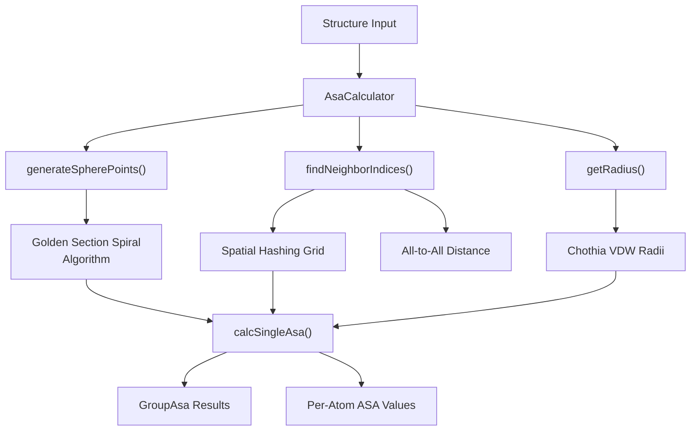
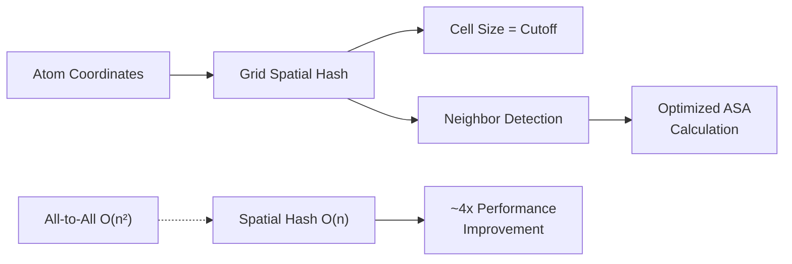
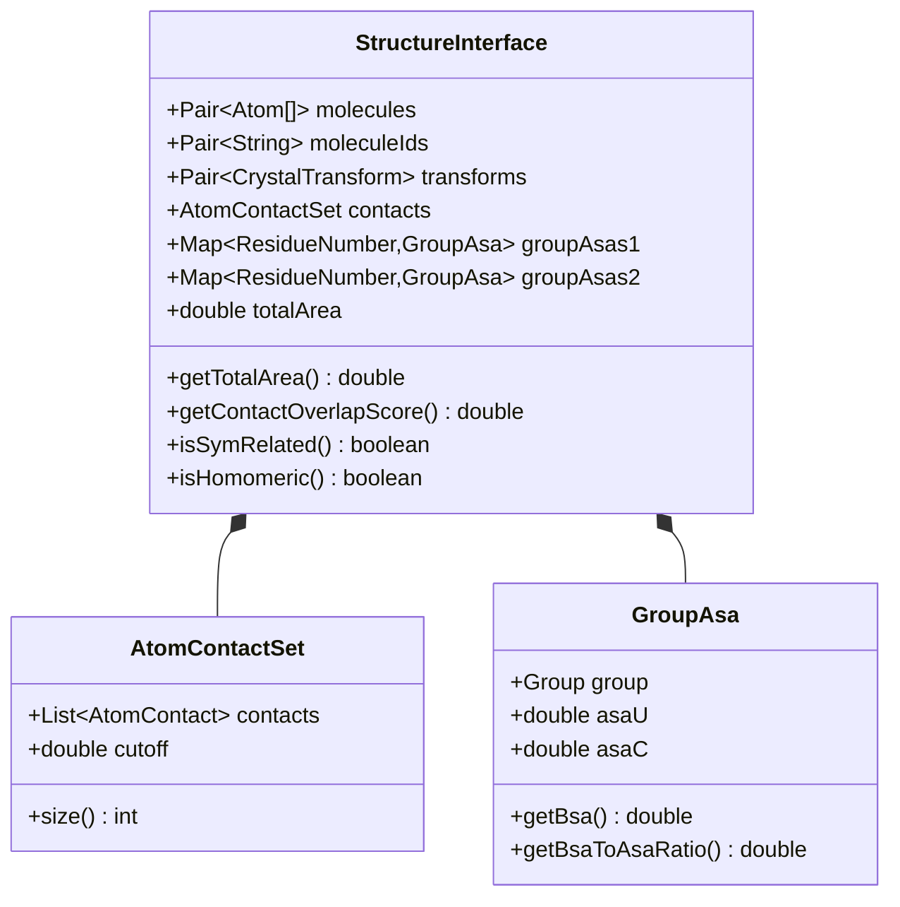
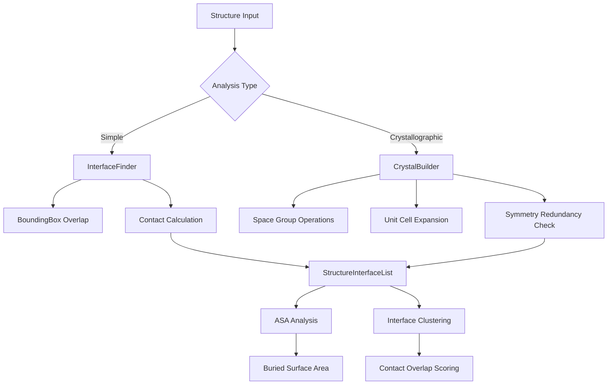
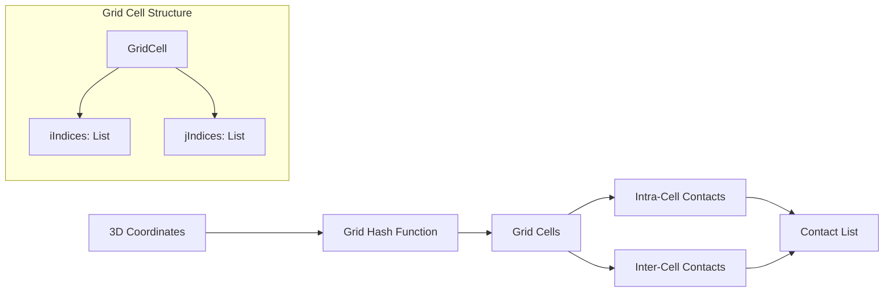
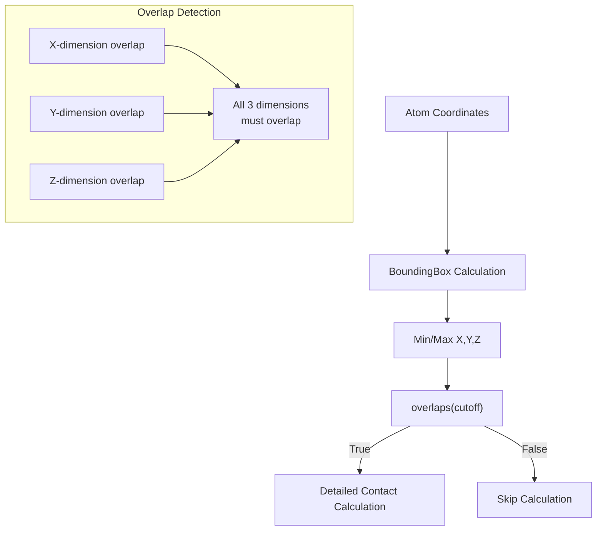
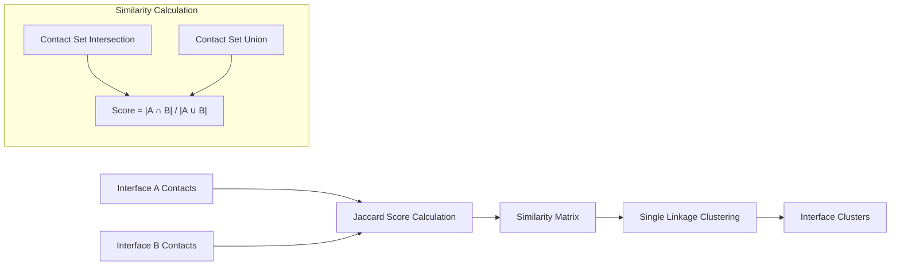

# Surface Area and Interface Analysis

Relevant source files

The following files were used as context for generating this wiki page:

- [biojava-integrationtest/src/test/java/org/biojava/nbio/structure/test/StructureTest.java](biojava-integrationtest/src/test/java/org/biojava/nbio/structure/test/StructureTest.java)
- [biojava-integrationtest/src/test/java/org/biojava/nbio/structure/test/contact/TestInterfaceFinder.java](biojava-integrationtest/src/test/java/org/biojava/nbio/structure/test/contact/TestInterfaceFinder.java)
- [biojava-integrationtest/src/test/java/org/biojava/nbio/structure/test/xtal/TestCrystalBuilder.java](biojava-integrationtest/src/test/java/org/biojava/nbio/structure/test/xtal/TestCrystalBuilder.java)
- [biojava-structure/src/main/java/org/biojava/nbio/structure/asa/AsaCalculator.java](biojava-structure/src/main/java/org/biojava/nbio/structure/asa/AsaCalculator.java)
- [biojava-structure/src/main/java/org/biojava/nbio/structure/contact/BoundingBox.java](biojava-structure/src/main/java/org/biojava/nbio/structure/contact/BoundingBox.java)
- [biojava-structure/src/main/java/org/biojava/nbio/structure/contact/Contact.java](biojava-structure/src/main/java/org/biojava/nbio/structure/contact/Contact.java)
- [biojava-structure/src/main/java/org/biojava/nbio/structure/contact/Grid.java](biojava-structure/src/main/java/org/biojava/nbio/structure/contact/Grid.java)
- [biojava-structure/src/main/java/org/biojava/nbio/structure/contact/GridCell.java](biojava-structure/src/main/java/org/biojava/nbio/structure/contact/GridCell.java)
- [biojava-structure/src/main/java/org/biojava/nbio/structure/contact/InterfaceFinder.java](biojava-structure/src/main/java/org/biojava/nbio/structure/contact/InterfaceFinder.java)
- [biojava-structure/src/main/java/org/biojava/nbio/structure/contact/StructureInterface.java](biojava-structure/src/main/java/org/biojava/nbio/structure/contact/StructureInterface.java)
- [biojava-structure/src/main/java/org/biojava/nbio/structure/contact/StructureInterfaceCluster.java](biojava-structure/src/main/java/org/biojava/nbio/structure/contact/StructureInterfaceCluster.java)
- [biojava-structure/src/main/java/org/biojava/nbio/structure/contact/StructureInterfaceList.java](biojava-structure/src/main/java/org/biojava/nbio/structure/contact/StructureInterfaceList.java)
- [biojava-structure/src/main/java/org/biojava/nbio/structure/xtal/CrystalBuilder.java](biojava-structure/src/main/java/org/biojava/nbio/structure/xtal/CrystalBuilder.java)
- [biojava-structure/src/main/java/org/biojava/nbio/structure/xtal/UnitCellBoundingBox.java](biojava-structure/src/main/java/org/biojava/nbio/structure/xtal/UnitCellBoundingBox.java)
- [biojava-structure/src/test/java/org/biojava/nbio/structure/asa/TestAsaCalc.java](biojava-structure/src/test/java/org/biojava/nbio/structure/asa/TestAsaCalc.java)
- [biojava-structure/src/test/java/org/biojava/nbio/structure/contact/TestInterfaceFinder.java](biojava-structure/src/test/java/org/biojava/nbio/structure/contact/TestInterfaceFinder.java)
- [biojava-structure/src/test/java/org/biojava/nbio/structure/redmine/Test1DARSeqAlign.java](biojava-structure/src/test/java/org/biojava/nbio/structure/redmine/Test1DARSeqAlign.java)

## Purpose and Scope

This document covers BioJava's computational tools for analyzing protein surface areas and molecular interfaces. The system provides algorithms for calculating Accessible Surface Area (ASA) using the rolling ball method, detecting contacts between molecular chains, and identifying crystal interfaces through symmetry operations. For structure visualization and display components, see [Jmol Integration and Structure Visualization](#5.1). For protein comparison applications, see [Protein Comparison Tool](#5.2).

## ASA Calculation System

### Core ASA Algorithm

The `AsaCalculator` class implements the Shrake-Rupley rolling ball algorithm for computing Accessible Surface Areas. The algorithm samples points on a sphere around each atom and determines which points are accessible (not occluded by neighboring atoms).

**ASA Calculation Pipeline**

The system uses Van der Waals radii from Chothia (1976) to account for different atom types in amino acids and nucleotides. The `DEFAULT_N_SPHERE_POINTS` is set to 1000 for accuracy, with `DEFAULT_PROBE_SIZE` of 1.4 Å.

Sources: [biojava-structure/src/main/java/org/biojava/nbio/structure/asa/AsaCalculator.java:55-669]()

### Spatial Optimization

The ASA calculator employs spatial hashing to efficiently find neighboring atoms within the cutoff distance, avoiding costly all-to-all distance calculations.

**Spatial Hashing Optimization**

Sources: [biojava-structure/src/main/java/org/biojava/nbio/structure/asa/AsaCalculator.java:389-440](), [biojava-structure/src/main/java/org/biojava/nbio/structure/contact/Grid.java:59-516]()

## Interface Detection and Analysis

### StructureInterface Representation

The `StructureInterface` class represents contacts between two molecular chains, storing atom pairs, contact distances, and buried surface areas.

**StructureInterface Class Structure**

Sources: [biojava-structure/src/main/java/org/biojava/nbio/structure/contact/StructureInterface.java:62-819]()

### Interface Analysis Workflow

The interface analysis system provides multiple approaches for finding molecular interfaces, from simple contact detection to comprehensive crystal lattice analysis.

**Interface Analysis Workflow**

Sources: [biojava-structure/src/main/java/org/biojava/nbio/structure/contact/InterfaceFinder.java:22-107](), [biojava-structure/src/main/java/org/biojava/nbio/structure/xtal/CrystalBuilder.java:45-632]()

### Crystal Interface Analysis

The `CrystalBuilder` class performs comprehensive interface analysis by generating symmetry mates and detecting contacts across the crystal lattice.

| Parameter | Default Value | Description |
|-----------|---------------|-------------|
| `DEF_NUM_CELLS` | 20 | Number of neighboring cells to search |
| `DEFAULT_INTERFACE_DISTANCE_CUTOFF` | 5.5 Å | Maximum distance for interface contacts |
| `DEFAULT_CONTACT_OVERLAP_SCORE_CLUSTER_CUTOFF` | 0.2 | Threshold for interface clustering |

**Crystal Builder Configuration**

The system handles various crystallographic scenarios including non-standard space groups, missing unit cell information, and non-standard coordinate frames.

Sources: [biojava-structure/src/main/java/org/biojava/nbio/structure/xtal/CrystalBuilder.java:65-71]()

## Contact Calculation and Spatial Data Structures

### Grid-Based Contact Detection

The `Grid` class implements spatial hashing for efficient contact calculation, dividing 3D space into cells of size equal to the cutoff distance.

**Grid-Based Spatial Hashing**

Sources: [biojava-structure/src/main/java/org/biojava/nbio/structure/contact/Grid.java:59-96](), [biojava-structure/src/main/java/org/biojava/nbio/structure/contact/GridCell.java:35-175]()

### BoundingBox Optimization

`BoundingBox` objects provide rapid overlap detection to avoid unnecessary contact calculations between distant molecular regions.

**BoundingBox Overlap Detection**

Sources: [biojava-structure/src/main/java/org/biojava/nbio/structure/contact/BoundingBox.java:42-255]()

## Interface Clustering and Classification

### Contact Overlap Scoring

The system uses Jaccard similarity (intersection over union) of contact sets to measure interface similarity and perform clustering.

**Interface Clustering Pipeline**

Sources: [biojava-structure/src/main/java/org/biojava/nbio/structure/contact/StructureInterfaceList.java:375-451]()

### Interface Classification

The system classifies interfaces based on several criteria:

| Classification | Method | Description |
|----------------|---------|-------------|
| Homomeric/Heteromeric | `isHomomeric()` | Same vs different entities |
| Symmetric/Asymmetric | `isSymRelated()` | Crystallographic symmetry |
| Isologous/Heterologous | `isIsologous()` | Self-contact overlap analysis |
| Infinite/Finite | `isInfinite()` | Crystal translation properties |

**Interface Classification Types**

Sources: [biojava-structure/src/main/java/org/biojava/nbio/structure/contact/StructureInterface.java:375-404]()

## Performance Considerations

The system implements several optimization strategies:

1. **Spatial Hashing**: Reduces neighbor finding from O(n²) to O(n)
2. **BoundingBox Pre-filtering**: Eliminates distant molecule pairs early
3. **Multi-threading**: Parallel ASA calculation with configurable thread count
4. **Sorted Neighbor Lists**: Optimizes occlusion checking in ASA calculation

The `DEFAULT_ASA_SPHERE_POINTS` of 3000 provides a balance between accuracy and performance for interface area calculations.

Sources: [biojava-structure/src/main/java/org/biojava/nbio/structure/contact/StructureInterfaceList.java:62-67](), [biojava-structure/src/main/java/org/biojava/nbio/structure/asa/AsaCalculator.java:466-470]()

---