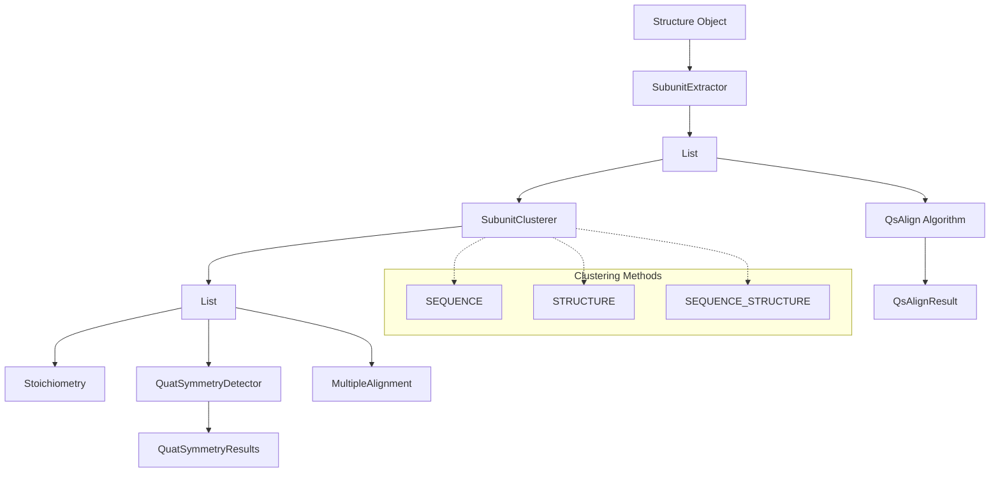
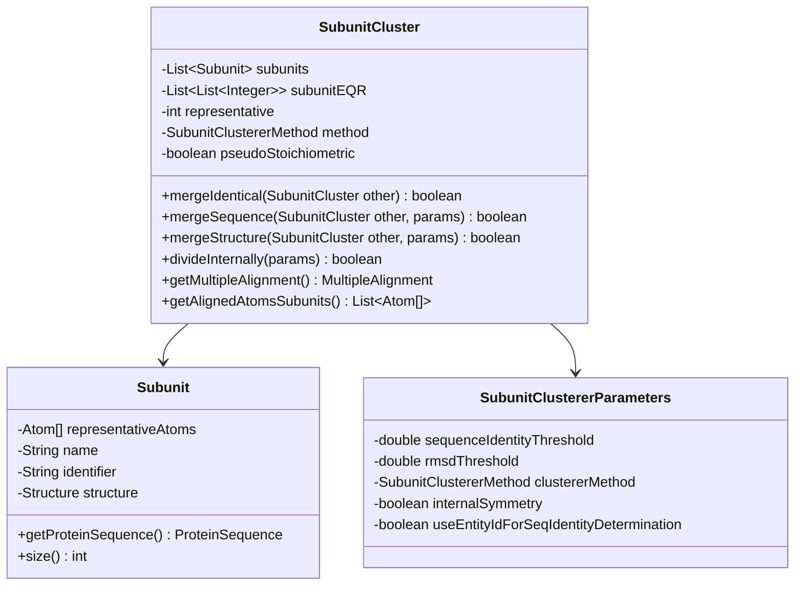
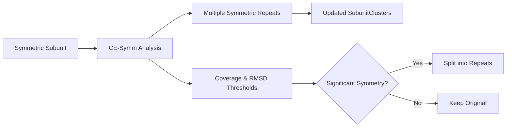
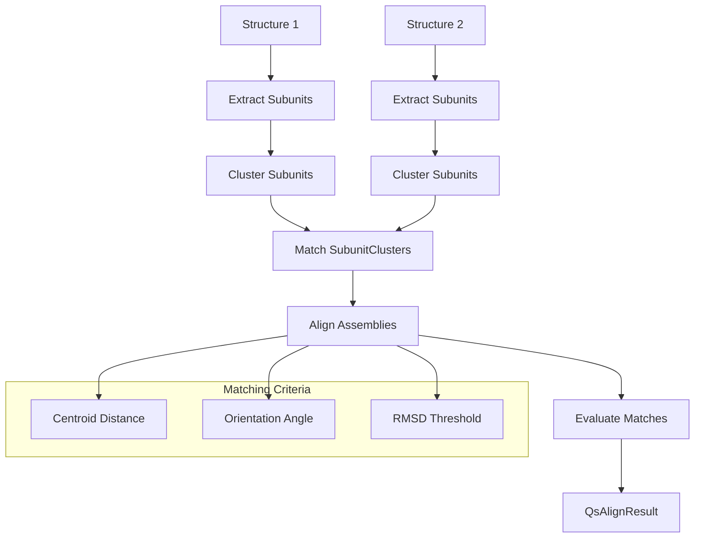
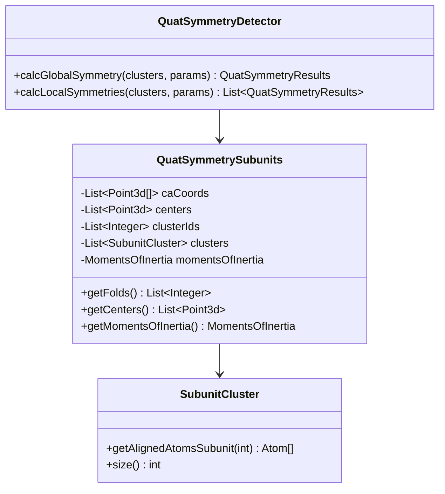

# Subunit Clustering and Quaternary Structure

<details>
<summary>Relevant source files</summary>

The following files were used as context for generating this wiki page:

- [biojava-integrationtest/src/test/java/org/biojava/nbio/structure/test/align/qsalign/TestQsAlignExamples.java](biojava-integrationtest/src/test/java/org/biojava/nbio/structure/test/align/qsalign/TestQsAlignExamples.java)
- [biojava-integrationtest/src/test/java/org/biojava/nbio/structure/test/cluster/TestSubunitClustererExamples.java](biojava-integrationtest/src/test/java/org/biojava/nbio/structure/test/cluster/TestSubunitClustererExamples.java)
- [biojava-integrationtest/src/test/java/org/biojava/nbio/structure/test/symmetry/TestQuatSymmetryDetectorExamples.java](biojava-integrationtest/src/test/java/org/biojava/nbio/structure/test/symmetry/TestQuatSymmetryDetectorExamples.java)
- [biojava-structure/src/main/java/demo/DemoQsAlign.java](biojava-structure/src/main/java/demo/DemoQsAlign.java)
- [biojava-structure/src/main/java/org/biojava/nbio/structure/align/quaternary/QsAlign.java](biojava-structure/src/main/java/org/biojava/nbio/structure/align/quaternary/QsAlign.java)
- [biojava-structure/src/main/java/org/biojava/nbio/structure/align/quaternary/QsAlignParameters.java](biojava-structure/src/main/java/org/biojava/nbio/structure/align/quaternary/QsAlignParameters.java)
- [biojava-structure/src/main/java/org/biojava/nbio/structure/align/quaternary/QsAlignResult.java](biojava-structure/src/main/java/org/biojava/nbio/structure/align/quaternary/QsAlignResult.java)
- [biojava-structure/src/main/java/org/biojava/nbio/structure/cluster/SubunitCluster.java](biojava-structure/src/main/java/org/biojava/nbio/structure/cluster/SubunitCluster.java)
- [biojava-structure/src/main/java/org/biojava/nbio/structure/cluster/SubunitClusterer.java](biojava-structure/src/main/java/org/biojava/nbio/structure/cluster/SubunitClusterer.java)
- [biojava-structure/src/main/java/org/biojava/nbio/structure/cluster/SubunitClustererMethod.java](biojava-structure/src/main/java/org/biojava/nbio/structure/cluster/SubunitClustererMethod.java)
- [biojava-structure/src/main/java/org/biojava/nbio/structure/cluster/SubunitClustererParameters.java](biojava-structure/src/main/java/org/biojava/nbio/structure/cluster/SubunitClustererParameters.java)
- [biojava-structure/src/main/java/org/biojava/nbio/structure/cluster/SubunitExtractor.java](biojava-structure/src/main/java/org/biojava/nbio/structure/cluster/SubunitExtractor.java)
- [biojava-structure/src/main/java/org/biojava/nbio/structure/symmetry/core/QuatSymmetrySubunits.java](biojava-structure/src/main/java/org/biojava/nbio/structure/symmetry/core/QuatSymmetrySubunits.java)
- [biojava-structure/src/main/java/org/biojava/nbio/structure/symmetry/core/Stoichiometry.java](biojava-structure/src/main/java/org/biojava/nbio/structure/symmetry/core/Stoichiometry.java)
- [biojava-structure/src/test/java/org/biojava/nbio/structure/cluster/TestSubunitCluster.java](biojava-structure/src/test/java/org/biojava/nbio/structure/cluster/TestSubunitCluster.java)
- [biojava-structure/src/test/java/org/biojava/nbio/structure/cluster/TestSubunitExtractor.java](biojava-structure/src/test/java/org/biojava/nbio/structure/cluster/TestSubunitExtractor.java)

</details>


This document covers BioJava's capabilities for analyzing protein quaternary structure through subunit clustering and alignment algorithms. The system provides tools for identifying equivalent subunits within protein complexes, determining stoichiometry, and aligning quaternary structures between different proteins.

For information about protein symmetry analysis, see [Protein Symmetry Analysis](#3.1). For surface area and interface analysis tools, see [Surface Area and Interface Analysis](#3.2).

## Overview

BioJava's quaternary structure analysis system operates through a multi-step process that extracts protein subunits from structures, clusters equivalent subunits using sequence and/or structural similarity, and enables comparative analysis of protein assemblies.

### Quaternary Structure Analysis Workflow



**Sources:** [biojava-structure/src/main/java/org/biojava/nbio/structure/cluster/SubunitExtractor.java:65-94](), [biojava-structure/src/main/java/org/biojava/nbio/structure/cluster/SubunitClusterer.java:50-136]()

## Core Components

### SubunitExtractor

The `SubunitExtractor` is responsible for converting protein chains from a `Structure` object into individual `Subunit` objects that can be analyzed for clustering.

**Key Features:**
- Extracts only protein chains from structures
- Applies length filtering with adaptive minimum sequence lengths
- Handles both asymmetric units and biological assemblies

The extractor uses adaptive length thresholds to accommodate structures with very short chains (such as collagen), adjusting the minimum sequence length based on the median chain length.

**Sources:** [biojava-structure/src/main/java/org/biojava/nbio/structure/cluster/SubunitExtractor.java:65-143]()

### SubunitClusterer 

The `SubunitClusterer` implements the main clustering algorithm that groups equivalent subunits based on sequence and/or structural similarity.

#### Clustering Methods

| Method | Description | Use Case |
|--------|-------------|----------|
| `SEQUENCE` | Sequence-based clustering using pairwise alignments | High sequence identity subunits |
| `STRUCTURE` | Structure-based clustering using 3D alignment | Structurally similar but sequence-divergent subunits |
| `SEQUENCE_STRUCTURE` | Combined approach with both methods | Comprehensive analysis including pseudosymmetry detection |

**Sources:** [biojava-structure/src/main/java/org/biojava/nbio/structure/cluster/SubunitClustererMethod.java:31-68]()

### SubunitCluster

The `SubunitCluster` class represents a group of equivalent subunits and provides methods for cluster manipulation and analysis.

#### Core SubunitCluster Operations



**Sources:** [biojava-structure/src/main/java/org/biojava/nbio/structure/cluster/SubunitCluster.java:77-854](), [biojava-structure/src/main/java/org/biojava/nbio/structure/cluster/SubunitClustererParameters.java:36-532]()

## Clustering Algorithm Details

### Sequence-Based Clustering

Sequence clustering uses pairwise sequence alignments with configurable identity and coverage thresholds. The algorithm supports both local and global alignment metrics.

**Default Thresholds:**
- High confidence sequence identity: 95% (local) / 85% (global)
- Sequence coverage: 75%

For performance optimization with large complexes, the system can use entity ID comparison to avoid expensive sequence alignments when subunits belong to the same molecular entity.

**Sources:** [biojava-structure/src/main/java/org/biojava/nbio/structure/cluster/SubunitCluster.java:361-475](), [biojava-structure/src/main/java/org/biojava/nbio/structure/cluster/SubunitClustererParameters.java:48]()

### Structure-Based Clustering

Structure clustering performs 3D structural alignments using configurable structural alignment algorithms (default: CE-CP).

**Default Thresholds:**
- RMSD threshold: 3.0 Å
- Structure coverage: 75%
- TM-Score threshold: 0.5

**Sources:** [biojava-structure/src/main/java/org/biojava/nbio/structure/cluster/SubunitCluster.java:491-581]()

### Internal Symmetry Detection

The clustering system can detect and split internally symmetric subunits into their symmetric repeats using the CE-Symm algorithm.



**Sources:** [biojava-structure/src/main/java/org/biojava/nbio/structure/cluster/SubunitCluster.java:643-746]()

## Stoichiometry Representation

The `Stoichiometry` class provides human-readable representation of protein assembly composition with flexible formatting strategies.

### Stoichiometry String Strategies

| Strategy | Description | Example |
|----------|-------------|---------|
| `CYCLE` | Cycles through alphabet when clusters exceed letters | `A2B2C2...ZABC` |
| `DOUBLE` | Uses two-letter combinations for many clusters | `AA2AB2AC2...` |
| `QUESTIONMARK` | Uses '?' for excess clusters | `A2B2C2...Z???` |
| `CUSTOM` | User-defined string generation function | Custom format |

**Sources:** [biojava-structure/src/main/java/org/biojava/nbio/structure/symmetry/core/Stoichiometry.java:39-366]()

## Quaternary Structure Alignment (QsAlign)

The `QsAlign` algorithm performs quaternary structure alignment between two protein complexes by matching equivalent subunits and calculating optimal superposition.

### QsAlign Algorithm Flow



**Algorithm Parameters:**
- Maximum centroid distance: 10.0 Å
- Maximum orientation angle: π/6 radians (30°)
- Maximum RMSD: 10.0 Å

**Sources:** [biojava-structure/src/main/java/org/biojava/nbio/structure/align/quaternary/QsAlign.java:67-378](), [biojava-structure/src/main/java/org/biojava/nbio/structure/align/quaternary/QsAlignParameters.java:30-95]()

### QsAlign Result Types

The algorithm classifies quaternary structure relationships into four categories:

| Relationship | Description |
|--------------|-------------|
| `EQUIVALENT` | All subunits from both structures are matched |
| `PARTIAL_COMPLETE` | All subunits from one structure are matched |
| `PARTIAL_INCOMPLETE` | Some subunits from both structures are matched |
| `DIFFERENT` | No subunit matches found |

**Sources:** [biojava-structure/src/main/java/org/biojava/nbio/structure/align/quaternary/QsAlignResult.java:119-136]()

## Integration with Symmetry Analysis

The subunit clustering system integrates with BioJava's symmetry detection framework through the `QuatSymmetrySubunits` class, which adapts clustered subunits for symmetry analysis.

### QuatSymmetrySubunits Bridge



**Sources:** [biojava-structure/src/main/java/org/biojava/nbio/structure/symmetry/core/QuatSymmetrySubunits.java:47-287]()

## Usage Examples

### Basic Subunit Clustering

```java
// Extract and cluster subunits
Structure structure = StructureIO.getStructure("4hhb");
SubunitClustererParameters params = new SubunitClustererParameters();
params.setClustererMethod(SubunitClustererMethod.SEQUENCE);

Stoichiometry stoichiometry = SubunitClusterer.cluster(structure, params);
List<SubunitCluster> clusters = stoichiometry.getClusters();
```

### Quaternary Structure Alignment

```java
// Align two quaternary structures
Structure s1 = StructureIO.getStructure("1bcc");
Structure s2 = StructureIO.getStructure("1kb9");

SubunitClustererParameters clusterParams = new SubunitClustererParameters();
QsAlignParameters alignParams = new QsAlignParameters();

QsAlignResult result = QsAlign.align(s1, s2, clusterParams, alignParams);
```

**Sources:** [biojava-structure/src/main/java/demo/DemoQsAlign.java:48-67](), [biojava-integrationtest/src/test/java/org/biojava/nbio/structure/test/symmetry/TestQuatSymmetryDetectorExamples.java:67-83]()

## Performance Considerations

For large protein complexes (e.g., viral capsids), the system provides optimization strategies:

1. **Entity ID-based clustering**: Bypasses sequence alignment for identical entities
2. **Structure-only mode**: Skips sequence clustering for speed
3. **Reduced precision alignment**: Uses non-optimized structural alignment

The entity ID optimization can reduce clustering time from hours to minutes for large complexes like viral capsids.

**Sources:** [biojava-structure/src/main/java/org/biojava/nbio/structure/cluster/SubunitClusterer.java:74-80](), [biojava-integrationtest/src/test/java/org/biojava/nbio/structure/test/symmetry/TestQuatSymmetryDetectorExamples.java:402-435]()

---