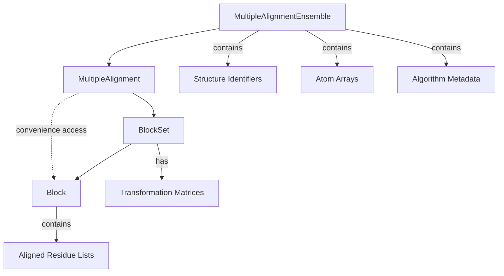
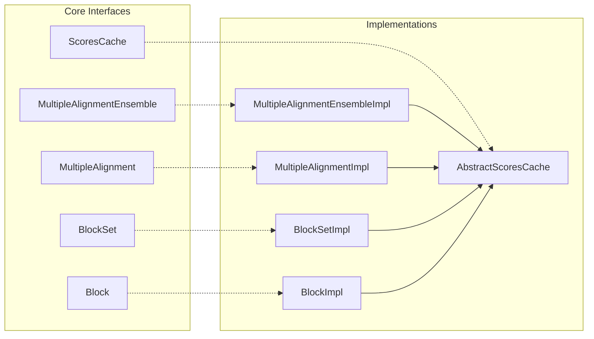
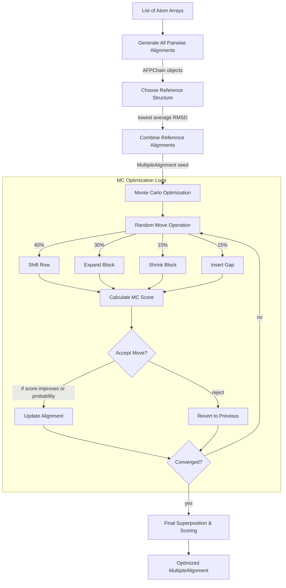
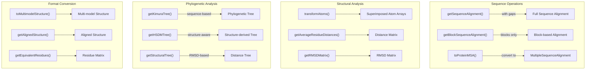
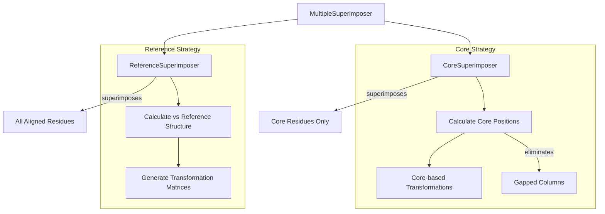

# Multiple Structure Alignment

<details>
<summary>Relevant source files</summary>

The following files were used as context for generating this wiki page:

- [biojava-structure-gui/src/main/java/demo/DemoMultipleMC.java](biojava-structure-gui/src/main/java/demo/DemoMultipleMC.java)
- [biojava-structure/src/main/java/demo/DemoMultipleMC.java](biojava-structure/src/main/java/demo/DemoMultipleMC.java)
- [biojava-structure/src/main/java/org/biojava/nbio/structure/align/multiple/Block.java](biojava-structure/src/main/java/org/biojava/nbio/structure/align/multiple/Block.java)
- [biojava-structure/src/main/java/org/biojava/nbio/structure/align/multiple/BlockImpl.java](biojava-structure/src/main/java/org/biojava/nbio/structure/align/multiple/BlockImpl.java)
- [biojava-structure/src/main/java/org/biojava/nbio/structure/align/multiple/BlockSet.java](biojava-structure/src/main/java/org/biojava/nbio/structure/align/multiple/BlockSet.java)
- [biojava-structure/src/main/java/org/biojava/nbio/structure/align/multiple/BlockSetImpl.java](biojava-structure/src/main/java/org/biojava/nbio/structure/align/multiple/BlockSetImpl.java)
- [biojava-structure/src/main/java/org/biojava/nbio/structure/align/multiple/MultipleAlignment.java](biojava-structure/src/main/java/org/biojava/nbio/structure/align/multiple/MultipleAlignment.java)
- [biojava-structure/src/main/java/org/biojava/nbio/structure/align/multiple/MultipleAlignmentEnsemble.java](biojava-structure/src/main/java/org/biojava/nbio/structure/align/multiple/MultipleAlignmentEnsemble.java)
- [biojava-structure/src/main/java/org/biojava/nbio/structure/align/multiple/MultipleAlignmentEnsembleImpl.java](biojava-structure/src/main/java/org/biojava/nbio/structure/align/multiple/MultipleAlignmentEnsembleImpl.java)
- [biojava-structure/src/main/java/org/biojava/nbio/structure/align/multiple/MultipleAlignmentImpl.java](biojava-structure/src/main/java/org/biojava/nbio/structure/align/multiple/MultipleAlignmentImpl.java)
- [biojava-structure/src/main/java/org/biojava/nbio/structure/align/multiple/ScoresCache.java](biojava-structure/src/main/java/org/biojava/nbio/structure/align/multiple/ScoresCache.java)
- [biojava-structure/src/main/java/org/biojava/nbio/structure/align/multiple/mc/MultipleMcMain.java](biojava-structure/src/main/java/org/biojava/nbio/structure/align/multiple/mc/MultipleMcMain.java)
- [biojava-structure/src/main/java/org/biojava/nbio/structure/align/multiple/mc/MultipleMcOptimizer.java](biojava-structure/src/main/java/org/biojava/nbio/structure/align/multiple/mc/MultipleMcOptimizer.java)
- [biojava-structure/src/main/java/org/biojava/nbio/structure/align/multiple/mc/MultipleMcParameters.java](biojava-structure/src/main/java/org/biojava/nbio/structure/align/multiple/mc/MultipleMcParameters.java)
- [biojava-structure/src/main/java/org/biojava/nbio/structure/align/multiple/util/CoreSuperimposer.java](biojava-structure/src/main/java/org/biojava/nbio/structure/align/multiple/util/CoreSuperimposer.java)
- [biojava-structure/src/main/java/org/biojava/nbio/structure/align/multiple/util/MultipleAlignmentScorer.java](biojava-structure/src/main/java/org/biojava/nbio/structure/align/multiple/util/MultipleAlignmentScorer.java)
- [biojava-structure/src/main/java/org/biojava/nbio/structure/align/multiple/util/MultipleAlignmentTools.java](biojava-structure/src/main/java/org/biojava/nbio/structure/align/multiple/util/MultipleAlignmentTools.java)
- [biojava-structure/src/main/java/org/biojava/nbio/structure/align/multiple/util/MultipleAlignmentWriter.java](biojava-structure/src/main/java/org/biojava/nbio/structure/align/multiple/util/MultipleAlignmentWriter.java)
- [biojava-structure/src/main/java/org/biojava/nbio/structure/align/multiple/util/MultipleSuperimposer.java](biojava-structure/src/main/java/org/biojava/nbio/structure/align/multiple/util/MultipleSuperimposer.java)
- [biojava-structure/src/main/java/org/biojava/nbio/structure/align/multiple/util/ReferenceSuperimposer.java](biojava-structure/src/main/java/org/biojava/nbio/structure/align/multiple/util/ReferenceSuperimposer.java)

</details>


This document covers BioJava's framework for representing and computing multiple protein structure alignments. The system provides data structures to store alignment results, algorithms to generate alignments (particularly the Monte Carlo-based MultipleMC algorithm), and utilities for analysis and visualization. For pairwise structure alignment tools, see the Structure Alignment module. For sequence-based multiple alignments, see the Core Alignment module.

## Core Data Model

BioJava's multiple structure alignment system is built around a hierarchical data model that can represent flexible and non-topological alignments, including circular permutations.

### Hierarchy Overview



**Data Model Hierarchy**

The core interfaces define a four-level hierarchy where each level serves a specific purpose in representing complex structural alignments.

Sources: [biojava-structure/src/main/java/org/biojava/nbio/structure/align/multiple/MultipleAlignmentEnsemble.java:1-231](), [biojava-structure/src/main/java/org/biojava/nbio/structure/align/multiple/MultipleAlignment.java:1-221](), [biojava-structure/src/main/java/org/biojava/nbio/structure/align/multiple/BlockSet.java:1-163](), [biojava-structure/src/main/java/org/biojava/nbio/structure/align/multiple/Block.java:1-179]()

### Key Interfaces and Implementations

| Interface | Implementation | Purpose |
|-----------|----------------|---------|
| `MultipleAlignmentEnsemble` | `MultipleAlignmentEnsembleImpl` | Top-level container holding structures and algorithm metadata |
| `MultipleAlignment` | `MultipleAlignmentImpl` | Single alignment result with multiple BlockSets |
| `BlockSet` | `BlockSetImpl` | Flexible alignment part with transformation matrices |
| `Block` | `BlockImpl` | Sequential aligned residues within a BlockSet |

The `ScoresCache` interface provides score storage across all levels, allowing algorithms to cache computed metrics like RMSD and TM-scores.



**Interface Implementation Relationships**

Sources: [biojava-structure/src/main/java/org/biojava/nbio/structure/align/multiple/MultipleAlignmentEnsembleImpl.java:1-402](), [biojava-structure/src/main/java/org/biojava/nbio/structure/align/multiple/MultipleAlignmentImpl.java:1-289](), [biojava-structure/src/main/java/org/biojava/nbio/structure/align/multiple/BlockSetImpl.java:1-246](), [biojava-structure/src/main/java/org/biojava/nbio/structure/align/multiple/BlockImpl.java:1-202]()

## Monte Carlo Multiple Alignment Algorithm

The MultipleMC algorithm is BioJava's primary tool for generating multiple structure alignments. It combines pairwise alignments into a seed alignment, then optimizes it using Monte Carlo methods.

### Algorithm Workflow



**MultipleMC Algorithm Flow**

Sources: [biojava-structure/src/main/java/org/biojava/nbio/structure/align/multiple/mc/MultipleMcMain.java:120-172](), [biojava-structure/src/main/java/org/biojava/nbio/structure/align/multiple/mc/MultipleMcOptimizer.java:239-335]()

### Core Algorithm Classes

The MultipleMC algorithm is implemented across several key classes:

- `MultipleMcMain`: Main algorithm entry point implementing `MultipleStructureAligner`
- `MultipleMcOptimizer`: Monte Carlo optimization engine implementing `Callable<MultipleAlignment>`
- `MultipleMcParameters`: Configuration parameters for the algorithm

The optimization process uses four types of moves to modify alignments:

1. **Shift Row** [biojava-structure/src/main/java/org/biojava/nbio/structure/align/multiple/mc/MultipleMcOptimizer.java:454-647](): Shifts aligned residues left or right within a structure
2. **Expand Block** [biojava-structure/src/main/java/org/biojava/nbio/structure/align/multiple/mc/MultipleMcOptimizer.java:656-771](): Adds new columns to alignment blocks
3. **Shrink Block** [biojava-structure/src/main/java/org/biojava/nbio/structure/align/multiple/mc/MultipleMcOptimizer.java:776-818](): Removes alignment columns with high average distance
4. **Insert Gap** [biojava-structure/src/main/java/org/biojava/nbio/structure/align/multiple/mc/MultipleMcOptimizer.java:400-442](): Introduces gaps at positions with high structural deviation

Sources: [biojava-structure/src/main/java/org/biojava/nbio/structure/align/multiple/mc/MultipleMcMain.java:1-429](), [biojava-structure/src/main/java/org/biojava/nbio/structure/align/multiple/mc/MultipleMcOptimizer.java:1-854](), [biojava-structure/src/main/java/org/biojava/nbio/structure/align/multiple/mc/MultipleMcParameters.java:1-225]()

## Alignment Tools and Utilities

The `MultipleAlignmentTools` class provides essential utilities for working with multiple alignments, from sequence generation to phylogenetic analysis.

### Core Utility Functions



**MultipleAlignmentTools Function Categories**

### Sequence Alignment Generation

The tools provide two main approaches for generating sequence alignments from structural alignments:

- `getSequenceAlignment()` [biojava-structure/src/main/java/org/biojava/nbio/structure/align/multiple/util/MultipleAlignmentTools.java:108-298](): Includes all residues with aligned positions in uppercase and unaligned in lowercase
- `getBlockSequenceAlignment()` [biojava-structure/src/main/java/org/biojava/nbio/structure/align/multiple/util/MultipleAlignmentTools.java:346-451](): Shows only residues within alignment blocks

Both methods return position mappings between sequence and structure coordinates for GUI applications.

### Structural Transformations

The `transformAtoms()` method [biojava-structure/src/main/java/org/biojava/nbio/structure/align/multiple/util/MultipleAlignmentTools.java:659-721]() applies the stored transformation matrices to create superimposed atom arrays. This enables:

- RMSD calculations across all structure pairs
- Visualization of aligned structures
- Distance-based scoring functions

Sources: [biojava-structure/src/main/java/org/biojava/nbio/structure/align/multiple/util/MultipleAlignmentTools.java:1-1010]()

## Superposition Algorithms

BioJava provides multiple algorithms for superimposing structures in multiple alignments, each with different strategies for handling gaps and reference structures.

### Superimposer Implementations



**Superposition Algorithm Comparison**

| Algorithm | Strategy | Handles Gaps | Use Case |
|-----------|----------|--------------|----------|
| `ReferenceSuperimposer` | All residues vs reference | Skips null positions | General alignment display |
| `CoreSuperimposer` | Core residues only | Excludes gapped columns | Conservative superposition |

Both algorithms implement the `MultipleSuperimposer` interface and use SVD-based superposition via `SuperPositions.superpose()`.

Sources: [biojava-structure/src/main/java/org/biojava/nbio/structure/align/multiple/util/ReferenceSuperimposer.java:1-163](), [biojava-structure/src/main/java/org/biojava/nbio/structure/align/multiple/util/CoreSuperimposer.java:1-174](), [biojava-structure/src/main/java/org/biojava/nbio/structure/align/multiple/util/MultipleSuperimposer.java:1-66]()

## Scoring and Analysis

The `MultipleAlignmentScorer` class provides comprehensive scoring functions for evaluating alignment quality and structural similarity.

### Scoring Functions

| Score Type | Method | Description |
|------------|--------|-------------|
| RMSD | `getRMSD()` | All-pairs root mean square deviation |
| Ref-RMSD | `getRefRMSD()` | Average RMSD to reference structure |
| TM-Score | `getAvgTMScore()` | Average template modeling score |
| MC-Score | `getMCScore()` | Monte Carlo optimization objective function |

The MC-Score [biojava-structure/src/main/java/org/biojava/nbio/structure/align/multiple/util/MultipleAlignmentScorer.java:321-400]() combines geometric quality with gap penalties:

```
MC-Score = Σ(aligned_residues) - gap_open_penalty * gaps - gap_extend_penalty * gap_length - distance_penalty * avg_distance
```

### Output Formats

The `MultipleAlignmentWriter` class supports multiple output formats:

- **FASTA**: Sequence alignment format
- **FatCat**: Detailed alignment with block information  
- **Aligned Residues**: Tab-delimited residue positions
- **XML**: Complete alignment serialization
- **3D Format**: I-TASSER template-target format

Sources: [biojava-structure/src/main/java/org/biojava/nbio/structure/align/multiple/util/MultipleAlignmentScorer.java:1-447](), [biojava-structure/src/main/java/org/biojava/nbio/structure/align/multiple/util/MultipleAlignmentWriter.java:1-377]()

## Usage Example

The following demonstrates basic usage of the MultipleMC algorithm:

```java
// Load structures
AtomCache cache = new AtomCache();
List<Atom[]> atomArrays = new ArrayList<>();
List<StructureIdentifier> ids = new ArrayList<>();

for (String name : structureNames) {
    StructureIdentifier id = new StructureName(name);
    ids.add(id);
    atomArrays.add(cache.getAtoms(id));
}

// Configure algorithm
MultipleMcMain algorithm = new MultipleMcMain(new CeMain());
MultipleMcParameters params = (MultipleMcParameters) algorithm.getParameters();
params.setMinBlockLen(10);
params.setGapExtension(20.0);

// Generate alignment
MultipleAlignment result = algorithm.align(atomArrays);
result.getEnsemble().setStructureIdentifiers(ids);

// Output results
System.out.println(MultipleAlignmentWriter.toFatCat(result));
```

Sources: [biojava-structure-gui/src/main/java/demo/DemoMultipleMC.java:94-124](), [biojava-structure/src/main/java/demo/DemoMultipleMC.java:94-122]()

---