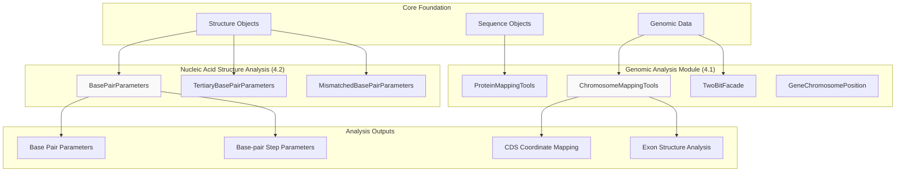
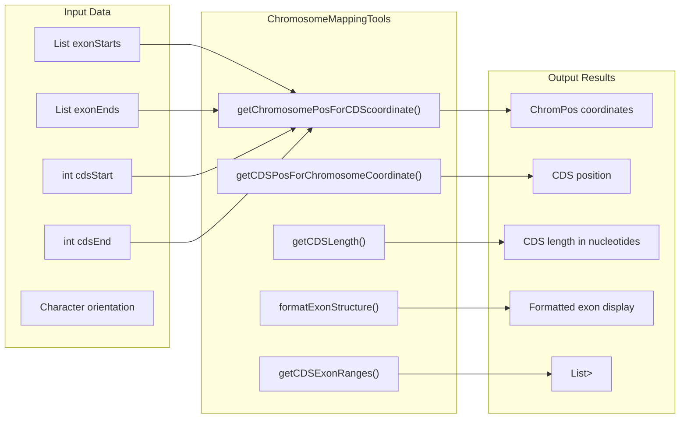
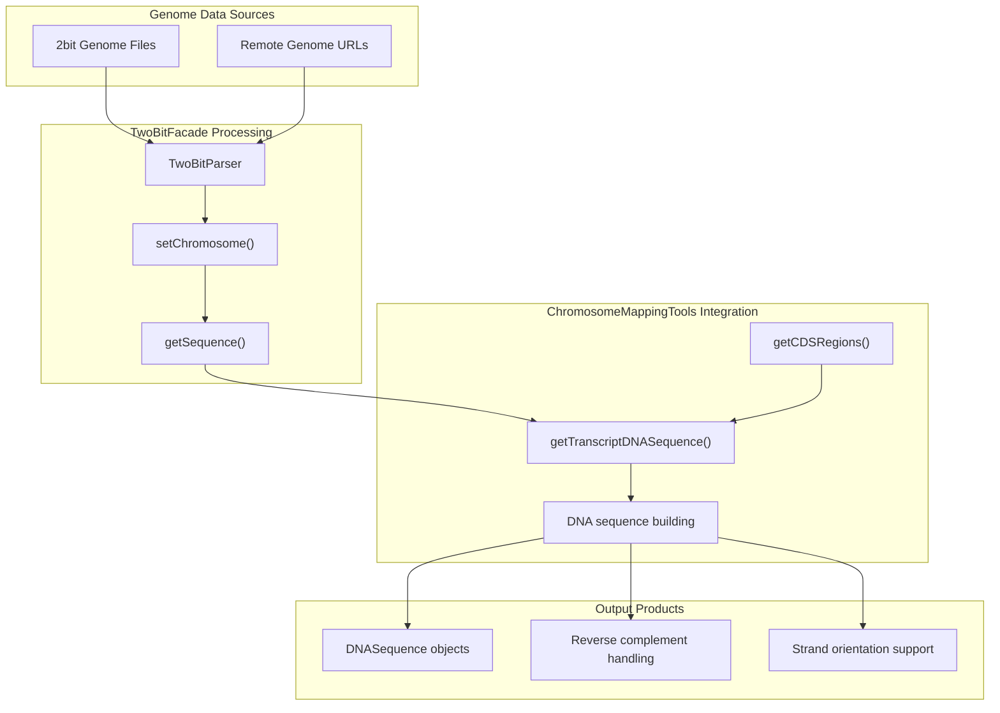
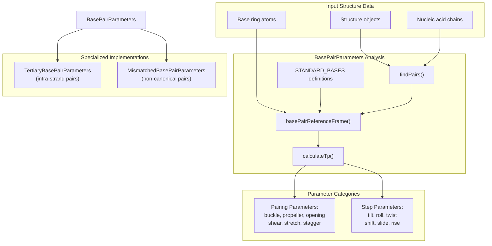
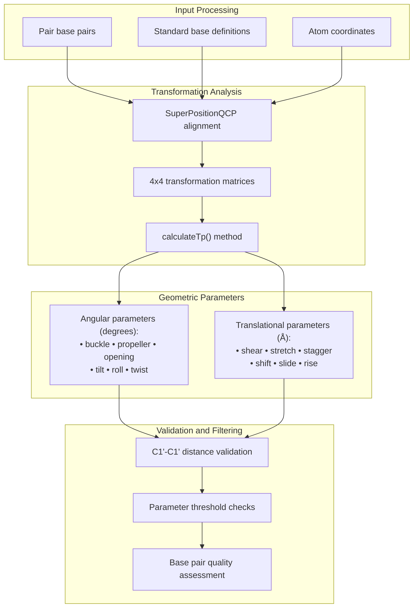

# Specialized Analysis Modules

Relevant source files

The following files were used as context for generating this wiki page:

- [biojava-alignment/src/test/java/org/biojava/nbio/alignment/NeedlemanWunschTest.java](biojava-alignment/src/test/java/org/biojava/nbio/alignment/NeedlemanWunschTest.java)
- [biojava-alignment/src/test/java/org/biojava/nbio/alignment/aaindex/TestAAINDEXLoading.java](biojava-alignment/src/test/java/org/biojava/nbio/alignment/aaindex/TestAAINDEXLoading.java)
- [biojava-alignment/src/test/java/org/biojava/nbio/alignment/io/TestStockholmParser.java](biojava-alignment/src/test/java/org/biojava/nbio/alignment/io/TestStockholmParser.java)
- [biojava-genome/src/main/java/org/biojava/nbio/genome/io/fastq/package-info.java](biojava-genome/src/main/java/org/biojava/nbio/genome/io/fastq/package-info.java)
- [biojava-genome/src/main/java/org/biojava/nbio/genome/parsers/twobit/TwoBitFacade.java](biojava-genome/src/main/java/org/biojava/nbio/genome/parsers/twobit/TwoBitFacade.java)
- [biojava-genome/src/main/java/org/biojava/nbio/genome/util/ChromosomeMappingTools.java](biojava-genome/src/main/java/org/biojava/nbio/genome/util/ChromosomeMappingTools.java)
- [biojava-genome/src/main/java/org/biojava/nbio/genome/util/ProteinMappingTools.java](biojava-genome/src/main/java/org/biojava/nbio/genome/util/ProteinMappingTools.java)
- [biojava-genome/src/main/resources/log4j2.xml](biojava-genome/src/main/resources/log4j2.xml)
- [biojava-genome/src/test/java/org/biojava/nbio/genome/FeatureListTest.java](biojava-genome/src/test/java/org/biojava/nbio/genome/FeatureListTest.java)
- [biojava-genome/src/test/java/org/biojava/nbio/genome/TestChromosomeMappingTools.java](biojava-genome/src/test/java/org/biojava/nbio/genome/TestChromosomeMappingTools.java)
- [biojava-genome/src/test/java/org/biojava/nbio/genome/TestGenomeMapping.java](biojava-genome/src/test/java/org/biojava/nbio/genome/TestGenomeMapping.java)
- [biojava-integrationtest/src/test/java/org/biojava/nbio/structure/test/align/TestSimilarityCalc.java](biojava-integrationtest/src/test/java/org/biojava/nbio/structure/test/align/TestSimilarityCalc.java)
- [biojava-structure-gui/src/main/java/org/biojava/nbio/structure/align/gui/jmol/JmolTools.java](biojava-structure-gui/src/main/java/org/biojava/nbio/structure/align/gui/jmol/JmolTools.java)
- [biojava-structure/src/main/java/org/biojava/nbio/structure/basepairs/BasePairParameters.java](biojava-structure/src/main/java/org/biojava/nbio/structure/basepairs/BasePairParameters.java)
- [biojava-structure/src/main/java/org/biojava/nbio/structure/basepairs/MismatchedBasePairParameters.java](biojava-structure/src/main/java/org/biojava/nbio/structure/basepairs/MismatchedBasePairParameters.java)
- [biojava-structure/src/main/java/org/biojava/nbio/structure/basepairs/TertiaryBasePairParameters.java](biojava-structure/src/main/java/org/biojava/nbio/structure/basepairs/TertiaryBasePairParameters.java)
- [biojava-structure/src/test/java/org/biojava/nbio/structure/basepairs/TestBasePairParameters.java](biojava-structure/src/test/java/org/biojava/nbio/structure/basepairs/TestBasePairParameters.java)

This page documents BioJava's specialized analysis modules that provide domain-specific computational tools for genomics and nucleic acid structural analysis. These modules extend beyond the core data structures and file format support to offer advanced analytical capabilities for biological sequence analysis.

The specialized analysis modules are organized into two main categories: genomic analysis tools for working with chromosomal coordinates and coding sequences, and nucleic acid structure analysis tools for calculating base pair parameters and structural properties. For detailed information about protein structure analysis tools, see [Structural Analysis Tools](#3). For basic sequence alignment algorithms, see [Core Architecture](#2).

## Module Architecture Overview

The specialized analysis modules build upon BioJava's core data structures to provide advanced analytical capabilities:

Sources: [biojava-genome/src/main/java/org/biojava/nbio/genome/util/ChromosomeMappingTools.java:1-972](), [biojava-structure/src/main/java/org/biojava/nbio/structure/basepairs/BasePairParameters.java:1-805]()

## Genomic Analysis Tools

The genomic analysis module provides sophisticated tools for working with chromosomal coordinates, coding sequences, and genomic feature mapping. The primary entry point is the `ChromosomeMappingTools` class, which handles bidirectional coordinate transformations between genomic and coding sequence positions.

### Coordinate Mapping System

The coordinate mapping system handles both forward and reverse strand orientations using specialized algorithms:

| Method | Purpose | Input | Output |
|--------|---------|-------|--------|
| `getChromosomePosForCDScoordinate()` | Maps CDS position to genomic coordinate | CDS nucleotide position, gene data | ChromPos object |
| `getCDSPosForChromosomeCoordinate()` | Maps genomic coordinate to CDS position | Chromosome coordinate, gene data | CDS position (int) |
| `formatExonStructure()` | Creates human-readable exon display | GeneChromosomePosition | Formatted string |
| `getCDSLength()` | Calculates coding sequence length | Gene chromosome position | Length in nucleotides |

Sources: [biojava-genome/src/main/java/org/biojava/nbio/genome/util/ChromosomeMappingTools.java:232-256](), [biojava-genome/src/main/java/org/biojava/nbio/genome/util/ChromosomeMappingTools.java:779-793](), [biojava-genome/src/main/java/org/biojava/nbio/genome/util/ChromosomeMappingTools.java:210-224]()

### Sequence Extraction and Processing

The genomic module integrates with external genome data sources through the `TwoBitFacade` class, which provides efficient access to compressed genome files:

Sources: [biojava-genome/src/main/java/org/biojava/nbio/genome/parsers/twobit/TwoBitFacade.java:81-85](), [biojava-genome/src/main/java/org/biojava/nbio/genome/util/ChromosomeMappingTools.java:939-971]()

For comprehensive documentation of genomic coordinate mapping algorithms and CDS analysis workflows, see [Genomic Analysis and Chromosome Mapping](#4.1).

## Nucleic Acid Structure Analysis

The nucleic acid structure analysis module implements the el Hassan-Calladine method for calculating base pair and base-pair step parameters in nucleic acid structures. The analysis supports both DNA and RNA structures with multiple specialized implementations for different analysis scenarios.

### Base Pair Parameter Analysis

The `BasePairParameters` class serves as the foundation for nucleic acid structural analysis:

The analysis workflow processes nucleic acid structures through several key stages:

| Analysis Stage | Method | Function |
|----------------|--------|----------|
| Chain identification | `getNucleicChains()` | Identifies nucleic acid chains in structure |
| Base pair detection | `findPairs()` | Locates Watson-Crick and other base pairs |
| Reference frame calculation | `basePairReferenceFrame()` | Establishes coordinate system for each pair |
| Parameter calculation | `calculateTp()` | Computes geometric parameters |

Sources: [biojava-structure/src/main/java/org/biojava/nbio/structure/basepairs/BasePairParameters.java:215-240](), [biojava-structure/src/main/java/org/biojava/nbio/structure/basepairs/BasePairParameters.java:461-525](), [biojava-structure/src/main/java/org/biojava/nbio/structure/basepairs/BasePairParameters.java:533-627]()

### Parameter Calculation Methods

The base pair parameter calculation uses transformation matrices to determine structural relationships:

Sources: [biojava-structure/src/main/java/org/biojava/nbio/structure/basepairs/BasePairParameters.java:655-697](), [biojava-structure/src/main/java/org/biojava/nbio/structure/basepairs/TertiaryBasePairParameters.java:80-109](), [biojava-structure/src/main/java/org/biojava/nbio/structure/basepairs/MismatchedBasePairParameters.java:98-131]()

### Specialized Analysis Implementations

The module provides specialized implementations for different analysis scenarios:

**TertiaryBasePairParameters**: Designed for RNA tertiary structure analysis, this implementation relaxes the standard constraints to detect intra-strand base pairs and non-canonical interactions. It uses configurable thresholds for stagger (`maxStagger`) and propeller twist (`maxPropeller`) parameters.

**MismatchedBasePairParameters**: Focuses on inter-strand base pairs that may not follow canonical Watson-Crick pairing rules. This implementation adds additional filtering parameters including maximum shear (`maxShear`) and stretch (`maxStretch`) values to identify structurally valid but non-canonical base pairs.

Sources: [biojava-structure/src/main/java/org/biojava/nbio/structure/basepairs/TertiaryBasePairParameters.java:47-51](), [biojava-structure/src/main/java/org/biojava/nbio/structure/basepairs/MismatchedBasePairParameters.java:52-55]()

For detailed information about base pair parameter calculations and nucleic acid structural analysis algorithms, see [Nucleic Acid Structure Analysis](#4.2).

---