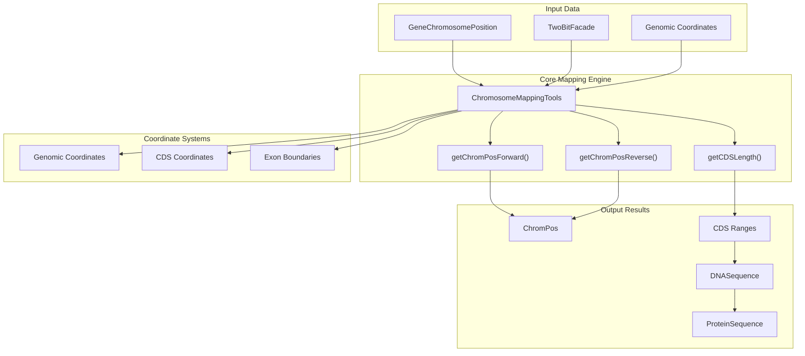
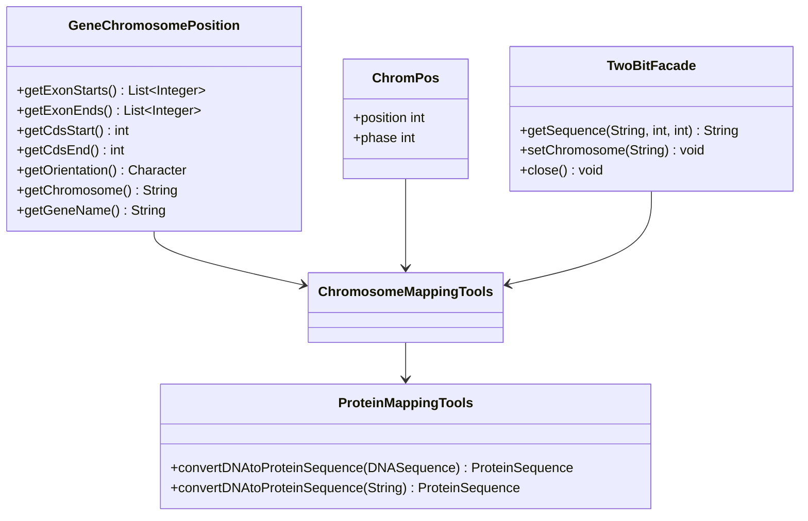
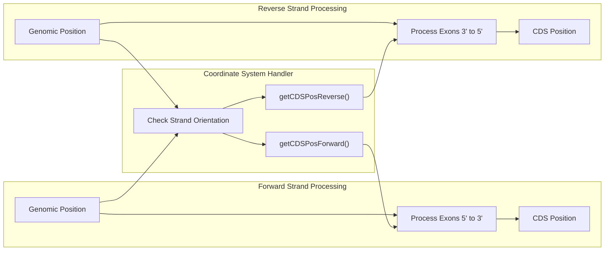
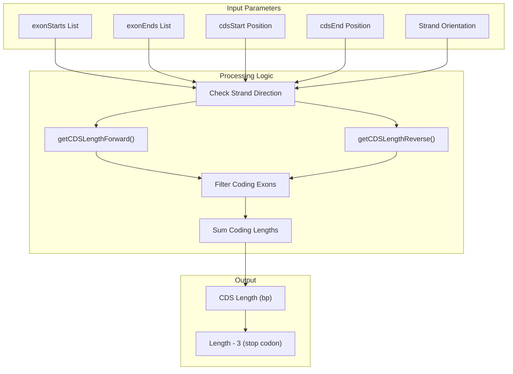
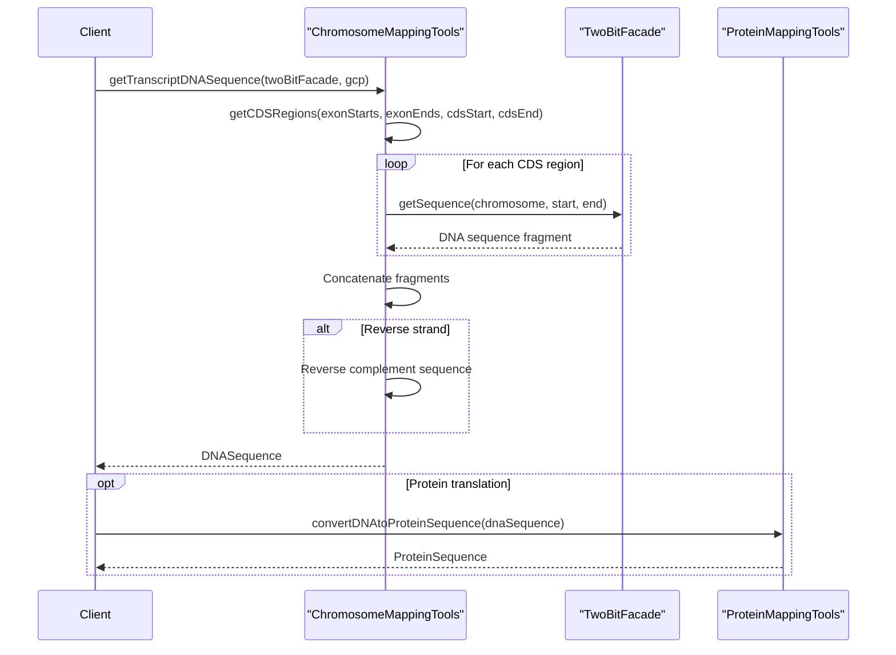

# Genomic Analysis and Chromosome Mapping

<details>
<summary>Relevant source files</summary>

The following files were used as context for generating this wiki page:

- [biojava-alignment/src/test/java/org/biojava/nbio/alignment/aaindex/TestAAINDEXLoading.java](biojava-alignment/src/test/java/org/biojava/nbio/alignment/aaindex/TestAAINDEXLoading.java)
- [biojava-alignment/src/test/java/org/biojava/nbio/alignment/io/TestStockholmParser.java](biojava-alignment/src/test/java/org/biojava/nbio/alignment/io/TestStockholmParser.java)
- [biojava-genome/src/main/java/org/biojava/nbio/genome/io/fastq/package-info.java](biojava-genome/src/main/java/org/biojava/nbio/genome/io/fastq/package-info.java)
- [biojava-genome/src/main/java/org/biojava/nbio/genome/parsers/twobit/TwoBitFacade.java](biojava-genome/src/main/java/org/biojava/nbio/genome/parsers/twobit/TwoBitFacade.java)
- [biojava-genome/src/main/java/org/biojava/nbio/genome/util/ChromosomeMappingTools.java](biojava-genome/src/main/java/org/biojava/nbio/genome/util/ChromosomeMappingTools.java)
- [biojava-genome/src/main/java/org/biojava/nbio/genome/util/ProteinMappingTools.java](biojava-genome/src/main/java/org/biojava/nbio/genome/util/ProteinMappingTools.java)
- [biojava-genome/src/main/resources/log4j2.xml](biojava-genome/src/main/resources/log4j2.xml)
- [biojava-genome/src/test/java/org/biojava/nbio/genome/FeatureListTest.java](biojava-genome/src/test/java/org/biojava/nbio/genome/FeatureListTest.java)
- [biojava-genome/src/test/java/org/biojava/nbio/genome/TestChromosomeMappingTools.java](biojava-genome/src/test/java/org/biojava/nbio/genome/TestChromosomeMappingTools.java)
- [biojava-genome/src/test/java/org/biojava/nbio/genome/TestGenomeMapping.java](biojava-genome/src/test/java/org/biojava/nbio/genome/TestGenomeMapping.java)
- [biojava-integrationtest/src/test/java/org/biojava/nbio/structure/test/align/TestSimilarityCalc.java](biojava-integrationtest/src/test/java/org/biojava/nbio/structure/test/align/TestSimilarityCalc.java)

</details>


## Purpose and Scope

This document covers BioJava's genomic analysis and chromosome mapping capabilities, which provide tools for working with genomic coordinates, gene structures, and coding sequence (CDS) analysis. The primary functionality enables conversion between chromosomal positions and mRNA coordinates, extraction of exon boundaries, CDS length calculations, and retrieval of genomic sequences.

For nucleic acid structure analysis including base pair parameters, see [Nucleic Acid Structure Analysis](#4.2). For general sequence handling and file format support, see [File Format Support and Parsing](#2.2).

## System Architecture

The genomic analysis system is built around coordinate transformation between different genomic reference frames:



**Sources:** [biojava-genome/src/main/java/org/biojava/nbio/genome/util/ChromosomeMappingTools.java:1-972]()

## Core Classes and Data Structures

### ChromosomeMappingTools

The `ChromosomeMappingTools` class serves as the primary interface for genomic coordinate operations:

| Method | Purpose | Return Type |
|--------|---------|-------------|
| `getChromosomePosForCDScoordinate()` | Maps CDS position to chromosomal position | `ChromPos` |
| `getCDSPosForChromosomeCoordinate()` | Maps chromosomal position to CDS position | `int` |
| `getCDSLength()` | Calculates coding sequence length | `int` |
| `getCDSExonRanges()` | Extracts exon boundaries in CDS coordinates | `List<Range<Integer>>` |
| `getChromosomalRangesForCDS()` | Gets chromosomal ranges for coding regions | `List<Range<Integer>>` |
| `getTranscriptDNASequence()` | Extracts DNA sequence from coordinates | `DNASequence` |

**Sources:** [biojava-genome/src/main/java/org/biojava/nbio/genome/util/ChromosomeMappingTools.java:43-972]()

### Supporting Data Structures



**Sources:** [biojava-genome/src/main/java/org/biojava/nbio/genome/parsers/genename/GeneChromosomePosition.java](), [biojava-genome/src/main/java/org/biojava/nbio/genome/parsers/genename/ChromPos.java](), [biojava-genome/src/main/java/org/biojava/nbio/genome/parsers/twobit/TwoBitFacade.java:30-86](), [biojava-genome/src/main/java/org/biojava/nbio/genome/util/ProteinMappingTools.java:28-51]()

## Coordinate Mapping Operations

The system handles bidirectional coordinate mapping between genomic and CDS reference frames, accounting for strand orientation:



### Forward Strand Mapping

For genes on the forward strand, the mapping process iterates through exons from 5' to 3':

**Sources:** [biojava-genome/src/main/java/org/biojava/nbio/genome/util/ChromosomeMappingTools.java:809-840](), [biojava-genome/src/main/java/org/biojava/nbio/genome/util/ChromosomeMappingTools.java:415-490]()

### Reverse Strand Mapping

For genes on the reverse strand, exons are processed in reverse order with coordinate transformation:

**Sources:** [biojava-genome/src/main/java/org/biojava/nbio/genome/util/ChromosomeMappingTools.java:856-887](), [biojava-genome/src/main/java/org/biojava/nbio/genome/util/ChromosomeMappingTools.java:277-404]()

## CDS Analysis and Exon Structure

### CDS Length Calculation

The system provides methods to calculate coding sequence lengths while accounting for introns and UTR regions:



**Sources:** [biojava-genome/src/main/java/org/biojava/nbio/genome/util/ChromosomeMappingTools.java:210-224](), [biojava-genome/src/main/java/org/biojava/nbio/genome/util/ChromosomeMappingTools.java:548-569](), [biojava-genome/src/main/java/org/biojava/nbio/genome/util/ChromosomeMappingTools.java:501-537]()

### Exon Range Extraction

The `getCDSExonRanges()` and `getChromosomalRangesForCDS()` methods extract exon boundaries in different coordinate systems:

| Method | Coordinate System | Use Case |
|--------|------------------|----------|
| `getCDSExonRanges()` | CDS coordinates | Protein domain mapping |
| `getChromosomalRangesForCDS()` | Genomic coordinates | Variant annotation |

**Sources:** [biojava-genome/src/main/java/org/biojava/nbio/genome/util/ChromosomeMappingTools.java:577-581](), [biojava-genome/src/main/java/org/biojava/nbio/genome/util/ChromosomeMappingTools.java:588-592]()

## Sequence Extraction and Translation

### DNA Sequence Extraction

The system integrates with `TwoBitFacade` to extract genomic sequences:



**Sources:** [biojava-genome/src/main/java/org/biojava/nbio/genome/util/ChromosomeMappingTools.java:939-971](), [biojava-genome/src/main/java/org/biojava/nbio/genome/parsers/twobit/TwoBitFacade.java:81-85](), [biojava-genome/src/main/java/org/biojava/nbio/genome/util/ProteinMappingTools.java:36-50]()

### Coordinate System Configuration

The system supports configurable coordinate systems through `setCoordinateSystem()`:

```java
// Set to 0-based coordinates (default)
ChromosomeMappingTools.setCoordinateSystem(0);

// Set to 1-based coordinates
ChromosomeMappingTools.setCoordinateSystem(1);
```

**Sources:** [biojava-genome/src/main/java/org/biojava/nbio/genome/util/ChromosomeMappingTools.java:52-55]()

## Testing and Validation

The system includes comprehensive test suites validating coordinate mapping accuracy:

| Test Class | Focus Area | Key Tests |
|------------|------------|-----------|
| `TestGenomeMapping` | CDS region extraction | `testGenomeMappingToolGetCDSRanges()` |
| `TestChromosomeMappingTools` | Length calculations | `testGetCDSLengthForward()`, `testGetCDSLengthReverse()` |

**Sources:** [biojava-genome/src/test/java/org/biojava/nbio/genome/TestGenomeMapping.java:37-59](), [biojava-genome/src/test/java/org/biojava/nbio/genome/TestChromosomeMappingTools.java:37-80]()

## Integration with BioJava Core

The genomic analysis module integrates with BioJava's core sequence handling:

- Uses `DNASequence` from `biojava-core` for sequence representation
- Leverages `Range<Integer>` from Google Guava for coordinate ranges
- Integrates with `ProteinSequence` for translation workflows

**Sources:** [biojava-genome/src/main/java/org/biojava/nbio/genome/util/ChromosomeMappingTools.java:24-29](), [biojava-genome/src/main/java/org/biojava/nbio/genome/util/ProteinMappingTools.java:23-26]()

---