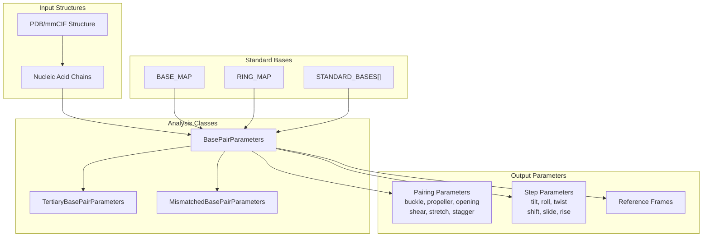
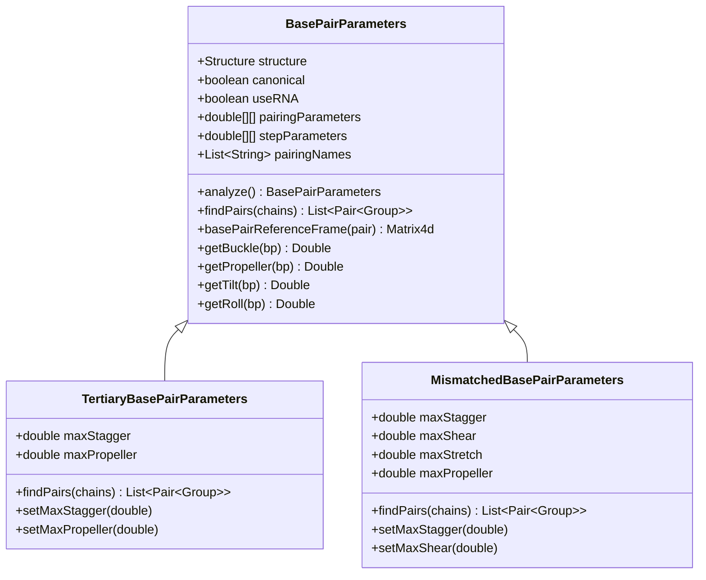
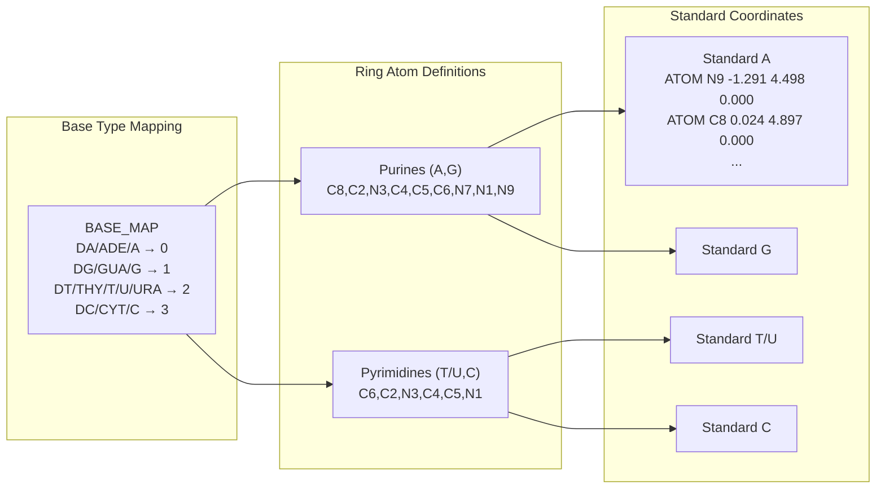
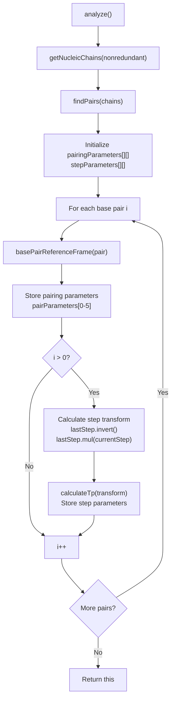
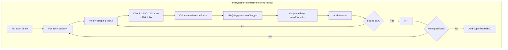

# Nucleic Acid Structure Analysis

<details>
<summary>Relevant source files</summary>

The following files were used as context for generating this wiki page:

- [biojava-alignment/src/test/java/org/biojava/nbio/alignment/NeedlemanWunschTest.java](biojava-alignment/src/test/java/org/biojava/nbio/alignment/NeedlemanWunschTest.java)
- [biojava-structure-gui/src/main/java/org/biojava/nbio/structure/align/gui/jmol/JmolTools.java](biojava-structure-gui/src/main/java/org/biojava/nbio/structure/align/gui/jmol/JmolTools.java)
- [biojava-structure/src/main/java/org/biojava/nbio/structure/basepairs/BasePairParameters.java](biojava-structure/src/main/java/org/biojava/nbio/structure/basepairs/BasePairParameters.java)
- [biojava-structure/src/main/java/org/biojava/nbio/structure/basepairs/MismatchedBasePairParameters.java](biojava-structure/src/main/java/org/biojava/nbio/structure/basepairs/MismatchedBasePairParameters.java)
- [biojava-structure/src/main/java/org/biojava/nbio/structure/basepairs/TertiaryBasePairParameters.java](biojava-structure/src/main/java/org/biojava/nbio/structure/basepairs/TertiaryBasePairParameters.java)
- [biojava-structure/src/test/java/org/biojava/nbio/structure/basepairs/TestBasePairParameters.java](biojava-structure/src/test/java/org/biojava/nbio/structure/basepairs/TestBasePairParameters.java)

</details>


## Purpose and Scope

This document covers BioJava's nucleic acid structure analysis capabilities, specifically the calculation of base pair and base-pair step parameters for DNA and RNA structures. The system implements the el Hassan-Calladine method for characterizing nucleic acid geometry through systematic measurement of structural parameters between base pairs and consecutive base pair steps.

For genomic sequence analysis and chromosome mapping, see [Genomic Analysis and Chromosome Mapping](#4.1). For general structure visualization capabilities, see [Jmol Integration and Structure Visualization](#5.1).

## Base Pair Parameter Analysis System

BioJava provides a comprehensive framework for analyzing nucleic acid structural parameters based on the methodology described in Hassan & Calladine (2001). The system calculates both intra-base-pair parameters (buckle, propeller, opening, shear, stretch, stagger) and inter-base-pair step parameters (tilt, roll, twist, shift, slide, rise) for double-helical regions within protein-nucleic acid complexes or standalone nucleic acid structures.



**Base Pair Parameter Analysis Architecture**

Sources: [biojava-structure/src/main/java/org/biojava/nbio/structure/basepairs/BasePairParameters.java:54-70]()

## Core Classes and Relationships

The nucleic acid analysis system centers around three main classes that provide different levels of base pair detection and analysis:

| Class | Purpose | Base Pair Detection |
|-------|---------|-------------------|
| `BasePairParameters` | Standard Watson-Crick pairs between separate strands | Canonical pairs with sequence alignment |
| `TertiaryBasePairParameters` | RNA tertiary structure analysis | Intra-strand and non-canonical pairs |
| `MismatchedBasePairParameters` | Non-canonical inter-strand pairs | Relaxed geometric criteria |



**Base Pair Parameter Class Hierarchy**

Sources: [biojava-structure/src/main/java/org/biojava/nbio/structure/basepairs/BasePairParameters.java:71](), [biojava-structure/src/main/java/org/biojava/nbio/structure/basepairs/TertiaryBasePairParameters.java:43](), [biojava-structure/src/main/java/org/biojava/nbio/structure/basepairs/MismatchedBasePairParameters.java:42]()

## Standard Base Definitions and Coordinate System

The system uses hard-coded standard base geometries for adenine, guanine, thymine/uracil, and cytosine to establish reference coordinate systems. These standard bases are defined as PDB-format strings with idealized atomic coordinates.



**Standard Base Reference System**

The `BASE_MAP` associates various PDB residue names with numerical base types, while `RING_MAP` defines the ring atoms used for superposition and parameter calculation. The `STANDARD_BASES` array contains idealized coordinates for each base type.

Sources: [biojava-structure/src/main/java/org/biojava/nbio/structure/basepairs/BasePairParameters.java:128-146](), [biojava-structure/src/main/java/org/biojava/nbio/structure/basepairs/BasePairParameters.java:79-125]()

## Parameter Calculation Workflow

The analysis workflow follows a systematic process of structure parsing, base pair identification, and geometric parameter calculation:



**Parameter Calculation Flow**

The `basePairReferenceFrame` method performs superposition of actual base pairs onto standard base geometries using the `SuperPositionQCP` algorithm, establishing a local coordinate system for each base pair. Step parameters are calculated by comparing consecutive base pair reference frames.

Sources: [biojava-structure/src/main/java/org/biojava/nbio/structure/basepairs/BasePairParameters.java:215-240](), [biojava-structure/src/main/java/org/biojava/nbio/structure/basepairs/BasePairParameters.java:533-627]()

## Specialized Analysis Implementations

### TertiaryBasePairParameters

The `TertiaryBasePairParameters` class extends the base functionality to detect intra-strand base pairs commonly found in RNA tertiary structures. It uses geometric criteria rather than sequence complementarity:



**Tertiary Structure Base Pair Detection**

Default thresholds: `maxStagger = 2.0 Å`, `maxPropeller = 60.0°`

Sources: [biojava-structure/src/main/java/org/biojava/nbio/structure/basepairs/TertiaryBasePairParameters.java:64-109]()

### MismatchedBasePairParameters  

The `MismatchedBasePairParameters` class identifies inter-strand pairs that don't follow Watson-Crick complementarity rules, using expanded geometric tolerance criteria:

| Parameter | Default Threshold | Purpose |
|-----------|------------------|---------|
| `maxStagger` | 2.0 Å | Vertical displacement limit |
| `maxShear` | 5.0 Å | Horizontal displacement limit |
| `maxStretch` | 5.0 Å | Distance variation limit |
| `maxPropeller` | 60.0° | Twist angle limit |

Sources: [biojava-structure/src/main/java/org/biojava/nbio/structure/basepairs/MismatchedBasePairParameters.java:46-55](), [biojava-structure/src/main/java/org/biojava/nbio/structure/basepairs/MismatchedBasePairParameters.java:77-131]()

## Parameter Types and Accessor Methods

The system calculates twelve structural parameters organized into two categories:

### Pairing Parameters (intra-base-pair)
- **Angular parameters (degrees)**: `getBuckle()`, `getPropeller()`, `getOpening()`  
- **Translational parameters (Å)**: `getShear()`, `getStretch()`, `getStagger()`

### Step Parameters (inter-base-pair)
- **Angular parameters (degrees)**: `getTilt()`, `getRoll()`, `getTwist()`
- **Translational parameters (Å)**: `getShift()`, `getSlide()`, `getRise()`

The `calculateTp` method implements the mathematical transformation from 4×4 matrices to parameter space using trigonometric relationships defined in the el Hassan-Calladine methodology.

Sources: [biojava-structure/src/main/java/org/biojava/nbio/structure/basepairs/BasePairParameters.java:307-425](), [biojava-structure/src/main/java/org/biojava/nbio/structure/basepairs/BasePairParameters.java:655-697]()

## Usage Examples

### Basic DNA Analysis
```java
Structure structure = StructureIO.getStructure("1KX5");
BasePairParameters bp = new BasePairParameters(structure);
bp.analyze();

// Access individual parameters
double buckle = bp.getBuckle(0);    // First base pair buckle
double twist = bp.getTwist(1);      // Second base pair step twist
```

### RNA Tertiary Structure Analysis  
```java
Structure structure = StructureIO.getStructure("3PHP");
TertiaryBasePairParameters bp = new TertiaryBasePairParameters(structure, true, false);
bp.setMaxStagger(2.5);  // Adjust tolerance
bp.analyze();
```

### Non-canonical Base Pair Detection
```java
MismatchedBasePairParameters bp = new MismatchedBasePairParameters(structure, false, false, false);
bp.setMaxShear(6.0);    // Allow more geometric variation
bp.analyze();
```

Sources: [biojava-structure/src/test/java/org/biojava/nbio/structure/basepairs/TestBasePairParameters.java:47-75](), [biojava-structure/src/test/java/org/biojava/nbio/structure/basepairs/TestBasePairParameters.java:98-101]()

---