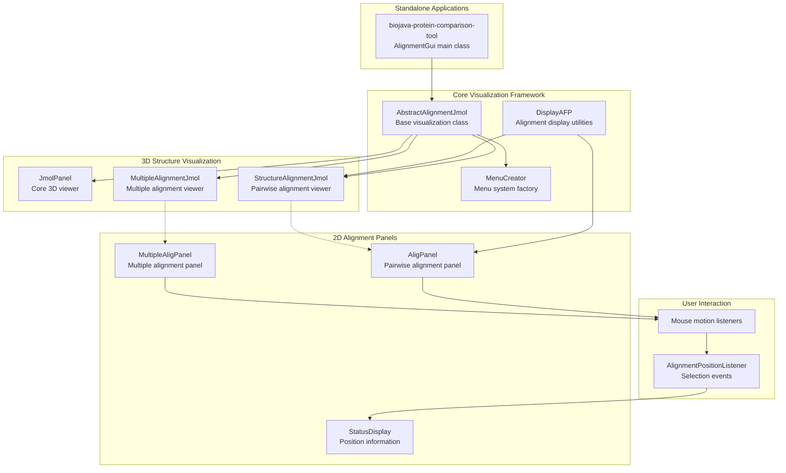
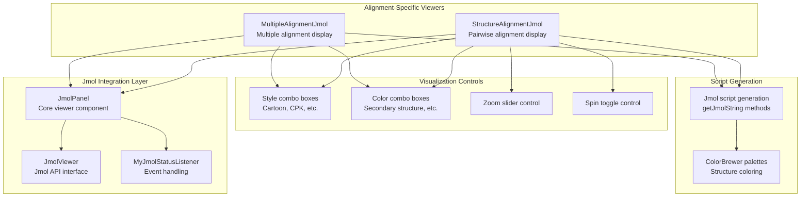
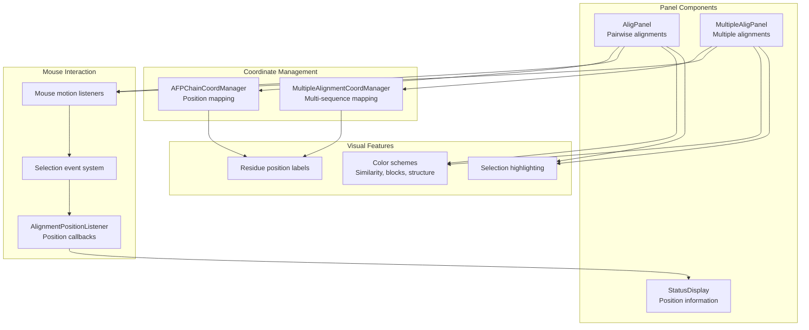
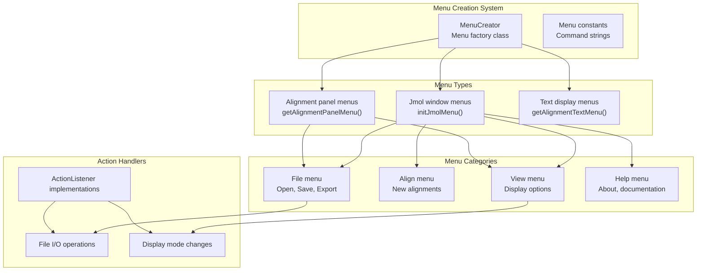

# User Interfaces and Visualization

Relevant source files

The following files were used as context for generating this wiki page:

- [biojava-protein-comparison-tool/pom.xml](biojava-protein-comparison-tool/pom.xml)
- [biojava-structure-gui/src/main/java/org/biojava/nbio/structure/align/gui/DisplayAFP.java](biojava-structure-gui/src/main/java/org/biojava/nbio/structure/align/gui/DisplayAFP.java)
- [biojava-structure-gui/src/main/java/org/biojava/nbio/structure/align/gui/MenuCreator.java](biojava-structure-gui/src/main/java/org/biojava/nbio/structure/align/gui/MenuCreator.java)
- [biojava-structure-gui/src/main/java/org/biojava/nbio/structure/align/gui/StructureAlignmentDisplay.java](biojava-structure-gui/src/main/java/org/biojava/nbio/structure/align/gui/StructureAlignmentDisplay.java)
- [biojava-structure-gui/src/main/java/org/biojava/nbio/structure/align/gui/aligpanel/AFPChainCoordManager.java](biojava-structure-gui/src/main/java/org/biojava/nbio/structure/align/gui/aligpanel/AFPChainCoordManager.java)
- [biojava-structure-gui/src/main/java/org/biojava/nbio/structure/align/gui/aligpanel/AligPanel.java](biojava-structure-gui/src/main/java/org/biojava/nbio/structure/align/gui/aligpanel/AligPanel.java)
- [biojava-structure-gui/src/main/java/org/biojava/nbio/structure/align/gui/aligpanel/AligPanelMouseMotionListener.java](biojava-structure-gui/src/main/java/org/biojava/nbio/structure/align/gui/aligpanel/AligPanelMouseMotionListener.java)
- [biojava-structure-gui/src/main/java/org/biojava/nbio/structure/align/gui/aligpanel/MultipleAligPanel.java](biojava-structure-gui/src/main/java/org/biojava/nbio/structure/align/gui/aligpanel/MultipleAligPanel.java)
- [biojava-structure-gui/src/main/java/org/biojava/nbio/structure/align/gui/aligpanel/StatusDisplay.java](biojava-structure-gui/src/main/java/org/biojava/nbio/structure/align/gui/aligpanel/StatusDisplay.java)
- [biojava-structure-gui/src/main/java/org/biojava/nbio/structure/align/gui/jmol/AbstractAlignmentJmol.java](biojava-structure-gui/src/main/java/org/biojava/nbio/structure/align/gui/jmol/AbstractAlignmentJmol.java)
- [biojava-structure-gui/src/main/java/org/biojava/nbio/structure/align/gui/jmol/JmolPanel.java](biojava-structure-gui/src/main/java/org/biojava/nbio/structure/align/gui/jmol/JmolPanel.java)
- [biojava-structure-gui/src/main/java/org/biojava/nbio/structure/align/gui/jmol/MultipleAlignmentJmol.java](biojava-structure-gui/src/main/java/org/biojava/nbio/structure/align/gui/jmol/MultipleAlignmentJmol.java)
- [biojava-structure-gui/src/main/java/org/biojava/nbio/structure/align/gui/jmol/MyJmolStatusListener.java](biojava-structure-gui/src/main/java/org/biojava/nbio/structure/align/gui/jmol/MyJmolStatusListener.java)
- [biojava-structure-gui/src/main/java/org/biojava/nbio/structure/align/gui/jmol/StructureAlignmentJmol.java](biojava-structure-gui/src/main/java/org/biojava/nbio/structure/align/gui/jmol/StructureAlignmentJmol.java)

This document covers BioJava's graphical user interface components and visualization capabilities for structural biology data. The framework provides interactive 3D structure visualization through Jmol integration, 2D alignment panels for sequence and structural alignments, and comprehensive menu systems for user interaction. 

For information about the underlying structural analysis algorithms that these interfaces display, see [Structural Analysis Tools](#3). For details about the data models and file formats being visualized, see [Core Architecture](#2).

## Purpose and Scope

BioJava's visualization system enables interactive exploration of protein structures, structural alignments, and multiple sequence alignments through sophisticated graphical interfaces. The system supports both embedded components for integration into larger applications and standalone GUI applications for end-users.

## Core GUI Architecture

The visualization system is built around a modular architecture with distinct layers for different types of content display:

Sources: [biojava-structure-gui/src/main/java/org/biojava/nbio/structure/align/gui/jmol/AbstractAlignmentJmol.java:1-284](), [biojava-structure-gui/src/main/java/org/biojava/nbio/structure/align/gui/MenuCreator.java:1-896](), [biojava-structure-gui/src/main/java/org/biojava/nbio/structure/align/gui/DisplayAFP.java:1-585]()

## Jmol Integration Framework

BioJava provides comprehensive 3D structure visualization through integration with the Jmol molecular viewer. The integration supports both pairwise and multiple structure alignments with coordinated highlighting and interactive selection.

### Core Jmol Components

The `JmolPanel` class serves as the core integration point with the Jmol viewer, handling structure loading, script execution, and user interaction events. It supports multiple input formats including PDB, mmCIF, and MMTF through BioJava's structure parsing system.

Sources: [biojava-structure-gui/src/main/java/org/biojava/nbio/structure/align/gui/jmol/JmolPanel.java:1-461](), [biojava-structure-gui/src/main/java/org/biojava/nbio/structure/align/gui/jmol/StructureAlignmentJmol.java:1-632](), [biojava-structure-gui/src/main/java/org/biojava/nbio/structure/align/gui/jmol/MultipleAlignmentJmol.java:1-572]()

### Structure Alignment Visualization

The system provides specialized viewers for different types of structural alignments:

| Component | Purpose | Key Features |
|-----------|---------|--------------|
| `StructureAlignmentJmol` | Pairwise structure alignments | Color coding by alignment blocks, zoom controls, selection highlighting |
| `MultipleAlignmentJmol` | Multiple structure alignments | Structure selection checkboxes, block-based coloring, phylogenetic tree display |
| `AbstractAlignmentJmol` | Base functionality | Mouse interaction, structure loading, menu integration |

The alignment viewers generate Jmol scripts dynamically to highlight aligned regions using coordinated color schemes. For pairwise alignments, the `getJmolString` method in `StructureAlignmentJmol` creates scripts that color equivalent residues with consistent colors across both structures [biojava-structure-gui/src/main/java/org/biojava/nbio/structure/align/gui/jmol/StructureAlignmentJmol.java:417-488]().

For multiple alignments, the coloring system supports both structure-based and block-based schemes, with the ability to toggle between different visualization modes through the interface controls [biojava-structure-gui/src/main/java/org/biojava/nbio/structure/align/gui/jmol/MultipleAlignmentJmol.java:419-465]().

Sources: [biojava-structure-gui/src/main/java/org/biojava/nbio/structure/align/gui/jmol/StructureAlignmentJmol.java:417-632](), [biojava-structure-gui/src/main/java/org/biojava/nbio/structure/align/gui/jmol/MultipleAlignmentJmol.java:419-572]()

## 2D Alignment Panel System

BioJava provides interactive 2D sequence alignment panels that work in coordination with the 3D Jmol viewers. These panels display sequence alignments with position-specific coloring and support mouse-based selection of alignment regions.

### Alignment Panel Architecture

The alignment panels provide several key interaction modes:

- **Mouse hover**: Highlights corresponding positions in both 2D panel and 3D viewer
- **Click selection**: Selects individual alignment positions
- **Drag selection**: Selects ranges of alignment positions  
- **Keyboard modifiers**: Allows additive selection with Shift/Ctrl keys

Sources: [biojava-structure-gui/src/main/java/org/biojava/nbio/structure/align/gui/aligpanel/AligPanel.java:1-501](), [biojava-structure-gui/src/main/java/org/biojava/nbio/structure/align/gui/aligpanel/MultipleAligPanel.java:1-501]()

### Coordinate Management System

The coordinate management system handles the complex mapping between different coordinate spaces:

| Coordinate Space | Manager Class | Purpose |
|------------------|---------------|---------|
| Panel coordinates | `AFPChainCoordManager` | Maps mouse positions to alignment positions for pairwise alignments |
| Sequence coordinates | `MultipleAlignmentCoordManager` | Maps positions for multiple sequence alignments |
| Structure coordinates | Position mapping methods | Links alignment positions to 3D structure atoms |

The coordinate managers implement methods like `getSeqPos()` and `getPanelPos()` to convert between pixel coordinates on the panel and logical alignment positions [biojava-structure-gui/src/main/java/org/biojava/nbio/structure/align/gui/aligpanel/AFPChainCoordManager.java:98-146]().

Sources: [biojava-structure-gui/src/main/java/org/biojava/nbio/structure/align/gui/aligpanel/AFPChainCoordManager.java:98-216]()

## Menu System and User Controls

The GUI framework includes a comprehensive menu system that provides access to alignment operations, visualization options, and data export capabilities.

### Menu Architecture

The `MenuCreator` class centralizes menu creation with methods for different window types. Key menu commands include:

| Menu Item | Constant | Function |
|-----------|----------|----------|
| Alignment Panel | `ALIGNMENT_PANEL` | Opens interactive 2D alignment view |
| Text Only | `TEXT_ONLY` | Shows alignment in text format |
| Pairs Only | `PAIRS_ONLY` | Displays aligned residue pairs |
| FATCAT Text | `FATCAT_TEXT` | Shows FATCAT-format alignment |
| Distance Matrices | `DIST_MATRICES` | Displays distance matrix plots |
| Phylogenetic Tree | `PHYLOGENETIC_TREE` | Shows evolutionary tree (multiple alignments) |

Sources: [biojava-structure-gui/src/main/java/org/biojava/nbio/structure/align/gui/MenuCreator.java:48-896]()

## Standalone Protein Comparison Tool

BioJava includes a standalone GUI application for protein structure comparison, packaged as an executable JAR with all dependencies included.

### Application Structure

The protein comparison tool is configured as a Maven project that creates a shaded JAR containing:

- All BioJava modules (`biojava-core`, `biojava-structure`, `biojava-structure-gui`, `biojava-alignment`)
- Jmol viewer library (version 13.0.14)
- Logging frameworks (SLF4J, Log4j2)

The main class is specified as `org.biojava.nbio.structure.align.gui.AlignmentGui` in the JAR manifest [biojava-protein-comparison-tool/pom.xml:135]().

### Tool Capabilities

The standalone application provides:

| Feature | Implementation | Description |
|---------|----------------|-------------|
| Structure Loading | File picker dialogs | Load structures from local PDB files or fetch by ID |
| Alignment Algorithms | Algorithm selection | Choose from CE, FATCAT, and other alignment methods |
| 3D Visualization | Embedded Jmol viewer | Interactive 3D structure display with alignment highlighting |
| 2D Alignment View | Integrated alignment panels | Sequence-level view with position selection |
| Export Options | Multiple formats | Save alignments as XML, text, or image formats |

The application integrates all the visualization components described above into a cohesive user interface for structural biology analysis workflows.

Sources: [biojava-protein-comparison-tool/pom.xml:1-192]()

---