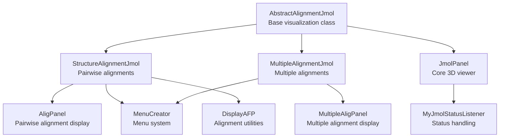
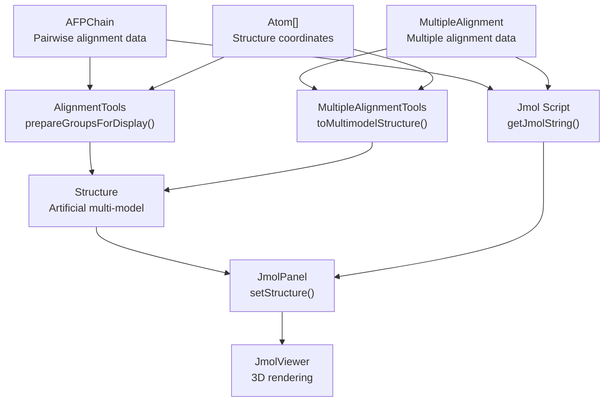
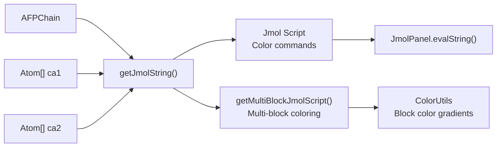
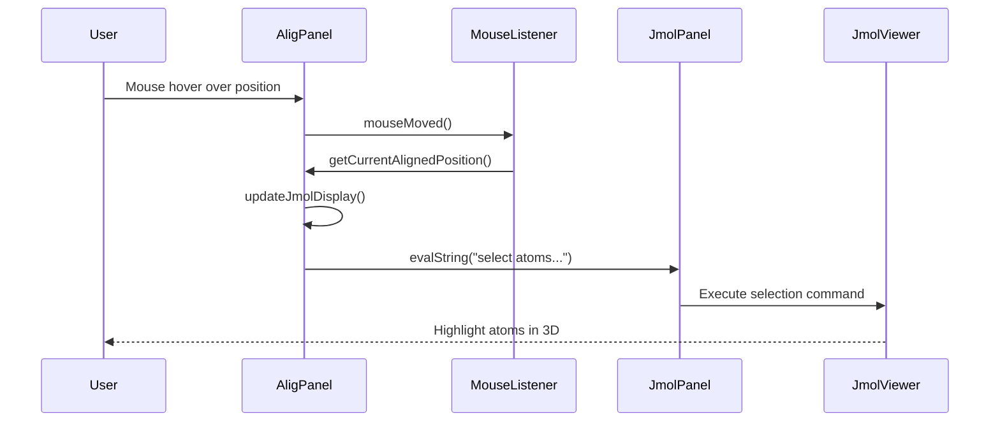

# Jmol Integration and Structure Visualization

Relevant source files

The following files were used as context for generating this wiki page:

- [biojava-structure-gui/src/main/java/org/biojava/nbio/structure/align/gui/DisplayAFP.java](biojava-structure-gui/src/main/java/org/biojava/nbio/structure/align/gui/DisplayAFP.java)
- [biojava-structure-gui/src/main/java/org/biojava/nbio/structure/align/gui/MenuCreator.java](biojava-structure-gui/src/main/java/org/biojava/nbio/structure/align/gui/MenuCreator.java)
- [biojava-structure-gui/src/main/java/org/biojava/nbio/structure/align/gui/StructureAlignmentDisplay.java](biojava-structure-gui/src/main/java/org/biojava/nbio/structure/align/gui/StructureAlignmentDisplay.java)
- [biojava-structure-gui/src/main/java/org/biojava/nbio/structure/align/gui/aligpanel/AFPChainCoordManager.java](biojava-structure-gui/src/main/java/org/biojava/nbio/structure/align/gui/aligpanel/AFPChainCoordManager.java)
- [biojava-structure-gui/src/main/java/org/biojava/nbio/structure/align/gui/aligpanel/AligPanel.java](biojava-structure-gui/src/main/java/org/biojava/nbio/structure/align/gui/aligpanel/AligPanel.java)
- [biojava-structure-gui/src/main/java/org/biojava/nbio/structure/align/gui/aligpanel/AligPanelMouseMotionListener.java](biojava-structure-gui/src/main/java/org/biojava/nbio/structure/align/gui/aligpanel/AligPanelMouseMotionListener.java)
- [biojava-structure-gui/src/main/java/org/biojava/nbio/structure/align/gui/aligpanel/MultipleAligPanel.java](biojava-structure-gui/src/main/java/org/biojava/nbio/structure/align/gui/aligpanel/MultipleAligPanel.java)
- [biojava-structure-gui/src/main/java/org/biojava/nbio/structure/align/gui/aligpanel/StatusDisplay.java](biojava-structure-gui/src/main/java/org/biojava/nbio/structure/align/gui/aligpanel/StatusDisplay.java)
- [biojava-structure-gui/src/main/java/org/biojava/nbio/structure/align/gui/jmol/AbstractAlignmentJmol.java](biojava-structure-gui/src/main/java/org/biojava/nbio/structure/align/gui/jmol/AbstractAlignmentJmol.java)
- [biojava-structure-gui/src/main/java/org/biojava/nbio/structure/align/gui/jmol/JmolPanel.java](biojava-structure-gui/src/main/java/org/biojava/nbio/structure/align/gui/jmol/JmolPanel.java)
- [biojava-structure-gui/src/main/java/org/biojava/nbio/structure/align/gui/jmol/MultipleAlignmentJmol.java](biojava-structure-gui/src/main/java/org/biojava/nbio/structure/align/gui/jmol/MultipleAlignmentJmol.java)
- [biojava-structure-gui/src/main/java/org/biojava/nbio/structure/align/gui/jmol/MyJmolStatusListener.java](biojava-structure-gui/src/main/java/org/biojava/nbio/structure/align/gui/jmol/MyJmolStatusListener.java)
- [biojava-structure-gui/src/main/java/org/biojava/nbio/structure/align/gui/jmol/StructureAlignmentJmol.java](biojava-structure-gui/src/main/java/org/biojava/nbio/structure/align/gui/jmol/StructureAlignmentJmol.java)

This page documents BioJava's 3D structure visualization capabilities through Jmol integration, interactive alignment displays, and the coordination between 2D sequence alignments and 3D structural representations. The system provides comprehensive tools for visualizing both pairwise and multiple structure alignments with rich interactive features.

For information about the underlying structure alignment algorithms, see [3.4](#3.4). For details about alignment data models, see [2.1](#2.1).

## Core Architecture

The Jmol integration system is built around a hierarchy of visualization components that coordinate 3D structure display with 2D alignment representations. The architecture separates concerns between structure visualization, alignment display, and user interaction management.

### Class Hierarchy and Component Relationships

Sources: [biojava-structure-gui/src/main/java/org/biojava/nbio/structure/align/gui/jmol/AbstractAlignmentJmol.java:55-56](), [biojava-structure-gui/src/main/java/org/biojava/nbio/structure/align/gui/jmol/StructureAlignmentJmol.java:59](), [biojava-structure-gui/src/main/java/org/biojava/nbio/structure/align/gui/jmol/MultipleAlignmentJmol.java:75]()

### Data Flow and Visualization Pipeline

Sources: [biojava-structure-gui/src/main/java/org/biojava/nbio/structure/align/gui/jmol/StructureAlignmentJmol.java:350](), [biojava-structure-gui/src/main/java/org/biojava/nbio/structure/align/gui/jmol/MultipleAlignmentJmol.java:355](), [biojava-structure-gui/src/main/java/org/biojava/nbio/structure/align/gui/jmol/JmolPanel.java:130]()

## Main Visualization Components

### AbstractAlignmentJmol Base Class

The `AbstractAlignmentJmol` class provides the foundation for all Jmol-based visualizations in BioJava. It manages the core `JmolPanel`, handles mouse interactions, and defines the interface for alignment-specific visualization logic.

| Method | Purpose |
|--------|---------|
| `setStructure(Structure)` | Load structure into Jmol viewer |
| `evalString(String)` | Execute Jmol scripting commands |
| `resetDisplay()` | Abstract method for resetting visualization |
| `initCoords()` | Abstract method for initializing coordinates |
| `destroy()` | Cleanup resources and listeners |

The base class implements mouse motion handling to provide atom information display and selection capabilities across all visualization types.

Sources: [biojava-structure-gui/src/main/java/org/biojava/nbio/structure/align/gui/jmol/AbstractAlignmentJmol.java:55-97](), [biojava-structure-gui/src/main/java/org/biojava/nbio/structure/align/gui/jmol/AbstractAlignmentJmol.java:152-181]()

### StructureAlignmentJmol for Pairwise Alignments

`StructureAlignmentJmol` specializes the base class for pairwise structure alignments using `AFPChain` objects. It creates artificial two-model structures where aligned regions are colored distinctively.

Key visualization features:
- **Color Coding**: Orange and cyan coloring for aligned regions
- **Block Visualization**: Multi-block alignments use color gradients
- **Interactive Controls**: Zoom slider, spin control, style selection
- **Selection Display**: Click-to-select atom regions

Sources: [biojava-structure-gui/src/main/java/org/biojava/nbio/structure/align/gui/jmol/StructureAlignmentJmol.java:417-488](), [biojava-structure-gui/src/main/java/org/biojava/nbio/structure/align/gui/jmol/StructureAlignmentJmol.java:516-540]()

### MultipleAlignmentJmol for Multiple Structure Alignments

`MultipleAlignmentJmol` handles visualization of multiple structure alignments, supporting both structure-based and block-based coloring schemes. It includes additional controls for structure selection and block coloring.

Enhanced features for multiple alignments:
- **Structure Selection**: Individual structure visibility controls
- **Block Coloring**: Color by alignment blocks using `colorByBlocks` checkbox
- **Palette Selection**: Multiple color palette options (Spectral, Set1, Set2, Pastel)
- **Phylogenetic Integration**: Tree visualization through Archaeopteryx

Sources: [biojava-structure-gui/src/main/java/org/biojava/nbio/structure/align/gui/jmol/MultipleAlignmentJmol.java:191-199](), [biojava-structure-gui/src/main/java/org/biojava/nbio/structure/align/gui/jmol/MultipleAlignmentJmol.java:294-306]()

### JmolPanel Core Integration

`JmolPanel` wraps the Jmol viewer and provides BioJava-specific functionality including structure loading, style management, and domain coloring capabilities.

| Style Option | Jmol Command Generated |
|--------------|------------------------|
| Cartoon | `cartoon on; ligand wireframe/spacefill` |
| Backbone | `backbone 0.4; cartoon off` |
| CPK | `cpk on; cartoon off` |
| Ball and Stick | `wireframe 0.2; spacefill 25%` |
| By Chain | `color_by_chain()` custom function |

Sources: [biojava-structure-gui/src/main/java/org/biojava/nbio/structure/align/gui/jmol/JmolPanel.java:232-294]()

## Interactive Alignment Panels

### 2D Alignment Display Integration

The alignment panel system provides 2D sequence representations that synchronize with the 3D Jmol display. Selection in the 2D panel automatically highlights corresponding atoms in the 3D structure.

Sources: [biojava-structure-gui/src/main/java/org/biojava/nbio/structure/align/gui/aligpanel/AligPanel.java:426-479](), [biojava-structure-gui/src/main/java/org/biojava/nbio/structure/align/gui/aligpanel/MultipleAligPanel.java:350-373]()

### Mouse Interaction and Selection Management

Both `AligPanel` and `MultipleAligPanel` implement sophisticated mouse interaction through dedicated mouse listeners that support:

- **Hover Selection**: Real-time highlighting of alignment positions
- **Range Selection**: Click-and-drag to select alignment regions  
- **Toggle Selection**: Ctrl/Shift-click to modify selections
- **Selection Locking**: Persistent selections across multiple operations

The selection state is managed using `BitSet` objects that track selected alignment positions, with automatic translation to Jmol selection commands.

Sources: [biojava-structure-gui/src/main/java/org/biojava/nbio/structure/align/gui/aligpanel/AligPanelMouseMotionListener.java:59-107](), [biojava-structure-gui/src/main/java/org/biojava/nbio/structure/align/gui/aligpanel/AligPanel.java:72-88]()

## Menu System and User Controls

### MenuCreator Functionality

The `MenuCreator` class provides standardized menu systems across all Jmol visualization windows, supporting common operations like file I/O, display options, and format exports.

Key menu categories:
- **File Menu**: Load, save, export PDB, print functionality
- **Align Menu**: New pairwise/multiple alignment launches
- **View Menu**: Text formats, alignment panels, distance matrices, dot plots
- **Help Menu**: Documentation and system information

Sources: [biojava-structure-gui/src/main/java/org/biojava/nbio/structure/align/gui/MenuCreator.java:86-202]()

### Display Format Options

The visualization system supports multiple output formats through menu-driven actions:

| Format | Implementation | Purpose |
|--------|----------------|---------|
| Text Only | `AfpChainWriter.toWebSiteDisplay()` | Human-readable alignment |
| Aligned Pairs | `AfpChainWriter.toAlignedPairs()` | Residue-level correspondences |
| FatCat Format | `AFPChain.toFatcat()` | Algorithm-specific output |
| Distance Matrices | `getDistanceMatrices()` | Structural distance analysis |
| Phylogenetic Tree | `MultipleAlignmentTools.getKimuraTree()` | Evolutionary relationships |

Sources: [biojava-structure-gui/src/main/java/org/biojava/nbio/structure/align/gui/jmol/StructureAlignmentJmol.java:373-414](), [biojava-structure-gui/src/main/java/org/biojava/nbio/structure/align/gui/jmol/MultipleAlignmentJmol.java:378-409]()

## Configuration and Customization

### Color Palette Management

The system uses `ColorBrewer` palettes for consistent coloring across multiple structures. Users can select from predefined palettes (Spectral, Set1, Set2, Pastel) that automatically scale to the number of structures being displayed.

### Jmol Script Generation

Alignment-specific Jmol scripts are generated dynamically based on alignment data and user preferences. The scripts handle:
- Residue selection based on alignment positions
- Color assignment using palette schemes  
- Ligand and metal ion highlighting
- Model-specific commands for multi-structure displays

Sources: [biojava-structure-gui/src/main/java/org/biojava/nbio/structure/align/gui/jmol/MultipleAlignmentJmol.java:419-465](), [biojava-structure-gui/src/main/java/org/biojava/nbio/structure/align/gui/jmol/StructureAlignmentJmol.java:542-600]()

### Resource Management and Cleanup

All visualization components implement proper resource cleanup through `destroy()` methods that handle:
- Jmol viewer disposal
- Mouse listener removal  
- Structure object nullification
- Window listener cleanup

This ensures memory-efficient operation when working with multiple large structure alignments.

Sources: [biojava-structure-gui/src/main/java/org/biojava/nbio/structure/align/gui/jmol/AbstractAlignmentJmol.java:87-92](), [biojava-structure-gui/src/main/java/org/biojava/nbio/structure/align/gui/jmol/JmolPanel.java:400-407]()

---