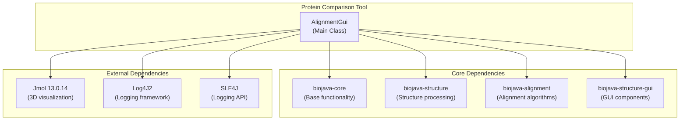
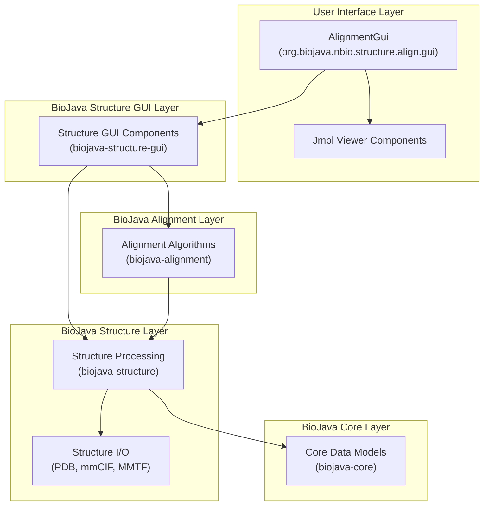
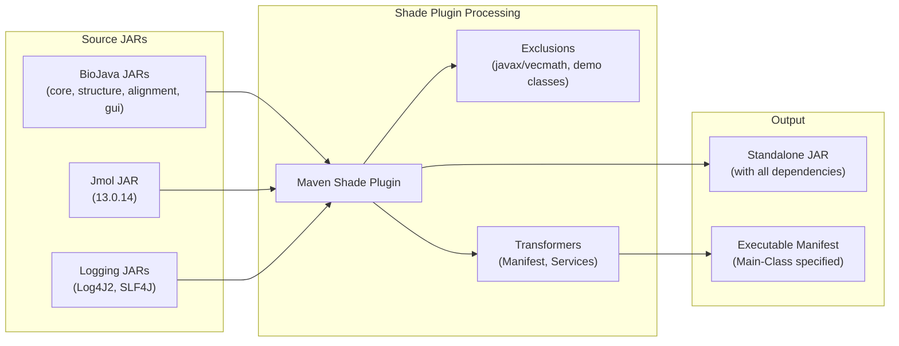
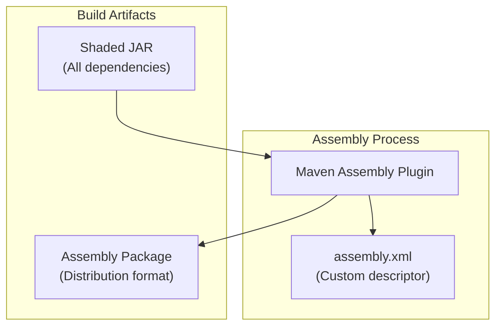

# Protein Comparison Tool

Relevant source files

The following files were used as context for generating this wiki page:

- [biojava-protein-comparison-tool/pom.xml](biojava-protein-comparison-tool/pom.xml)

## Purpose and Scope

The Protein Comparison Tool is a standalone GUI application built on top of BioJava's structure analysis capabilities. It provides an interactive interface for comparing and aligning protein structures using BioJava's alignment algorithms. This tool is packaged as a self-contained JAR file that can be executed independently of other BioJava modules.

For information about the underlying Jmol integration and visualization components, see [Jmol Integration and Structure Visualization](#5.1). For details about the structural analysis algorithms used by this tool, see [Structural Analysis Tools](#3).

## Application Overview

The Protein Comparison Tool is implemented as a Maven module that creates a complete standalone application. The main entry point is the `AlignmentGui` class, which provides a graphical user interface for protein structure alignment and comparison tasks.

### Module Dependencies

The tool integrates multiple BioJava modules to provide comprehensive functionality:

**Sources:** [biojava-protein-comparison-tool/pom.xml:28-80]()

### Application Architecture

The tool follows a layered architecture where the GUI layer leverages the underlying BioJava structure processing and alignment capabilities:

**Sources:** [biojava-protein-comparison-tool/pom.xml:36-56]()

## Main Application Entry Point

The application's main class is `AlignmentGui`, located in the `org.biojava.nbio.structure.align.gui` package. This class serves as the primary entry point for the standalone protein comparison tool.

| Property | Value |
|----------|-------|
| Main Class | `org.biojava.nbio.structure.align.gui.AlignmentGui` |
| Module | `biojava-protein-comparison-tool` |
| Package | `org.biojava.nbio.structure.align.gui` |

**Sources:** [biojava-protein-comparison-tool/pom.xml:135]()

## Distribution and Packaging

The tool uses Maven plugins to create a comprehensive distribution package suitable for end-user deployment.

### Shade Plugin Configuration

The Maven Shade Plugin creates a fat JAR containing all dependencies:

**Sources:** [biojava-protein-comparison-tool/pom.xml:85-145]()

### Build Configuration Details

The build process includes several important configurations:

| Configuration | Purpose | Details |
|---------------|---------|---------|
| JAR Minimization | Disabled | Prevents removal of Jmol and Log4J dependencies |
| Vecmath Exclusion | Dependency conflict resolution | Excludes `javax/vecmath/**` from Jmol JAR |
| Demo Exclusion | Size optimization | Excludes demo classes from biojava-structure |
| Signature Exclusion | JAR validity | Removes META-INF signature files |
| Services Merging | Dependency integration | Merges META-INF/services files |

**Sources:** [biojava-protein-comparison-tool/pom.xml:94-141]()

### Assembly Plugin Configuration

The Maven Assembly Plugin creates additional distribution packages:

**Sources:** [biojava-protein-comparison-tool/pom.xml:147-171]()

## Project Metadata and Licensing

The tool is distributed under the GNU LGPL v2 license and includes comprehensive metadata for tracking builds and versions.

| Property | Value |
|----------|-------|
| License | GNU LGPL v2 |
| Vendor | Open Bioinformatics Foundation |
| Build Tracking | Git buildNumber integration |
| Character Encoding | UTF-8 |

**Sources:** [biojava-protein-comparison-tool/pom.xml:14-26](), [biojava-protein-comparison-tool/pom.xml:128-137](), [biojava-protein-comparison-tool/pom.xml:173-188]()

---