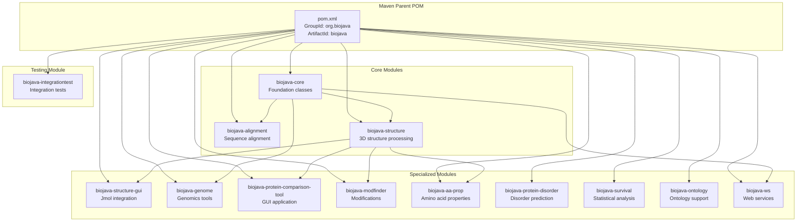
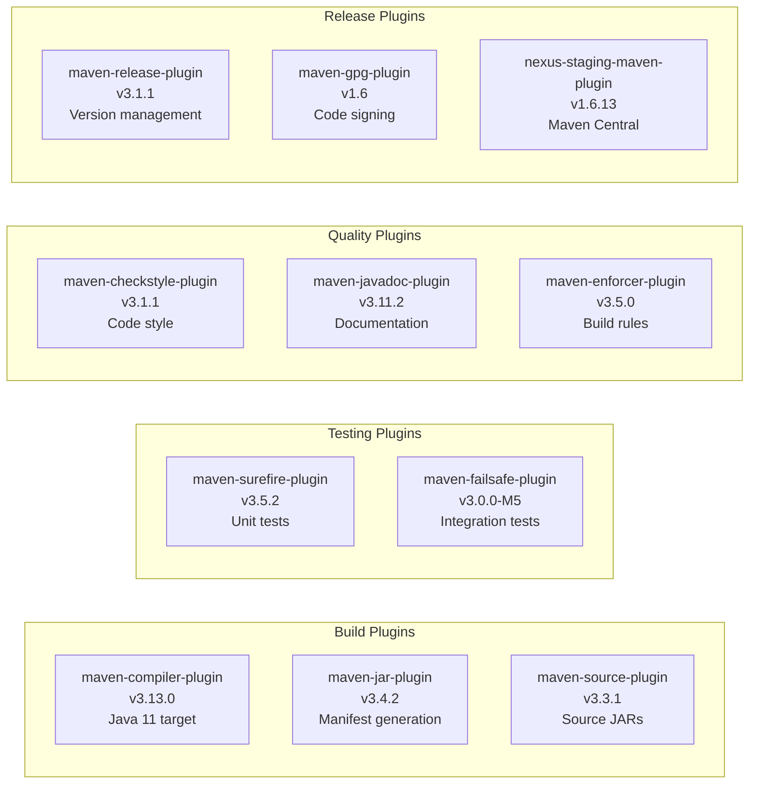
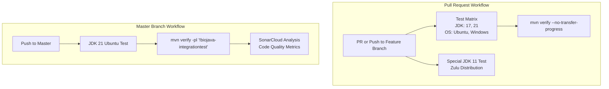
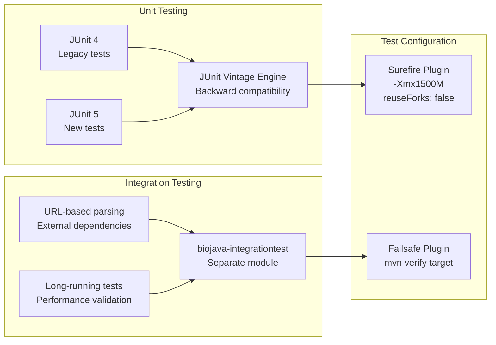
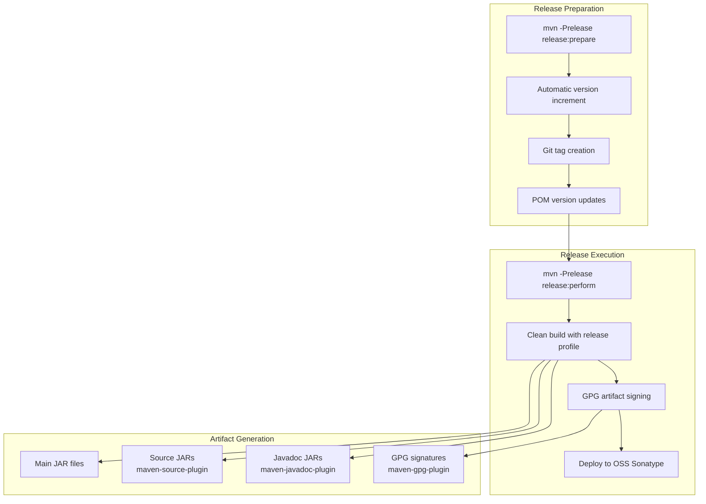

# Development and Deployment

Relevant source files

The following files were used as context for generating this wiki page:

- [.github/workflows/master.yml](.github/workflows/master.yml)
- [.github/workflows/pull_request.yml](.github/workflows/pull_request.yml)
- [CHANGELOG.md](CHANGELOG.md)
- [README.md](README.md)
- [biojava-aa-prop/pom.xml](biojava-aa-prop/pom.xml)
- [biojava-alignment/pom.xml](biojava-alignment/pom.xml)
- [biojava-core/pom.xml](biojava-core/pom.xml)
- [biojava-genome/pom.xml](biojava-genome/pom.xml)
- [biojava-integrationtest/pom.xml](biojava-integrationtest/pom.xml)
- [biojava-modfinder/pom.xml](biojava-modfinder/pom.xml)
- [biojava-ontology/pom.xml](biojava-ontology/pom.xml)
- [biojava-protein-disorder/pom.xml](biojava-protein-disorder/pom.xml)
- [biojava-structure-gui/pom.xml](biojava-structure-gui/pom.xml)
- [biojava-structure/pom.xml](biojava-structure/pom.xml)
- [biojava-structure/src/test/java/org/biojava/nbio/structure/io/TestURLBasedFileParsing.java](biojava-structure/src/test/java/org/biojava/nbio/structure/io/TestURLBasedFileParsing.java)
- [biojava-survival/pom.xml](biojava-survival/pom.xml)
- [biojava-ws/pom.xml](biojava-ws/pom.xml)
- [pom.xml](pom.xml)

This document provides comprehensive information for developers working with BioJava, covering the build system architecture, testing infrastructure, continuous integration, and release management processes. It serves as a technical guide for contributors, maintainers, and developers who need to understand BioJava's development lifecycle and deployment procedures.

For information about BioJava's modular architecture and individual components, see [Build System and Module Structure](#6.1). For details about testing infrastructure and release processes, see [Testing, CI/CD, and Release Process](#6.2).

## Build System Architecture

BioJava uses a Maven-based multi-module build system orchestrated by a parent POM that manages dependencies, plugin versions, and build configurations across all modules. The build system supports Java 11+ compatibility and provides comprehensive tooling for development, testing, and deployment.

The parent POM defines critical build properties including Java version compatibility, dependency versions, and plugin configurations. Key build properties include `jdk.version` set to 11, UTF-8 encoding for all sources, and standardized logging frameworks.

**Sources:** [pom.xml:34-48](), [pom.xml:721-737]()

## Maven Plugin Management

The build system employs extensive plugin management to ensure consistent builds across all modules. Essential plugins include the Maven Compiler Plugin for Java 11 compilation, Surefire Plugin for unit testing, and Failsafe Plugin for integration testing.

The Surefire plugin is configured with increased memory allocation (`-Xmx1500M`) and fork settings to handle BioJava's memory-intensive tests. The Jar plugin includes manifest entries for trusted library status and permissions required for some BioJava applications.

**Sources:** [pom.xml:169-347](), [pom.xml:350-403]()

## Dependency Management Strategy

BioJava implements centralized dependency management through the parent POM's `dependencyManagement` section, ensuring version consistency across all modules. Critical dependencies include JUnit 5 for testing, SLF4J 2.0 for logging, and specialized libraries like MMTF for molecular structure formats.

| Dependency Category | Key Libraries | Versions |
|-------------------|---------------|----------|
| Testing Framework | JUnit Jupiter, JUnit Vintage | 5.10.1 |
| Logging | SLF4J API, Log4j Core | 2.0.12, 2.23.1 |
| Structure Formats | MMTF API, CIFTools Java | 1.0.11, 7.0.1 |
| XML Processing | Jakarta XML Bind, JAXB Runtime | 4.0.0, 4.0.3 |
| Utilities | Google Guava | 33.4.0-jre |

Logging is standardized on SLF4J 2.0 with Log4j 2 as the implementation, providing consistent logging across all modules while allowing flexibility in logging configuration.

**Sources:** [pom.xml:415-492](), [pom.xml:42-47]()

## Continuous Integration Pipeline

BioJava uses GitHub Actions for continuous integration with separate workflows for pull requests and master branch builds. The CI system tests compatibility across multiple JDK versions and operating systems.

The pull request workflow tests on JDK 17 and 21 with both Ubuntu and Windows, ensuring cross-platform compatibility. A separate job tests JDK 11 using the Zulu distribution since OpenJDK 11 is not available in GitHub Actions.

**Sources:** [.github/workflows/pull_request.yml:14-35](), [.github/workflows/master.yml:12-37]()

## Testing Infrastructure

BioJava implements a comprehensive testing strategy with both unit tests and integration tests. Unit tests run with every build, while integration tests are executed separately due to their longer execution time and external dependencies.

The integration test module (`biojava-integrationtest`) is configured to skip JAR creation since it only contains test code. Integration tests can include network operations, such as testing URL-based file parsing for remote structure files.

The test configuration allocates 1.5GB of memory for unit tests and disables fork reuse to prevent memory issues during testing. Integration tests are executed only during the Maven `verify` phase.

**Sources:** [pom.xml:353-361](), [biojava-integrationtest/pom.xml:70-83](), [biojava-structure/src/test/java/org/biojava/nbio/structure/io/TestURLBasedFileParsing.java:37-44]()

## Release Management Process

BioJava follows a formal release process using Maven Release Plugin with deployment to Maven Central via OSS Sonatype. The release process includes automated version management, code signing, and artifact deployment.

The release profile activates additional plugins including GPG signing, source JAR creation, and Javadoc generation. The Nexus Staging Plugin handles the deployment to Maven Central with automatic release after staging validation.

**Sources:** [pom.xml:574-668](), [README.md:40-46]()

## Development Profile Configuration

BioJava provides multiple build profiles to support different development scenarios. The main profiles include the default profile for development builds, a release profile for Maven Central deployment, and a codesigning profile for signed JARs.

| Profile Name | Purpose | Key Features |
|-------------|---------|--------------|
| Default | Development builds | Standard compilation, testing |
| Release | Maven Central deployment | GPG signing, source JARs, Javadoc |
| Codesigning | Signed JAR generation | Timestamp signing, keystore configuration |

The release profile includes comprehensive artifact generation with source attachments, Javadoc generation, and GPG signing for security. The codesigning profile supports timestamp signing with external timestamp authorities for long-term signature validity.

**Sources:** [pom.xml:575-719](), [pom.xml:674-718]()

## Documentation Generation

BioJava generates comprehensive documentation using Maven Site Plugin with aggregate Javadoc generation across all modules. The documentation build creates unified API documentation and project reports.

The Javadoc configuration includes custom footer with Google Analytics tracking and allows script content in comments. The aggregate reporting generates a single documentation site containing all module documentation.

**Sources:** [pom.xml:494-550](), [pom.xml:231-245]()

---