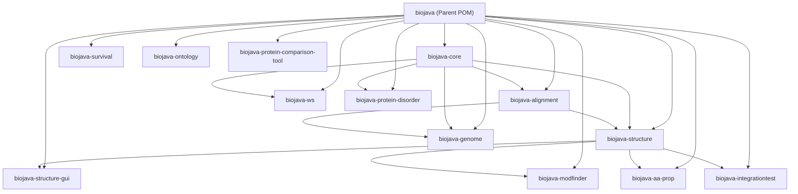
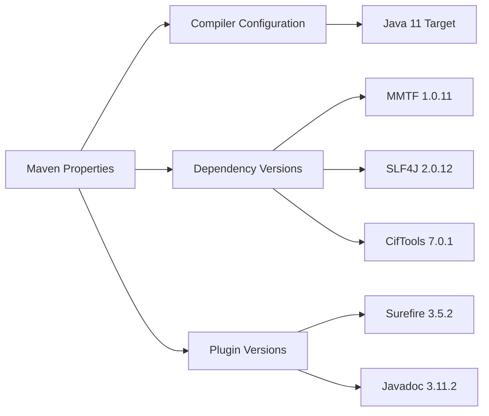
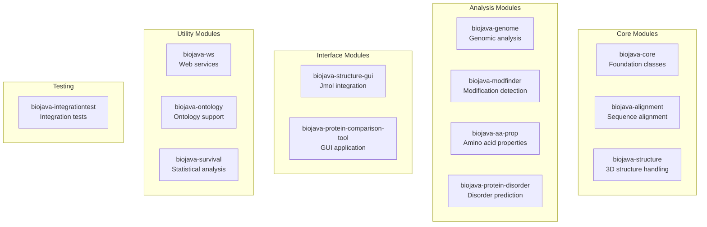
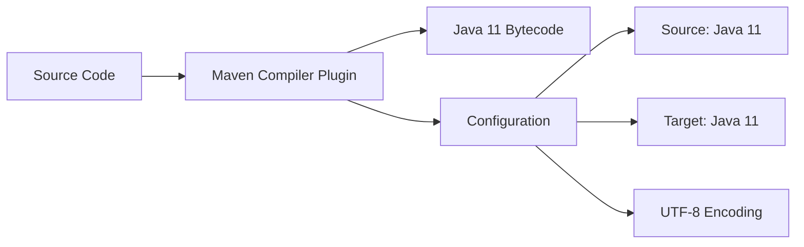
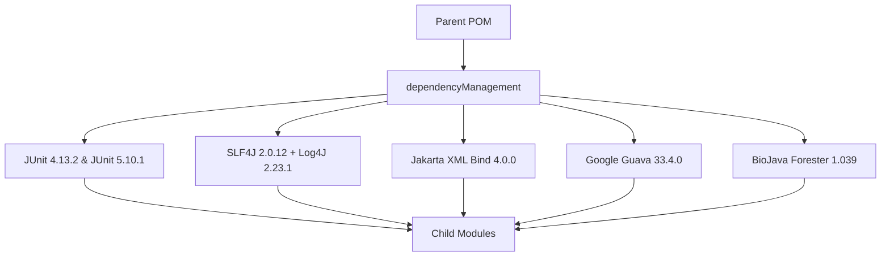
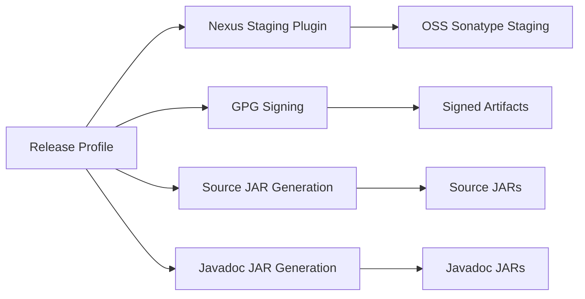
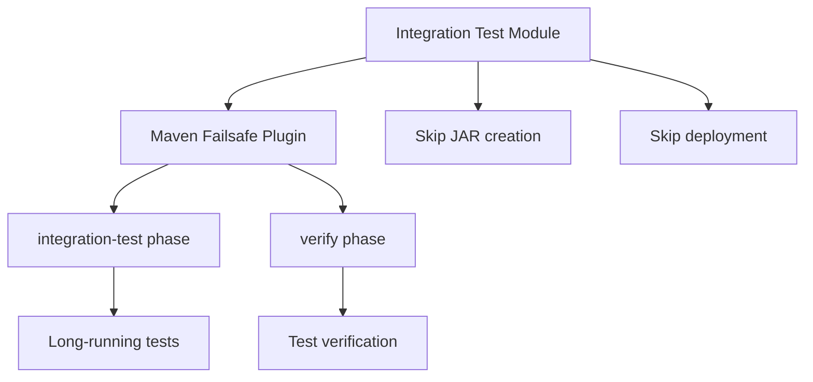

# Build System and Module Structure

<details>
<summary>Relevant source files</summary>

The following files were used as context for generating this wiki page:

- [biojava-aa-prop/pom.xml](biojava-aa-prop/pom.xml)
- [biojava-alignment/pom.xml](biojava-alignment/pom.xml)
- [biojava-core/pom.xml](biojava-core/pom.xml)
- [biojava-genome/pom.xml](biojava-genome/pom.xml)
- [biojava-integrationtest/pom.xml](biojava-integrationtest/pom.xml)
- [biojava-modfinder/pom.xml](biojava-modfinder/pom.xml)
- [biojava-ontology/pom.xml](biojava-ontology/pom.xml)
- [biojava-protein-disorder/pom.xml](biojava-protein-disorder/pom.xml)
- [biojava-structure-gui/pom.xml](biojava-structure-gui/pom.xml)
- [biojava-structure/pom.xml](biojava-structure/pom.xml)
- [biojava-survival/pom.xml](biojava-survival/pom.xml)
- [biojava-ws/pom.xml](biojava-ws/pom.xml)
- [pom.xml](pom.xml)

</details>


This document provides a comprehensive guide to BioJava's Maven-based build system, including its multi-module architecture, dependency management, and build configurations. It covers the project structure, module dependencies, build profiles, and release processes for developers working with or contributing to the BioJava codebase.

For information about testing infrastructure and CI/CD processes, see [Testing, CI/CD, and Release Process](#6.2).

## Maven Multi-Module Architecture

BioJava uses Apache Maven as its primary build tool with a multi-module project structure. The parent POM coordinates all modules and provides shared configuration, dependency management, and build profiles.

### Module Dependency Structure



**Module Dependency Relationships**
The dependency hierarchy shows `biojava-core` as the foundation module, with specialized modules building upon it and each other.

Sources: [pom.xml:721-737](), [biojava-structure/pom.xml:52-62](), [biojava-genome/pom.xml:71-81]()

## Project Configuration

### Core Properties and Versions

The parent POM defines critical build properties and dependency versions used across all modules:

| Property | Value | Purpose |
|----------|-------|---------|
| `jdk.version` | 11 | Target Java version |
| `project.build.sourceEncoding` | UTF-8 | Source file encoding |
| `mmtf.version` | 1.0.11 | MMTF library version |
| `slf4j.version` | 2.0.12 | Logging framework version |
| `ciftools.version` | 7.0.1 | CIF parsing library version |



**Global Configuration Management**
Maven properties provide centralized version management across all modules.

Sources: [pom.xml:34-48](), [pom.xml:170-346]()

### Module Structure Overview

BioJava consists of 13 modules organized by functionality:



**Functional Module Organization**
Modules are grouped by their primary purpose: core functionality, analysis tools, user interfaces, utilities, and testing.

Sources: [pom.xml:721-737]()

## Build Plugin Configuration

### Key Maven Plugins

The parent POM configures essential Maven plugins with specific versions and settings:

| Plugin | Version | Purpose |
|--------|---------|---------|
| `maven-compiler-plugin` | 3.13.0 | Java compilation |
| `maven-surefire-plugin` | 3.5.2 | Unit testing |
| `maven-javadoc-plugin` | 3.11.2 | Documentation generation |
| `maven-assembly-plugin` | 3.7.1 | Distribution packaging |
| `maven-release-plugin` | 3.1.1 | Release management |

### Compiler Configuration

All modules compile to Java 11 with UTF-8 encoding:



**Compilation Process**
The Maven compiler plugin ensures consistent compilation across all modules.

Sources: [pom.xml:176-183](), [pom.xml:36]()

### Testing Configuration

The project uses both JUnit 4 and JUnit 5 for testing, with specific memory allocation:

```xml
<argLine>-Xmx1500M</argLine>
<reuseForks>false</reuseForks>
<forkCount>1</forkCount>
```

Sources: [pom.xml:353-361]()

## Dependency Management

### Centralized Dependency Management

The parent POM uses `dependencyManagement` to control versions across all modules:



**Dependency Version Control**
The parent POM ensures consistent dependency versions across all modules without requiring version specification in child POMs.

Sources: [pom.xml:415-492]()

### Logging Configuration

All modules use SLF4J with Log4J2 binding:

- **API**: `slf4j-api` (version managed in parent)
- **Implementation**: `log4j-slf4j2-impl` + `log4j-core` + `log4j-api`
- **Scope**: Runtime for implementation dependencies

Sources: [pom.xml:443-469](), [biojava-core/pom.xml:58-75]()

## Module-Specific Configurations

### Core Module Dependencies

Each module has specific dependency requirements:

| Module | Key Dependencies |
|--------|------------------|
| `biojava-structure` | MMTF, CifTools, JGraphT, Jackson, Vecmath |
| `biojava-structure-gui` | Jmol 14.31.10, JColorBrewer |
| `biojava-genome` | Google Guava |
| `biojava-ws` | JSON-lib |

### JAR Packaging Configuration

All modules exclude demo packages from final JARs to avoid namespace conflicts:

```xml
<excludes>
    <exclude>demo/**</exclude>
</excludes>
```

Sources: [biojava-core/pom.xml:28-37](), [biojava-structure/pom.xml:147-157]()

## Build Profiles

### Release Profile

The `release` profile configures deployment to Maven Central:



**Release Process Components**
The release profile ensures proper artifact signing and deployment to Maven Central.

Sources: [pom.xml:574-668]()

### Code Signing Profile

The `codesigning` profile provides JAR signing capabilities for Java Web Start applications:

- **Plugin**: `maven-jarsigner-plugin`
- **Configuration**: Keystore-based signing with timestamp authority
- **Activation**: Manual activation required

Sources: [pom.xml:674-717]()

## Integration Testing

The `biojava-integrationtest` module provides slow-running integration tests:



**Integration Testing Strategy**
Separate module for slow tests that don't block regular builds.

Sources: [biojava-integrationtest/pom.xml:64-125]()

## Distribution Management

### Repository Configuration

BioJava publishes to OSS Sonatype repositories:

- **Snapshots**: `https://oss.sonatype.org/content/repositories/snapshots`
- **Releases**: `https://oss.sonatype.org/service/local/staging/deploy/maven2/`
- **Parent POM**: OSS Sonatype parent POM version 9

### Site Generation

Maven site plugin generates aggregate Javadoc documentation:

```xml
<goal>javadoc:aggregate</goal>
```

Sources: [pom.xml:554-572](), [pom.xml:5-9](), [pom.xml:494-550]()

---