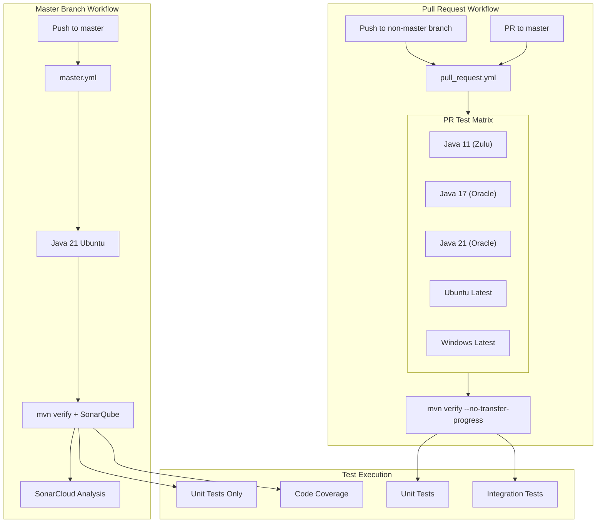
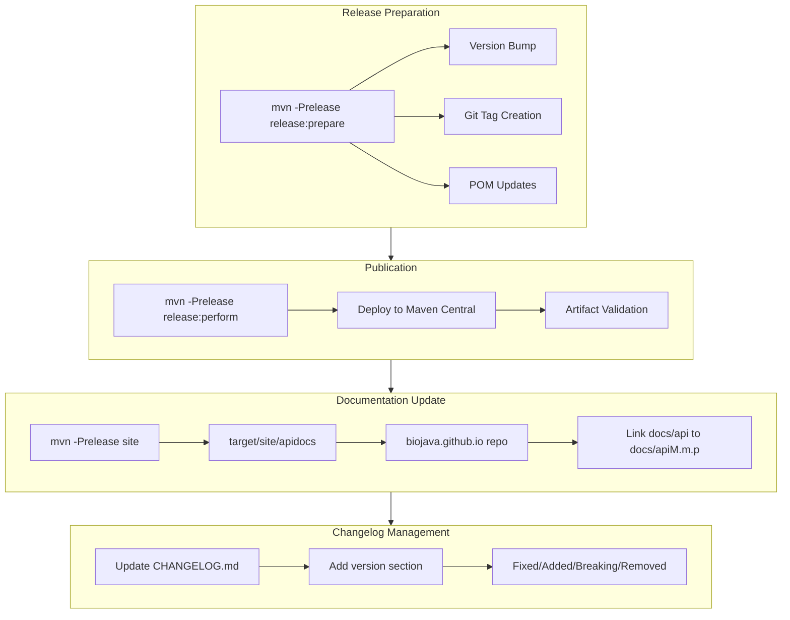
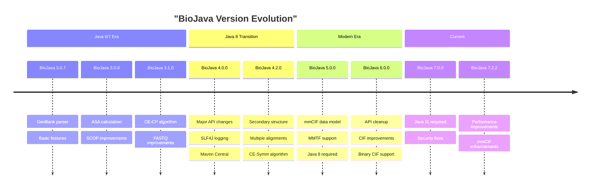

# Testing, CI/CD, and Release Process

<details>
<summary>Relevant source files</summary>

The following files were used as context for generating this wiki page:

- [.github/workflows/master.yml](.github/workflows/master.yml)
- [.github/workflows/pull_request.yml](.github/workflows/pull_request.yml)
- [CHANGELOG.md](CHANGELOG.md)
- [README.md](README.md)
- [biojava-structure/src/test/java/org/biojava/nbio/structure/io/TestURLBasedFileParsing.java](biojava-structure/src/test/java/org/biojava/nbio/structure/io/TestURLBasedFileParsing.java)

</details>


This document covers BioJava's testing infrastructure, continuous integration and deployment pipelines, and release management processes. It details the automated workflows that ensure code quality, the testing strategies across multiple Java versions and platforms, and the procedures for publishing new versions to Maven Central.

For information about the build system and module structure, see [Module Structure](#6.1).

## Testing Infrastructure

BioJava employs a comprehensive testing strategy using JUnit 4 for unit testing and Maven for test execution. The testing framework supports both unit tests and integration tests, with the ability to exclude integration tests for faster CI builds.

### Test Structure and Organization

The project uses standard JUnit 4 annotations and follows Maven's conventional directory structure for tests. Test classes are located in `src/test/java` directories within each module and follow naming conventions that mirror the main source structure.

**Example Test Structure:**
```
biojava-structure/src/test/java/org/biojava/nbio/structure/io/TestURLBasedFileParsing.java
```

Tests utilize standard JUnit patterns with `@Test` annotations and assertion methods like `assertNotNull()` for validation [biojava-structure/src/test/java/org/biojava/nbio/structure/io/TestURLBasedFileParsing.java:29-43]().

### Test Execution Strategy

The Maven build system supports different test execution modes:
- **Full verification**: `mvn verify` runs all tests including integration tests
- **Excluding integration tests**: `mvn verify -pl '!biojava-integrationtest'` for faster CI builds
- **No transfer progress**: `--no-transfer-progress` flag reduces log verbosity in CI environments

Sources: [.github/workflows/pull_request.yml](), [.github/workflows/master.yml](), [biojava-structure/src/test/java/org/biojava/nbio/structure/io/TestURLBasedFileParsing.java]()

## Continuous Integration Pipeline

BioJava uses GitHub Actions for continuous integration with separate workflows for pull requests and master branch commits. The CI system tests multiple Java versions and operating systems to ensure compatibility across different environments.

### CI Workflow Architecture



### Multi-Platform Testing Strategy

The pull request workflow tests across multiple configurations:

| Java Version | Distribution | Operating Systems |
|--------------|-------------|-------------------|
| 11 | Zulu | Ubuntu Latest |
| 17 | Oracle | Ubuntu Latest, Windows Latest |
| 21 | Oracle | Ubuntu Latest, Windows Latest |

The master branch workflow focuses on a single configuration (Java 21 on Ubuntu) but includes additional code quality analysis.

### SonarQube Integration

The master branch workflow integrates with SonarQube for code quality analysis [.github/workflows/master.yml:34-37](). The analysis uses:
- `SONAR_TOKEN` and `SONAR_HOST_URL` secrets for authentication
- `sonar.projectKey=biojava_biojava` for project identification
- `sonar.organization=biojava` for organization grouping

Sources: [.github/workflows/pull_request.yml](), [.github/workflows/master.yml]()

## Release Process

BioJava follows a structured release process using Maven's release plugin and semantic versioning. The process includes preparation, publishing to Maven Central, and documentation updates.

### Release Workflow



### Maven Release Commands

The release process uses Maven profiles and plugins:

1. **Preparation Phase**: `mvn -Prelease release:prepare`
   - Updates version numbers in POMs
   - Creates Git tags
   - Commits changes

2. **Performance Phase**: `mvn -Prelease release:perform`
   - Builds artifacts
   - Deploys to Maven Central
   - Validates deployment

3. **Documentation Phase**: `mvn -Prelease site`
   - Generates Javadocs in `target/site`
   - Requires manual deployment to GitHub Pages

### Javadoc Publishing Process

Documentation publishing involves multiple steps:
1. Generate site with `mvn -Prelease site`
2. Extract contents from `target/site/apidocs`
3. Push to `biojava.github.io` repository under `docs/apiM.m.p` directory structure
4. Update symbolic link from `docs/api` to current version directory

Sources: [README.md:40-46]()

## Version Management and Release History

BioJava follows semantic versioning with a comprehensive changelog documenting all changes. The versioning strategy has evolved to support major compatibility requirements.

### Version Evolution Timeline



### Changelog Structure

The changelog follows a consistent format with categorized changes:

- **Fixed**: Bug fixes and corrections
- **Added**: New features and capabilities  
- **Breaking**: API changes requiring code updates
- **Removed**: Deprecated functionality removal

### Java Compatibility Timeline

| Version Range | Java Requirement | Key Changes |
|---------------|------------------|-------------|
| 3.x | Java 6, 7 | Legacy compatibility |
| 4.x | Java 6, 7, 8 | Transition period |
| 5.x | Java 8+ | Modern features |
| 6.x | Java 8+ | API stabilization |
| 7.x | Java 11+ | Current LTS requirement |

### Recent Release Pattern

Recent releases show focus on:
- mmCIF parsing performance improvements [CHANGELOG.md:7-8]()
- Dependency upgrades for security [CHANGELOG.md:128,136,141]()
- Edge case handling in file parsing [CHANGELOG.md:18-19,27-28]()
- Code quality improvements via SonarQube integration

Sources: [CHANGELOG.md]()