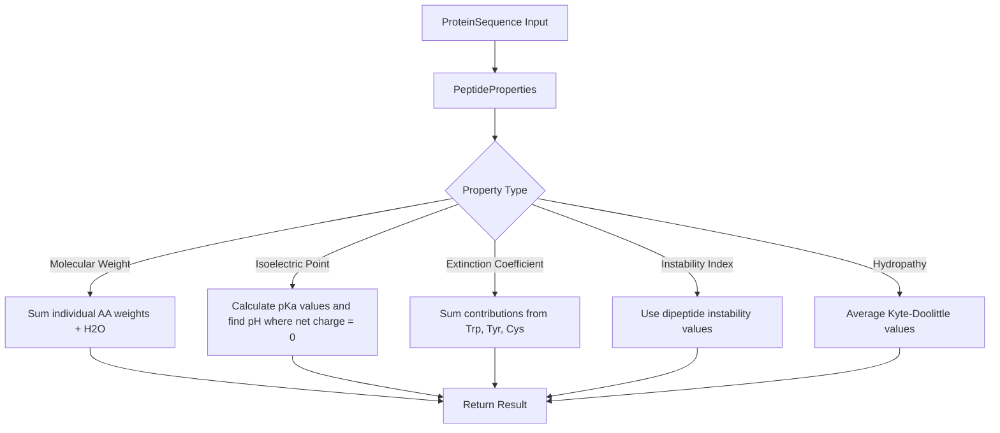

Understanding the physico-chemical properties of amino acids is fundamental to protein analysis in bioinformatics. BioJava's amino acid properties module provides a comprehensive toolkit for calculating various characteristics of protein sequences, from basic molecular weight to complex structural predictions. This guide will walk you through the essential properties you can compute and how to use them in your bioinformatics workflows.

## Why Amino Acid Properties Matter

Amino acid properties are the building blocks of protein function and structure. They determine how proteins fold, interact with other molecules, and perform their biological roles. By analyzing these properties, you can:

- Predict protein stability and behavior in different environments
- Understand protein-protein interactions
- Design experiments for protein purification and characterization
- Identify potential functional regions in protein sequences

BioJava's amino acid properties module makes these calculations accessible through a clean, intuitive API that integrates seamlessly with the rest of the BioJava framework.

## Core Properties You Can Calculate

The module provides access to a wide range of physico-chemical properties through the `IPeptideProperties` interface. Let's explore the most commonly used ones:

### Molecular Weight

Molecular weight is one of the most fundamental properties of any protein. It's essential for determining protein concentration, designing experiments, and understanding protein behavior.

```java
ProteinSequence sequence = new ProteinSequence("VLSPADKTNVKAAWGKVGAHAG");
double molecularWeight = PeptideProperties.getMolecularWeight(sequence.toString());
System.out.println("Molecular weight: " + molecularWeight + " Da");
```

The calculation includes the weight of a water molecule, as this represents the complete weight of the protein as it would exist in solution. The molecular weights are based on standard values from the EXPASY database, ensuring accuracy and consistency with other bioinformatics tools.
Sources: [IPeptideProperties.java#L55-L64](biojava-aa-prop/src/main/java/org/biojava/nbio/aaproperties/IPeptideProperties.java#L55-L64), [PeptideProperties.java#L84-L95](biojava-aa-prop/src/main/java/org/biojava/nbio/aaproperties/PeptideProperties.java#L84-L95)

### Isoelectric Point (pI)

The isoelectric point is the pH at which a protein carries no net electrical charge. This property is crucial for understanding protein solubility and for designing purification strategies like isoelectric focusing.

```java
ProteinSequence sequence = new ProteinSequence("VLSPADKTNVKAAWGKVGAHAG");
double pI = PeptideProperties.getIsoelectricPoint(sequence.toString());
System.out.println("Isoelectric point: " + pI);
```

BioJava offers two sets of pKa values for calculation: the default Expasy values and Innovagen values. You can choose which set to use based on your specific needs:
Sources: [IPeptideProperties.java#L235-L255](biojava-aa-prop/src/main/java/org/biojava/nbio/aaproperties/IPeptideProperties.java#L235-L255)

### Net Charge at Specific pH

Understanding a protein's charge at different pH values is essential for predicting its behavior in various experimental conditions.

```java
ProteinSequence sequence = new ProteinSequence("VLSPADKTNVKAAWGKVGAHAG");
double netCharge = PeptideProperties.getNetCharge(sequence.toString(), 7.0);
System.out.println("Net charge at pH 7.0: " + netCharge);
```

This calculation uses established pKa values for ionizable amino acid side chains and considers both N-terminal and C-terminal charges.
Sources: [IPeptideProperties.java#L258-L282](biojava-aa-prop/src/main/java/org/biojava/nbio/aaproperties/IPeptideProperties.java#L258-L282)

### Extinction Coefficient and Absorbance

These properties are vital for protein quantification using spectrophotometry. The extinction coefficient tells you how much light a protein absorbs at a specific wavelength (typically 280 nm), which is directly related to its concentration.

```java
ProteinSequence sequence = new ProteinSequence("VLSPADKTNVKAAWGKVGAHAG");
boolean assumeCysReduced = true; // or false if cystines are formed
double extinctionCoeff = PeptideProperties.getExtinctionCoefficient(sequence.toString(), assumeCysReduced);
double absorbance = PeptideProperties.getAbsorbance(sequence.toString(), assumeCysReduced);

System.out.println("Extinction coefficient: " + extinctionCoeff);
System.out.println("Absorbance: " + absorbance);
```

The calculation considers the contribution of aromatic amino acids (Tryptophan, Tyrosine) and cysteine residues, with the option to specify whether cysteines are reduced or form disulfide bonds.
Sources: [IPeptideProperties.java#L153-L185](biojava-aa-prop/src/main/java/org/biojava/nbio/aaproperties/IPeptideProperties.java#L153-L185)

### Instability Index

The instability index provides an estimate of protein stability in vitro. This is particularly useful for predicting whether a protein will remain stable during purification and storage.

```java
ProteinSequence sequence = new ProteinSequence("VLSPADKTNVKAAWGKVGAHAG");
double instabilityIndex = PeptideProperties.getInstabilityIndex(sequence.toString());
System.out.println("Instability index: " + instabilityIndex);

if (instabilityIndex < 40) {
    System.out.println("Predicted to be stable");
} else {
    System.out.println("May be unstable");
}
```

A value below 40 suggests the protein is stable, while values above 40 indicate potential instability.
Sources: [IPeptideProperties.java#L188-L199](biojava-aa-prop/src/main/java/org/biojava/nbio/aaproperties/IPeptideProperties.java#L188-L199)

### Aliphatic Index

The aliphatic index measures the relative volume occupied by aliphatic side chains (Alanine, Valine, Isoleucine, and Leucine). This property correlates with protein thermostability - proteins with higher aliphatic indices tend to be more stable at higher temperatures.

```java
ProteinSequence sequence = new ProteinSequence("VLSPADKTNVKAAWGKVGAHAG");
double aliphaticIndex = PeptideProperties.getApliphaticIndex(sequence.toString());
System.out.println("Aliphatic index: " + aliphaticIndex);
```
Sources: [IPeptideProperties.java#L202-L216](biojava-aa-prop/src/main/java/org/biojava/nbio/aaproperties/IPeptideProperties.java#L202-L216)

### Average Hydropathy

Hydropathy values indicate the hydrophobic or hydrophilic nature of amino acids. The average hydropathy of a protein sequence can reveal insights about its potential membrane association or solubility.

```java
ProteinSequence sequence = new ProteinSequence("VLSPADKTNVKAAWGKVGAHAG");
double avgHydropathy = PeptideProperties.getAvgHydropathy(sequence.toString());
System.out.println("Average hydropathy: " + avgHydropathy);
```

These values are based on the widely used Kyte-Doolittle scale, where positive values indicate hydrophobicity and negative values indicate hydrophilicity.
Sources: [IPeptideProperties.java#L219-L232](biojava-aa-prop/src/main/java/org/biojava/nbio/aaproperties/IPeptideProperties.java#L219-L232)

### Amino Acid Composition

Understanding the composition of amino acids in your protein can provide insights into its function and properties.

```java
ProteinSequence sequence = new ProteinSequence("VLSPADKTNVKAAWGKVGAHAG");

// Get composition of a specific amino acid
AminoAcidCompoundSet aaSet = new AminoAcidCompoundSet();
AminoAcidCompound alanine = aaSet.getCompoundForString("A");
double alanineComposition = PeptideProperties.getEnrichment(sequence.toString(), alanine);
System.out.println("Alanine composition: " + alanineComposition);

// Get composition of all 20 standard amino acids
Map<AminoAcidCompound, Double> allCompositions = PeptideProperties.getAAComposition(sequence.toString());
System.out.println("All amino acid compositions: " + allCompositions);
```
Sources: [IPeptideProperties.java#L284-L314](biojava-aa-prop/src/main/java/org/biojava/nbio/aaproperties/IPeptideProperties.java#L284-L314)

## Advanced Properties with PROFEAT

Beyond the basic properties, BioJava also integrates PROFEAT functionality, which provides more sophisticated protein feature calculations. PROFEAT converts amino acid sequences into various physico-chemical attributes and calculates composition, transition, and distribution features.

The seven main attributes in PROFEAT are:
- Hydrophobicity (Polar, Neutral, Hydrophobic)
- Normalized van der Waals volume
- Polarity
- Polarizability
- Charge (Positive, Neutral, Negative)
- Secondary structure propensity
- Solvent accessibility

```java
ProteinSequence sequence = new ProteinSequence("VLSPADKTNVKAAWGKVGAHAG");
IProfeatProperties profeat = new ProfeatPropertiesImpl();

// Get composition for a specific attribute
Map<GROUPING, Double> hydrophobicityComp = profeat.getComposition(sequence, ATTRIBUTE.HYDROPHOBICITY);
System.out.println("Hydrophobicity composition: " + hydrophobicityComp);

// Get all properties for all attributes
Map<ATTRIBUTE, Map<GROUPING, Double>> allProperties = profeat.getComposition(sequence);
System.out.println("All PROFEAT properties: " + allProperties);
```
Sources: [IProfeatProperties.java#L28-L43](biojava-aa-prop/src/main/java/org/biojava/nbio/aaproperties/profeat/IProfeatProperties.java#L28-L43)

## How BioJava Calculates These Properties

Behind the scenes, BioJava uses carefully curated data and established algorithms to ensure accuracy. The `Constraints` class contains predefined values for amino acid properties, including molecular weights, hydropathy values, and pKa constants.



The molecular weight calculation, for example, sums the individual weights of each amino acid and adds the weight of a water molecule (18.015 Da) to represent the complete protein as it exists in solution. These values are sourced from authoritative databases like EXPASY to ensure consistency with other bioinformatics tools.
Sources: [Constraints.java#L87-L100](biojava-aa-prop/src/main/java/org/biojava/nbio/aaproperties/Constraints.java#L87-L100), [PeptidePropertiesImpl.java#L73-L87](biojava-aa-prop/src/main/java/org/biojava/nbio/aaproperties/PeptidePropertiesImpl.java#L73-L87)

## Customizing Calculations with XML Files

For specialized applications, BioJava allows you to use custom XML files to define amino acid properties. This is particularly useful when working with non-standard amino acids or when you need to use specific values from the literature.

```java
// Use custom amino acid composition file
File customAAFile = new File("path/to/custom/composition.xml");
double customMW = PeptideProperties.getMolecularWeight(sequence.toString(), customAAFile);

// Or use both custom element mass and amino acid composition files
File elementMassFile = new File("path/to/element/mass.xml");
File aaCompositionFile = new File("path/to/aa/composition.xml");
double fullyCustomMW = PeptideProperties.getMolecularWeight(sequence.toString(), elementMassFile, aaCompositionFile);
```

This flexibility makes BioJava adaptable to various research needs and allows for reproducible science with clearly defined parameters.
Sources: [IPeptideProperties.java#L83-L103](biojava-aa-prop/src/main/java/org/biojava/nbio/aaproperties/IPeptideProperties.java#L83-L103)

> [!TIP]
> When working with protein sequences, always ensure your input contains only standard amino acid codes (A, C, D, E, F, G, H, I, K, L, M, N, P, Q, R, S, T, V, W, Y). BioJava will validate sequences and throw exceptions for invalid characters, helping you catch errors early in your analysis.

## Practical Applications

These amino acid properties calculations have numerous real-world applications:

1. **Protein Purification**: Use isoelectric point to design ion-exchange chromatography protocols
2. **Protein Engineering**: Modify sequences to achieve desired stability or solubility characteristics
3. **Drug Design**: Understand how mutations might affect protein-drug interactions
4. **Structural Biology**: Predict regions that might be difficult to crystallize based on sequence properties
5. **Metabolic Engineering**: Design enzymes with optimal properties for industrial processes

By integrating these calculations into your bioinformatics workflows, you can gain deeper insights into protein function and behavior, ultimately accelerating your research and discovery processes.

## Getting Started

To begin using amino acid properties in BioJava, you'll need to include the `biojava-aa-prop` module in your project. The static methods in `PeptideProperties` provide the easiest entry point, while the `IPeptideProperties` interface offers more flexibility for advanced use cases.

```java
// Simple example to get started
ProteinSequence sequence = new ProteinSequence("MVLSEGEWQLVLHVWAKVEADVAGHGQDILIRLFKSHPETLEKFDRVKHLKTEAEMKASEDLKKAGVTVLTALGAILKKKGHHEAELKPLAQSHATKHKIPIKYLEFISEAIIHVLHSRHPGDFGADAQGAMNKALELFRKDIAAKYKELGYQG");
System.out.println("Molecular weight: " + PeptideProperties.getMolecularWeight(sequence.toString()));
System.out.println("Isoelectric point: " + PeptideProperties.getIsoelectricPoint(sequence.toString()));
System.out.println("Instability index: " + PeptideProperties.getInstabilityIndex(sequence.toString()));
```

This example demonstrates how quickly you can extract valuable information from protein sequences using BioJava's amino acid properties module.
Sources: [BioJavaAADemo.java#L35-L41](biojava-aa-prop/src/main/java/demo/BioJavaAADemo.java#L35-L41)

## Conclusion

BioJava's amino acid properties module provides a comprehensive, well-documented, and scientifically accurate toolkit for protein sequence analysis. Whether you're a beginner just starting with bioinformatics or an experienced researcher working on complex protein engineering projects, this module offers the functionality you need with the flexibility to adapt to specialized requirements.

By understanding and leveraging these physico-chemical properties, you can gain deeper insights into protein function, stability, and behavior - ultimately accelerating your research and discovery processes in the exciting field of bioinformatics.