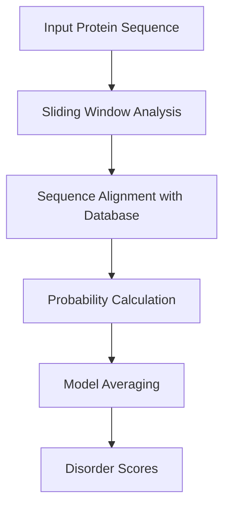

Protein disorder prediction is a crucial aspect of bioinformatics that helps identify regions within proteins that lack a fixed three-dimensional structure. These intrinsically disordered regions (IDRs) play significant roles in protein function, signaling, and disease mechanisms. BioJava's protein disorder prediction module, based on the Regional Order Neural Network (RONN) algorithm, provides developers with powerful tools to analyze protein sequences and predict disordered regions.

## Understanding Protein Disorder

Proteins are traditionally viewed as having well-defined three-dimensional structures that determine their functions. However, it's now known that many proteins contain regions that are **intrinsically disordered**—these segments don't adopt a fixed structure but instead exist as dynamic ensembles of conformations. Disordered regions are essential for many biological processes, including molecular recognition, signaling, and regulation.

The BioJava protein disorder module implements the RONN algorithm, which uses a neural network approach to predict the probability of disorder for each residue in a protein sequence. The algorithm analyzes sequence patterns and compares them against known structured and disordered regions to make predictions.

## Getting Started with Jronn

The primary API for protein disorder prediction in BioJava is the `Jronn` class, which provides a simple, intuitive interface for predicting disordered regions. This class loads prediction models automatically and offers several methods for analyzing protein sequences.

```java
import org.biojava.nbio.ronn.Jronn;
import org.biojava.nbio.core.sequence.ProteinSequence;

// Create a protein sequence
ProteinSequence sequence = new ProteinSequence("MAEGEITTFTALTEKFNLPPGNYKKPKLLYCSNGGHFLRILPDGTVDGTRDRSDQHIQLQLSAESVGEVYIKSTETGQYLAMDTSGLLYGSQTPSEECLFLERLEENHYNTYTSKKHAEKNWFVGLKKNGSCKRGPRTHYGQKAILFLPLPV");

// Get disorder scores for each residue
float[] disorderScores = Jronn.getDisorderScores(sequence);
```

The `getDisorderScores()` method returns an array of float values where each value represents the probability (0.0 to 1.0) that the corresponding residue in the sequence is disordered. Generally, values greater than 0.5 indicate a higher likelihood of disorder.

Sources: [Jronn.java#L135-L137](biojava-protein-disorder/src/main/java/org/biojava/nbio/ronn/Jronn.java#L135-L137), [PredictDisorder.java#L46-L48](biojava-protein-disorder/src/main/java/demo/PredictDisorder.java#L46-L48)

## Identifying Disordered Regions

While individual residue scores are useful, you'll often want to identify contiguous regions of disorder. The `Jronn` class provides methods to convert raw scores into defined disordered regions:

```java
import org.biojava.nbio.ronn.Jronn.Range;

// Get disordered regions as ranges
Range[] disorderedRegions = Jronn.getDisorder(sequence);

// Process the results
for (Range region : disorderedRegions) {
    System.out.println("Disordered region from position " + region.from + 
                      " to " + region.to + " with score " + region.score);
}
```

The `Range` class represents a disordered region with start (`from`) and end (`to`) positions (1-indexed) along with the average disorder score for that region. This makes it easy to identify and work with functionally important disordered segments in your proteins.

Sources: [Jronn.java#L199-L201](biojava-protein-disorder/src/main/java/org/biojava/nbio/ronn/Jronn.java#L199-L201), [Jronn.java#L75-L92](biojava-protein-disorder/src/main/java/org/biojava/nbio/ronn/Jronn.java#L75-L92)

## Working with Multiple Sequences

BioJava's disorder prediction module efficiently handles multiple sequences, making it suitable for high-throughput analysis:

```java
import org.biojava.nbio.data.sequence.FastaSequence;
import java.util.List;
import java.util.Map;

// Assuming you have a list of protein sequences
List<FastaSequence> sequences = ...; // Your list of sequences

// Get disorder scores for all sequences
Map<FastaSequence, float[]> allScores = Jronn.getDisorderScores(sequences);

// Get disordered regions for all sequences
Map<FastaSequence, Range[]> allRegions = Jronn.getDisorder(sequences);

// Process results
for (Map.Entry<FastaSequence, Range[]> entry : allRegions.entrySet()) {
    System.out.println("Sequence: " + entry.getKey().getId());
    for (Range region : entry.getValue()) {
        System.out.println("  Disordered region: " + region.from + "-" + region.to);
    }
}
```

This approach is particularly useful when analyzing entire proteomes or large sets of proteins, as it leverages BioJava's optimized processing pipeline.

Sources: [Jronn.java#L247-L250](biojava-protein-disorder/src/main/java/org/biojava/nbio/ronn/Jronn.java#L247-L250), [Jronn.java#L260-L263](biojava-protein-disorder/src/main/java/org/biojava/nbio/ronn/Jronn.java#L260-L263)

## Understanding the Prediction Algorithm

The RONN algorithm implemented in BioJava uses a neural network approach to predict disorder. Here's a simplified overview of how it works:

1. **Sliding Window Analysis**: The algorithm uses a sliding window of 19 amino acids to analyze local sequence patterns.

2. **Sequence Alignment**: For each window, it performs alignments against a database of known structured and disordered sequences.

3. **Probability Calculation**: Based on alignment scores, it calculates the probability that the central residue in the window is disordered.

4. **Model Averaging**: The final prediction is obtained by averaging results from multiple neural network models (10 models by default), improving prediction accuracy.



The algorithm uses the BLOSUM62 substitution matrix for sequence comparisons and employs statistical models to distinguish between ordered and disordered regions. The prediction models are loaded automatically when you first use the `Jronn` class.

Sources: [ORonnModel.java#L75-L125](biojava-protein-disorder/src/main/java/org/biojava/nbio/ronn/ORonnModel.java#L75-L125), [ORonn.java#L144-L146](biojava-protein-disorder/src/main/java/org/biojava/nbio/ronn/ORonn.java#L144-L146)

## Sequence Constraints and Limitations

When using the protein disorder prediction module, be aware of these important constraints:

- **Minimum Sequence Length**: Sequences must be at least 19 amino acids long for prediction. Shorter sequences will trigger an exception.
  
- **Valid Characters**: The algorithm works with standard amino acid codes. Non-standard amino acids are handled but may affect prediction accuracy.

- **Ambiguous Sequences**: Sequences with ambiguous amino acids (like 'X') are processed but may generate warnings.

```java
// Checking sequence validity
if (sequence.getLength() < RonnConstraint.MIN_SEQUENCE_LENGTH) {
    throw new IllegalArgumentException("Sequence too short for disorder prediction");
}
```

> [!TIP]
> For optimal results, use sequences longer than 30 amino acids. While the minimum is 19, longer sequences provide more context for accurate predictions.

Sources: [RonnConstraint.java#L155](biojava-protein-disorder/src/main/java/org/biojava/nbio/ronn/RonnConstraint.java#L155), [ORonn.java#L199-L221](biojava-protein-disorder/src/main/java/org/biojava/nbio/ronn/ORonn.java#L199-L221)

## Customizing Prediction Parameters

BioJava allows you to customize certain aspects of the disorder prediction:

```java
// Convert raw scores to ranges with a custom threshold
float[] scores = Jronn.getDisorderScores(sequence);
Range[] customRegions = Jronn.scoresToRanges(scores, 0.6f); // Using 0.6 as threshold
```

The default threshold for identifying disordered regions is 0.5, but you can adjust this value to be more or less stringent depending on your needs. Higher thresholds will identify fewer but more confidently predicted disordered regions.

Sources: [Jronn.java#L211-L236](biojava-protein-disorder/src/main/java/org/biojava/nbio/ronn/Jronn.java#L211-L236), [RonnConstraint.java#L43](biojava-protein-disorder/src/main/java/org/biojava/nbio/ronn/RonnConstraint.java#L43)

## Integration with BioJava Core

The protein disorder module integrates seamlessly with BioJava's core sequence handling capabilities:

```java
import org.biojava.nbio.core.sequence.ProteinSequence;
import org.biojava.nbio.core.sequence.compound.AminoAcidCompound;

// Working with BioJava ProteinSequence objects
ProteinSequence bioJavaSequence = ...; // Your BioJava sequence

// Convert to FastaSequence for disorder prediction
FastaSequence fastaSequence = Jronn.convertProteinSequencetoFasta(bioJavaSequence);

// Get disorder predictions
float[] scores = Jronn.getDisorderScores(fastaSequence);
```

This integration allows you to leverage BioJava's rich sequence manipulation features alongside disorder prediction, creating powerful analysis pipelines.

Sources: [Jronn.java#L147-L151](biojava-protein-disorder/src/main/java/org/biojava/nbio/ronn/Jronn.java#L147-L151), [Jronn.java#L160-L174](biojava-protein-disorder/src/main/java/org/biojava/nbio/ronn/Jronn.java#L160-L174)

## Performance Considerations

The protein disorder prediction module is designed for performance:

1. **Parallel Processing**: For large datasets, the module supports multi-threaded processing to speed up predictions.

2. **Model Caching**: Prediction models are loaded once and cached for subsequent use, minimizing initialization overhead.

3. **Optimized Algorithms**: The implementation uses efficient data structures and algorithms to minimize computational complexity.

When processing many sequences, consider using the batch processing methods to take advantage of these optimizations. The module automatically handles thread management and resource allocation for optimal performance.

Sources: [ORonn.java#L346-384](biojava-protein-disorder/src/main/java/org/biojava/nbio/ronn/ORonn.java#L346-384), [Jronn.java#L57-67](biojava-protein-disorder/src/main/java/org/biojava/nbio/ronn/Jronn.java#L57-67)

## Practical Applications

Protein disorder prediction has numerous applications in bioinformatics research:

- **Functional Annotation**: Disordered regions often correspond to functional sites in proteins.
- **Disease Research**: Many diseases are associated with mutations in disordered regions.
- **Protein Engineering**: Understanding disorder helps in designing proteins with desired properties.
- **Drug Discovery**: Disordered regions can be targets for therapeutic intervention.

By integrating BioJava's disorder prediction capabilities into your applications, you can leverage these insights for advanced protein analysis and research.
