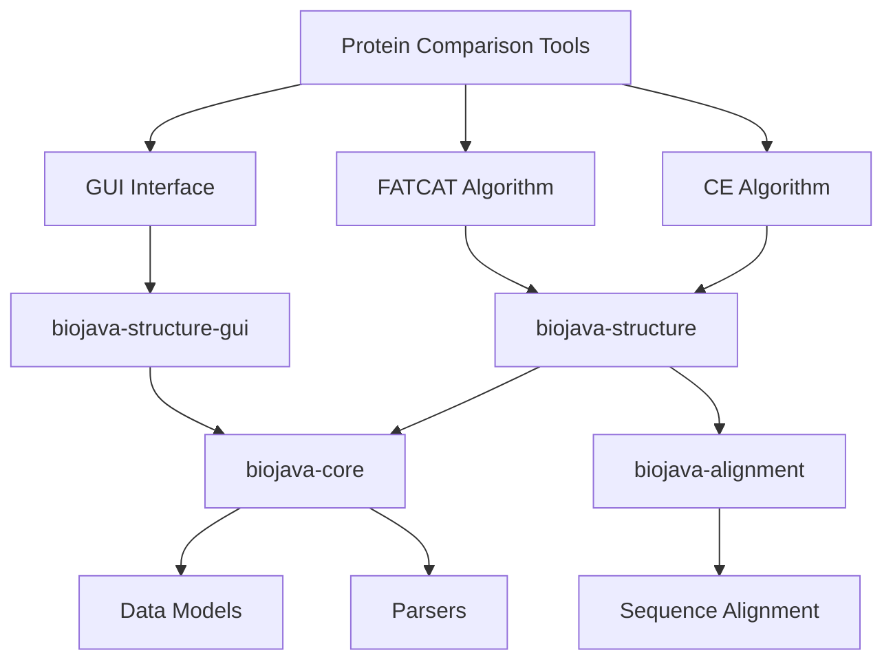

Protein structure comparison is a fundamental task in bioinformatics that helps scientists understand evolutionary relationships, functional similarities, and structural patterns across different proteins. BioJava provides a comprehensive suite of protein comparison tools that enable researchers to perform sophisticated structural analyses with ease.

## Understanding Protein Structure Comparison

Protein structure comparison goes beyond simple sequence alignment by examining the three-dimensional arrangements of atoms in protein structures. This approach is crucial because proteins with similar structures often share similar functions, even when their sequences have diverged significantly through evolution. BioJava's protein comparison tools implement several well-established algorithms to address this complex computational challenge.

The protein comparison tools in BioJava are primarily focused on **structural alignment algorithms** that determine the optimal three-dimensional superposition of two protein structures while maximizing the similarity between their spatial arrangements. These tools are essential for identifying structural motifs, detecting evolutionary relationships, and predicting protein functions.

Sources: [pom.xml#L28-L80](biojava-protein-comparison-tool/pom.xml#L28-L80), [CeMain.java#L36-L48](biojava-structure/src/main/java/org/biojava/nbio/structure/align/ce/CeMain.java#L36-L48)

## Key Algorithms in BioJava

BioJava implements two major protein structure comparison algorithms: CE (Combinatorial Extension) and FATCAT (Flexible structure AlignmenT by Chaining Aligned fragment pairs allowing Twists). Each algorithm offers unique advantages for different types of structural comparisons.

### CE (Combinatorial Extension) Algorithm

The CE algorithm, originally developed by Shindyalov and Bourne in 1998, works by identifying local structural similarities between two proteins and then extending these regions into a comprehensive alignment. CE is particularly effective for detecting **global structural similarities** and is known for its ability to handle proteins with significant conformational differences.

The algorithm operates by:
1. Finding short fragment pairs that are structurally similar
2. Combining these fragments into longer aligned regions
3. Optimizing the alignment to maximize the number of aligned residues while minimizing RMSD (Root Mean Square Deviation)

CE is especially useful when you need to determine if two proteins share a common fold or when analyzing proteins with low sequence similarity but potentially similar structures.

Sources: [CeMain.java#L37-L44](biojava-structure/src/main/java/org/biojava/nbio/structure/align/ce/CeMain.java#L37-L44)

### FATCAT Algorithm

FATCAT, developed by Ye and Godzik in 2003, introduces flexibility into the structural alignment process. Unlike CE, which assumes proteins are rigid structures, FATCAT allows for **flexible alignments** that can accommodate structural variations such as domain movements or hinge regions.

The key innovation in FATCAT is its ability to:
1. Identify Aligned Fragment Pairs (AFPs) between the two structures
2. Chain these AFPs together while allowing for twists (flexible regions)
3. Optimize the alignment to balance the number of aligned residues with the number of twists introduced

FATCAT is particularly valuable when comparing proteins that may have undergone conformational changes or when analyzing multi-domain proteins with flexible linkers.

Sources: [FatCat.java#L1-L9](biojava-structure/src/main/java/org/biojava/nbio/structure/align/fatcat/FatCat.java#L1-L9)

## Using the Protein Comparison Tool

BioJava's protein comparison tool provides both programmatic access and a graphical user interface for performing structural alignments. The tool is designed to be accessible to both developers and researchers with varying levels of computational expertise.

### Command Line Interface

The protein comparison tool can be executed from the command line using shell scripts for different algorithms:

```bash
# Run CE algorithm
./runCE.sh

# Run CECP algorithm (CE with circular permutation)
./runCECP.sh

# Run FATCAT algorithm
./runFATCAT.sh
```

These scripts accept various parameters to customize the alignment process, such as specifying PDB identifiers, setting alignment thresholds, and defining output formats.

Sources: [assembly.xml#L32-L48](biojava-protein-comparison-tool/src/main/assembly/assembly.xml#L32-L48)

### Input Format

The tool accepts protein structures in various formats, with PDB identifiers being the most common input method. The `example.lst` file demonstrates the expected input format:

```
# an example input for a DB search
4hhb.C 4hhb.D
4hhb:0 4hhb:1
1cdg.A 1tim.B
1hiv.A 1a4w.H
1RLW 1BYN
```

Each line represents a pair of protein structures to compare. The format supports:
- Full PDB IDs with chain identifiers (e.g., `4hhb.C`)
- Domain specifications (e.g., `4hhb:0`)
- Complex combinations with residue ranges (e.g., `4hhb:(A:10-40,B:10-40)`)

Sources: [example.lst#L1-L11](biojava-protein-comparison-tool/src/main/assembly/example.lst#L1-L11)

### Output Interpretation

The alignment results provide comprehensive information about the structural comparison, including:

```
#Legend: 
# name1	name2	score	z-score	rmsd	len1	len2	sim1	sim2	
4hhb.C	4hhb.D	309.61	6.47	1.41	141	146	99	95	0.43	null	
```

The output columns represent:
- **name1, name2**: Identifiers of the compared proteins
- **score**: Alignment score (higher values indicate better alignments)
- **z-score**: Statistical significance of the alignment
- **rmsd**: Root Mean Square Deviation of aligned residues (lower values indicate better structural similarity)
- **len1, len2**: Lengths of the aligned regions in each protein
- **sim1, sim2**: Sequence similarity percentages for each protein
- **Alignment coverage**: Fraction of each protein included in the alignment

Sources: [db.out#L1-L12](biojava-protein-comparison-tool/src/main/assembly/db.out#L1-L12)

## Programmatic Usage

For developers who want to integrate protein comparison functionality into their applications, BioJava provides a clean API for accessing the alignment algorithms.

### Basic CE Alignment Example

```java
// Load two protein structures
Atom[] ca1 = StructureTools.getAtomCAArray(structure1);
Atom[] ca2 = StructureTools.getAtomCAArray(structure2);

// Create CE alignment instance
CeMain ce = new CeMain();

// Perform alignment
AFPChain afpChain = ce.align(ca1, ca2);

// Access alignment results
double rmsd = afpChain.getTotalRmsdOpt();
int alignmentLength = afpChain.getAlignLength();
```

### Basic FATCAT Alignment Example

```java
// Load protein structures
Atom[] ca1 = StructureTools.getAtomCAArray(structure1);
Atom[] ca2 = StructureTools.getAtomCAArray(structure2);

// Create FATCAT alignment instance
FatCat fatCat = new FatCat();

// Perform flexible alignment
AFPChain afpChain = fatCat.align(ca1, ca2);

// Check if flexible alignment was needed
int blockNum = afpChain.getBlockNum();
boolean isFlexible = blockNum > 1;
```

The `AFPChain` object returned by these methods contains all the alignment information, including aligned residue pairs, rotation matrices, and various statistical measures of alignment quality.

Sources: [CeMain.java#L49](biojava-structure/src/main/java/org/biojava/nbio/structure/align/ce/CeMain.java#L49), [FatCat.java#L38-L50](biojava-structure/src/main/java/org/biojava/nbio/structure/align/fatcat/FatCat.java#L38-L50)

## Graphical User Interface

For researchers who prefer a visual approach, BioJava provides a comprehensive GUI for protein structure comparison. The `AlignmentGui` class serves as the main entry point for this interface.

The GUI offers:
- Interactive protein structure visualization
- Real-time alignment parameter adjustment
- 3D structure superposition viewing
- Alignment quality metrics display
- Export capabilities for results

```java
// Launch the protein comparison GUI
public static void main(String[] args) {
    AlignmentGui gui = new AlignmentGui();
    gui.setVisible(true);
}
```

The GUI integrates with Jmol for molecular visualization, allowing users to inspect aligned structures in 3D and interactively explore the alignment results.

Sources: [pom.xml#L135](biojava-protein-comparison-tool/pom.xml#L135), [AlignmentGui.java](biojava-structure-gui/src/main/java/org/biojava/nbio/structure/align/gui/AlignmentGui.java)

## Advanced Features

### Multiple Structure Alignment

Beyond pairwise comparisons, BioJava supports multiple structure alignment, which allows simultaneous comparison of three or more protein structures. This is particularly useful for identifying common structural motifs across protein families or analyzing conserved structural features in evolutionarily related proteins.

```java
// Create multiple structure aligner
MultipleStructureAligner multiAligner = new MultipleMcMain();

// Prepare structures for alignment
List<Atom[]> structures = new ArrayList<>();
structures.add(StructureTools.getAtomCAArray(structure1));
structures.add(StructureTools.getAtomCAArray(structure2));
structures.add(StructureTools.getAtomCAArray(structure3));

// Perform multiple alignment
MultipleAlignment multipleAlignment = multiAligner.align(structures);
```

### Custom Parameters and Optimization

Both CE and FATCAT algorithms offer extensive parameter customization to fine-tune the alignment process:

```java
// Custom CE parameters
CeParameters ceParams = new CeParameters();
ceParams.setScoringStrategy(CEParameters.SCORING_CA_ONLY);
ceParams.setMinAlignmentLength(20);
ceParams.setMaxGapSize(30);

// Custom FATCAT parameters
FatCatParameters fatCatParams = new FatCatParameters();
fatCatParams.setFlexible(true);
fatCatParams.setDisThreshold(3.0);
fatCatParams.setGapOpen(-5);
fatCatParams.setGapExtend(-1);
```

> [!TIP]
> When working with protein structure comparison, always consider the biological context of your analysis. Different algorithms and parameter settings may be more appropriate depending on whether you're looking for evolutionary relationships, functional similarities, or structural motifs.

## Performance Considerations

Protein structure comparison can be computationally intensive, especially for large proteins or when performing database searches. BioJava implements several optimizations to improve performance:

1. **C-alpha atom representation**: By default, alignments are performed using only C-alpha atoms, which reduces computational complexity while maintaining accuracy.

2. **Pre-filtering**: The tools include pre-filtering steps to quickly eliminate non-promising alignments before performing detailed calculations.

3. **Parallel processing**: Some algorithms support parallel processing for multi-core systems.

4. **Incremental alignment**: For large structures, algorithms can perform incremental alignments focusing on the most promising regions first.

For large-scale comparisons, consider using the command-line interface with batch processing capabilities rather than the GUI, which is optimized for interactive use with individual protein pairs.

Sources: [AbstractStructureAlignment.java](biojava-structure/src/main/java/org/biojava/nbio/structure/align/AbstractStructureAlignment.java)

## Integration with Other BioJava Modules

The protein comparison tools integrate seamlessly with other BioJava modules, providing a comprehensive bioinformatics toolkit:

- **Structure module**: For loading and manipulating protein structures from PDB files
- **Alignment module**: For sequence-based alignments and combined sequence-structure analysis
- **Core module**: For fundamental bioinformatics data structures and utilities
- **Structure-GUI module**: For visualization and interactive analysis



This modular architecture allows researchers to combine protein structure comparison with other bioinformatics analyses, creating powerful workflows for structural biology research.

Sources: [pom.xml#L36-L56](biojava-protein-comparison-tool/pom.xml#L36-L56)

## Conclusion

BioJava's protein comparison tools provide a robust, flexible, and accessible platform for protein structure analysis. Whether you're a developer building bioinformatics applications or a researcher investigating protein structure-function relationships, these tools offer the algorithms, interfaces, and integration capabilities needed for sophisticated structural comparisons.

By implementing both rigid (CE) and flexible (FATCAT) alignment algorithms, BioJava ensures that researchers can choose the most appropriate method for their specific research questions. The combination of command-line, programmatic, and graphical interfaces makes these tools accessible to users with varying levels of computational expertise.

As structural biology continues to grow in importance, particularly with the expansion of structural genomics initiatives and advances in protein structure prediction, tools like those provided by BioJava will remain essential for extracting biological insights from protein structure data.