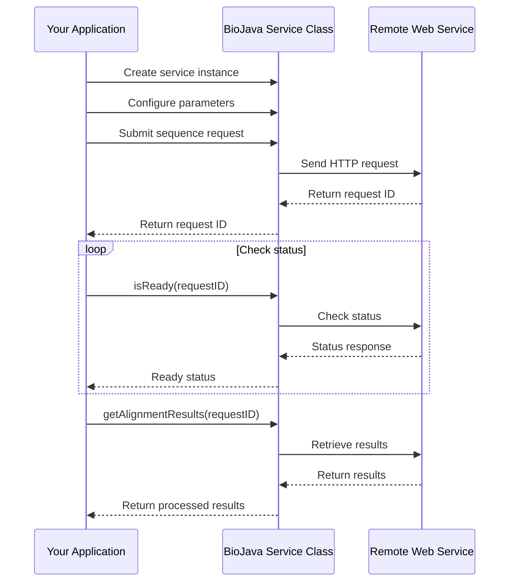

BioJava's web services integration module provides a powerful way to leverage external bioinformatics resources directly from your Java applications. This functionality allows you to submit sequences to remote services like NCBI BLAST and EBI HMMER, retrieve results, and process them programmatically without leaving your development environment.

## Why Web Services Integration Matters

In bioinformatics research, you often need to analyze sequences against large, constantly updated databases that would be impractical to maintain locally. Web services integration bridges this gap by providing programmatic access to these resources, enabling you to:

- Perform sequence alignments against the latest databases
- Identify protein domains and motifs
- Access specialized algorithms without local installation
- Automate analysis workflows that combine local and remote processing

The web services module in BioJava abstracts away the complexity of HTTP communication, request formatting, and response parsing, allowing you to focus on your scientific questions rather than technical implementation details.

## Supported Web Services

BioJava currently integrates with two major bioinformatics web services:

### NCBI BLAST Service

The NCBI BLAST (Basic Local Alignment Search Tool) service is one of the most widely used tools in bioinformatics for comparing sequences against large databases. BioJava provides a comprehensive implementation through the `NCBIQBlastService` class, which supports:

- All standard BLAST programs (blastn, blastp, blastx, tblastn, tblastx)
- Multiple database options (nr, nt, swissprot, etc.)
- Advanced search parameters and filtering options
- Various output formats (XML, text, HTML, etc.)

The implementation follows NCBI's QBlast API specification, which uses an asynchronous request-response pattern. When you submit a query, you receive a Request ID (RID) that you can use to check the status and retrieve results later.

### EBI HMMER Service

The HMMER service at the European Bioinformatics Institute (EBI) specializes in protein domain analysis using profile hidden Markov models. BioJava's `RemoteHmmerScan` class provides access to this service for:

- Pfam domain identification
- Protein family classification
- Domain architecture analysis
- Statistical evaluation of domain matches

This service is particularly valuable for understanding the functional domains within protein sequences and their evolutionary relationships.

## Architecture and Design

The web services module follows a clean, extensible architecture that separates concerns and provides consistent interfaces for different services.

### Core Interfaces

The foundation of the module is built around two main interfaces:

1. **RemotePairwiseAlignmentService**: Defines the contract for sequence alignment services
   - `sendAlignmentRequest()`: Submits sequences for analysis
   - `isReady()`: Checks if results are available
   - `getAlignmentResults()`: Retrieves completed results

2. **HmmerScan**: Defines the contract for protein domain analysis
   - `scan()`: Submits protein sequences for domain identification

These interfaces ensure that different service implementations can be used interchangeably, making your code more flexible and easier to maintain.

### Service Implementation Pattern

Both services follow a similar implementation pattern:



This asynchronous pattern is crucial for web services because analysis can take time to complete, and you don't want your application to block while waiting.

## Practical Usage Examples

### NCBI BLAST Example

Here's how to perform a BLAST search using BioJava's web services integration:

```java
// Create the BLAST service
NCBIQBlastService service = new NCBIQBlastService();

// Configure alignment parameters
NCBIQBlastAlignmentProperties props = new NCBIQBlastAlignmentProperties();
props.setBlastProgram(BlastProgramEnum.blastp);
props.setBlastDatabase("swissprot");
props.setAlignmentOption(ENTREZ_QUERY, "\"serum albumin\"[Protein name]");

// Submit the request
String sequence = "MKWVTFISLLFLFSSAYSRGVFRRDAHKSEVAHRFKDLGEENFKALVLIAFAQYLQQCPFEDHVKLVNEVTEFAKTCVADESAENCDKS";
String requestId = service.sendAlignmentRequest(sequence, props);

// Wait for results
while (!service.isReady(requestId)) {
    Thread.sleep(5000);
}

// Retrieve and save results
NCBIQBlastOutputProperties outputProps = new NCBIQBlastOutputProperties();
InputStream results = service.getAlignmentResults(requestId, outputProps);
```

This example demonstrates the complete workflow: creating a service, configuring parameters, submitting a request, waiting for completion, and retrieving results.

Sources: [NCBIQBlastService.java#L1-423](biojava-ws/src/main/java/org/biojava/nbio/ws/alignment/qblast/NCBIQBlastService.java), [NCBIQBlastServiceDemo.java#L1-98](biojava-ws/src/main/java/demo/NCBIQBlastServiceDemo.java)

### HMMER Domain Analysis Example

For protein domain analysis, the HMMER service provides a straightforward interface:

```java
// Get a protein sequence (from UniProt in this case)
ProteinSequence sequence = getUniprot("P08487");

// Create HMMER service and scan for domains
RemoteHmmerScan hmmer = new RemoteHmmerScan();
SortedSet<HmmerResult> results = hmmer.scan(sequence);

// Process the results
for (HmmerResult result : results) {
    for (HmmerDomain domain : result.getDomains()) {
        System.out.printf("%s\t%s\t%d-%d\te=%.2e%n",
            result.getName(), domain.getHmmAcc(),
            domain.getSqFrom(), domain.getSqTo(),
            domain.getEvalue());
    }
}
```

This example shows how to identify protein domains and their locations within a sequence, along with statistical significance measures.

Sources: [RemoteHmmerScan.java#L1-235](biojava-ws/src/main/java/org/biojava/nbio/ws/hmmer/RemoteHmmerScan.java), [HmmerDemo.java#L1-96](biojava-ws/src/main/java/demo/HmmerDemo.java)

## Advanced Configuration

### Custom Service Endpoints

Both services allow you to specify custom endpoints, which is useful for:

- Using local or institutional BLAST installations
- Accessing specialized databases
- Working with development or testing environments

```java
// Use a custom BLAST service endpoint
NCBIQBlastService customBlast = new NCBIQBlastService("http://my-institution.edu/blast.cgi");

// Use a custom HMMER service endpoint
URL customHmmerUrl = new URL("http://my-institution.edu/hmmer/search/hmmscan");
SortedSet<HmmerResult> results = hmmer.scan(sequence, customHmmerUrl);
```

### Parameter Customization

BioJava provides extensive parameter customization through enum-based configuration:

| Service | Parameter Type | Configuration Method |
|---------|---------------|----------------------|
| BLAST | Alignment parameters | `NCBIQBlastAlignmentProperties` |
| BLAST | Output formatting | `NCBIQBlastOutputProperties` |
| HMMER | Search parameters | Direct URL parameters |

This approach provides type safety and autocompletion support in IDEs, reducing errors and improving developer productivity.

## Error Handling and Best Practices

### Robust Error Handling

Web services can fail for various reasons - network issues, service downtime, invalid parameters, etc. BioJava's implementations include comprehensive error handling:

```java
try {
    String requestId = service.sendAlignmentRequest(sequence, props);
    // ... wait and retrieve results
} catch (IllegalArgumentException e) {
    // Handle invalid parameters
    System.err.println("Invalid parameters: " + e.getMessage());
} catch (IOException e) {
    // Handle network issues
    System.err.println("Network error: " + e.getMessage());
} catch (Exception e) {
    // Handle other errors
    System.err.println("Service error: " + e.getMessage());
}
```

### Performance Considerations

When working with web services, keep these performance tips in mind:

1. **Batch Processing**: Submit multiple requests before checking for results
2. **Timeout Management**: Set appropriate timeouts for network operations
3. **Result Caching**: Cache results locally when possible to avoid repeated requests
4. **Resource Cleanup**: Always clean up resources and delete completed jobs

> [!TIP]
> Remember to call `sendDeleteRequest()` for BLAST jobs when you're done with the results. This helps the NCBI service manage its resources efficiently and is considered good web citizenship.

## Integration with Other BioJava Modules

The web services module integrates seamlessly with other BioJava components:

- **Core Module**: Uses `ProteinSequence` and `Compound` classes for sequence representation
- **Structure Module**: Can combine BLAST results with 3D structure analysis
- **Alignment Module**: Can process and visualize alignment results
- **Ontology Module**: Can annotate results with controlled vocabulary terms

This integration allows you to build comprehensive analysis pipelines that leverage both local and remote resources.

## Future Directions

The web services module is designed to be extensible, and future versions may include:

- Additional service providers (EBI BLAST, KEGG API, etc.)
- Asynchronous processing with callbacks
- Result caching and local indexing
- Support for authentication and rate limiting
- Integration with workflow management systems

By providing a clean, consistent interface to web services, BioJava enables developers to focus on their scientific questions while leveraging the power of external bioinformatics resources.
