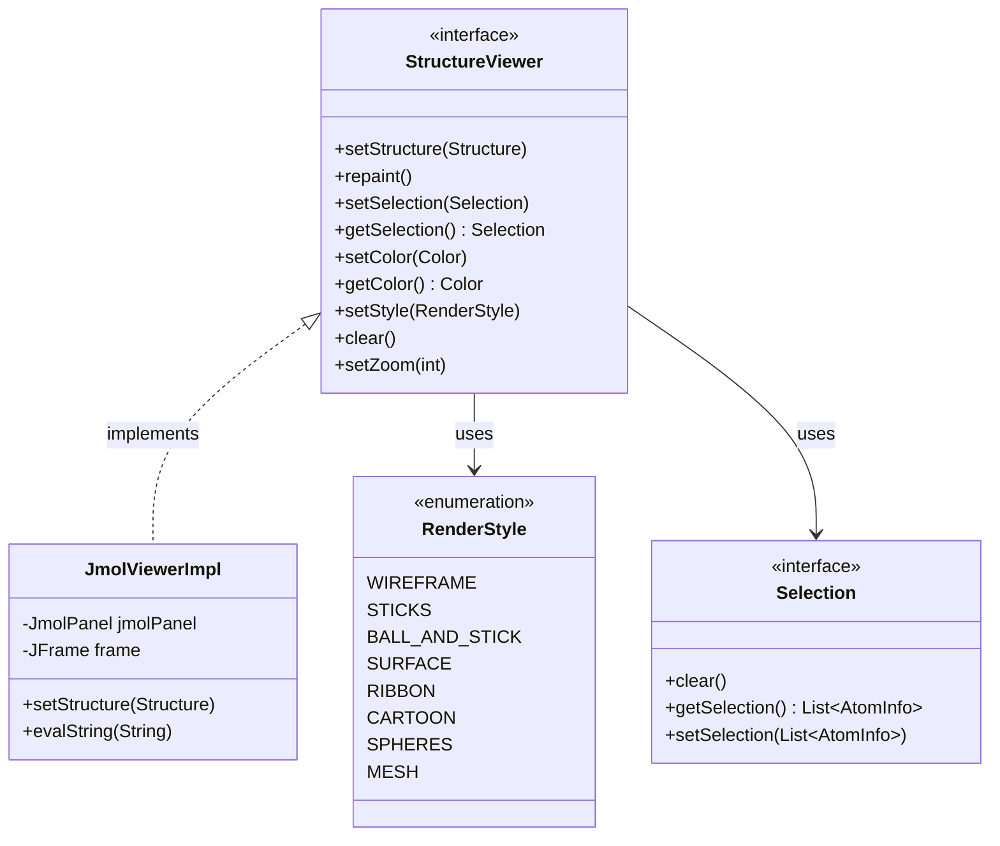

Structure visualization is a critical aspect of bioinformatics that allows researchers to explore and understand the three-dimensional arrangements of biological macromolecules. BioJava provides powerful structure visualization capabilities through its integration with Jmol, a widely-used open-source molecular viewer. This blog post will guide you through how to leverage BioJava's structure visualization components in your applications.

## Why Structure Visualization Matters

Visualizing protein structures helps researchers understand molecular interactions, binding sites, and overall architecture. Whether you're analyzing protein-ligand interactions, studying protein folding, or comparing structural homologs, visualization provides intuitive insights that complement computational analysis. BioJava's visualization tools bridge the gap between structural data analysis and visual exploration.

## Core Visualization Components

BioJava's structure visualization functionality is primarily provided by the `biojava-structure-gui` module, which contains several key components that work together to enable interactive 3D visualization of protein structures.

### StructureViewer Interface

The `StructureViewer` interface defines the contract for all structure visualization implementations in BioJava. It provides methods for setting structures, controlling rendering styles, managing selections, and interacting with the visualization.

```java
public interface StructureViewer {
    public void setStructure(Structure structure);
    public void repaint();
    public void setSelection(Selection selection);
    public Selection getSelection();
    public void setColor(Color color);
    public Color getColor();
    public void setStyle(RenderStyle style);
    public void clear();
    public void setZoom(int i);
}
```

This interface ensures that different visualization implementations can be used interchangeably in your applications.

Sources: [StructureViewer.java](biojava-structure-gui/src/main/java/org/biojava/nbio/structure/gui/StructureViewer.java)

### JmolViewerImpl: The Primary Implementation

The `JmolViewerImpl` class is the main implementation of the `StructureViewer` interface, providing Jmol-based 3D visualization capabilities. It creates a Swing-based GUI window with an embedded Jmol viewer, complete with interactive controls and command input.

Key features of JmolViewerImpl include:
- Interactive 3D visualization with mouse controls
- Support for RASMOL-like scripting commands
- Multiple rendering styles and coloring schemes
- Structure selection and highlighting capabilities

```java
JmolViewerImpl viewer = new JmolViewerImpl();
viewer.setStructure(proteinStructure);
```

Sources: [JmolViewerImpl.java](biojava-structure-gui/src/main/java/org/biojava/nbio/structure/gui/JmolViewerImpl.java)

### RenderStyle Options

BioJava provides various rendering styles through the `RenderStyle` enum, allowing you to control how structures are displayed:

| Render Style | Description |
|--------------|-------------|
| WIREFRAME | Shows only the bonds between atoms |
| STICKS | Displays atoms as small spheres connected by cylinders |
| BALL_AND_STICK | Shows atoms as larger spheres connected by cylinders |
| SURFACE | Displays the molecular surface |
| RIBBON | Shows the protein backbone as a ribbon |
| CARTOON | Displays secondary structure elements as cartoons |
| SPHERES | Shows atoms as spheres |
| MESH | Displays a mesh representation of the surface |

```java
viewer.setStyle(RenderStyle.CARTOON);
```

Sources: [RenderStyle.java](biojava-structure-gui/src/main/java/org/biojava/nbio/structure/gui/RenderStyle.java)

## Quick Start: Visualizing Your First Structure

Let's walk through a simple example of how to load and visualize a protein structure using BioJava:

```java
import org.biojava.nbio.structure.Structure;
import org.biojava.nbio.structure.StructureIO;
import org.biojava.nbio.structure.gui.JmolViewerImpl;

public class SimpleVisualization {
    public static void main(String[] args) {
        try {
            // Load a structure from the PDB
            Structure structure = StructureIO.getStructure("1aoi");
            
            // Create a viewer and display the structure
            JmolViewerImpl viewer = new JmolViewerImpl();
            viewer.setStructure(structure);
            
            // Apply some visualization commands
            viewer.evalString("select *; cartoon on; color chain;");
        } catch (Exception e) {
            e.printStackTrace();
        }
    }
}
```

This simple example loads the structure with PDB code "1aoi" and displays it in a Jmol window with cartoon representation colored by chain.

Sources: [ShowStructureInJmol.java](biojava-structure-gui/src/main/java/demo/ShowStructureInJmol.java)

## Advanced Visualization Techniques

### Customizing Appearance

You can customize the appearance of your structures using Jmol scripting commands:

```java
JmolViewerImpl viewer = new JmolViewerImpl();
viewer.setStructure(structure);

// Apply custom coloring and rendering
viewer.evalString("select protein; cartoon on; color structure;");
viewer.evalString("select ligand; wireframe off; spacefill 200;");
viewer.evalString("select water; spacefill 50%; color blue;");
```

These commands demonstrate how to apply different rendering styles to different parts of your structure.

### Working with Selections

The `Selection` interface allows you to work with selected parts of your structure:

```java
Selection selection = viewer.getSelection();
// Manipulate the selection as needed
viewer.setSelection(selection);
viewer.setColor(Color.RED); // Apply color to the selected parts
```

Sources: [Selection.java](biojava-structure-gui/src/main/java/org/biojava/nbio/structure/gui/Selection.java)

## Architecture Overview

The structure visualization components in BioJava follow a well-defined architecture that separates concerns and promotes flexibility:



This diagram shows how the main components interact. The `StructureViewer` interface defines the contract, while `JmolViewerImpl` provides the concrete implementation using Jmol. The `RenderStyle` and `Selection` interfaces provide additional control over the visualization.

> [!TIP]
> The biojava-structure-gui module depends on Jmol for 3D visualization capabilities. Make sure to include the Jmol dependency in your Maven project when using these visualization components.

## Integration with Other BioJava Components

Structure visualization works seamlessly with other BioJava modules. For example, you can visualize structures after performing alignments or modifications:

```java
// Load and modify a structure
Structure structure = StructureIO.getStructure("1tim");
// ... perform modifications or analysis ...

// Visualize the result
JmolViewerImpl viewer = new JmolViewerImpl();
viewer.setStructure(structure);
viewer.setStyle(RenderStyle.CARTOON);
```

Sources: [biojava-structure/readme.md](biojava-structure/readme.md)

## Conclusion

BioJava's structure visualization capabilities provide a powerful toolkit for exploring protein structures programmatically. By leveraging the Jmol integration through the `StructureViewer` interface, you can create applications that combine computational analysis with interactive visualization. Whether you're building research tools, educational software, or analysis pipelines, BioJava's visualization components offer the flexibility and functionality you need.

The modular architecture ensures that you can use these components independently or integrate them with other BioJava functionality, making it easier to create comprehensive bioinformatics applications that bridge the gap between analysis and visualization.
