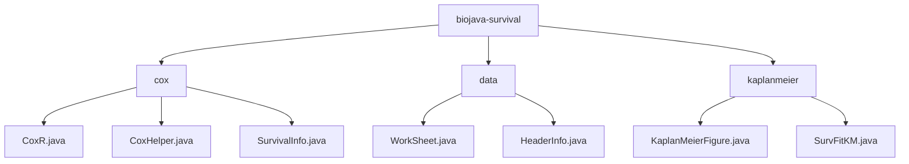
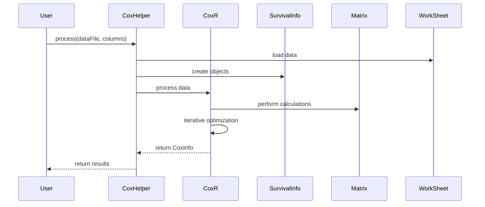

Survival analysis is a crucial statistical method in bioinformatics for analyzing time-to-event data, such as patient survival times, disease progression, or treatment response. The biojava-survival module provides a comprehensive Java implementation of key survival analysis techniques, including **Cox proportional hazards regression** and **Kaplan-Meier survival estimation**, making these powerful statistical methods accessible to Java developers working with biological and clinical data.

## Understanding Survival Analysis in Bioinformatics

Survival analysis deals with analyzing data where the outcome is the time until the occurrence of an event of interest. In bioinformatics, this could be time until death, disease recurrence, or treatment failure. What makes survival analysis unique is its ability to handle **censored data** - cases where we don't know the exact event time because the event hasn't occurred yet or the subject was lost to follow-up.

The biojava-survival module implements two fundamental approaches:

1. **Kaplan-Meier Estimation**: A non-parametric method used to estimate the survival function from lifetime data
2. **Cox Proportional Hazards Model**: A semi-parametric regression model for analyzing the effect of multiple variables on survival time

Sources: [CoxMethod.java#L27-L36](biojava-survival/src/main/java/org/biojava/nbio/survival/cox/CoxMethod.java#L27-L36), [SurvFitKM.java#L44-L50](biojava-survival/src/main/java/org/biojava/nbio/survival/kaplanmeier/figure/SurvFitKM.java#L44-L50)

## Module Architecture and Key Components

The biojava-survival module is organized into three main packages, each serving a specific purpose in the survival analysis workflow:



### Core Data Structures

At the heart of the module are two key data structures:

**SurvivalInfo**: Represents individual survival data points with essential information:
- `time`: The survival time or censoring time
- `status`: Event indicator (1=event occurred, 0=censored)
- `data`: LinkedHashMap containing covariates and their values
- Additional fields for weights, strata, and cluster information

**WorkSheet**: A memory-efficient data structure for handling large datasets, similar to a spreadsheet but optimized for performance with biological data.

Sources: [SurvivalInfo.java#L34-L54](biojava-survival/src/main/java/org/biojava/nbio/survival/cox/SurvivalInfo.java#L34-L54), [WorkSheet.java#L32-L38](biojava-survival/src/main/java/org/biojava/nbio/survival/data/WorkSheet.java#L32-L38)

## Getting Started with Cox Regression

The Cox proportional hazards model is the most widely used regression model for survival analysis. It allows you to examine the effect of multiple variables on survival time without needing to specify the underlying survival distribution.

### Basic Cox Regression Analysis

Here's how to perform a simple Cox regression analysis using the CoxHelper class:

```java
// Load survival data from a tab-delimited file
String dataFile = "path/to/your/data.txt";
String timeColumn = "TIME";
String statusColumn = "CENSOR";
String[] variables = {"AGE", "TREATMENT", "RACE"};

// Perform Cox regression
CoxHelper coxHelper = new CoxHelper();
CoxInfo coxInfo = coxHelper.process(dataFile, timeColumn, statusColumn, 
                                   "", "", "", variables, false, false);

// Get results
double[] coefficients = coxInfo.getCoefficients();
double[] pValues = coxInfo.getPValues();
```

The results include:
- **Coefficients**: Log hazard ratios for each variable
- **P-values**: Statistical significance of each variable
- **Confidence intervals**: Range of plausible values for hazard ratios
- **Model fit statistics**: Overall model performance measures

Sources: [CoxHelper.java#L29-L50](biojava-survival/src/main/java/org/biojava/nbio/survival/cox/CoxHelper.java#L29-L50), [uis-complete.txt#L1-L20](biojava-survival/src/main/resources/uis-complete.txt#L1-L20)

### Advanced Cox Regression Features

The module supports advanced features for more sophisticated analyses:

```java
// Cox regression with strata and weights
CoxInfo coxInfo = coxHelper.process(dataFile, timeColumn, statusColumn,
                                   "WEIGHT", "STRATA", "", variables, true, true);

// Using different methods for handling tied events
CoxMethod method = CoxMethod.Efron; // or CoxMethod.Breslow
CoxR coxR = new CoxR();
coxR.process(survivalDataList, method, maxIterations, tolerance);
```

> [!TIP]
> The choice between Breslow and Efron methods depends on your data. Breslow is faster but less accurate when many events occur at the same time. Efron provides better accuracy for tied events but requires more computational resources.

Sources: [CoxMethod.java#L27-L36](biojava-survival/src/main/java/org/biojava/nbio/survival/cox/CoxMethod.java#L27-L36), [CoxR.java#L33-L42](biojava-survival/src/main/java/org/biojava/nbio/survival/cox/CoxR.java#L33-L42)

## Kaplan-Meier Survival Analysis

Kaplan-Meier analysis is used to estimate and visualize survival curves, showing the probability of survival over time for different groups.

### Creating Survival Curves

```java
// Prepare survival data
ArrayList<SurvivalInfo> survivalData = new ArrayList<>();
survivalData.add(new SurvivalInfo(10, 1, "GROUP", 1)); // time=10, event=1, group=1
survivalData.add(new SurvivalInfo(15, 0, "GROUP", 1)); // time=15, censored=0, group=1
survivalData.add(new SurvivalInfo(8, 1, "GROUP", 2));  // time=8, event=1, group=2

// Perform Kaplan-Meier analysis
SurvFitKM survFit = new SurvFitKM();
SurvFitInfo survFitInfo = survFit.process(survivalData, "GROUP");

// Create visualization
KaplanMeierFigure kmFigure = new KaplanMeierFigure();
kmFigure.generateFigure(survFitInfo, "Survival Analysis by Treatment Group");
```

### Interpreting Kaplan-Meier Curves

The Kaplan-Meier figure shows:
- **Y-axis**: Survival probability (from 1.0 to 0.0)
- **X-axis**: Time
- **Steps**: Drops indicate events (deaths/failures)
- **Tick marks**: Indicate censored observations
- **Multiple curves**: Different groups can be compared on the same plot

Sources: [KaplanMeierFigure.java#L41-L50](biojava-survival/src/main/java/org/biojava/nbio/survival/kaplanmeier/figure/KaplanMeierFigure.java#L41-L50), [SurvFitKM.java#L34-L38](biojava-survival/src/main/java/org/biojava/nbio/survival/kaplanmeier/figure/SurvFitKM.java#L34-L38)

## Data Preparation and Best Practices

### Working with Clinical Data

The module includes example data in `uis-complete.txt` that demonstrates the typical format for survival analysis:

```
ID	AGE	BECKTOTA	HERCOC	IVHX	NDRUGTX	RACE	TREAT	SITE	LOS	TIME	CENSOR
101	33	.	.	.	6	0	1	0	2	2	1
152	22	.	.	.	3	0	1	0	3	3	1
```

Key columns for survival analysis:
- **TIME**: Survival time or time to event
- **CENSOR**: Event indicator (1=event, 0=censored)
- **Other columns**: Covariates for analysis

### Data Quality Considerations

When preparing data for survival analysis:

1. **Handle missing values**: The module can handle missing data (marked as ".")
2. **Ensure proper time units**: Consistent time units across all observations
3. **Verify censoring status**: Correct coding of events vs. censored observations
4. **Check for outliers**: Extreme values can significantly affect results

Sources: [uis-complete.txt#L1-L20](biojava-survival/src/main/resources/uis-complete.txt#L1-L20), [SurvivalInfo.java#L60-L96](biojava-survival/src/main/java/org/biojava/nbio/survival/cox/SurvivalInfo.java#L60-L96)

## Internal Architecture and Performance

The biojava-survival module is designed for performance with large biological datasets:

### Memory Optimization

- **CompactCharSequence**: Used in WorkSheet to minimize memory footprint
- **Efficient data structures**: LinkedHashMap for fast lookups while maintaining order
- **Stream processing**: Large files can be processed without loading everything into memory

### Algorithm Implementation

The Cox regression implementation is a port of R's survival package, adapted for Java's object-oriented paradigm:



The algorithm uses:
- **Newton-Raphson optimization**: For finding maximum likelihood estimates
- **Cholesky decomposition**: For matrix operations in variance calculations
- **Efficient handling of ties**: Both Breslow and Efron methods implemented

Sources: [CoxR.java#L53-L95](biojava-survival/src/main/java/org/biojava/nbio/survival/cox/CoxR.java#L53-L95), [WorkSheet.java#L26-L38](biojava-survival/src/main/java/org/biojava/nbio/survival/data/WorkSheet.java#L26-L38)

## Integration with Other BioJava Modules

The survival analysis module can be integrated with other BioJava components for comprehensive bioinformatics analysis:

### Combining with Structure Analysis

```java
// Analyze protein structure features and survival
ProteinStructure structure = StructureIO.getStructure("protein.pdb");
double stabilityScore = calculateStability(structure);

// Add to survival data
SurvivalInfo survInfo = new SurvivalInfo(survivalTime, eventStatus);
survInfo.getData().put("PROTEIN_STABILITY", stabilityScore);
```

### Integration with Sequence Analysis

```java
// Analyze sequence features and correlate with survival
DNASequence sequence = new DNASequence(dnaString);
double gcContent = sequence.getGCContent();

SurvivalInfo survInfo = new SurvivalInfo(survivalTime, eventStatus);
survInfo.getData().put("GC_CONTENT", gcContent);
```

This integration allows researchers to investigate relationships between molecular features and clinical outcomes, enabling precision medicine applications.

> [!TIP]
> When integrating multiple data types, ensure proper normalization of features. Different scales (e.g., protein stability scores vs. gene expression levels) can affect model convergence and interpretation.

Sources: [pom.xml#L21-L50](biojava-survival/pom.xml#L21-L50), [SurvivalInfo.java#L48-L54](biojava-survival/src/main/java/org/biojava/nbio/survival/cox/SurvivalInfo.java#L48-L54)

## Conclusion

The biojava-survival module provides a robust, Java-based implementation of essential survival analysis methods. By offering both Cox regression and Kaplan-Meier analysis with comprehensive visualization capabilities, it enables bioinformaticians to:

1. **Analyze time-to-event data** with proper handling of censored observations
2. **Identify prognostic factors** using multivariate Cox regression
3. **Visualize survival patterns** with publication-ready Kaplan-Meier curves
4. **Integrate molecular data** with clinical outcomes for biomarker discovery

Whether you're analyzing clinical trial data, studying disease progression, or investigating the relationship between molecular features and patient outcomes, the biojava-survival module provides the statistical tools needed for rigorous survival analysis in a Java environment.

The module's efficient implementation, comprehensive feature set, and integration capabilities make it a valuable addition to any bioinformatician's toolkit for survival analysis applications.