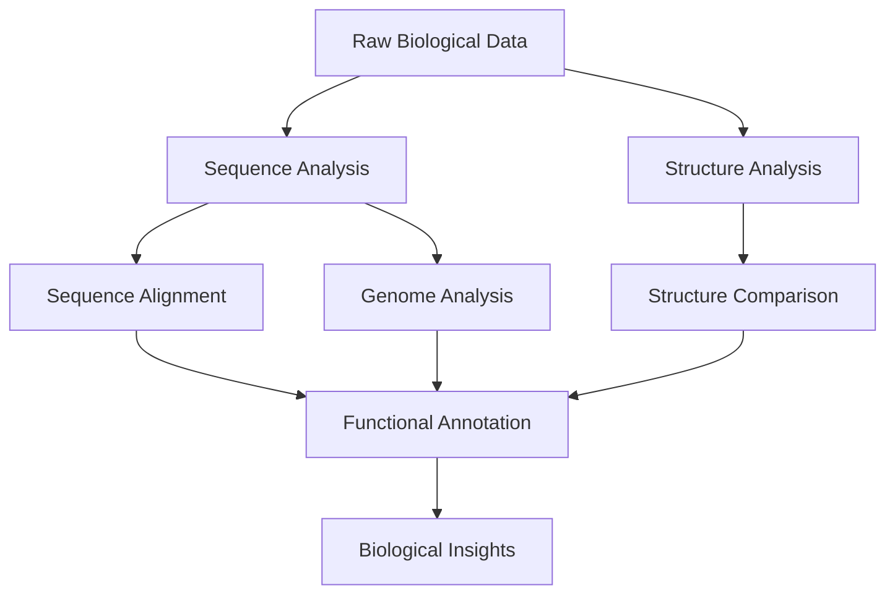

Bioinformatics is an interdisciplinary field that combines biology, computer science, and statistics to analyze and interpret biological data. As a developer working with BioJava, understanding these fundamental concepts will help you leverage the library effectively for your bioinformatics applications. This guide introduces the key bioinformatics concepts that form the foundation of BioJava's functionality.

## What is Bioinformatics?

Bioinformatics is the application of computational techniques to analyze and manage biological data. It encompasses a wide range of activities from collecting and storing biological information to analyzing complex datasets and modeling biological systems. Think of it as the bridge between raw biological data and meaningful biological insights.

In BioJava, these concepts are implemented as modular components that you can use individually or together to build sophisticated bioinformatics applications. Each module focuses on specific aspects of biological data analysis, making it easier to work with complex biological problems in a structured way.

## Core Biological Data Types

### Sequences

Sequences are the fundamental building blocks of bioinformatics. They represent the linear arrangement of biological molecules such as DNA, RNA, and proteins. In BioJava, sequences are represented as strings of characters where each character corresponds to a specific biological unit:

- **DNA sequences**: Composed of nucleotides (A, T, G, C)
- **RNA sequences**: Composed of nucleotides (A, U, G, C)
- **Protein sequences**: Composed of amino acids (represented by 20 standard letters)

```java
// Creating a DNA sequence in BioJava
DNASequence dnaSeq = new DNASequence("ATGCGATCGTAGC");
System.out.println("DNA Sequence: " + dnaSeq.getSequenceAsString());

// Creating a protein sequence
ProteinSequence proteinSeq = new ProteinSequence("MAGLRHLLVA");
System.out.println("Protein Sequence: " + proteinSeq.getSequenceAsString());
```

Sources: [README.md#L7](README.md#L7)

### Structures

Biological structures refer to the three-dimensional arrangements of molecules, particularly proteins. Understanding protein structure is crucial because the structure determines the function of a protein. BioJava provides comprehensive tools for working with protein structures:

```java
// Loading a protein structure from PDB file
Structure structure = StructureIO.getStructure("4HHB");
System.out.println("Protein structure loaded: " + structure.getPDBCode());

// Accessing chains in the structure
for (Chain chain : structure.getChains()) {
    System.out.println("Chain " + chain.getChainID() + " has " + 
                      chain.getAtomGroups().size() + " groups");
}
```

Sources: [biojava-structure/readme.md#L12-L16](biojava-structure/readme.md#L12-L16), [pom.xml#L725](pom.xml#L725)

## Key Bioinformatics Concepts

### Sequence Alignment

Sequence alignment is the process of arranging two or more sequences to identify regions of similarity. This is one of the most fundamental operations in bioinformatics, used to:

- Identify functional or evolutionary relationships between sequences
- Find conserved regions across species
- Predict the function of unknown sequences

BioJava provides both pairwise and multiple sequence alignment algorithms:

```java
// Pairwise sequence alignment
Sequence<DNASequence, NucleotideCompound> seq1 = new DNASequence("ATGCGATCGTAGC");
Sequence<DNASequence, NucleotideCompound> seq2 = new DNASequence("ATGCGTTAGTAC");

SimpleGapPenalty gapPenalty = new SimpleGapPenalty((short)5, (short)2);
SubstitutionMatrix<NucleotideCompound> matrix = SubstitutionMatrixHelper.getNuc4_2();

PairwiseSequenceAligner<Sequence<DNASequence, NucleotideCompound>, NucleotideCompound> aligner = 
    Alignments.getPairwiseAligner(seq1, seq2, PairwiseSequenceAlignerType.LOCAL, gapPenalty, matrix);

SequencePair<Sequence<DNASequence, NucleotideCompound>, NucleotideCompound> alignment = aligner.getAlignment();
System.out.println("Alignment score: " + alignment.getScore());
```

Sources: [pom.xml#L724](pom.xml#L724)

### Genome Analysis

Genome analysis involves studying the complete set of DNA in an organism, including all of its genes. This field encompasses:

- Gene prediction and annotation
- Genome assembly from short reads
- Comparative genomics
- Identification of genetic variations

BioJava's genome module provides tools for working with genomic data at various scales:

```java
// Working with genomic features
ChromosomeSequence chr1 = new ChromosomeSequence("chr1");
chr1.addFeature(new GeneFeature("gene1", 1000, 5000, Strand.POSITIVE));
chr1.addFeature(new GeneFeature("gene2", 6000, 9000, Strand.NEGATIVE));

// Iterating through features
for (GeneFeature feature : chr1.getFeatures()) {
    System.out.println("Found feature: " + feature.getName() + 
                      " at " + feature.getStart() + "-" + feature.getEnd());
}
```

Sources: [pom.xml#L727](pom.xml#L727)

### Protein Structure Analysis

Protein structure analysis involves studying the 3D arrangement of atoms in a protein molecule. Key concepts include:

- **Primary structure**: The linear sequence of amino acids
- **Secondary structure**: Local folding patterns (alpha helices, beta sheets)
- **Tertiary structure**: Overall 3D fold of the protein
- **Quaternary structure**: Arrangement of multiple protein chains

BioJava provides comprehensive tools for protein structure analysis:

```java
// Loading and analyzing protein structure
Structure structure = StructureIO.getStructure("1TIM");

// Calculating secondary structure
SecStrucCalc ssCalc = new SecStrucCalc();
ssCalc.calculate(structure);

// Accessing secondary structure elements
for (Chain chain : structure.getChains()) {
    for (Group group : chain.getAtomGroups()) {
        if (group instanceof AminoAcid) {
            AminoAcid aa = (AminoAcid) group;
            SecStrucType ssType = aa.getSecStrucType();
            System.out.println("Residue " + aa.getResidueNumber() + 
                              " has secondary structure: " + ssType);
        }
    }
}
```

Sources: [biojava-structure/readme.md#L12-L16](biojava-structure/readme.md#L12-L16), [pom.xml#L725](pom.xml#L725)

### Protein Disorder Prediction

Protein disorder refers to regions of proteins that lack a fixed three-dimensional structure. These intrinsically disordered regions are important for:

- Protein-protein interactions
- Signaling pathways
- Regulatory functions

BioJava provides tools for predicting protein disorder:

```java
// Predicting protein disorder
ProteinSequence sequence = new ProteinSequence("MAGLRHLLVALRILLLVLVSS");
DisorderPredictor predictor = new DisoRDPredictor();
DisorderPrediction prediction = predictor.predict(sequence);

// Accessing disorder scores
for (int i = 0; i < sequence.getLength(); i++) {
    double score = prediction.getDisorderScore(i + 1); // 1-based indexing
    System.out.println("Position " + (i + 1) + " disorder score: " + score);
}
```

Sources: [pom.xml#L730](pom.xml#L730)

### Amino Acid Properties

Amino acids are the building blocks of proteins, and each has unique chemical properties that influence protein structure and function. Key properties include:

- Hydrophobicity
- Charge
- Size
- Flexibility
- Propensity to form secondary structures

BioJava provides tools for calculating and analyzing these properties:

```java
// Calculating amino acid properties
ProteinSequence sequence = new ProteinSequence("MAGLRHLLVA");
AminoAcidPropertiesCalculator calc = new AminoAcidPropertiesCalculator();

// Calculate various properties
double hydrophobicity = calc.getHydrophobicity(sequence);
double charge = calc.getCharge(sequence, 7.0); // at pH 7.0
double molecularWeight = calc.getMolecularWeight(sequence);

System.out.println("Hydrophobicity: " + hydrophobicity);
System.out.println("Charge at pH 7.0: " + charge);
System.out.println("Molecular weight: " + molecularWeight);
```

Sources: [pom.xml#L731](pom.xml#L731)

### Ontology Support

Ontologies in bioinformatics are controlled vocabularies that describe biological concepts and their relationships. They provide a standardized way to annotate and analyze biological data. BioJava supports various biological ontologies including:

- Gene Ontology (GO)
- Sequence Ontology (SO)
- Protein Ontology (PRO)

```java
// Working with Gene Ontology terms
GOTerm goTerm = new GOTerm("GO:0008150"); // biological_process
System.out.println("GO Term: " + goTerm.getName());
System.out.println("Definition: " + goTerm.getDefinition());

// Finding parent and child terms
for (GOTerm parent : goTerm.getParents()) {
    System.out.println("Parent: " + parent.getName());
}
```

Sources: [pom.xml#L733](pom.xml#L733)

### Web Services Integration

Bioinformatics often requires accessing remote databases and services. BioJava provides integration with various bioinformatics web services:

- PDB (Protein Data Bank)
- UniProt
- NCBI services
- BLAST services

```java
// Accessing PDB through web services
PDBFileReader reader = new PDBFileReader();
reader.setPath("/path/to/pdb/files");

// Downloading a structure
Structure structure = reader.getStructureById("4HHB");
System.out.println("Downloaded structure: " + structure.getPDBCode());
```

Sources: [pom.xml#L729](pom.xml#L729)

## Bioinformatics Data Formats

BioJava supports parsing and writing various bioinformatics file formats:

| Format Type | Common Formats | Description |
|-------------|---------------|-------------|
| Sequence | FASTA, GenBank, EMBL | Formats for storing sequence data |
| Structure | PDB, mmCIF | Formats for storing 3D structures |
| Alignment | CLUSTAL, Stockholm | Formats for storing sequence alignments |
| Annotation | GFF, GTF | Formats for storing genomic annotations |

```java
// Reading different sequence formats
// FASTA format
FastaReader<DNASequence, NucleotideCompound> fastaReader = 
    new FastaReader<DNASequence, NucleotideCompound>(
        new File("sequences.fasta"), 
        new DNASequenceCreator());
LinkedHashMap<String, DNASequence> fastaSequences = fastaReader.process();

// GenBank format
GenbankReader<ProteinSequence, AminoAcidCompound> genbankReader = 
    new GenbankReader<ProteinSequence, AminoAcidCompound>(
        new File("sequence.gb"), 
        new ProteinSequenceCreator());
ProteinSequence genbankSequence = genbankReader.readSequence();
```

Sources: [README.md#L7](README.md#L7)

## Putting It All Together

The real power of BioJava comes from combining these concepts to solve complex biological problems. Here's a conceptual workflow that demonstrates how these concepts work together:



> [!TIP]
> When working with BioJava, remember that each module is designed to work independently but can also be combined with other modules for more complex analyses. Start with the core module for basic sequence operations, then add other modules as needed for specific tasks.

## Next Steps

Now that you understand the key concepts in bioinformatics that BioJava addresses, you're ready to dive deeper into specific modules and their APIs. The next guide, [Module Organization](5-module-organization), will show you how BioJava is structured and how to choose the right modules for your specific bioinformatics tasks.
