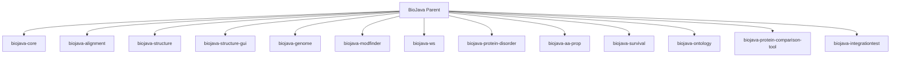
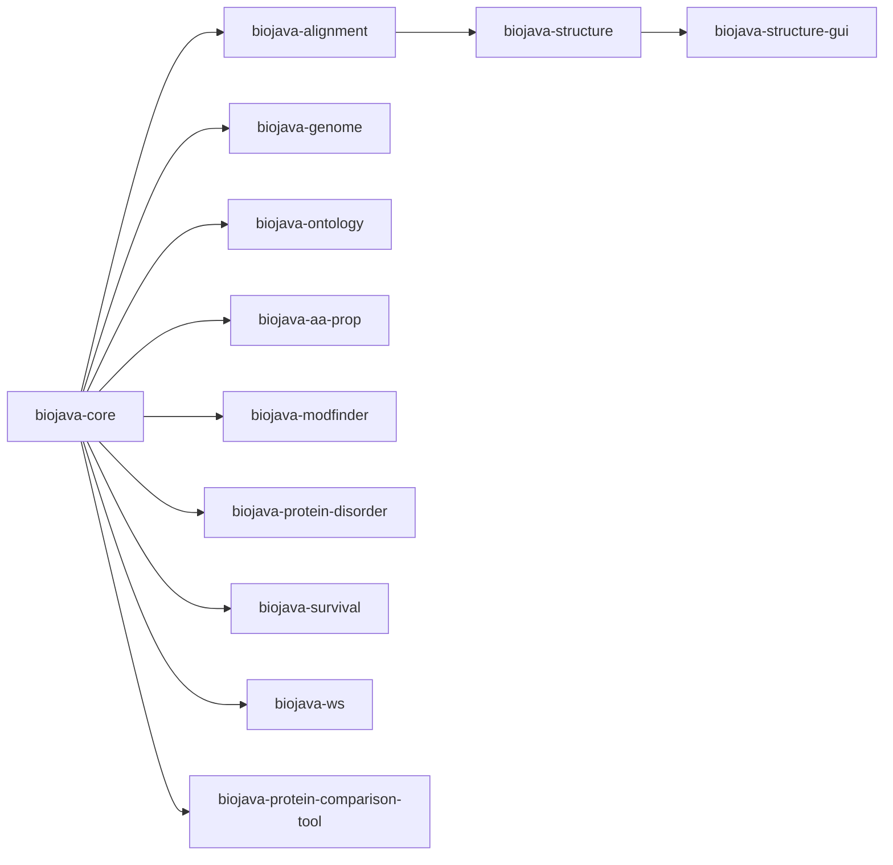

BioJava is designed as a modular framework, allowing developers to use only the components they need for their specific bioinformatics tasks. This modular architecture keeps the library lightweight and flexible while providing comprehensive functionality for biological data analysis.

## Understanding BioJava's Modular Architecture

BioJava follows a **multi-module Maven project structure** where each module focuses on a specific domain of bioinformatics. This design approach allows for better maintainability, reduced dependencies, and targeted functionality. The project is organized with a parent POM that coordinates all child modules, ensuring consistent versioning and dependency management across the entire framework.

The modular architecture offers several key advantages:
- **Selective Usage**: You can include only the modules relevant to your project
- **Reduced Footprint**: Smaller applications by avoiding unnecessary dependencies
- **Clear Separation of Concerns**: Each module has a well-defined purpose
- **Independent Development**: Modules can be developed and updated independently

## Core Modules Overview

BioJava consists of **13 main modules**, each serving a specific purpose in the bioinformatics landscape:

Sources: [pom.xml#L721-L737](pom.xml#L721-L737)

### Foundation Module: biojava-core

The **biojava-core** module serves as the foundation for the entire BioJava framework. It provides essential data structures, interfaces, and utilities that other modules build upon. This module contains fundamental classes for representing biological sequences, basic I/O operations, and core utilities that are used throughout the framework.

Key features of biojava-core include:
- Basic sequence representations and manipulations
- Core data structures for biological entities
- Fundamental I/O utilities
- Common utilities and helper classes

The core module has minimal external dependencies, primarily relying on logging frameworks (SLF4J with Log4j2) and XML binding libraries (Jakarta XML Bind). This lightweight design makes it an ideal starting point for any BioJava-based application.

Sources: [biojava-core/pom.xml](biojava-core/pom.xml)

### Sequence Analysis: biojava-alignment

The **biojava-alignment** module extends the core functionality with sequence alignment capabilities. It builds upon biojava-core and adds specialized algorithms and data structures for comparing biological sequences. This module is essential for tasks involving sequence similarity, evolutionary analysis, and comparative genomics.

Key features include:
- Multiple sequence alignment algorithms
- Pairwise sequence alignment implementations
- Support for various alignment scoring schemes
- Integration with the Forester library for phylogenetic analysis

The alignment module depends on biojava-core and includes the Forester library as a third-party dependency for advanced phylogenetic tree operations.

Sources: [biojava-alignment/pom.xml#L48-L56](biojava-alignment/pom.xml#L48-L56)

### Protein Structure Analysis: biojava-structure

The **biojava-structure** module is one of the most comprehensive components, providing tools for protein structure analysis and manipulation. This module enables developers to work with 3D protein structures from the Protein Data Bank (PDB) and other structural biology file formats.

Key capabilities include:
- Loading and parsing protein structure files (PDB, mmCIF)
- Structure manipulation and analysis
- Geometric calculations and measurements
- Integration with modern structure file formats (MMTF)

This module has richer dependencies, including:
- **biojava-core** and **biojava-alignment** as foundational modules
- **MMTF libraries** for efficient structure file handling
- **CIF tools** for crystallographic information file processing
- **JGraphT** for graph-based structure analysis
- **Jackson** for JSON processing
- **Vecmath** for 3D vector mathematics

The protein structure modules provide an API that allows to maintain local installations of PDB, load structures and manipulate them, and perform standard analysis such as sequence and structure alignments.

Sources: [biojava-structure/pom.xml#L52-L62](biojava-structure/pom.xml#L52-L62), [biojava-structure/readme.md#L12-L18](biojava-structure/readme.md#L12-L18)

## Specialized Modules

Beyond the core functionality, BioJava includes several specialized modules that address specific bioinformatics domains:

### Protein-Focused Modules

- **biojava-structure-gui**: Provides visualization capabilities for protein structures, building upon the structure module to offer interactive 3D visualization.
- **biojava-protein-disorder**: Implements algorithms for predicting intrinsically disordered regions in proteins.
- **biojava-aa-prop**: Calculates various physicochemical properties of amino acids and proteins.
- **biojava-protein-comparison-tool**: Offers specialized utilities for comparing protein sequences and structures.

### Genomics and Advanced Analysis

- **biojava-genome**: Provides tools for genome-scale analysis, including handling large genomic sequences and annotations.
- **biojava-modfinder**: Specialized in identifying post-translational modifications in protein sequences.
- **biojava-survival**: Implements statistical methods for survival analysis, commonly used in biomedical research.

### Integration and Support Modules

- **biojava-ontology**: Handles biological ontologies and controlled vocabularies, essential for standardized data representation.
- **biojava-ws**: Provides web service integration capabilities, allowing BioJava to interact with external bioinformatics resources.
- **biojava-integrationtest**: Contains integration tests that verify the compatibility and interaction between different modules.

## Module Dependencies and Interactions

The modules in BioJava are designed with a clear dependency hierarchy that ensures stability and prevents circular dependencies:

This hierarchical structure ensures that:
- **biojava-core** remains the foundation with no dependencies on other BioJava modules
- Specialized modules build upon the core or other foundational modules
- Integration tests can validate the entire ecosystem
- Clear separation of concerns is maintained throughout the framework

> [!TIP]
> When starting a new BioJava project, begin with biojava-core and only add additional modules as needed. This approach minimizes dependencies and keeps your application lightweight.

## Choosing the Right Modules for Your Project

Selecting the appropriate modules depends on your specific bioinformatics needs:

| Use Case | Recommended Modules | Description |
|----------|-------------------|-------------|
| Basic sequence operations | biojava-core | Fundamental sequence handling and manipulation |
| Sequence alignment analysis | biojava-core, biojava-alignment | Pairwise and multiple sequence alignments |
| Protein structure analysis | biojava-core, biojava-alignment, biojava-structure | 3D structure loading, manipulation, and analysis |
| Protein visualization | biojava-core, biojava-alignment, biojava-structure, biojava-structure-gui | Interactive 3D structure visualization |
| Genome-scale analysis | biojava-core, biojava-genome | Large genomic sequence processing |
| Protein property calculation | biojava-core, biojava-aa-prop | Physicochemical property calculations |
| Web service integration | biojava-core, biojava-ws | Access to external bioinformatics resources |

## Best Practices for Module Usage

When working with BioJava's modular architecture, follow these best practices:

1. **Start Minimal**: Begin with only biojava-core and add modules as needed
2. **Understand Dependencies**: Be aware of transitive dependencies when adding modules
3. **Version Consistency**: Ensure all modules use the same version (managed by parent POM)
4. **Leverage Integration Tests**: Use biojava-integrationtest to verify module compatibility
5. **Check Module Documentation**: Each module may have specific documentation in its README file

The modular design of BioJava reflects the diverse nature of bioinformatics applications, allowing developers to create tailored solutions that are both powerful and efficient. By understanding the module organization, you can make informed decisions about which components to include in your projects, ensuring optimal performance and functionality.
