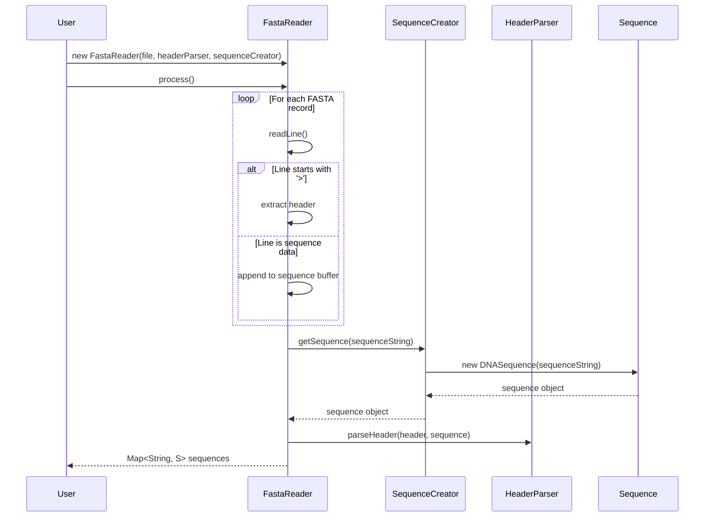

In the world of bioinformatics, data comes in many formats and represents complex biological information. BioJava provides a robust framework for handling this data through well-designed data models and flexible parsers. Understanding these components is essential for effectively working with biological sequences and structures in Java.

## Core Data Models

At the heart of BioJava's architecture are the fundamental data models that represent biological sequences. The primary interface is `Sequence<C extends Compound>`, which defines a collection of compounds (nucleotides, amino acids, etc.) with biological indexing. This interface provides essential methods for sequence manipulation:

```java
public interface Sequence<C extends Compound> extends Iterable<C>, Accessioned {
    public int getLength();
    public C getCompoundAt(int position);
    public int getIndexOf(C compound);
    public String getSequenceAsString();
    public SequenceView<C> getSubSequence(Integer start, Integer end);
    public CompoundSet<C> getCompoundSet();
}
```

The `Sequence` interface uses 1-based indexing, following biological convention rather than computer science's 0-based indexing. This design choice makes BioJava more intuitive for biologists and reduces off-by-one errors when working with genomic coordinates.

### Concrete Sequence Implementations

BioJava provides several concrete implementations for different types of biological sequences:

| Sequence Type | Class | Compound Type | Use Case |
|---------------|-------|---------------|----------|
| DNA | `DNASequence` | `NucleotideCompound` | Genomic DNA, mitochondrial DNA, plasmids |
| RNA | `RNASequence` | `NucleotideCompound` | mRNA, tRNA, rRNA |
| Protein | `ProteinSequence` | `AminoAcidCompound` | Polypeptide chains, proteins |

For example, creating a DNA sequence is straightforward:

```java
try {
    DNASequence dnaSeq = new DNASequence("ATGCGTAACGT");
    System.out.println("Length: " + dnaSeq.getLength());
    System.out.println("Sequence: " + dnaSeq.getSequenceAsString());
} catch (CompoundNotFoundException e) {
    e.printStackTrace();
}
```

The `DNASequence` class extends `AbstractSequence<NucleotideCompound>` and adds DNA-specific functionality like transcription to RNA:

```java
public DNASequence(String seqString) throws CompoundNotFoundException {
    super(seqString, DNACompoundSet.getDNACompoundSet());
}
```

This constructor creates a DNA sequence using the default DNA compound set, which validates that only valid nucleotides (A, T, G, C) are present in the sequence.

## Parser Architecture

BioJava's parser architecture is designed to be flexible and extensible, supporting multiple file formats while maintaining a consistent interface. The parsers follow a template pattern with clear separation of concerns:

### Key Parser Components

1. **Sequence Readers**: Classes that read from input streams and parse sequence data
2. **Header Parsers**: Handle metadata associated with sequences
3. **Sequence Creators**: Factory objects that create appropriate sequence objects
4. **Format-specific Parsers**: Specialized parsers for different file formats

The `FastaReader<S extends Sequence<?>, C extends Compound>` class exemplifies this architecture. It's designed to parse FASTA files, one of the most common formats in bioinformatics:

```java
public class FastaReader<S extends Sequence<?>, C extends Compound> {
    SequenceCreatorInterface<C> sequenceCreator;
    SequenceHeaderParserInterface<S,C> headerParser;
    BufferedReaderBytesRead br;
    // ... other fields
}
```

### FASTA Parsing Process

The FASTA parsing logic demonstrates how BioJava handles file parsing efficiently:



The parser processes FASTA files line by line, identifying headers (lines starting with '>') and accumulating sequence data. When a new header is encountered, it signals the completion of the previous sequence, which is then created and added to the result map.

### Supported File Formats

BioJava supports parsing various bioinformatics file formats through specialized readers:

| Format | Reader Class | Description |
|--------|-------------|-------------|
| FASTA | `FastaReader` | Simple sequence format with headers |
| GenBank | `GenbankReader` | NCBI GenBank format with rich annotations |
| EMBL | `EmblReader` | EMBL/EBI sequence database format |
| ABIF | `ABITrace` | Applied Biosystems trace files |

Each reader follows a similar pattern but handles format-specific details. For example, the `GenbankReader` parses complex feature annotations, while the `FastaReader` focuses on simple sequence and header parsing.

## Working with Parsers

Using BioJava parsers is straightforward. Here's how to read a FASTA file containing DNA sequences:

```java
File fastaFile = new File("sequences.fasta");
FastaReader<DNASequence, NucleotideCompound> fastaReader = 
    new FastaReader<>(
        fastaFile,
        new GenericFastaHeaderParser<DNASequence, NucleotideCompound>(),
        new DNASequenceCreator()
    );

Map<String, DNASequence> sequences = fastaReader.process();
for (Map.Entry<String, DNASequence> entry : sequences.entrySet()) {
    System.out.println("ID: " + entry.getKey());
    System.out.println("Sequence: " + entry.getValue().getSequenceAsString());
}
fastaReader.close();
```

For convenience, BioJava provides helper classes that simplify common parsing tasks:

```java
// Using FastaReaderHelper for quick parsing
Map<String, DNASequence> sequences = 
    FastaReaderHelper.readFastaDNASequence(new File("sequences.fasta"));
```

> [!TIP]
> When working with large sequence files, consider using the `process(int max)` method instead of `process()` to limit memory usage. This allows you to process sequences in batches rather than loading everything at once.

## Compound System

BioJava's compound system represents the individual units that make up biological sequences. The `Compound` interface is the foundation, with specialized implementations for different types:

- `NucleotideCompound`: Represents DNA and RNA nucleotides
- `AminoAcidCompound`: Represents amino acids in proteins
- `CompoundSet`: Defines valid compounds and their relationships

This system ensures type safety and validates sequence data. For example, attempting to create a DNA sequence with invalid characters will throw a `CompoundNotFoundException`:

```java
try {
    DNASequence invalidSeq = new DNASequence("ATGCX123"); // X and 1,2,3 are invalid
} catch (CompoundNotFoundException e) {
    System.out.println("Invalid nucleotide detected: " + e.getMessage());
}
```

## Extending the Framework

BioJava's data models and parsers are designed to be extensible. You can create custom sequence types, parsers for new formats, or specialized compound sets. For example, to create a parser for a custom file format, you would:

1. Implement `SequenceParserInterface` for parsing logic
2. Implement `SequenceHeaderParserInterface` for header handling
3. Implement `SequenceCreatorInterface` for object creation
4. Create a main reader class that coordinates these components

This modular architecture allows BioJava to adapt to new bioinformatics data formats and requirements while maintaining backward compatibility.

## Conclusion

BioJava's data models and parsers provide a solid foundation for bioinformatics applications in Java. The combination of well-designed interfaces, concrete implementations, and flexible parsing architecture makes it easier to work with biological data while ensuring correctness and type safety. Whether you're working with DNA, RNA, or protein sequences, BioJava offers the tools you need to parse, manipulate, and analyze biological information effectively.
