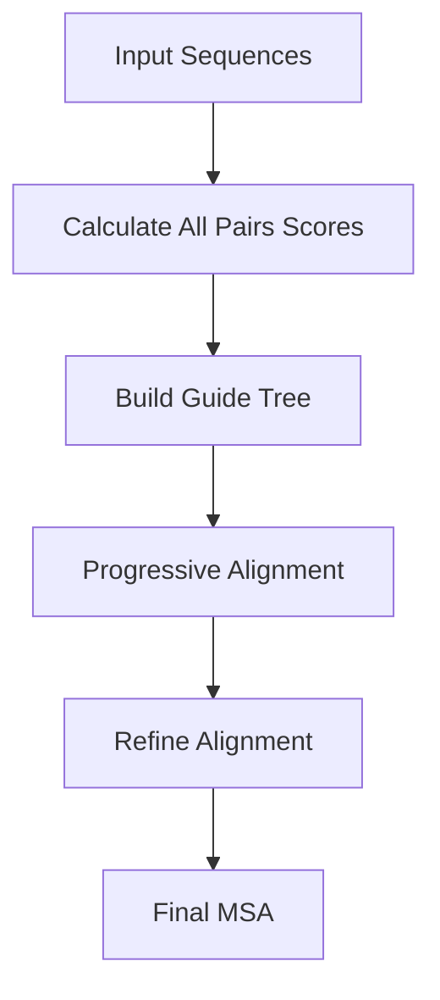

Sequence alignment is a fundamental technique in bioinformatics that compares DNA, RNA, or protein sequences to identify regions of similarity. These similarities can help us understand evolutionary relationships, predict protein function, and identify conserved domains. In BioJava, the biojava-alignment module provides a comprehensive suite of tools for performing both pairwise and multiple sequence alignments using well-established algorithms.

## Why Sequence Alignment Matters

Sequence alignment is like comparing two texts to find similar passages, but for biological sequences. When we align sequences, we're looking for evolutionary traces - regions that have been conserved across species because they're important for function. BioJava makes this powerful technique accessible through a clean, intuitive API that handles the complex mathematics behind the scenes.

**Key applications of sequence alignment include:**
- Identifying homologous genes or proteins across species
- Predicting protein structure and function
- Detecting mutations and polymorphisms
- Building phylogenetic trees to understand evolutionary relationships
- Finding conserved domains that indicate functional regions

## Core Alignment Algorithms in BioJava

BioJava implements the two most fundamental sequence alignment algorithms: global alignment using the Needleman-Wunsch algorithm and local alignment using the Smith-Waterman algorithm. These algorithms use dynamic programming to find optimal alignments efficiently.

### Global Alignment: Needleman-Wunsch Algorithm

The Needleman-Wunsch algorithm finds the best alignment between two entire sequences, from beginning to end. This is particularly useful when you believe the sequences are similar across their entire length and evolutionarily related.

The algorithm works by:
1. Creating a scoring matrix where each cell represents the best score up to that point
2. Filling the matrix using dynamic programming based on match/mismatch scores and gap penalties
3. Tracing back from the bottom-right corner to find the optimal alignment path

Here's how to perform a global alignment in BioJava:

```java
// Create sequences to align
ProteinSequence s1 = getSequenceForId("P69905");
ProteinSequence s2 = getSequenceForId("P68871");

// Set up alignment parameters
SubstitutionMatrix<AminoAcidCompound> matrix = SubstitutionMatrixHelper.getBlosum65();
GapPenalty penalty = new SimpleGapPenalty(8, 1); // gap open: 8, gap extend: 1

// Perform global alignment
PairwiseSequenceAligner<ProteinSequence, AminoAcidCompound> aligner =
    Alignments.getPairwiseAligner(s1, s2, PairwiseSequenceAlignerType.GLOBAL, penalty, matrix);
SequencePair<ProteinSequence, AminoAcidCompound> pair = aligner.getPair();

System.out.println(pair.toString(60));
```

Sources: [NeedlemanWunsch.java#L34-41](biojava-alignment/src/main/java/org/biojava/nbio/alignment/NeedlemanWunsch.java#L34-41), [DemoAlignProteins.java#L47-63](biojava-alignment/src/main/java/demo/DemoAlignProteins.java#L47-63)

### Local Alignment: Smith-Waterman Algorithm

The Smith-Waterman algorithm finds the best matching subsequences within two larger sequences. This is ideal when you suspect only parts of the sequences are related, or when looking for domains or motifs.

Unlike global alignment, local alignment:
1. Allows alignments to start and end anywhere within the sequences
2. Can find multiple high-scoring local alignments
3. Is better for detecting distant evolutionary relationships

```java
// Perform local alignment
PairwiseSequenceAligner<ProteinSequence, AminoAcidCompound> smithWaterman =
    Alignments.getPairwiseAligner(s1, s2, PairwiseSequenceAlignerType.LOCAL, penalty, matrix);

SequencePair<ProteinSequence, AminoAcidCompound> localPair = smithWaterman.getPair();
System.out.println(localPair.toString(60));
```

Sources: [SmithWaterman.java#L38-44](biojava-alignment/src/main/java/org/biojava/nbio/alignment/SmithWaterman.java#L38-44), [DemoAlignProteins.java#L57-63](biojava-alignment/src/main/java/demo/DemoAlignProteins.java#L57-63)

## Understanding Alignment Parameters

The quality of your alignment depends heavily on choosing appropriate parameters. BioJava gives you full control over these critical settings.

### Substitution Matrices

Substitution matrices define the score for aligning each possible pair of amino acids or nucleotides. BioJava provides several built-in matrices:

| Matrix Type | Best For | Description |
|-------------|----------|-------------|
| BLOSUM62 | General protein alignment | Default matrix for protein comparisons |
| BLOSUM45 | Distantly related proteins | For sequences with <30% identity |
| BLOSUM80 | Closely related proteins | For sequences with >80% identity |
| PAM250 | Ancient evolutionary relationships | Based on observed mutations over long periods |
| NUC4_4 | DNA/RNA alignment | For nucleotide sequences |

```java
// Choose appropriate substitution matrix
SubstitutionMatrix<AminoAcidCompound> matrix = SubstitutionMatrixHelper.getBlosum62();
// or for DNA sequences:
SubstitutionMatrix<NucleotideCompound> dnaMatrix = SubstitutionMatrixHelper.getNuc4_4();
```

Sources: [Alignments.java#L153-166](biojava-alignment/src/main/java/org/biojava/nbio/alignment/Alignments.java#L153-166)

### Gap Penalties

Gap penalties control how much alignment scores are reduced for insertions or deletions. BioJava supports both simple and affine gap penalties:

```java
// Simple gap penalty (same cost for opening and extending gaps)
GapPenalty simplePenalty = new SimpleGapPenalty();
simplePenalty.setOpenPenalty(8);  // Cost to open a gap
simplePenalty.setExtensionPenalty(1);  // Cost to extend a gap by one position
```

> [!TIP]
> Choosing appropriate gap penalties is crucial. For protein alignments, gap open penalties of 8-12 and extension penalties of 1-2 are common. For DNA alignments, lower penalties (5-10 for open, 0.5-2 for extend) work better due to higher rates of insertion/deletion.

Sources: [SimpleGapPenalty.java](biojava-alignment/src/main/java/org/biojava/nbio/alignment/SimpleGapPenalty.java)

## Multiple Sequence Alignment

While pairwise alignment compares two sequences, multiple sequence alignment (MSA) aligns three or more sequences simultaneously. This is essential for:
- Building accurate phylogenetic trees
- Identifying conserved regions across many species
- Predicting protein structure and function
- Detecting evolutionary patterns

BioJava implements a progressive alignment strategy for MSA:



Here's how to perform a multiple sequence alignment:

```java
// Prepare list of sequences
List<ProteinSequence> sequences = new ArrayList<>();
sequences.add(getSequenceForId("Q21691"));
sequences.add(getSequenceForId("A8WS47"));
sequences.add(getSequenceForId("O48771"));

// Perform multiple sequence alignment
Profile<ProteinSequence, AminoAcidCompound> profile = 
    Alignments.getMultipleSequenceAlignment(sequences);

System.out.printf("Clustalw format:%n%s%n", profile);

// Clean up concurrent resources
ConcurrencyTools.shutdown();
```

Sources: [CookbookMSA.java#L45-54](biojava-alignment/src/main/java/demo/CookbookMSA.java#L45-54), [Alignments.java#L187-199](biojava-alignment/src/main/java/org/biojava/nbio/alignment/Alignments.java#L187-199)

## Advanced Features and Scoring Options

BioJava provides sophisticated scoring options beyond basic alignment:

### Alignment Scoring Types

The framework supports multiple ways to score alignments:

| Scoring Type | Use Case | Description |
|--------------|----------|-------------|
| GLOBAL | Full sequence similarity | Standard global alignment score |
| GLOBAL_IDENTITIES | Percent identity | Counts identical positions only |
| GLOBAL_SIMILARITIES | Conservative substitutions | Scores similar amino acids positively |
| LOCAL | Best local match | Finds highest-scoring local regions |
| KMERS | Fast pre-alignment scoring | Uses k-mer matches for quick filtering |

```java
// Different scoring options
double identityScore = getPairwiseScore(s1, s2, 
    PairwiseSequenceScorerType.GLOBAL_IDENTITIES, penalty, matrix);
double similarityScore = getPairwiseScore(s1, s2, 
    PairwiseSequenceScorerType.GLOBAL_SIMILARITIES, penalty, matrix);
```

Sources: [Alignments.java#L79-88](biojava-alignment/src/main/java/org/biojava/nbio/alignment/Alignments.java#L79-88)

### Parallel Processing

BioJava leverages multi-core processors for faster alignment of multiple sequence pairs:

```java
// Align all pairs in parallel
List<SequencePair<ProteinSequence, AminoAcidCompound>> allPairs = 
    Alignments.getAllPairsAlignments(sequences, 
        PairwiseSequenceAlignerType.GLOBAL, penalty, matrix);

// Remember to shut down the thread pool when done
ConcurrencyTools.shutdown();
```

> [!TIP]
> When using parallel processing methods, always call ConcurrencyTools.shutdown() when you're done to properly clean up thread pools and avoid resource leaks.

Sources: [Alignments.java#L132-136](biojava-alignment/src/main/java/org/biojava/nbio/alignment/Alignments.java#L132-136)

## Practical Example: Protein Alignment Workflow

Let's walk through a complete example of aligning protein sequences and interpreting the results:

```java
public class ProteinAlignmentExample {
    public static void main(String[] args) throws Exception {
        // 1. Load sequences from UniProt
        ProteinSequence hemoglobin = getSequenceForId("P69905");  // Human hemoglobin
        ProteinSequence myoglobin = getSequenceForId("P02144");   // Human myoglobin
        
        // 2. Set up alignment parameters
        SubstitutionMatrix<AminoAcidCompound> matrix = SubstitutionMatrixHelper.getBlosum62();
        GapPenalty penalty = new SimpleGapPenalty(10, 1);
        
        // 3. Perform both global and local alignments
        SequencePair<ProteinSequence, AminoAcidCompound> globalAlign = 
            Alignments.getPairwiseAlignment(hemoglobin, myoglobin, 
                PairwiseSequenceAlignerType.GLOBAL, penalty, matrix);
        
        SequencePair<ProteinSequence, AminoAcidCompound> localAlign = 
            Alignments.getPairwiseAlignment(hemoglobin, myoglobin, 
                PairwiseSequenceAlignerType.LOCAL, penalty, matrix);
        
        // 4. Calculate alignment statistics
        double globalScore = globalAlign.getScore();
        double localScore = localAlign.getScore();
        int numIdentical = globalAlign.getNumIdenticals();
        double similarity = (double) numIdentical / globalAlign.getLength();
        
        // 5. Display results
        System.out.println("Global Alignment Score: " + globalScore);
        System.out.println("Local Alignment Score: " + localScore);
        System.out.println("Sequence Identity: " + (similarity * 100) + "%");
        System.out.println("\nGlobal Alignment:");
        System.out.println(globalAlign.toString(60));
    }
    
    private static ProteinSequence getSequenceForId(String uniProtId) throws Exception {
        URL uniprotFasta = new URL(String.format(
            "http://www.uniprot.org/uniprot/%s.fasta", uniProtId));
        return FastaReaderHelper.readFastaProteinSequence(
            uniprotFasta.openStream()).get(uniProtId);
    }
}
```

This example demonstrates the complete workflow from sequence retrieval to alignment and analysis, showing how BioJava integrates seamlessly with other bioinformatics tasks.

## Conclusion

BioJava's sequence alignment module provides a powerful, flexible framework for both pairwise and multiple sequence alignments. By implementing classic algorithms like Needleman-Wunsch and Smith-Waterman with a modern, object-oriented approach, BioJava makes sophisticated sequence analysis accessible to all developers.

Whether you're performing quick pairwise comparisons or building complex phylogenetic analyses, BioJava's alignment tools offer the performance and flexibility you need. The key to success lies in understanding your biological question and choosing the appropriate algorithm, parameters, and scoring methods for your specific use case.
