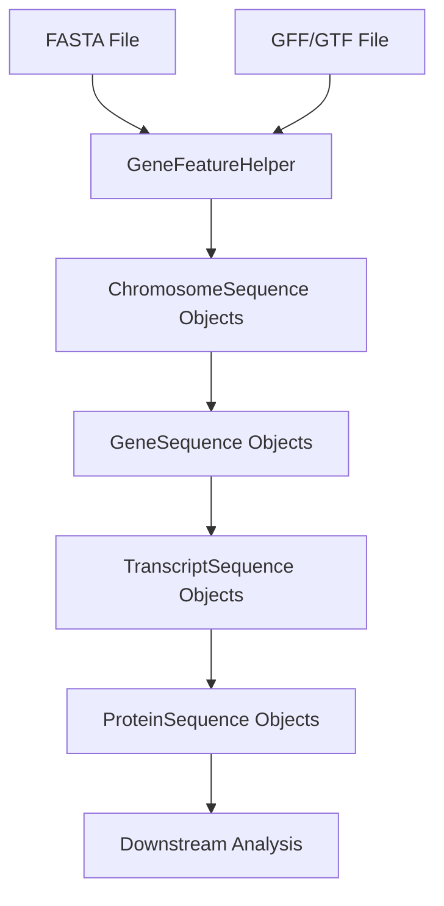
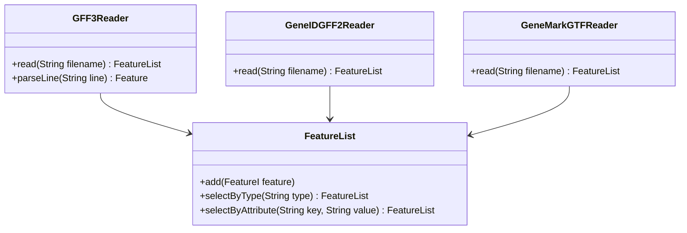

Genome analysis is a fundamental aspect of bioinformatics that involves studying the structure, function, and evolution of genomes. BioJava provides comprehensive tools for genome analysis through its `biojava-genome` module, which enables researchers to parse, manipulate, and analyze genomic data efficiently. This module serves as a bridge between raw genomic data and meaningful biological insights.

## Understanding Genome Analysis in BioJava

The genome analysis capabilities in BioJava are centered around the concept of **gene features** - structured representations of genomic elements such as genes, exons, introns, and coding sequences (CDS). These features allow researchers to work with genome annotations in a standardized, programmatic way.

BioJava's genome analysis module is particularly powerful because it supports multiple annotation formats from various gene prediction tools, making it a versatile solution for comparative genomics and annotation studies. Whether you're working with model organisms or newly sequenced genomes, BioJava provides the tools to extract and analyze genomic features effectively.

## Key Components of Genome Analysis

### Core Data Structures

At the heart of BioJava's genome analysis are several key data structures that represent genomic features:

1. **ChromosomeSequence**: Represents a chromosome or contig sequence with associated gene features
2. **GeneSequence**: Represents a gene with its location, strand, and associated transcripts
3. **TranscriptSequence**: Represents a transcript with its exons, CDS regions, and UTRs
4. **ProteinSequence**: Represents the protein product translated from a transcript

These structures form a hierarchical relationship that mirrors the biological organization of genomic information.

### Annotation Format Support

BioJava supports parsing genome annotations from multiple formats and tools:

| Format/Tool | Description | Use Case |
|-------------|-------------|----------|
| GFF3 | Generic Feature Format version 3 | Standard annotation format |
| GFF2 | Generic Feature Format version 2 | Legacy format support |
| GTF | Gene Transfer Format | Gene prediction outputs |
| GeneID | Gene prediction tool output | Eukaryotic gene prediction |
| Glimmer | Gene prediction tool output | Prokaryotic gene prediction |
| GeneMark | Gene prediction tool output | Prokaryotic/eukaryotic prediction |

This multi-format support ensures compatibility with various genome annotation pipelines and tools.

## Practical Genome Analysis with BioJava

### Loading Genomic Data

The most common starting point for genome analysis is loading genomic sequences along with their annotations. BioJava's `GeneFeatureHelper` class provides convenient methods for this:

```java
// Load FASTA sequences and GFF3 annotations
Map<String, ChromosomeSequence> chromosomeSequences = 
    GeneFeatureHelper.loadFastaAddGeneFeaturesFromGmodGFF3(
        new File("genome.fasta"), 
        new File("annotations.gff3"), 
        false
    );
```

This method reads both the genomic sequences in FASTA format and their annotations in GFF3 format, creating a structured representation of the genome with all its features.

### Extracting Protein Sequences

Once you have loaded the genomic data, you can easily extract protein sequences from the annotated genes:

```java
// Extract all protein sequences from the genome
LinkedHashMap<String, ProteinSequence> proteinSequences = 
    GeneFeatureHelper.getProteinSequences(chromosomeSequences.values());

// Write protein sequences to a FASTA file
FastaWriterHelper.writeProteinSequence(
    new File("proteins.faa"), 
    proteinSequences.values()
);
```

This capability is particularly useful for downstream analyses such as protein function prediction, homology searches, and comparative genomics.

### Working with Gene Features

BioJava provides fine-grained access to individual gene features, allowing for detailed analysis:

```java
// Iterate through all genes in a chromosome
for (GeneSequence gene : chromosomeSequences.get("chr1").getGeneSequences().values()) {
    System.out.println("Gene: " + gene.getAccession().getID());
    System.out.println("Location: " + gene.getBioBegin() + "-" + gene.getBioEnd());
    System.out.println("Strand: " + gene.getStrand());
    
    // Iterate through transcripts
    for (TranscriptSequence transcript : gene.getTranscripts().values()) {
        System.out.println("  Transcript: " + transcript.getAccession().getID());
        
        // Get protein sequence
        ProteinSequence protein = transcript.getProteinSequence();
        System.out.println("  Protein length: " + protein.getLength());
    }
}
```

This level of detail enables researchers to perform sophisticated analyses of gene structure, alternative splicing, and protein-coding potential.

## Advanced Genome Analysis Features

### Custom Annotation Processing

BioJava allows for custom processing of genome annotations through its flexible feature system. For example, you can filter genes based on specific criteria:

```java
// Filter genes by length
List<GeneSequence> longGenes = new ArrayList<>();
for (ChromosomeSequence chr : chromosomeSequences.values()) {
    for (GeneSequence gene : chr.getGeneSequences().values()) {
        if (gene.getLength() > 10000) { // Genes longer than 10kb
            longGenes.add(gene);
        }
    }
}
```

### Genome Statistics

BioJava provides utilities for calculating genome-wide statistics:

```java
// Calculate gene density per chromosome
for (String chrName : chromosomeSequences.keySet()) {
    ChromosomeSequence chr = chromosomeSequences.get(chrName);
    int geneCount = chr.getGeneSequences().size();
    double chrLength = chr.getLength();
    double density = geneCount / (chrLength / 1000000.0); // genes per Mb
    
    System.out.printf("Chromosome %s: %d genes, %.2f genes/Mb%n", 
                     chrName, geneCount, density);
}
```

## Internal Architecture

### Feature Processing Pipeline

BioJava's genome analysis follows a well-defined pipeline for processing genomic annotations:



This pipeline ensures that genomic data is processed systematically and consistently, regardless of the input format.

### Parser Architecture

The parser system is designed to be extensible, with separate parsers for different annotation formats:



This architecture allows for easy addition of new parsers as new annotation formats emerge.

> [!TIP]
> When working with large genome files, consider using the lazy loading option available in some methods to reduce memory usage. This is particularly important for mammalian genomes which can be quite large.

## Best Practices for Genome Analysis

1. **Validate Input Data**: Always check that your FASTA and annotation files are compatible and properly formatted before processing.
2. **Handle Memory Wisely**: For large genomes, use lazy loading when available and process chromosomes sequentially when possible.
3. **Check Strand Information**: Pay attention to strand information when analyzing gene features, as it affects the interpretation of start/end positions.
4. **Use Appropriate Data Structures**: Choose the right data structure for your analysis - ChromosomeSequence for whole-genome analyses, GeneSequence for gene-focused studies.

## Conclusion

BioJava's genome analysis module provides a comprehensive toolkit for genomic research. Its support for multiple annotation formats, hierarchical feature representation, and extensible architecture make it suitable for a wide range of genome analysis tasks. From basic gene extraction to complex comparative genomics, BioJava offers the tools needed to transform raw genomic data into biological insights.
