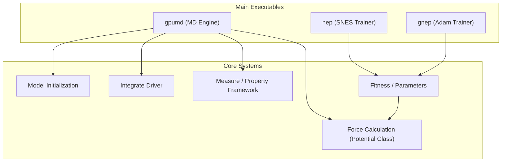
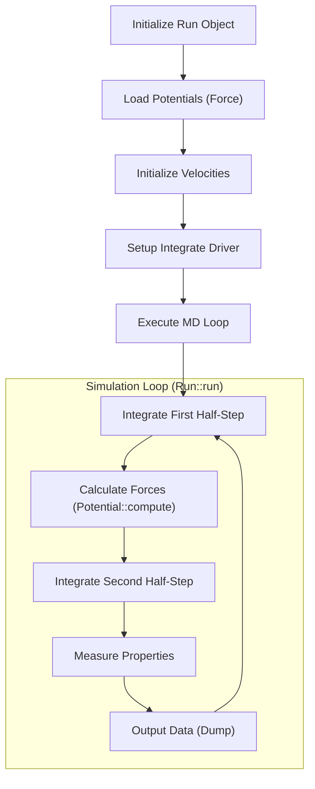
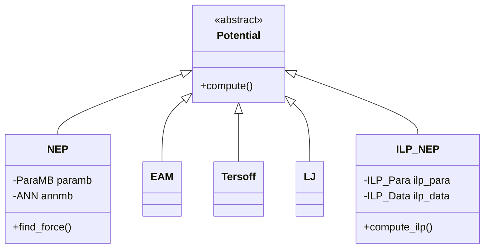

# GPUMD Overview

Relevant source files

The following files were used as context for generating this wiki page:

- [Dockerfile](Dockerfile)
- [README.md](README.md)
- [developers/readme.md](developers/readme.md)
- [doc/conf.py](doc/conf.py)
- [doc/gpumd/input_parameters/potential.rst](doc/gpumd/input_parameters/potential.rst)
- [doc/gpumd/output_files/heatmode_out.rst](doc/gpumd/output_files/heatmode_out.rst)
- [doc/gpumd/output_files/kappamode_out.rst](doc/gpumd/output_files/kappamode_out.rst)
- [doc/index.rst](doc/index.rst)
- [doc/installation.rst](doc/installation.rst)
- [doc/potentials/index.rst](doc/potentials/index.rst)
- [doc/potentials/nep_ilp.rst](doc/potentials/nep_ilp.rst)
- [doc/potentials/sw_ilp.rst](doc/potentials/sw_ilp.rst)
- [doc/potentials/tersoff_ilp.rst](doc/potentials/tersoff_ilp.rst)
- [doc/publications.bib](doc/publications.bib)
- [doc/publications.rst](doc/publications.rst)
- [src/force/ilp_nep.cu](src/force/ilp_nep.cu)
- [src/force/ilp_nep.cuh](src/force/ilp_nep.cuh)
- [src/main_gnep/main.cu](src/main_gnep/main.cu)
- [src/main_gpumd/main.cu](src/main_gpumd/main.cu)
- [src/main_mdi/main.cu](src/main_mdi/main.cu)
- [src/main_nep/main.cu](src/main_nep/main.cu)

This page provides a high-level overview of the GPUMD (Graphics Processing Units Molecular Dynamics) software package, its architecture, core capabilities, and system design. For installation instructions, see [Installation and Building](#1.1), and for a quick introduction to running simulations, see [Quick Start Guide](#1.2).

## What is GPUMD?

GPUMD is a highly efficient general-purpose molecular dynamics (MD) package fully implemented on graphics processing units (GPUs). It consists of three main executables:

- `gpumd`: For performing molecular dynamics simulations. [src/main_gpumd/main.cu:29-66]()
- `nep`: For training machine-learned potentials called neuroevolution potentials (NEPs) using the SNES optimizer. [src/main_nep/main.cu:30-71]()
- `gnep`: A gradient-based training executable for NEP models using analytical gradients and the Adam optimizer. [src/main_gnep/main.cu:27-66]()

The package enables both classical molecular dynamics simulations with various interatomic potentials and the training and use of machine-learned potentials for accurate atomistic simulations at high performance.

Sources: [README.md:11-15](), [doc/installation.rst:94-98]()

## System Architecture

GPUMD's architecture is organized around main executables that share common code related to force calculations and atomic data handling:

The software package is built on a modular architecture that separates different functional components:

- **Model Initialization**: Handles atomic configurations, box dimensions, and boundary conditions.
- **Force Calculation**: Computes interatomic forces using the `Potential` base class. [src/force/ilp_nep.cuh:122]()
- **Integration System**: Implements time evolution algorithms via the `Integrate` driver.
- **Measurement System**: Calculates physical properties via the `Measure` framework.
- **NEP Training System**: Optimizes neural network parameters using either `SNES` or `Adam` optimizers. [src/main_nep/main.cu:53](), [src/main_gnep/main.cu:38]()

Sources: [README.md:11-15](), [src/main_gpumd/main.cu:42-51](), [src/main_nep/main.cu:43-53]()

## Data Flow in Molecular Dynamics Simulation

The typical workflow for a molecular dynamics simulation in GPUMD follows this pattern, managed by the `Run` class:

Sources: [src/main_gpumd/main.cu:44](), [src/main_mdi/main.cu:64]()

## Force Calculation System

GPUMD supports multiple interatomic potential models through a hierarchical potential framework inheriting from `Potential`:

The software supports several types of potentials:

1. **Neuroevolution Potentials (NEP)**: Machine-learned potentials (versions 3, 4, 5 supported). [src/force/ilp_nep.cu:160-166]()
2. **Traditional Potentials**: Including Lennard-Jones (LJ), EAM, Tersoff, and Force Constant Potential (FCP). [README.md:66-69]()
3. **Hybrid Potentials**: Combinations like `ILP_NEP` which integrates Interlayer Potentials (ILP) with NEP for 2D materials like graphene and MoS2. [src/force/ilp_nep.cu:17-26](), [doc/potentials/nep_ilp.rst:8-13]()
4. **External Interfaces**: Support for DeePMD-kit and NNAP.

Sources: [src/force/ilp_nep.cuh:122-184](), [doc/potentials/index.rst:9-23]()

## Integration and Measurement

GPUMD implements various integration methods and thermodynamic ensembles including NVE, NVT (Berendsen, NHC, BDP, Langevin), and NPT. Specialized modes include:
- **Path Integral MD (PIMD)**: For quantum nuclear effects. [README.md:77]()
- **Monte Carlo MD (MCMD)**: Hybrid MC/MD simulations. [README.md:76]()
- **Shock Simulation**: Using MSST and NPHug methods. [README.md:72,78]()

The measurement system handles transport properties like thermal conductivity (HAC, HNEMD, SHC), viscosity, and structural analysis (RDF, ADF).

Sources: [README.md:62-78](), [doc/installation.rst:134-178]()

## NEP Training System

The `nep` and `gnep` executables implement the machine learning framework:
- **NEP**: Uses the Separable Natural Evolution Strategy (`SNES`) optimizer. [src/main_nep/main.cu:53]()
- **GNEP**: Uses the `Adam` optimizer with analytical gradients for potentially faster convergence. [src/main_gnep/main.cu:38-39]()

Key components include the `Fitness` class for RMSE calculation and the `Parameters` class for input handling. [src/main_nep/main.cu:43-44]()

Sources: [src/main_nep/main.cu:16-18](), [src/main_gnep/main.cu:16-18]()

## Performance and GPU Acceleration

GPUMD achieves high performance through:
1. **Full GPU Implementation**: All computation-intensive parts are offloaded to the GPU. [README.md:14]()
2. **Portability**: Supports NVIDIA (CUDA) and AMD (ROCm/HIP) architectures. [doc/installation.rst:19-23, 71-77]()
3. **Memory Management**: Uses the `GPU_Vector` template for efficient device memory handling. [src/force/ilp_nep.cuh:36-44, 66-77]()

Sources: [README.md:17-20](), [doc/installation.rst:3-30]()

## Citations

If you use GPUMD in your research, please cite the appropriate references, such as the GPUMD 4.0 paper [Xu2025].

Sources: [README.md:56-104](), [doc/publications.bib:3-10]()

---