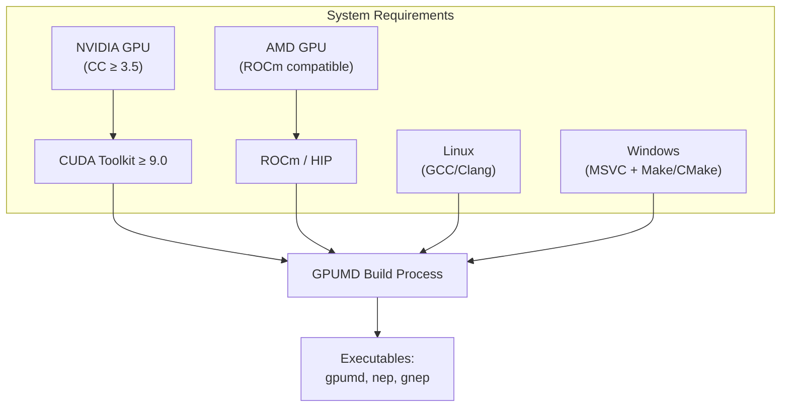

# Installation and Building

<details>
<summary>Relevant source files</summary>

The following files were used as context for generating this wiki page:

- [.github/workflows/cuda-build.yml](.github/workflows/cuda-build.yml)
- [.github/workflows/cuda_build_windows.yml](.github/workflows/cuda_build_windows.yml)
- [.gitlab-ci.yml](.gitlab-ci.yml)
- [Dockerfile](Dockerfile)
- [doc/_static/custom.css](doc/_static/custom.css)
- [doc/_static/logo-2x1.png](doc/_static/logo-2x1.png)
- [doc/_static/logo-icon.svg](doc/_static/logo-icon.svg)
- [doc/_static/logo.ico](doc/_static/logo.ico)
- [doc/_static/logo.png](doc/_static/logo.png)
- [doc/_static/logo.svg](doc/_static/logo.svg)
- [doc/_templates/breadcrumbs.html](doc/_templates/breadcrumbs.html)
- [doc/_templates/page.html](doc/_templates/page.html)
- [doc/conf.py](doc/conf.py)
- [doc/gpumd/output_files/heatmode_out.rst](doc/gpumd/output_files/heatmode_out.rst)
- [doc/gpumd/output_files/kappamode_out.rst](doc/gpumd/output_files/kappamode_out.rst)
- [doc/index.rst](doc/index.rst)
- [doc/installation.rst](doc/installation.rst)
- [doc/publications.bib](doc/publications.bib)
- [doc/publications.rst](doc/publications.rst)
- [src/force/pppm.cu](src/force/pppm.cu)
- [src/force/pppm.cuh](src/force/pppm.cuh)
- [src/makefile](src/makefile)
- [src/makefile.hip](src/makefile.hip)
- [src/measure/extrapolation.cu](src/measure/extrapolation.cu)
- [src/measure/extrapolation.cuh](src/measure/extrapolation.cuh)
- [src/model/group.cu](src/model/group.cu)
- [src/utilities/gpu_macro.cuh](src/utilities/gpu_macro.cuh)
- [src/utilities/read_file.cu](src/utilities/read_file.cu)
- [src/utilities/read_file.cuh](src/utilities/read_file.cuh)

</details>


This page provides detailed instructions for installing and building the GPUMD (Graphics Processing Units Molecular Dynamics) software package. It covers CUDA (NVIDIA) and HIP (AMD) compilation methods, optional features like NetCDF and GNEP, and the pre-release CMake build system.

## Prerequisites

Before attempting to install GPUMD, ensure your system meets the following requirements:

*   **GPU Hardware**: NVIDIA GPU with compute capability 3.5 or higher [doc/installation.rst:19-19](), or a compatible AMD GPU [doc/installation.rst:23-23]().
*   **CUDA Toolkit**: Version 9.0 or newer for NVIDIA GPUs [doc/installation.rst:19-19]().
*   **ROCm/HIP**: Required for AMD GPUs [doc/installation.rst:75-75]().
*   **Operating Systems**: 
    *   **Linux**: C++ compiler supporting C++11 (Make) or C++17 (CMake) [doc/installation.rst:20-28]().
    *   **Windows**: `cl.exe` from Microsoft Visual Studio and a 64-bit `make.exe` or CMake 3.24+ [doc/installation.rst:21-29]().



Sources: [doc/installation.rst:12-30](), [src/makefile:1-13]()

## Obtaining the Source Code

The source code is hosted on GitHub. Clone the repository using:

```bash
git clone https://github.com/brucefan1983/GPUMD.git
cd GPUMD
```

Sources: [doc/installation.rst:9-9]()

## Building with CUDA (NVIDIA GPUs)

GPUMD uses a standard `makefile` for NVIDIA GPUs. The build process generates three primary executables: `gpumd` (MD engine), `nep` (SNES-based NEP training), and `gnep` (Gradient-based NEP training).

### Basic Build Steps

1.  Navigate to the `src` directory.
2.  Run `make` to build `gpumd` and `nep` [src/makefile:91-91]().
3.  Run `make gnep` to build the gradient-based training executable [doc/installation.rst:104-104]().

```bash
cd src
make      # Generates gpumd and nep
make gnep # Generates gnep
```

### Customizing GPU Architecture

The target architecture is defined by the `CUDA_ARCH` variable in the makefile [src/makefile:18-18]().

*   **Default**: `-arch=sm_60` (Pascal) [src/makefile:18-18]().
*   **Kepler (< 6.0)**: Use `-arch=sm_35` and add `-DUSE_KEPLER` to `CFLAGS` [src/makefile:3-5]().
*   **Modern GPUs**: Update to `-arch=sm_80` (Ampere), `sm_90` (Hopper), etc.

Sources: [src/makefile:1-33](), [doc/installation.rst:38-42]()

## Building with HIP (AMD GPUs)

GPUMD supports AMD GPUs via ROCm/HIP using `makefile.hip` [doc/installation.rst:71-73]().

### HIP Build Steps

```bash
cd src
make -f makefile.hip HIP_ARCH=gfx90a
```

*   **Compiler**: Uses `hipcc` [src/makefile.hip:15-15]().
*   **Libraries**: Links `hipblas`, `hipsolver`, and `hipfft` [src/makefile.hip:23-23]().
*   **Architecture**: Controlled via `HIP_ARCH` (defaults to `gfx90a`) [src/makefile.hip:16-16]().

Sources: [doc/installation.rst:64-78](), [src/makefile.hip:1-23]()

## CMake Build System (Pre-release)

A CMake-based build system is available for standard builds on Linux and Windows.

```bash
cmake -S . -B build
cmake --build build --config Release --parallel
```

*   **Architecture**: Specify via `-D CMAKE_CUDA_ARCHITECTURES=80` [doc/installation.rst:59-59]().
*   **Targets**: Build specific tools using `--target gnep` [doc/installation.rst:112-112]().
*   **Note**: CMake does not yet support AMD/HIP builds [doc/installation.rst:81-81]().

Sources: [doc/installation.rst:43-61]()

## Optional Features and Dependencies

### NetCDF Support
To enable NetCDF output (via `dump_netcdf`), GPUMD must be linked against `netcdf-c` (4.6.3+) [doc/installation.rst:137-139]().

1.  Install NetCDF with `--disable-netcdf-4 --disable-dap` for basic support [doc/installation.rst:149-149]().
2.  Modify `src/makefile`:
    *   Add `-DUSE_NETCDF` to `CFLAGS` [doc/installation.rst:169-169]().
    *   Set `INC` and `LDFLAGS` to the NetCDF installation path [doc/installation.rst:175-177]().
    *   Add `-lnetcdf` to `LIBS` [doc/installation.rst:177-177]().

### External Potential Plugins
*   **PLUMED**: Add `-DUSE_PLUMED` to `CFLAGS` [src/makefile:9-9]().
*   **DeePMD-kit**: Requires building the DeePMD interface (see external documentation).
*   **NNAP**: Enabled via the JSE bridge for specific neural network potentials.

Sources: [doc/installation.rst:134-180](), [src/makefile:1-10]()

## Build System Architecture

The build system maps source directories to specific functional components.

```mermaid
classDiagram
    class "Build Driver" {
        makefile
        makefile.hip
        CMakeLists.txt
    }

    class "Executables" {
        gpumd
        nep
        gnep
    }

    class "Core Modules" {
        model/ (Box, Atom)
        force/ (Potentials, Neighbor)
        integrate/ (Verlet, Ensembles)
        measure/ (Properties, HAC)
        utilities/ (GPU_Vector, IO)
    }

    class "Specialized Modules" {
        minimize/ (FIRE, SD)
        phonon/ (Hessian, K-points)
        mc/ (Monte Carlo)
    }

    "Build Driver" ..> "Core Modules" : Compiles
    "Build Driver" ..> "Specialized Modules" : Compiles
    "Core Modules" --> "Executables" : Links
    "Specialized Modules" --> "gpumd" : Links
    "utilities/" --> "nep" : Links
```

### Source Organization
*   **gpumd**: Includes all directories under `src/` except `main_nep/` and `main_gnep/` [src/makefile:39-48]().
*   **nep**: Combines `main_nep/` with `utilities/` [src/makefile:49-51]().
*   **gnep**: Combines `main_gnep/` with `utilities/` [src/makefile:52-54]().
*   **Portability**: The `gpu_macro.cuh` header provides a translation layer between CUDA and HIP symbols (e.g., `gpuMalloc` maps to `cudaMalloc` or `hipMalloc`) [src/utilities/gpu_macro.cuh:111-122]().

Sources: [src/makefile:36-55](), [src/utilities/gpu_macro.cuh:18-188]()

## Troubleshooting

### Windows Compilation
If `cl.exe` fails with `C1083` (cannot open source file), remove `-Xcompiler "/wd 4819"` from the makefile [src/makefile:6-8]().

### Active Learning / Extrapolation
Building for Active Learning requires `gpublas` (cuBLAS/hipBLAS). The `Extrapolation` class in `src/measure/extrapolation.cu` utilizes `gpublasCreate` and `gpublasDestroy` for calculating extrapolation grades [src/measure/extrapolation.cu:114-132]().

### Cleaning the Build
Use `make clean` to remove object files and executables [src/makefile:164-169](). On Windows, this deletes `.obj`, `.exp`, `.lib`, and `.exe` files [src/makefile:166-166]().

Sources: [src/makefile:6-169](), [src/measure/extrapolation.cu:114-132]()

---