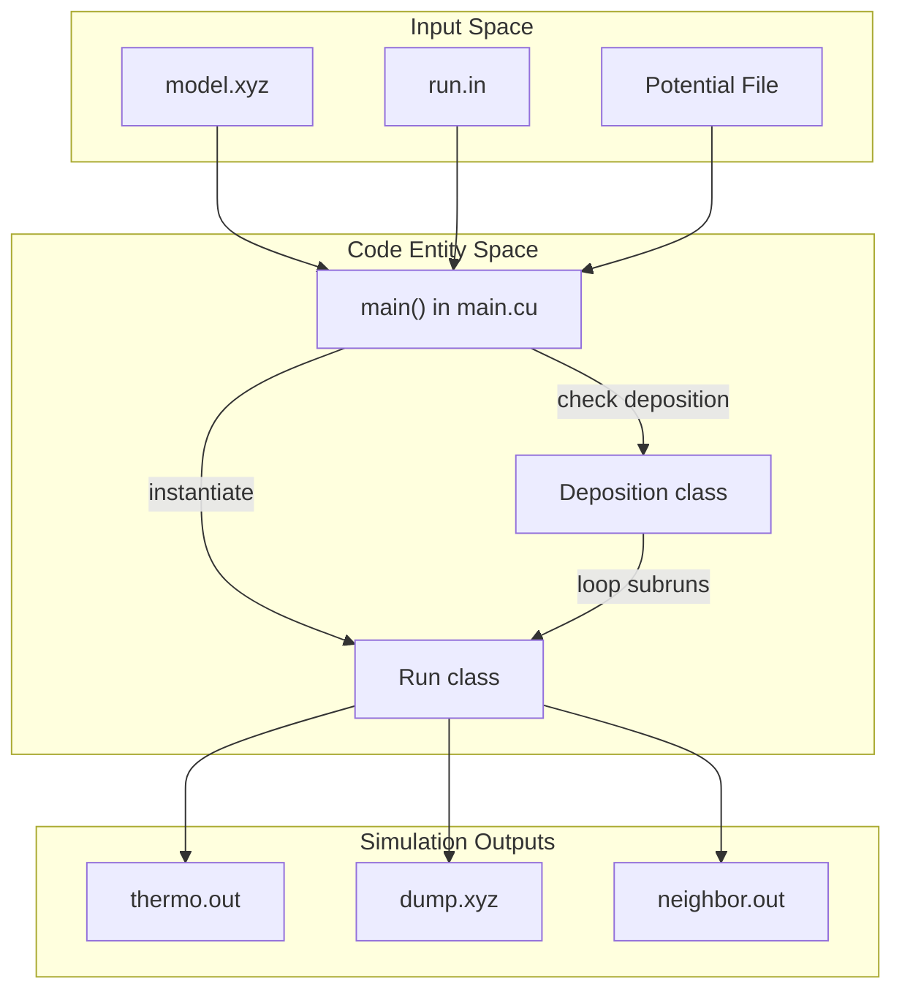
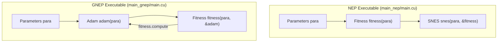

# Quick Start Guide

<details>
<summary>Relevant source files</summary>

The following files were used as context for generating this wiki page:

- [examples/gpumd_dynamic/model.xyz](examples/gpumd_dynamic/model.xyz)
- [examples/gpumd_dynamic/neighbor.out](examples/gpumd_dynamic/neighbor.out)
- [examples/gpumd_dynamic/plot_thermo.m](examples/gpumd_dynamic/plot_thermo.m)
- [examples/gpumd_dynamic/run.in](examples/gpumd_dynamic/run.in)
- [examples/gpumd_dynamic/thermo.out](examples/gpumd_dynamic/thermo.out)
- [examples/gpumd_static/dump.xyz](examples/gpumd_static/dump.xyz)
- [examples/gpumd_static/neighbor.out](examples/gpumd_static/neighbor.out)
- [examples/gpumd_static_qnep/dump.xyz](examples/gpumd_static_qnep/dump.xyz)
- [examples/gpumd_static_qnep/model.xyz](examples/gpumd_static_qnep/model.xyz)
- [examples/gpumd_static_qnep/neighbor.out](examples/gpumd_static_qnep/neighbor.out)
- [examples/readme.md](examples/readme.md)
- [potentials/nep/Song-2024-UNEP-v1-AgAlAuCrCuMgMoNiPbPdPtTaTiVWZr.txt](potentials/nep/Song-2024-UNEP-v1-AgAlAuCrCuMgMoNiPbPdPtTaTiVWZr.txt)
- [potentials/nep/readme.md](potentials/nep/readme.md)
- [potentials/readme.md](potentials/readme.md)
- [src/main_gnep/main.cu](src/main_gnep/main.cu)
- [src/main_gpumd/main.cu](src/main_gpumd/main.cu)
- [src/main_mdi/main.cu](src/main_mdi/main.cu)
- [src/main_nep/main.cu](src/main_nep/main.cu)

</details>


This guide provides a simplified introduction to running basic molecular dynamics simulations with GPUMD and training machine-learned potentials with NEP. It covers the essential steps to get started with simulations and understand the basic workflow.

For detailed installation instructions, please refer to [1.1. Installation and Building](). For comprehensive information on the architecture and capabilities, see [2. Core System Architecture]().

## Prerequisites

Before running GPUMD or NEP, ensure you have:

- A GPU card with compute capability no less than 3.5.
- CUDA toolkit no older than version 9.0.
- Compiled the executables as described in [1.1. Installation and Building]().

By default, the `nep` and `gpumd` executables will use all visible GPUs in your system [examples/readme.md:15-16](). You can control which GPUs to use by setting the environment variable:

```bash
export CUDA_VISIBLE_DEVICES=0       # Only use GPU with ID 0
export CUDA_VISIBLE_DEVICES=1       # Only use GPU with ID 1
export CUDA_VISIBLE_DEVICES=0,2     # Use GPUs with ID 0 and ID 2
```

When using multiple GPUs, it's recommended to use GPUs of the same type for optimal performance [examples/readme.md:29-29]().

Sources: [examples/readme.md:15-31]()

## Basic GPUMD Workflow

GPUMD runs molecular dynamics simulations based on input files that specify the atomic configuration and simulation parameters. The `main` function in `gpumd` checks for specialized modes like `Deposition` before initializing a `Run` object [src/main_gpumd/main.cu:42-51]().

### Diagram: GPUMD Execution Flow
Title: GPUMD Execution Flow

Sources: [src/main_gpumd/main.cu:29-66](), [examples/readme.md:1-14]()

### Input Files

GPUMD requires two main input files:

1.  **model.xyz**: Contains the atomic configuration (positions, types, lattice vectors).
2.  **run.in**: Contains simulation parameters and commands.

#### model.xyz Format
The `model.xyz` file uses an extended XYZ format. The second line contains the `Lattice` vectors and `Properties` definition [examples/gpumd_static/dump.xyz:2-2]().

```
N
Lattice="ax ay az bx by bz cx cy cz" Properties=species:S:1:pos:R:3:forces:R:3
TYPE1 x1 y1 z1 fx1 fy1 fz1
TYPE2 x2 y2 z2 fx2 fy2 fz2
...
```

Sources: [examples/gpumd_static/dump.xyz:1-7](), [examples/gpumd_dynamic/model.xyz:1-5]()

#### run.in Format
The `run.in` file contains commands that control the simulation. Common keywords include `potential`, `velocity`, `ensemble`, `time_step`, and `run` [examples/gpumd_dynamic/run.in:1-7]().

### Running Simulations

1.  **Static Calculation**: Computes energy, forces, and stress without time integration.
2.  **Dynamic Simulation**: Performs time integration (e.g., NVT, NPT) for molecular dynamics.
3.  **MDI Coupling**: GPUMD can also run as an MDI engine using the `--mdi` flag [src/main_mdi/main.cu:42-52]().

### Multi-GPU Considerations
For NEP-based simulations, GPUMD partitions the system. By default, it partitions along the thickest direction, but users can specify `x`, `y`, or `z` in the `potential` command [examples/readme.md:33-39]().

Sources: [examples/readme.md:33-39](), [src/main_mdi/main.cu:32-79]()

## Basic NEP and GNEP Usage

NEP (Neuroevolution Potential) training is handled by the `nep` executable, which uses the `SNES` (Separable Natural Evolution Strategy) optimizer [src/main_nep/main.cu:53-53](). GNEP uses analytical gradients and the `Adam` optimizer for training [src/main_gnep/main.cu:38-39]().

### Diagram: NEP vs GNEP Entry Points
Title: NEP and GNEP Code Entities

Sources: [src/main_nep/main.cu:43-53](), [src/main_gnep/main.cu:37-48]()

### Pre-trained NEP Models
GPUMD includes several published NEP models in `potentials/nep/`, such as `Si_2022_NEP3` and `C_2024_NEP4` [potentials/nep/readme.md:8-10](). A general-purpose 16-element metal potential (`Song-2024-UNEP-v1`) is also provided [potentials/nep/readme.md:11-11]().

Sources: [potentials/nep/readme.md:1-12]()

## Summary of Examples

The `examples/` directory contains templates for common tasks:

| Folder | Description | Executable |
| :--- | :--- | :--- |
| `nep_train` | Training a NEP model for PbTe | `nep` |
| `nep_prediction` | Predicting properties for an existing dataset | `nep` |
| `gpumd_static` | Static calculation (forces/stress) | `gpumd` |
| `gpumd_dynamic` | MD simulation with time integration | `gpumd` |
| `gpumd_mdi` | MDI coupling test with VASP | `gpumd` |

Sources: [examples/readme.md:42-49]()

For more realistic examples and detailed tutorials, visit the [GPUMD-Tutorials repository](https://github.com/brucefan1983/GPUMD-Tutorials).

---