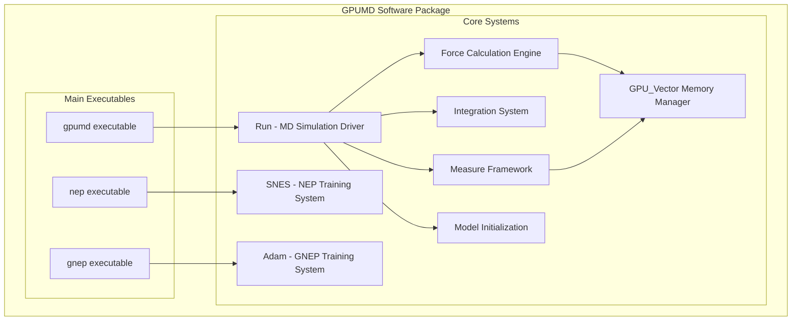
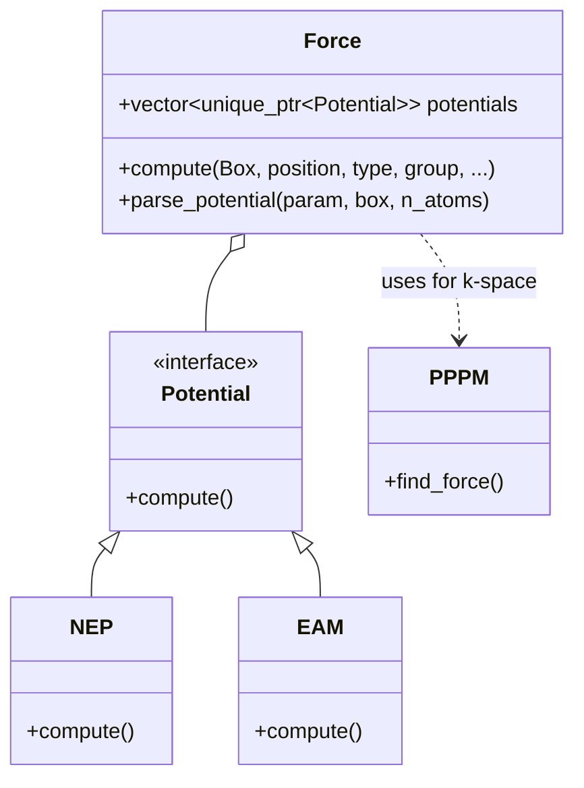
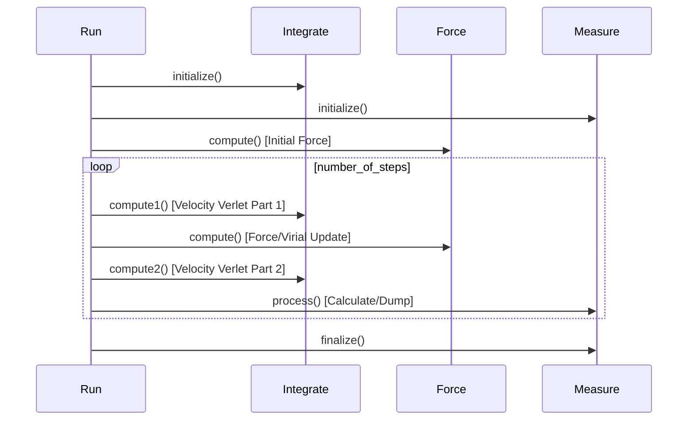

# Core System Architecture

Relevant source files

The following files were used as context for generating this wiki page:

- [src/force/force.cu](src/force/force.cu)
- [src/force/force.cuh](src/force/force.cuh)
- [src/force/pppm.cu](src/force/pppm.cu)
- [src/force/pppm.cuh](src/force/pppm.cuh)
- [src/main_gnep/main.cu](src/main_gnep/main.cu)
- [src/main_gpumd/main.cu](src/main_gpumd/main.cu)
- [src/main_gpumd/run.cu](src/main_gpumd/run.cu)
- [src/main_mdi/main.cu](src/main_mdi/main.cu)
- [src/main_nep/main.cu](src/main_nep/main.cu)
- [src/makefile](src/makefile)
- [src/makefile.hip](src/makefile.hip)
- [src/measure/dump_observer.cu](src/measure/dump_observer.cu)
- [src/measure/dump_observer.cuh](src/measure/dump_observer.cuh)
- [src/measure/extrapolation.cu](src/measure/extrapolation.cu)
- [src/measure/extrapolation.cuh](src/measure/extrapolation.cuh)
- [src/measure/lsqt.cu](src/measure/lsqt.cu)
- [src/measure/lsqt.cuh](src/measure/lsqt.cuh)
- [src/measure/measure.cu](src/measure/measure.cu)
- [src/measure/measure.cuh](src/measure/measure.cuh)
- [src/model/group.cu](src/model/group.cu)
- [src/utilities/gpu_macro.cuh](src/utilities/gpu_macro.cuh)
- [src/utilities/gpu_vector.cuh](src/utilities/gpu_vector.cuh)
- [src/utilities/main_common.cu](src/utilities/main_common.cu)
- [src/utilities/main_common.cuh](src/utilities/main_common.cuh)
- [src/utilities/read_file.cu](src/utilities/read_file.cu)
- [src/utilities/read_file.cuh](src/utilities/read_file.cuh)

This document describes the high-level architecture of GPUMD (Graphics Processing Units Molecular Dynamics), covering the main software components and their interactions. It explains the core systems that power both the molecular dynamics simulations and the neural network potential training functionality.

## Overall System Structure

GPUMD consists of three main executables, each serving a distinct purpose:

1.  `gpumd` - Performs molecular dynamics simulations.
2.  `nep` - Trains neural network potentials (Neuroevolution Potentials) using the SNES optimizer.
3.  `gnep` - Trains neural network potentials using gradient-based optimization (Adam).

Sources: [src/main_gpumd/main.cu:29-51](), [src/main_nep/main.cu:30-71](), [src/main_gnep/main.cu:27-66](), [src/makefile:91-106]()

## Main Executables

### GPUMD Executable
The `gpumd` executable is the entry point for molecular dynamics. It initializes the GPU via `gpuDeviceSynchronize` [src/main_gpumd/main.cu:39](), checks for atom deposition modes [src/main_gpumd/main.cu:42-51](), and instantiates the `Run` class to execute the simulation.

### NEP and GNEP Executables
The `nep` and `gnep` executables handle potential training. `nep` utilizes the `SNES` (Separable Natural Evolution Strategy) class [src/main_nep/main.cu:53](), while `gnep` uses the `Adam` optimizer [src/main_gnep/main.cu:38]() and a gradient-aware `Fitness` class [src/main_gnep/main.cu:39]().

## Core Components and Interactions

The GPUMD system is built around several primary driver classes:

| Class | Role | Location |
| :--- | :--- | :--- |
| `Run` | Main MD loop driver; parses `run.in`. | [src/main_gpumd/run.cuh:24]() |
| `Force` | Management of interatomic potentials and virial calculation. | [src/force/force.cuh:26]() |
| `Measure` | Framework for calculating properties and dumping data. | [src/measure/measure.cuh:28]() |
| `GPU_Vector` | Template for seamless Host/Device memory management. | [src/utilities/gpu_vector.cuh:28]() |

### Run System
The `Run` class coordinates the lifecycle of a simulation. It initializes atomic positions [src/main_gpumd/run.cu:151](), allocates GPU memory for atoms [src/main_gpumd/run.cu:153](), and parses the `run.in` file [src/main_gpumd/run.cu:175-209]().

For details on how atomic data is structured, see [Atom Model and Box](#2.1).

### Force Engine
The `Force` class acts as a driver for the `Potential` base class. It supports hybrid potentials and specialized drivers like `PPPM` for long-range electrostatics [src/force/pppm.cuh:25](). It can compute forces for standard MD or Path Integral MD (PIMD) beads [src/main_gpumd/run.cu:218-242]().

Sources: [src/force/force.cuh:26-85](), [src/force/force.cu:75-180]()

### Measure Framework
The `Measure` system uses a plugin-style architecture where various `Property` objects (e.g., `Dump_XYZ`, `MSD`, `LSQT`) are registered. During the simulation loop, `Measure::process` [src/measure/measure.cu:91-120]() is called to trigger calculations across all active properties.

### GPU Memory Management (`GPU_Vector`)
GPUMD abstracts CUDA/HIP memory management through the `GPU_Vector` template. It handles allocation, deallocation, and transfers between Host and Device. 

For details on the GPU abstraction layer, see [GPU Utilities and Portability Layer](#2.2).

## Simulation Execution Flow

The `Run::perform_a_run` method contains the main MD integration loop.

Sources: [src/main_gpumd/run.cu:211-340]()

## Multi-GPU Support
GPUMD implements spatial domain decomposition for NEP potentials via the `NEP_MULTIGPU` class [src/force/force.cu:159](). This allows the `Force` engine to distribute the workload across available devices, partitioned along the x, y, or z axis [src/force/force.cu:147-158]().

Sources: [src/force/force.cu:139-160]()

---