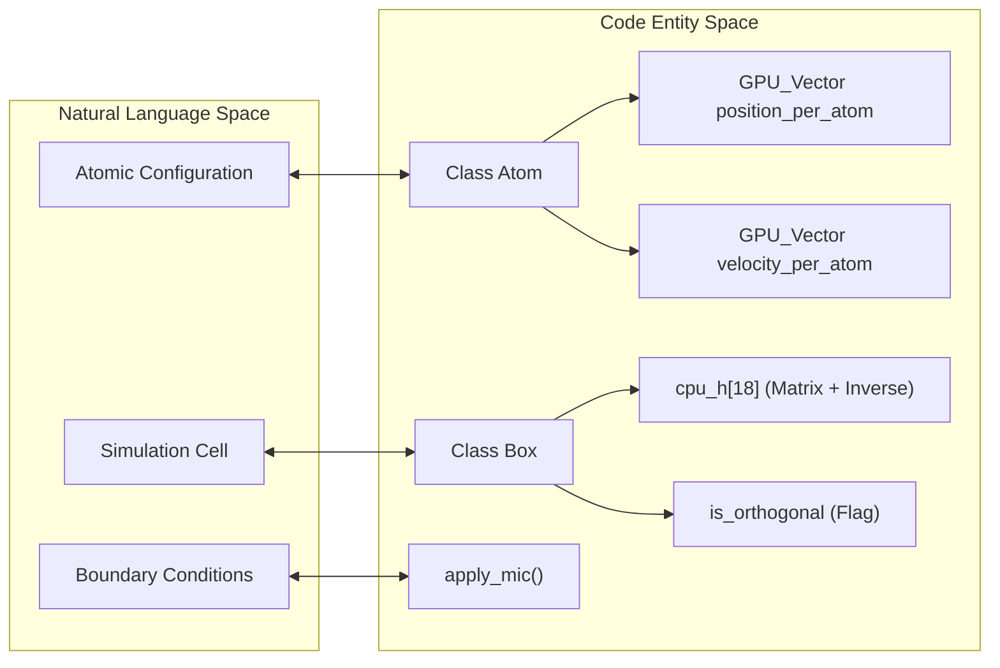
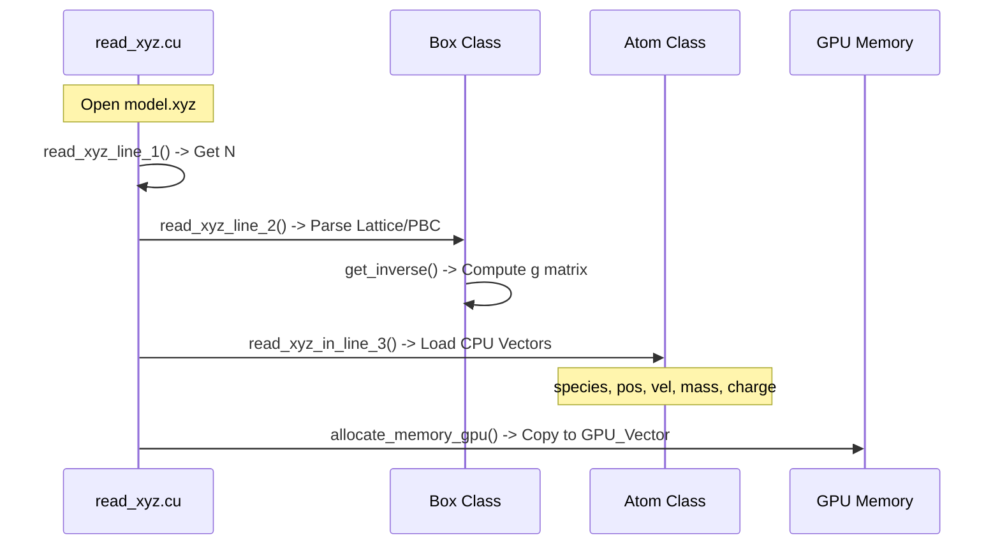

# Atom Model and Box

Relevant source files

The following files were used as context for generating this wiki page:

- [doc/gpumd/input_parameters/replicate.rst](doc/gpumd/input_parameters/replicate.rst)
- [doc/gpumd/input_parameters/velocity.rst](doc/gpumd/input_parameters/velocity.rst)
- [src/force/fcp.cu](src/force/fcp.cu)
- [src/force/fcp.cuh](src/force/fcp.cuh)
- [src/integrate/ensemble_pimd.cu](src/integrate/ensemble_pimd.cu)
- [src/integrate/ensemble_pimd.cuh](src/integrate/ensemble_pimd.cuh)
- [src/main_gpumd/replicate.cu](src/main_gpumd/replicate.cu)
- [src/main_gpumd/replicate.cuh](src/main_gpumd/replicate.cuh)
- [src/model/atom.cu](src/model/atom.cu)
- [src/model/atom.cuh](src/model/atom.cuh)
- [src/model/box.cu](src/model/box.cu)
- [src/model/box.cuh](src/model/box.cuh)
- [src/model/read_xyz.cu](src/model/read_xyz.cu)
- [src/model/read_xyz.cuh](src/model/read_xyz.cuh)
- [src/utilities/common.cuh](src/utilities/common.cuh)

## Purpose and Scope

This document describes the core data structures for atomic configurations in GPUMD, specifically the `Atom` and `Box` classes. It details how atomic positions, velocities, forces, and types are stored, how lattice vectors and periodic boundary conditions (PBC) are managed, and the process of reading structures from `model.xyz` files.

## Data Structures

GPUMD uses a "Structure of Arrays" (SoA) approach for GPU efficiency, where atomic properties are stored in contiguous vectors rather than as an array of objects.

### The Atom Class
The `Atom` class is the primary container for per-atom data. It maintains both host (CPU) vectors for I/O and `GPU_Vector` templates for device-side calculations.

| Member Variable | Code Entity | Description |
|:---|:---|:---|
| **Positions** | `position_per_atom` | $3N$ components (x, y, z) [src/model/atom.cuh:35]() |
| **Velocities** | `velocity_per_atom` | $3N$ components [src/model/atom.cuh:38]() |
| **Forces** | `force_per_atom` | $3N$ components computed by force engine [src/model/atom.cuh:39]() |
| **Masses** | `mass` | Per-atom mass [src/model/atom.cuh:33]() |
| **Charges** | `charge` | Per-atom charge (float precision) [src/model/atom.cuh:34]() |
| **Types** | `type` | Integer type IDs [src/model/atom.cuh:32]() |
| **Virials** | `virial_per_atom` | 9 components per atom [src/model/atom.cuh:41]() |
| **PIMD Beads** | `position_beads` | Vectors for Path Integral MD beads [src/model/atom.cuh:45-49]() |

Sources: [src/model/atom.cuh:21-52]()

### The Box Class
The `Box` class manages the simulation cell geometry and periodic boundary conditions.

*   **Lattice Vectors**: Stored in `cpu_h[18]`. The first 9 elements represent the $3 \times 3$ lattice matrix $h = [a, b, c]$; the next 9 represent the inverse matrix $g = h^{-1}$ used for coordinate wrapping [src/model/box.cuh:24](), [src/model/box.cu:60-78]().
*   **PBC Flags**: `pbc_x`, `pbc_y`, and `pbc_z` (1 for periodic, 0 for free) [src/model/box.cuh:21-23]().
*   **Orthogonality**: Optimization flag `is_orthogonal` triggers simplified Minimum Image Convention (MIC) logic [src/model/box.cuh:33](), [src/model/box.cu:111-117]().

Sources: [src/model/box.cuh:18-35](), [src/model/box.cu:16-117]()

## System Integration: Code Entity Mapping

The following diagram bridges the conceptual "Atom/Box" model to the specific code entities used for memory management and spatial calculations.

Sources: [src/model/atom.cuh:21-42](), [src/model/box.cuh:18-34](), [src/model/box.cuh:37-82]()

## Model Initialization from XYZ

GPUMD uses an extended XYZ format (`model.xyz`) to load the initial configuration. The reading process is handled primarily in `read_xyz.cu`.

### The model.xyz Format
1.  **Line 1**: Total number of atoms $N$ [src/model/read_xyz.cu:141-153]().
2.  **Line 2**: Metadata string containing `lattice`, `pbc`, and `properties` headers [src/model/read_xyz.cu:155-235]().
3.  **Line 3 to N+2**: Per-atom data columns (e.g., species, positions, velocities) [src/model/read_xyz.cu:312-400]().

### Coordinate Wrapping and MIC
When calculating distances between atoms, the `apply_mic` function enforces periodic boundaries. If the box is orthogonal, it uses simple modulo-like logic; for triclinic boxes, it transforms coordinates to fractional space using the inverse matrix $g$, wraps them, and transforms back [src/model/box.cuh:37-82]().

Sources: [src/model/read_xyz.cu:141-310](), [src/model/read_xyz.cu:532-557](), [src/model/box.cu:60-78]()

## Velocity Initialization
If velocities are not provided in the `model.xyz` file, they are initialized via the `velocity` keyword in `run.in`. The `Velocity` initialization logic (documented in user-facing parameters) ensures that the total linear and angular momenta are zeroed and the velocities are scaled to the target initial temperature [doc/gpumd/input_parameters/velocity.rst:8-36]().

## System Modification: Replicate
The `Replicate` function allows expanding a small unit cell into a larger supercell. It updates both the `Box` dimensions (scaling `cpu_h`) and the `Atom` arrays (tiling positions based on lattice vectors) [src/main_gpumd/replicate.cu:20-112]().

Sources: [src/main_gpumd/replicate.cu:20-112](), [doc/gpumd/input_parameters/replicate.rst]()

---