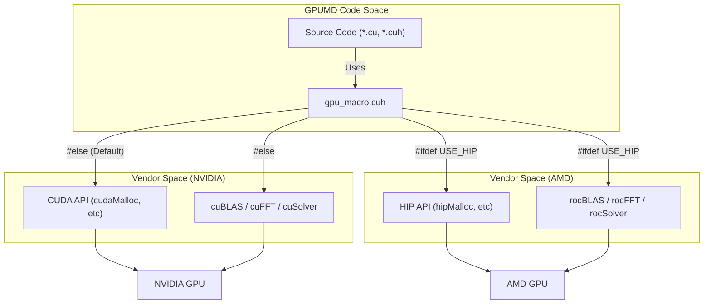
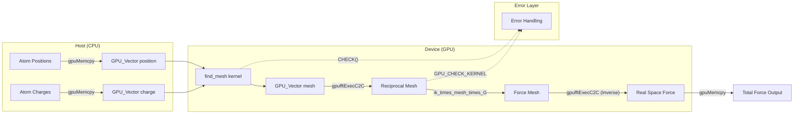

# GPU Utilities and Portability Layer

Relevant source files

The following files were used as context for generating this wiki page:

- [doc/gpumd/input_parameters/compute_extrapolation.rst](doc/gpumd/input_parameters/compute_extrapolation.rst)
- [src/force/pppm.cu](src/force/pppm.cu)
- [src/force/pppm.cuh](src/force/pppm.cuh)
- [src/makefile](src/makefile)
- [src/makefile.hip](src/makefile.hip)
- [src/measure/extrapolation.cu](src/measure/extrapolation.cu)
- [src/measure/extrapolation.cuh](src/measure/extrapolation.cuh)
- [src/model/group.cu](src/model/group.cu)
- [src/utilities/error.cu](src/utilities/error.cu)
- [src/utilities/error.cuh](src/utilities/error.cuh)
- [src/utilities/gpu_macro.cuh](src/utilities/gpu_macro.cuh)
- [src/utilities/main_common.cu](src/utilities/main_common.cu)
- [src/utilities/main_common.cuh](src/utilities/main_common.cuh)
- [src/utilities/read_file.cu](src/utilities/read_file.cu)
- [src/utilities/read_file.cuh](src/utilities/read_file.cuh)

The GPU Utilities and Portability Layer provides a unified abstraction for heterogeneous computing in GPUMD. It enables the codebase to target both NVIDIA (CUDA) and AMD (HIP) hardware through a common macro-based interface, manages device memory via the `GPU_Vector` template, and provides robust error handling and I/O utilities for high-performance molecular dynamics simulations.

### GPU Abstraction Layer (gpu_macro.cuh)

GPUMD achieves portability across GPU vendors using a header-based abstraction layer in `src/utilities/gpu_macro.cuh`. By defining the `USE_HIP` macro during compilation (typically via `makefile.hip`), the system maps generic `gpu*` identifiers to their respective vendor-specific APIs.

#### API Mapping Table

| Generic GPUMD Macro | CUDA Implementation | HIP Implementation |
|:---|:---|:---|
| `gpuMalloc` | `cudaMalloc` | `hipMalloc` |
| `gpuMemcpy` | `cudaMemcpy` | `hipMemcpy` |
| `gpuStream_t` | `cudaStream_t` | `hipStream_t` |
| `gpublasHandle_t` | `cublasHandle_t` | `hipblasHandle_t` |
| `gpufftHandle` | `cufftHandle` | `hipfftHandle` |
| `gpurandState` | `curandState` | `hiprandState` |
| `gpusolverDnHandle_t` | `cusolverDnHandle_t` | `hipsolverDnHandle_t` |

Sources: `[src/utilities/gpu_macro.cuh:18-107]()`, `[src/utilities/gpu_macro.cuh:110-188]()`

#### Diagram: Portability Architecture
This diagram illustrates how the `gpu_macro.cuh` header bridges the gap between the GPUMD source code and the underlying hardware libraries.

Sources: `[src/utilities/gpu_macro.cuh:18-188]()`, `[src/makefile:17-33]()`, `[src/makefile.hip:15-23]()`

---

### GPU Memory Management: GPU_Vector

The `GPU_Vector` template class is the primary mechanism for managing memory in GPUMD. It abstracts the allocation, deallocation, and synchronization of data between the Host (CPU) and Device (GPU).

#### Memory Types
`GPU_Vector` supports multiple memory allocation strategies, often specified via `Memory_Type`:
*   **Device Memory**: Standard GPU memory allocated via `gpuMalloc`.
*   **Managed Memory**: Unified memory accessible by both CPU and GPU, allocated via `gpuMallocManaged` `[src/utilities/gpu_macro.cuh:24]()`.

#### Key Usage Examples
In the `PPPM` (Particle-Particle Particle-Mesh) class, `GPU_Vector` is used to manage complex mesh data and reciprocal space vectors:
*   `GPU_Vector<float> kx, ky, kz` for reciprocal lattice vectors `[src/force/pppm.cuh:56-58]()`.
*   `GPU_Vector<gpufftComplex> mesh` for FFT operations `[src/force/pppm.cuh:60]()`.

In the `Extrapolation` class for active learning, it manages large projection matrices:
*   `GPU_Vector<double> B` for projection vectors `[src/measure/extrapolation.cuh:77]()`.
*   `asi_list` stores pointers to managed memory vectors for atom-type specific inversion matrices `[src/measure/extrapolation.cuh:76]()`.

Sources: `[src/force/pppm.cuh:56-64]()`, `[src/measure/extrapolation.cuh:76-80]()`, `[src/measure/extrapolation.cu:96-98]()`

---

### Error Handling and Validation

GPUMD provides a set of macros and functions to ensure simulation stability and provide meaningful feedback on failure.

#### CUDA/HIP Error Checking
The `CHECK(call)` macro is used extensively to wrap GPU API calls. It captures the `gpuError_t`, and if it is not `gpuSuccess`, it prints the file, line number, and error string before terminating the process `[src/utilities/error.cuh:23-34]()`.

#### Kernel Execution Validation
The `GPU_CHECK_KERNEL` macro is placed after kernel launches. In `STRONG_DEBUG` mode, it forces a `gpuDeviceSynchronize()` to catch asynchronous errors immediately `[src/utilities/error.cuh:65-76]()`.

#### Input Validation
Functions in `src/utilities/read_file.cu` provide robust parsing of input parameters:
*   `is_valid_int(const char* s, int* result)`: Validates and converts strings to integers using `strtol`, checking for `errno` and trailing characters `[src/utilities/read_file.cu:26-41]()`.
*   `is_valid_real(const char* s, double* result)`: Validates and converts strings to doubles, handling scientific notation `[src/utilities/read_file.cu:43-58]()`.
*   `get_double_from_token`: Converts tokens and explicitly checks for `inf` or `nan` values to prevent simulation divergence `[src/utilities/error.cu:168-189]()`.

Sources: `[src/utilities/error.cuh:23-76]()`, `[src/utilities/read_file.cu:26-58]()`, `[src/utilities/error.cu:168-189]()`

---

### GPU Utility Functions

#### Device Information and Peer Access
The `print_gpu_information()` function in `src/utilities/main_common.cu` performs the following sequence:
1.  Retrieves the number of available GPUs via `gpuGetDeviceCount` `[src/utilities/main_common.cu:45]()`.
2.  Iterates through each device to print the name, compute capability, global memory, and SM count `[src/utilities/main_common.cu:48-57]()`.
3.  **Peer-to-Peer (P2P) Setup**: It checks if GPUs can access each other's memory using `gpuDeviceCanAccessPeer` and enables access via `gpuDeviceEnablePeerAccess` if supported `[src/utilities/main_common.cu:59-73]()`.

#### FFT and BLAS Integration
The layer provides wrappers for vendor-specific math libraries:
*   **FFT**: Used in `PPPM` for long-range electrostatics. It utilizes `gpufftPlan3d` and `gpufftExecC2C` `[src/utilities/gpu_macro.cuh:97-106]()`.
*   **BLAS**: Used in the `Extrapolation` measure for matrix-vector multiplications. The `Extrapolation::calculate_gamma` function uses `gpublasHandle_t` `[src/measure/extrapolation.cuh:91]()` and calls mapped functions like `gpublasDgemvBatched` `[src/utilities/gpu_macro.cuh:67]()`.

#### Diagram: Data Flow in Force Calculation
This diagram shows how GPU utilities and `GPU_Vector` facilitate the flow of data during a PPPM force calculation.

Sources: `[src/force/pppm.cu:135-183]()`, `[src/force/pppm.cuh:31-41]()`, `[src/utilities/error.cuh:23-34]()`

Sources: `[src/utilities/main_common.cu:38-76]()`, `[src/force/pppm.cu:64-113]()`, `[src/measure/extrapolation.cu:114-132]()`

---