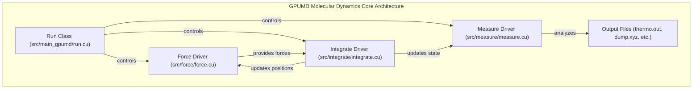
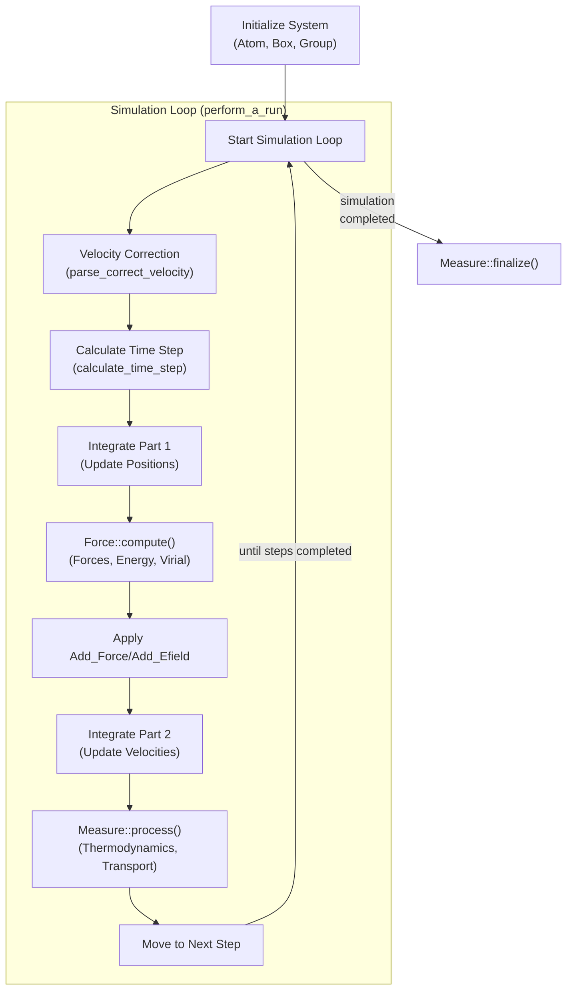
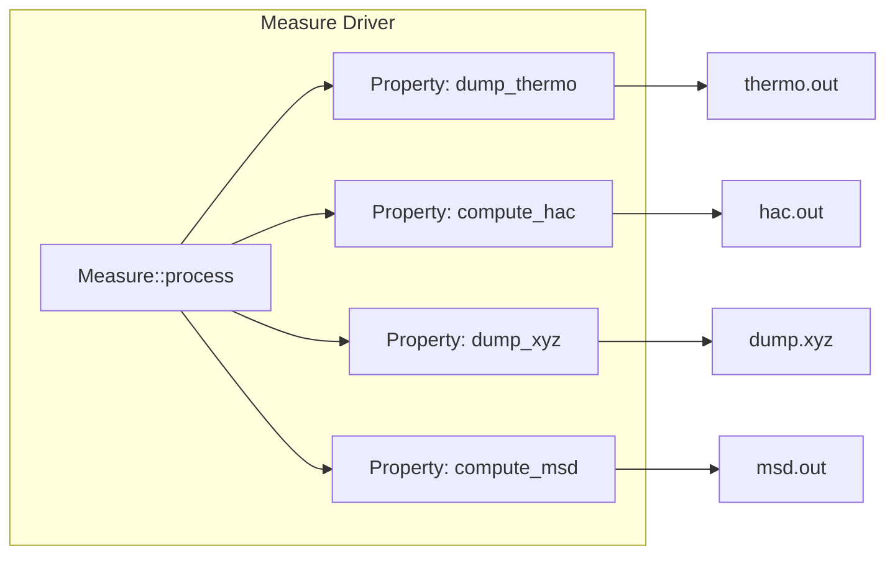

# GPUMD Molecular Dynamics

Relevant source files

The following files were used as context for generating this wiki page:

- [doc/bibliography.rst](doc/bibliography.rst)
- [doc/glossary.rst](doc/glossary.rst)
- [doc/gpumd/input_files/run_in.rst](doc/gpumd/input_files/run_in.rst)
- [doc/gpumd/input_parameters/dump_observer.rst](doc/gpumd/input_parameters/dump_observer.rst)
- [doc/gpumd/input_parameters/ensemble.rst](doc/gpumd/input_parameters/ensemble.rst)
- [doc/gpumd/input_parameters/index.rst](doc/gpumd/input_parameters/index.rst)
- [doc/gpumd/output_files/dump_xyz.rst](doc/gpumd/output_files/dump_xyz.rst)
- [doc/gpumd/output_files/index.rst](doc/gpumd/output_files/index.rst)
- [doc/gpumd/output_files/observer_xyz.rst](doc/gpumd/output_files/observer_xyz.rst)
- [doc/theory/ensembles.rst](doc/theory/ensembles.rst)
- [src/force/force.cu](src/force/force.cu)
- [src/force/force.cuh](src/force/force.cuh)
- [src/main_gpumd/electron_stop.cu](src/main_gpumd/electron_stop.cu)
- [src/main_gpumd/electron_stop.cuh](src/main_gpumd/electron_stop.cuh)
- [src/main_gpumd/run.cu](src/main_gpumd/run.cu)
- [src/main_gpumd/run.cuh](src/main_gpumd/run.cuh)
- [src/main_gpumd/velocity.cu](src/main_gpumd/velocity.cu)
- [src/main_gpumd/velocity.cuh](src/main_gpumd/velocity.cuh)
- [src/measure/dump_observer.cu](src/measure/dump_observer.cu)
- [src/measure/dump_observer.cuh](src/measure/dump_observer.cuh)
- [src/measure/lsqt.cu](src/measure/lsqt.cu)
- [src/measure/lsqt.cuh](src/measure/lsqt.cuh)
- [src/measure/measure.cu](src/measure/measure.cu)
- [src/measure/measure.cuh](src/measure/measure.cuh)
- [src/utilities/gpu_vector.cuh](src/utilities/gpu_vector.cuh)

GPUMD Molecular Dynamics is the core simulation system within the GPUMD software package. It provides GPU-accelerated classical molecular dynamics (MD) capabilities, enabling efficient atomistic simulations of material properties and behaviors. This page explains the architecture and workflow of the MD simulation engine, including how the system initializes, executes, and measures properties during simulation.

For information about Neural Network Potentials (NEP) used in GPUMD, see page [NEP: Neuroevolution Potentials](#4).

## Core MD Architecture

The GPUMD Molecular Dynamics system is built around four primary components that work together to perform simulations. The `Run` class in [src/main_gpumd/run.cuh:39-79]() encapsulates these components.

### Natural Language to Code Entity Mapping

The following diagram maps high-level MD concepts to the specific C++ classes and drivers implemented in GPUMD.

Sources: [src/main_gpumd/run.cuh:39-79](), [src/force/force.cuh:26-85](), [src/measure/measure.cuh:28-63]()

### Component Responsibilities

| Component | Primary Responsibility | Key Functions |
|-----------|------------------------|---------------|
| **Run System** | Controls simulation flow | `execute_run_in()`, `perform_a_run()` |
| **Force System** | Calculate atomic forces | `Force::compute()`, `Force::parse_potential()` |
| **Integration System** | Update atom states | `Integrate::update_v()`, `Integrate::update_x()` |
| **Measurement System** | Calculate physical properties | `Measure::process()`, `Measure::finalize()` |

Sources: [src/main_gpumd/run.cu:175-210](), [src/force/force.cu:457-603](), [src/measure/measure.cu:91-120]()

## Simulation Workflow

The simulation loop is managed within `Run::perform_a_run()` [src/main_gpumd/run.cu:211-342]().

Sources: [src/main_gpumd/run.cu:211-342](), [src/main_gpumd/run.cu:112-142]()

## Run System and Input Parsing

The `Run` class serves as the central controller. It reads the `run.in` file using `execute_run_in()` [src/main_gpumd/run.cu:175-209]() and dispatches keywords to specific parsing functions like `parse_potential()` or `parse_ensemble()`.

For details on the input file syntax, see [GPUMD run.in Reference](#9.1).

## Force Calculation System

The `Force` driver calculates interatomic forces using various potential models. It manages a vector of `Potential` objects [src/force/force.cuh:75]().

- **Neighbor List**: Efficiently finds interacting atom pairs. See [Neighbor List Generation](#3.2).
- **Potential Types**: Supports NEP, EAM, Tersoff, LJ, and hybrid models. See [Force Calculation](#3.1).
- **Multiple Potentials**: Supports `observe` or `average` modes via `set_multiple_potentials_mode()` [src/force/force.cu:633-636]().

Sources: [src/force/force.cu:75-191](), [src/force/force.cuh:26-85]()

## Integration and Ensembles

The `Integrate` driver updates atomic positions and velocities according to the selected ensemble (e.g., NVT, NPT).

- **Velocity Verlet**: The default underlying algorithm.
- **Thermostats/Barostats**: Includes Berendsen, BDP, NHC, and SCR.
- **Path Integrals**: Supported via `ensemble pimd` [doc/gpumd/input_parameters/ensemble.rst:29]().

For details, see [Integration Methods](#3.3).

## Measurement and Analysis

The `Measure` class manages a collection of `Property` objects [src/measure/measure.cuh:62](). During the MD loop, `Measure::process()` is called to accumulate data or write to files [src/measure/measure.cu:91-120]().

### Measurement Mapping

For details, see [Measurement and Analysis](#3.5) and [Output and Dump Commands](#3.6).

Sources: [src/measure/measure.cu:26-67](), [doc/gpumd/output_files/index.rst:7-152]()

## Special Simulation Modes

GPUMD includes specialized MD routines for specific physical scenarios:
- **Thermal Transport**: HNEMD and HNEMA for thermal conductivity.
- **Quantum Transport**: Linear-scaling quantum transport (LSQT) [src/measure/lsqt.cu:27-36]().
- **Electronic Effects**: Electron stopping [src/main_gpumd/electron_stop.cu:157-193]() and Two-Temperature Model (TTM).

For details, see [Special Simulation Modes](#3.7).

Sources: [src/main_gpumd/electron_stop.cu:157-193](), [src/measure/lsqt.cu:27-36]()

---