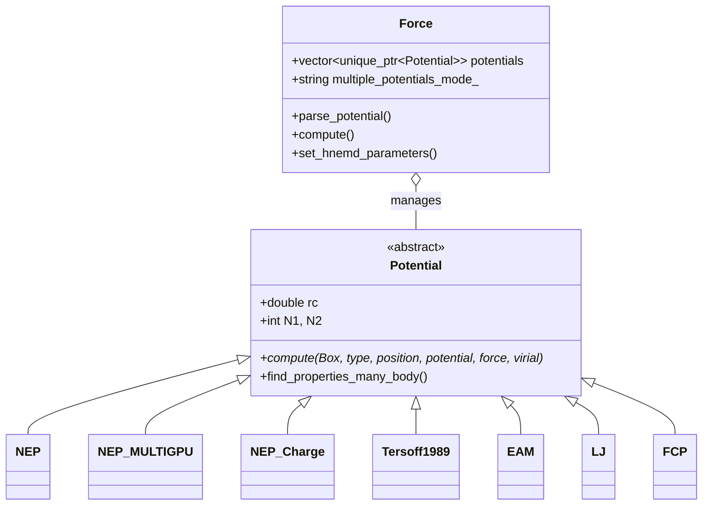
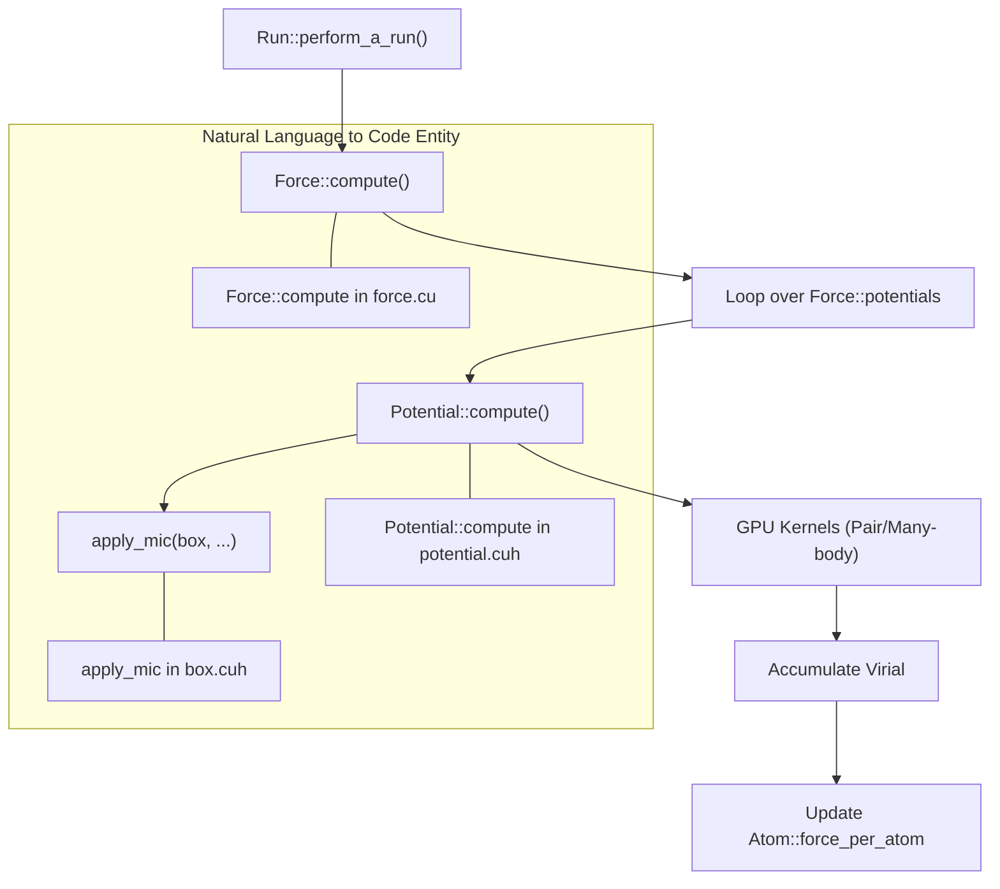

# Force Calculation

Relevant source files

The following files were used as context for generating this wiki page:

- [src/force/dftd3.cu](src/force/dftd3.cu)
- [src/force/dftd3.cuh](src/force/dftd3.cuh)
- [src/force/dftd3para.cuh](src/force/dftd3para.cuh)
- [src/force/ewald.cu](src/force/ewald.cu)
- [src/force/ewald.cuh](src/force/ewald.cuh)
- [src/force/force.cu](src/force/force.cu)
- [src/force/force.cuh](src/force/force.cuh)
- [src/force/potential.cu](src/force/potential.cu)
- [src/force/potential.cuh](src/force/potential.cuh)
- [src/main_gpumd/run.cu](src/main_gpumd/run.cu)
- [src/measure/dump_observer.cu](src/measure/dump_observer.cu)
- [src/measure/dump_observer.cuh](src/measure/dump_observer.cuh)
- [src/measure/lsqt.cu](src/measure/lsqt.cu)
- [src/measure/lsqt.cuh](src/measure/lsqt.cuh)
- [src/measure/measure.cu](src/measure/measure.cu)
- [src/measure/measure.cuh](src/measure/measure.cuh)
- [src/utilities/gpu_vector.cuh](src/utilities/gpu_vector.cuh)

This page documents the force calculation system in GPUMD, which is responsible for computing interatomic forces using various potential models. Force calculation is a core component of molecular dynamics simulations, as these forces drive atomic motion and determine all physical properties of the simulated systems.

## Force Calculation Architecture

Force calculation in GPUMD is orchestrated by the `Force` driver class, which manages one or more `Potential` objects. The system is designed to handle single potentials, hybrid potentials, and multiple potentials for observation or averaging.

### Force Driver and Potential Hierarchy

The `Force` class acts as the central interface for the MD loop, while specific potential models derive from the `Potential` abstract base class.

Sources: [src/force/force.cuh:26-85](), [src/force/potential.cuh:21-113]()

## Force Calculation Process

The MD engine triggers force calculation through the `Force::compute` method. In the standard MD loop, this occurs at the beginning of each time step.

Sources: [src/main_gpumd/run.cu:211-242](), [src/force/force.cu:231-275](), [src/force/potential.cu:78-81]()

### Multiple Potentials Mode

GPUMD supports a `multiple_potentials_mode` which defines how the `Force` class handles multiple loaded potentials:
*   **observe**: Only the first potential drives the dynamics (updates positions/velocities). Other potentials are calculated only for energy/force/virial output (e.g., in `Dump_Observer`).
*   **average**: The forces and energies from all loaded potentials are averaged to drive the MD simulation.

Sources: [src/force/force.cuh:81-81](), [src/measure/dump_observer.cu:193-210]()

## Key Implementation Components

### 1. PBC and Minimum Image Convention (MIC)
During force calculation, distances between atoms must account for Periodic Boundary Conditions (PBC). The `apply_mic` function (often called within GPU kernels) ensures that the shortest distance between atoms is used.

Sources: [src/force/potential.cu:81-81](), [src/force/dftd3.cu:75-76]()

### 2. Virial Accumulation
The virial stress is accumulated per-atom during the force calculation. For many-body potentials, the `Potential::find_properties_many_body` utility handles the mapping of pairwise partial forces to the atomic virial tensor.

Sources: [src/force/potential.cu:121-133](), [src/force/potential.cu:136-168]()

### 3. Non-Equilibrium MD (HNEMD/HNEMDEC)
The `Force` driver includes specific logic for Homogeneous Non-Equilibrium Molecular Dynamics (HNEMD). This involves adding an external driving force $\mathbf{F}_e$ to the calculated interatomic forces to simulate thermal transport.
*   `set_hnemd_parameters`: Configures the external field for thermal conductivity calculations.
*   `set_hnemdec_parameters`: Configures parameters for the HNEMD method applied to multicomponent systems (HNEMDEC).

Sources: [src/force/force.cuh:57-67](), [src/force/force.cu:293-335]()

## Specialized Force Drivers

### NEP (Neuroevolution Potential)
NEP implementation varies based on hardware configuration:
*   **Single GPU**: Uses the `NEP` class.
*   **Multi-GPU**: Uses `NEP_MULTIGPU` for spatial domain decomposition across multiple devices.
*   **Charged Systems**: `NEP_Charge` handles long-range electrostatics combined with NEP descriptors.

Sources: [src/force/force.cu:117-160](), [src/force/force.cu:139-159]()

### Long-Range Electrostatics
GPUMD provides `Ewald` and `PPPM` methods for long-range interactions. The `Ewald` class implements the reciprocal space part of the Ewald summation, calculating structure factors and reciprocal forces on the GPU.

Sources: [src/force/ewald.cu:26-46](), [src/force/ewald.cu:175-224]()

### Linear-Scaling Quantum Transport (LSQT)
While primarily a measurement tool, the `LSQT` class interacts with the force/neighbor infrastructure to build tight-binding Hamiltonians and compute electronic properties like DOS and conductivity using Chebyshev polynomial expansion.

Sources: [src/measure/lsqt.cu:27-36](), [src/measure/lsqt.cu:185-218]()

## Summary of Potential Loading

Potentials are loaded via the `potential` keyword in `run.in`, which triggers `Force::parse_potential`.

| Potential Name | Class | Implementation File |
| :--- | :--- | :--- |
| `nep3/4/5` | `NEP` / `NEP_MULTIGPU` | `nep.cu` / `nep_multigpu.cu` |
| `nep4_charge` | `NEP_Charge` | `nep_charge.cu` |
| `tersoff_1989` | `Tersoff1989` | `tersoff1989.cu` |
| `eam/alloy` | `EAMAlloy` | `eam_alloy.cu` |
| `lj` | `LJ` | `lj.cu` |
| `dp` | `DP` | `dp.cu` |
| `fcp` | `FCP` | `fcp.cu` |

Sources: [src/force/force.cu:93-182]()

---