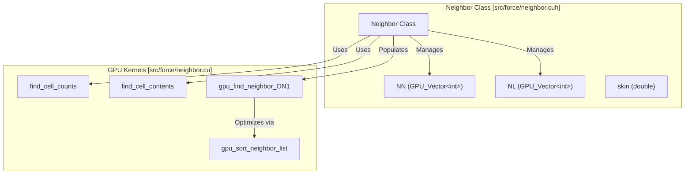
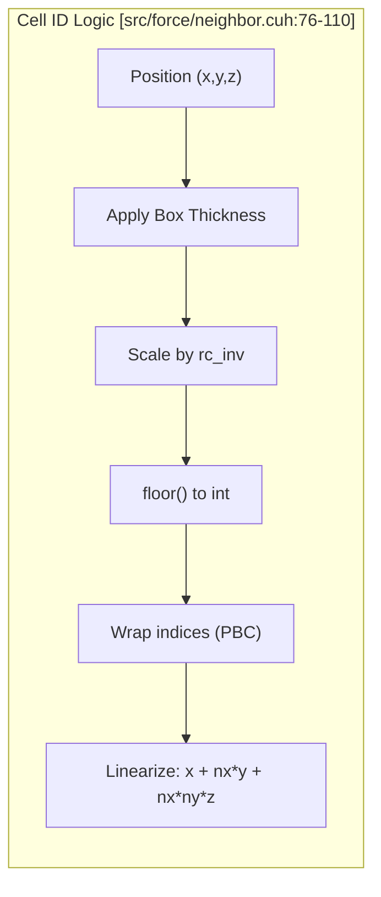

# Neighbor List Generation

Relevant source files

The following files were used as context for generating this wiki page:

- [doc/gpumd/input_parameters/replicate.rst](doc/gpumd/input_parameters/replicate.rst)
- [doc/gpumd/input_parameters/velocity.rst](doc/gpumd/input_parameters/velocity.rst)
- [src/force/neighbor.cu](src/force/neighbor.cu)
- [src/force/neighbor.cuh](src/force/neighbor.cuh)
- [src/force/nep.cu](src/force/nep.cu)
- [src/main_gpumd/replicate.cu](src/main_gpumd/replicate.cu)
- [src/main_gpumd/replicate.cuh](src/main_gpumd/replicate.cuh)
- [src/main_nep/nep.cu](src/main_nep/nep.cu)
- [src/main_nep/nep.cuh](src/main_nep/nep.cuh)
- [src/main_nep/potential.cuh](src/main_nep/potential.cuh)
- [src/model/read_xyz.cu](src/model/read_xyz.cu)
- [src/model/read_xyz.cuh](src/model/read_xyz.cuh)
- [src/utilities/nep_utilities.cuh](src/utilities/nep_utilities.cuh)

This page explains how GPUMD efficiently identifies and manages atom pairs within interaction cutoff distances using neighbor lists. Neighbor list generation is a critical optimization in molecular dynamics simulations that significantly reduces the computational cost of force calculations by storing which atoms are close enough to interact with each other.

## Overview

Neighbor list generation in GPUMD implements a cell-based algorithm that divides the simulation box into a grid of cells. This spatial decomposition allows for efficient $O(N)$ scaling of the neighbor search process instead of the naive $O(N^2)$ approach of checking all possible atom pairs. The primary management of these structures occurs within the `Neighbor` class.

### Code-to-System Mapping: Neighbor Management

The following diagram bridges the high-level neighbor list concepts to the specific C++ entities and GPU kernels used in the implementation.

Sources: [src/force/neighbor.cuh:194-218](), [src/force/neighbor.cu:42-162]()

## Cell List Construction

The cell list is a spatial data structure that partitions the simulation domain into a grid of cells. Each cell has a side length of approximately the cutoff radius $r_c$ (or $r_c/2$ depending on the specific potential requirements). This ensures that atoms in non-adjacent cells are guaranteed to be beyond the cutoff distance.

### Key Steps in Cell List Generation:

1.  **Initialize cell arrays**: Three main arrays managed by the `Neighbor` class:
    *   `cell_count`: Tracks the number of atoms in each cell [src/force/neighbor.cuh:213]().
    *   `cell_count_sum`: Stores the cumulative sum of atom counts (offsets) [src/force/neighbor.cuh:214]().
    *   `cell_contents`: Stores the atom indices for each cell [src/force/neighbor.cuh:215]().
2.  **Count atoms per cell**: The `find_cell_counts` kernel determines how many atoms belong to each cell [src/force/neighbor.cu:42-60]().
3.  **Calculate offsets**: An exclusive scan operation (`thrust::exclusive_scan`) creates offset pointers into the `cell_contents` array [src/force/neighbor.cu:196-197]().
4.  **Populate cell contents**: The `find_cell_contents` kernel assigns atom indices to their respective cells [src/force/neighbor.cu:62-83]().

Sources: [src/force/neighbor.cu:164-215](), [src/force/neighbor.cuh:211-218]()

### Cell ID Calculation

A central operation is mapping atom positions to cell indices. This is handled by the `find_cell_id` device function, which accounts for the simulation box geometry and periodic boundary conditions (PBC).

Sources: [src/force/neighbor.cuh:76-110]()

## Neighbor List Construction

After constructing the cell list, GPUMD builds the actual neighbor lists by examining atom pairs within neighboring cells.

### Standard Neighbor List
The `find_neighbor` function uses the `gpu_find_neighbor_ON1` kernel to populate the list. For every atom $n_1$, the kernel:
1.  Identifies the cell containing $n_1$ [src/force/neighbor.cu:115]().
2.  Iterates through a 3x3x3 grid of neighboring cells [src/force/neighbor.cu:122-124]().
3.  Calculates the distance $d_{12}$ using the Minimum Image Convention (`apply_mic`) [src/force/neighbor.cu:149]().
4.  Stores the neighbor index in `NL` if $d_{12}^2 < \text{cutoff\_square}$ [src/force/neighbor.cu:152-154]().

Sources: [src/force/neighbor.cu:85-162](), [src/force/neighbor.cuh:30-41]()

### Skin Distance Optimization
To avoid rebuilding the neighbor list at every time step, GPUMD employs a "skin distance" optimization. The neighbor list is built with a cutoff $r_c + \delta$, where $\delta$ is the `skin` distance [src/force/neighbor.cuh:212](). The list is only updated when an atom has moved more than $\delta/2$ since the last update.

Sources: [src/force/neighbor.cuh:212-217]()

## Specialized Neighbor Lists

GPUMD implements specialized neighbor list construction for specific potentials and simulation modes:

### NEP Small-Box vs. Large-Box
For the Neuroevolution Potential (NEP), the implementation distinguishes between "small-box" and "large-box" scenarios. 
*   **Large-box**: Standard cell-list search is used.
*   **Small-box**: When the simulation box is smaller than twice the cutoff, atoms can interact with multiple images of the same neighbor. Specialized kernels in `nep_small_box.cuh` handle these cases.

Sources: [src/force/nep.cu:25](), [src/main_nep/nep.cu:34-154]()

### Interlayer Potential (ILP) Neighbor Lists
For layered materials (e.g., graphene, h-BN), `find_neighbor_ilp` builds two separate lists:
1.  **Regular NL**: For atoms in different layers.
2.  **Big ILP NL**: For atoms within the same layer, typically using a larger cutoff for transverse interactions [src/force/neighbor.cuh:44-59]().

Sources: [src/force/neighbor.cu:352-506]()

## Sorting for Performance
After construction, neighbor lists are sorted by atom index using the `gpu_sort_neighbor_list` kernel [src/force/neighbor.cuh:112-136](). Sorting improves memory coalescing and cache hits during the force calculation phase by ensuring that threads in a warp access relatively contiguous atom indices.

Sources: [src/force/neighbor.cuh:112-136](), [src/force/neighbor.cuh:138-192]()

## Summary of Data Structures

| Data Entity | Code Symbol | File |
| :--- | :--- | :--- |
| Neighbor Count | `NN` | [src/force/neighbor.cuh:197]() |
| Neighbor Indices | `NL` | [src/force/neighbor.cuh:197]() |
| Cell Offset | `cell_count_sum` | [src/force/neighbor.cuh:214]() |
| Cell Mapping | `cell_contents` | [src/force/neighbor.cuh:215]() |
| Cutoff Radius | `rc` | [src/force/neighbor.cuh:33]() |
| Skin Distance | `skin` | [src/force/neighbor.cuh:212]() |

Sources: [src/force/neighbor.cuh:194-218]()

---