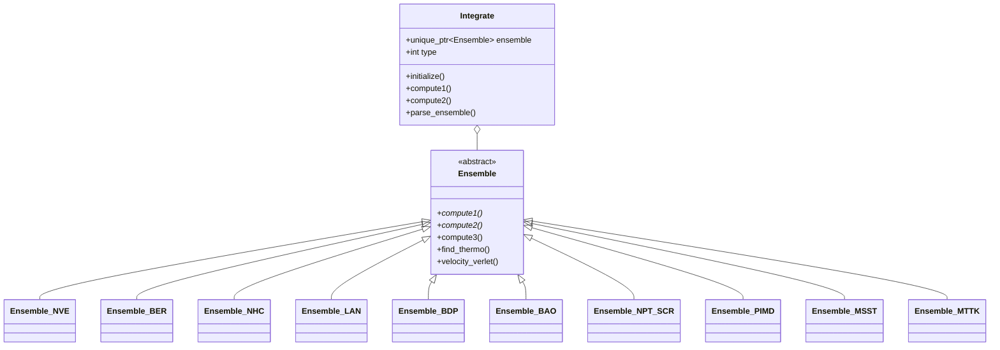
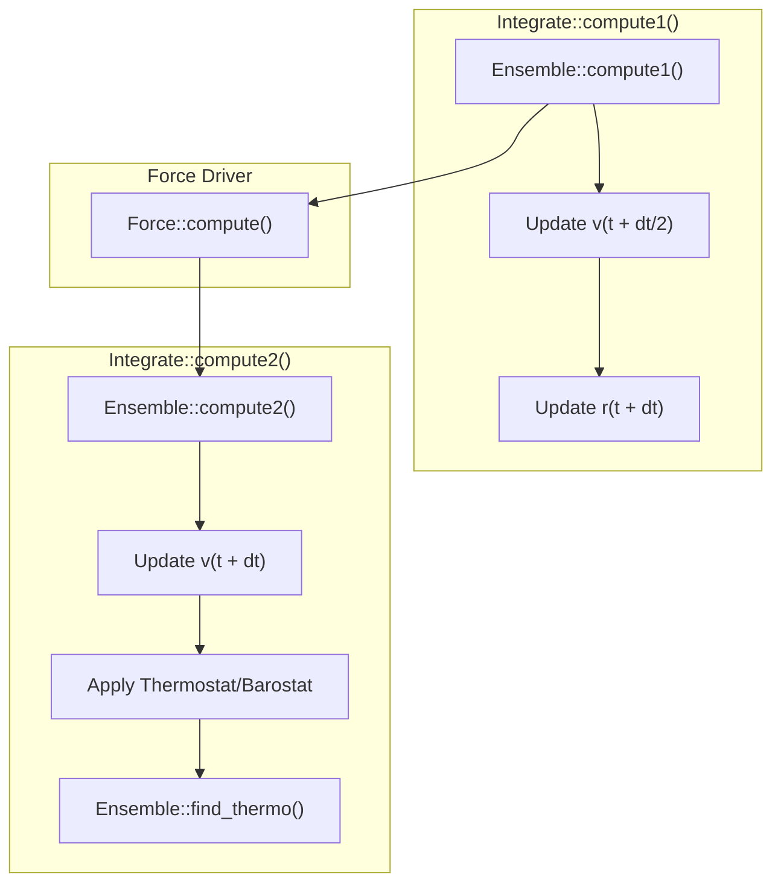

# Integration Methods

Relevant source files

The following files were used as context for generating this wiki page:

- [doc/gpumd/input_parameters/ensemble_msst.rst](doc/gpumd/input_parameters/ensemble_msst.rst)
- [doc/gpumd/input_parameters/ensemble_mttk.rst](doc/gpumd/input_parameters/ensemble_mttk.rst)
- [doc/gpumd/input_parameters/ensemble_nphug.rst](doc/gpumd/input_parameters/ensemble_nphug.rst)
- [doc/gpumd/input_parameters/ensemble_qtb.rst](doc/gpumd/input_parameters/ensemble_qtb.rst)
- [doc/gpumd/input_parameters/ensemble_standard.rst](doc/gpumd/input_parameters/ensemble_standard.rst)
- [src/integrate/ensemble.cu](src/integrate/ensemble.cu)
- [src/integrate/ensemble.cuh](src/integrate/ensemble.cuh)
- [src/integrate/ensemble_bao.cu](src/integrate/ensemble_bao.cu)
- [src/integrate/ensemble_bao.cuh](src/integrate/ensemble_bao.cuh)
- [src/integrate/ensemble_bdp.cu](src/integrate/ensemble_bdp.cu)
- [src/integrate/ensemble_bdp.cuh](src/integrate/ensemble_bdp.cuh)
- [src/integrate/ensemble_ber.cu](src/integrate/ensemble_ber.cu)
- [src/integrate/ensemble_ber.cuh](src/integrate/ensemble_ber.cuh)
- [src/integrate/ensemble_lan.cu](src/integrate/ensemble_lan.cu)
- [src/integrate/ensemble_lan.cuh](src/integrate/ensemble_lan.cuh)
- [src/integrate/ensemble_msst.cu](src/integrate/ensemble_msst.cu)
- [src/integrate/ensemble_msst.cuh](src/integrate/ensemble_msst.cuh)
- [src/integrate/ensemble_mttk.cu](src/integrate/ensemble_mttk.cu)
- [src/integrate/ensemble_mttk.cuh](src/integrate/ensemble_mttk.cuh)
- [src/integrate/ensemble_nhc.cu](src/integrate/ensemble_nhc.cu)
- [src/integrate/ensemble_nhc.cuh](src/integrate/ensemble_nhc.cuh)
- [src/integrate/ensemble_nphug.cu](src/integrate/ensemble_nphug.cu)
- [src/integrate/ensemble_nphug.cuh](src/integrate/ensemble_nphug.cuh)
- [src/integrate/ensemble_npt_qtb.cu](src/integrate/ensemble_npt_qtb.cu)
- [src/integrate/ensemble_npt_qtb.cuh](src/integrate/ensemble_npt_qtb.cuh)
- [src/integrate/ensemble_npt_scr.cu](src/integrate/ensemble_npt_scr.cu)
- [src/integrate/ensemble_npt_scr.cuh](src/integrate/ensemble_npt_scr.cuh)
- [src/integrate/ensemble_nve.cu](src/integrate/ensemble_nve.cu)
- [src/integrate/ensemble_nve.cuh](src/integrate/ensemble_nve.cuh)
- [src/integrate/ensemble_pimd.cu](src/integrate/ensemble_pimd.cu)
- [src/integrate/ensemble_pimd.cuh](src/integrate/ensemble_pimd.cuh)
- [src/integrate/ensemble_qtb.cu](src/integrate/ensemble_qtb.cu)
- [src/integrate/ensemble_qtb.cuh](src/integrate/ensemble_qtb.cuh)
- [src/integrate/integrate.cu](src/integrate/integrate.cu)
- [src/integrate/integrate.cuh](src/integrate/integrate.cuh)
- [src/integrate/langevin_utilities.cuh](src/integrate/langevin_utilities.cuh)
- [src/main_gpumd/add_random_force.cu](src/main_gpumd/add_random_force.cu)
- [src/main_gpumd/add_random_force.cuh](src/main_gpumd/add_random_force.cuh)
- [src/model/atom.cu](src/model/atom.cu)
- [src/model/atom.cuh](src/model/atom.cuh)
- [src/utilities/common.cuh](src/utilities/common.cuh)

## Purpose and Scope

This page describes the integration methods implemented in GPUMD for advancing molecular dynamics (MD) simulations through time. The integration methods control how atom positions and velocities are updated at each timestep, and they implement various thermodynamic ensembles that maintain specific physical conditions like temperature and pressure. For information about force calculation, which is used alongside integration, see [Force Calculation](#3.1).

## Integration Architecture Overview

GPUMD implements a variety of integration methods through a two-level class architecture. The top-level `Integrate` class [src/integrate/integrate.cuh:27-113]() serves as a driver that initializes and manages various ensemble implementations. Each specific ensemble is implemented as a derived class of the abstract `Ensemble` base class [src/integrate/ensemble.cuh:26-157]().

### Integration Class Hierarchy

**Sources:** [src/integrate/integrate.cuh:27-113](), [src/integrate/ensemble.cuh:26-157](), [src/integrate/integrate.cu:75-245]()

The integration process in GPUMD is typically divided into two half-steps, following the velocity Verlet algorithm. This is reflected in the `compute1` and `compute2` methods present in all ensemble implementations [src/integrate/ensemble.cuh:32-44]().

## Integration Process Flow

The integration process is executed in two phases for each timestep, orchestrated by the `Integrate` driver:

**Sources:** [src/integrate/integrate.cu:257-301](), [src/integrate/ensemble.cuh:32-44]()

## Supported Ensembles

GPUMD supports a wide range of ensembles, selected via the `type` parameter in the `Integrate` class [src/integrate/integrate.cu:76-245]().

| Ensemble Type | Description | Class Implementation | Type Code |
|---------------|-------------|---------------------|-----------|
| NVE | Microcanonical ensemble (constant energy) | `Ensemble_NVE` | 0 |
| NVT-Berendsen | Canonical ensemble with Berendsen thermostat | `Ensemble_BER` | 1 |
| NVT-NHC | Canonical ensemble with Nosé-Hoover chain thermostat | `Ensemble_NHC` | 2 |
| NVT-Langevin | Canonical ensemble with Langevin thermostat | `Ensemble_LAN` | 3 |
| NVT-BDP | Canonical ensemble with Bussi-Donadio-Parrinello thermostat | `Ensemble_BDP` | 4 |
| NVT-BAOAB | Canonical ensemble with BAOAB Langevin thermostat | `Ensemble_BAO` | 5 |
| NPT-Berendsen | Isothermal-isobaric ensemble with Berendsen barostat | `Ensemble_BER` | 11 |
| NPT-SCR | Isothermal-isobaric ensemble with stochastic cell rescaling | `Ensemble_NPT_SCR` | 12 |
| NPT-MTTK | Martyna-Tobias-Tuckerman-Klein NPT ensemble | `Ensemble_MTTK` | -3 |
| PIMD/RPMD | Path integral / Ring polymer MD | `Ensemble_PIMD` | 31-33 |
| MSST | Multi-Scale Shock Technique | `Ensemble_MSST` | -1 |

**Sources:** [src/integrate/integrate.cu:76-245](), [src/integrate/ensemble_mttk.cu:97-105]()

### The Velocity Verlet Algorithm

The core integration algorithm is implemented in the `Ensemble::velocity_verlet` function [src/integrate/ensemble.cuh:114-121](). It uses GPU kernels `gpu_velocity_verlet` to perform the updates in parallel across all atoms.

1. **Step 1 (`is_step1 = true`)**: 
   - $v(t + \Delta t/2) = v(t) + \frac{f(t)}{m} \frac{\Delta t}{2}$
   - $r(t + \Delta t) = r(t) + v(t + \Delta t/2) \Delta t$
2. **Step 2 (`is_step1 = false`)**:
   - $v(t + \Delta t) = v(t + \Delta t/2) + \frac{f(t + \Delta t)}{m} \frac{\Delta t}{2}$

**Sources:** [src/integrate/ensemble.cu:113-214]()

## Thermostats and Barostats

### Berendsen Thermostat and Barostat
Implemented in `Ensemble_BER`, it uses simple velocity scaling for temperature control and box scaling for pressure control [src/integrate/ensemble_ber.cu:70-86](). It supports orthogonal, isotropic, and triclinic pressure coupling [src/integrate/ensemble_ber.cu:88-176]().

### Nosé-Hoover Chain (NHC)
Implemented in `Ensemble_NHC`, this provides a deterministic method to sample the canonical ensemble by extending the system with a chain of thermostat variables [src/integrate/ensemble_nhc.cu:100-169]().

### Langevin Thermostat
Implemented in `Ensemble_LAN`, it uses the Bussi-Parrinello scheme [src/integrate/ensemble_lan.cu:17-19](). It adds random forces via `curand_states` and applies friction to maintain the target temperature [src/integrate/ensemble_lan.cu:100-109]().

### Stochastic Cell Rescaling (SCR)
Implemented in `Ensemble_NPT_SCR`, this is a stochastic barostat combined with the BDP thermostat [src/integrate/ensemble_npt_scr.cu:17-21](). It uses stochastic terms in cell rescaling to ensure proper NPT sampling [src/integrate/ensemble_npt_scr.cu:88-135]().

## Specialized Integration Methods

### Path Integral Molecular Dynamics (PIMD)
`Ensemble_PIMD` manages simulations where atoms are represented by multiple "beads" [src/integrate/ensemble_pimd.cuh:27-82]().
- **Transformation**: Uses a `transformation_matrix` to move between Cartesian coordinates and normal mode coordinates [src/integrate/ensemble_pimd.cu:152-172]().
- **Bead Management**: Stores bead positions, velocities, and forces in `std::vector<GPU_Vector<double>>` within the `Atom` class [src/model/atom.cuh:44-49]().

### Multi-Scale Shock Technique (MSST)
`Ensemble_MSST` implements shock wave simulations by evolving the system volume and strain rate according to the shock velocity $v_s$ [src/integrate/ensemble_msst.cu:101-160](). It uses a specialized `gpu_msst_v` kernel to update velocities under shock conditions [src/integrate/ensemble_msst.cu:57-88]().

### Martyna-Tobias-Tuckerman-Klein (MTTK)
`Ensemble_MTTK` provides a unified framework for NVT, NPT, and NPH ensembles using Nosé-Hoover thermostats and Parrinello-Rahman barostats [src/integrate/ensemble_mttk.cu:16-21](). It involves complex 3x3 matrix operations for the barostat implementation [src/integrate/ensemble_mttk.cu:30-77]().

## Group-Based Integration and Constraints

GPUMD allows for fixing or moving specific groups of atoms:
- **Fixed Group**: Atoms in the `fixed_group` have their velocities and forces effectively ignored during integration updates [src/integrate/ensemble.cu:145-151]().
- **Move Group**: Atoms in the `move_group` are moved with a constant `move_velocity` [src/integrate/ensemble.cu:152-158]().
- **Grouped Thermostats**: For heat transport simulations (NEMD), different thermostats can be applied to "source" and "sink" groups to maintain a temperature gradient [src/integrate/integrate.cu:158-217]().

**Sources:** [src/integrate/integrate.cu:59-73](), [src/integrate/ensemble.cu:113-174]()

---