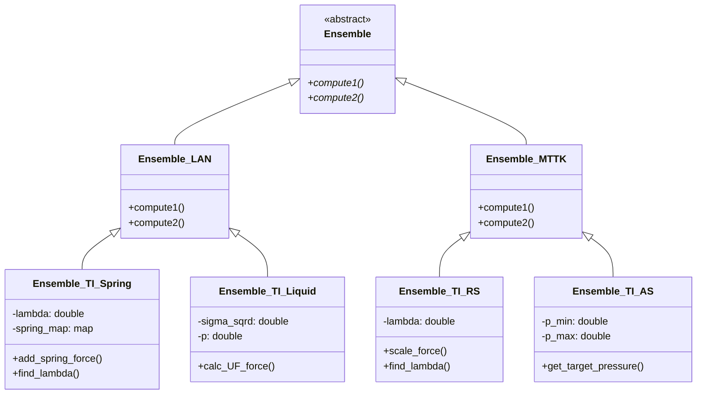
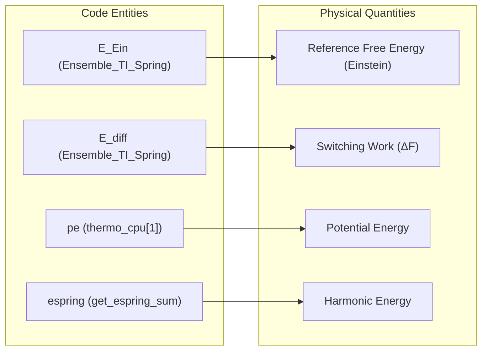

# Thermodynamic Integration and Free Energy

<details>
<summary>Relevant source files</summary>

The following files were used as context for generating this wiki page:

- [doc/gpumd/input_parameters/ensemble_ti.rst](doc/gpumd/input_parameters/ensemble_ti.rst)
- [doc/gpumd/input_parameters/ensemble_ti_as.rst](doc/gpumd/input_parameters/ensemble_ti_as.rst)
- [doc/gpumd/input_parameters/ensemble_ti_rs.rst](doc/gpumd/input_parameters/ensemble_ti_rs.rst)
- [doc/gpumd/input_parameters/ensemble_ti_spring.rst](doc/gpumd/input_parameters/ensemble_ti_spring.rst)
- [src/force/force_constant.cu](src/force/force_constant.cu)
- [src/force/force_constant.cuh](src/force/force_constant.cuh)
- [src/integrate/ensemble_ti.cu](src/integrate/ensemble_ti.cu)
- [src/integrate/ensemble_ti.cuh](src/integrate/ensemble_ti.cuh)
- [src/integrate/ensemble_ti_as.cu](src/integrate/ensemble_ti_as.cu)
- [src/integrate/ensemble_ti_as.cuh](src/integrate/ensemble_ti_as.cuh)
- [src/integrate/ensemble_ti_liquid.cu](src/integrate/ensemble_ti_liquid.cu)
- [src/integrate/ensemble_ti_liquid.cuh](src/integrate/ensemble_ti_liquid.cuh)
- [src/integrate/ensemble_ti_rs.cu](src/integrate/ensemble_ti_rs.cu)
- [src/integrate/ensemble_ti_rs.cuh](src/integrate/ensemble_ti_rs.cuh)
- [src/integrate/ensemble_ti_spring.cu](src/integrate/ensemble_ti_spring.cu)
- [src/integrate/ensemble_ti_spring.cuh](src/integrate/ensemble_ti_spring.cuh)
- [tests/gpumd/ti-liquid/self_consistent/model.xyz](tests/gpumd/ti-liquid/self_consistent/model.xyz)
- [tests/gpumd/ti-liquid/self_consistent/nep_al.txt](tests/gpumd/ti-liquid/self_consistent/nep_al.txt)

</details>


Thermodynamic Integration (TI) is a computational framework implemented in GPUMD for calculating absolute free energies. GPUMD supports several TI methods, including integration from an Einstein crystal (for solids), reversible scaling (for temperature paths), adiabatic switching (for pressure paths), and integration from a repulsive reference (for liquids).

## Implementation Overview

GPUMD implements TI through a hierarchy of ensemble classes. Each TI method inherits from a base ensemble type (either Langevin or MTTK) and implements specialized force scaling or auxiliary potential logic.

### Class Hierarchy and Data Flow

The following diagram shows how the TI ensembles relate to the core MD engine and each other.


**Sources:** [src/integrate/ensemble_ti_spring.cuh:26-27](), [src/integrate/ensemble_ti_rs.cuh:24-25](), [src/integrate/ensemble_ti_liquid.cuh:26-27](), [src/integrate/ensemble_ti_as.cuh:17-18]()

---

## 1. Einstein Crystal Integration (`ti_spring`)

This method calculates the absolute free energy of a solid by constructing a path to an Einstein crystal, where atoms are tethered to reference positions by harmonic springs.

### Theory and Logic
The Hamiltonian is coupled via $\lambda$:
$H(\lambda) = (1-\lambda)H_{target} + \lambda H_{spring}$

The spring force is calculated and blended in the `gpu_add_spring_force` kernel:
`fx[i] = (1 - lambda) * fx[i] + lambda * (-k[i] * dx);` [src/integrate/ensemble_ti_spring.cu:45-47]()

### Simulation Workflow
1. **Equilibration (`t_equil`):** System evolves under the target potential. If spring constants aren't provided, they are calculated via Mean Square Displacement (MSD) using the `gpu_add_msd` kernel [src/integrate/ensemble_ti_spring.cu:52-72]().
2. **Switching (`t_switch`):** $\lambda$ is varied from 0 to 1 (Forward) and 1 to 0 (Backward) using a 5th-order polynomial switching function `switch_func` [src/integrate/ensemble_ti_spring.cu:374-386]().

**Sources:** [src/integrate/ensemble_ti_spring.cu:22-50](), [src/integrate/ensemble_ti_spring.cu:294-346](), [doc/gpumd/input_parameters/ensemble_ti_spring.rst:6-23]()

---

## 2. Reversible Scaling (`ti_rs`)

Reversible Scaling (RS) calculates Gibbs free energy along an isobaric path by scaling the potential energy and forces. It is typically used to find the free energy at a high temperature given a known reference at a lower temperature.

### Scaling Mechanism
The forces and virials are scaled by $\lambda$ in the `gpu_scale_force` kernel:
```cpp
fx[i] *= lambda;
sxx[i] *= lambda;
```
**Sources:** [src/integrate/ensemble_ti_rs.cu:22-47]()

The coupling parameter $\lambda$ is defined as $\lambda = T_{ref}/T$. By scaling the potential, the system at temperature $T$ behaves as if it were at $T_{ref}$ under the scaled potential.

**Sources:** [src/integrate/ensemble_ti_rs.cu:161-166](), [doc/gpumd/input_parameters/ensemble_ti_rs.rst:6-19]()

---

## 3. Adiabatic Switching (`ti_as`)

Adiabatic Switching (AS) is used to calculate free energy differences along an isothermal path by continuously varying the pressure between $P_{min}$ and $P_{max}$.

### Implementation
Unlike `ti_spring` or `ti_rs`, `ti_as` does not scale forces directly. Instead, it dynamically updates the `p_target` matrix used by the `Ensemble_MTTK` barostat during the `compute1` phase.

```cpp
void Ensemble_TI_AS::get_target_pressure() {
    // ... logic to ramp p_target from p_min to p_max ...
    pp = (t * r_switch) * delta_p + p_min;
    for (int ii = 0; ii < 3; ii++)
        p_target[ii][ii] = pp;
}
```
**Sources:** [src/integrate/ensemble_ti_as.cu:197-215](), [doc/gpumd/input_parameters/ensemble_ti_as.rst:6-20]()

---

## 4. Liquid TI (`ti_liquid`)

This method calculates the free energy of a liquid by integrating from a reference system defined by the Uhlenbeck-Ford (UF) potential, which is purely repulsive and has a known analytical free energy.

### UF Force Calculation
The `calc_UF_force` kernel computes the forces based on the UF potential:
$V_{UF}(r) = -k_B T \ln(1 - \exp(-r^2/\sigma^2))$

```cpp
eUF_i -= p / beta * logf(1 - exp(-d12_sqrd / sigma_sqrd));
factor = -2 * p / (beta * sigma_sqrd * (exp((d12_sqrd / sigma_sqrd)) - 1));
```
**Sources:** [src/integrate/ensemble_ti_liquid.cu:38-96]()

The forces are then blended with the target potential forces using $\lambda$ in the `gpu_add_UF_force` kernel [src/integrate/ensemble_ti_liquid.cu:98-123]().

---

## Data Output and Analysis

Each TI method produces a specific CSV file for post-processing.

| Ensemble | Output File | Key Columns | Purpose |
| :--- | :--- | :--- | :--- |
| `ti_spring` | `ti_spring.csv` | `lambda`, `pe`, `espring` | Einstein crystal to Solid |
| `ti_rs` | `ti_rs.csv` | `lambda`, `enthalpy` | Temperature integration |
| `ti_as` | `ti_as.csv` | `p`, `V` | Pressure integration |
| `ti_liquid` | `ti_liquid.csv` | `lambda`, `pe`, `eUF` | UF potential to Liquid |

**Sources:** [src/integrate/ensemble_ti_spring.cu:168](), [src/integrate/ensemble_ti_rs.cu:181](), [src/integrate/ensemble_ti_as.cu:151](), [src/integrate/ensemble_ti_liquid.cu:253]()

### Free Energy Reconstruction (Code-to-System Mapping)

The following diagram maps the variables in the code to the physical quantities required for free energy reconstruction in the `ti_spring` method.


**Sources:** [src/integrate/ensemble_ti_spring.cu:214-230](), [src/integrate/ensemble_ti_spring.cuh:58-63]()

### Post-processing Equations
- **Solid Free Energy:** $F = F_{Einstein} + \int_0^1 \langle U_{target} - U_{spring} \rangle_{\lambda} d\lambda$
- **RS Gibbs Free Energy:** $G(T) = \frac{G(T_{ref}) + 1.5 k_B T_{ref} \ln(\lambda) + W_{RS}}{\lambda}$
- **AS Gibbs Free Energy:** $G(P) = G(P_{ref}) + \int_{P_{ref}}^P V(P') dP'$

**Sources:** [doc/gpumd/input_parameters/ensemble_ti_rs.rst:68](), [doc/gpumd/input_parameters/ensemble_ti_as.rst:66](), [src/integrate/ensemble_ti_spring.cu:229]()

---