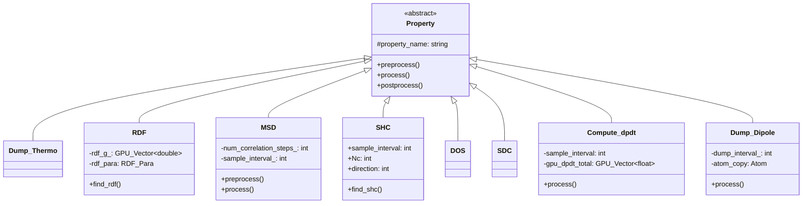
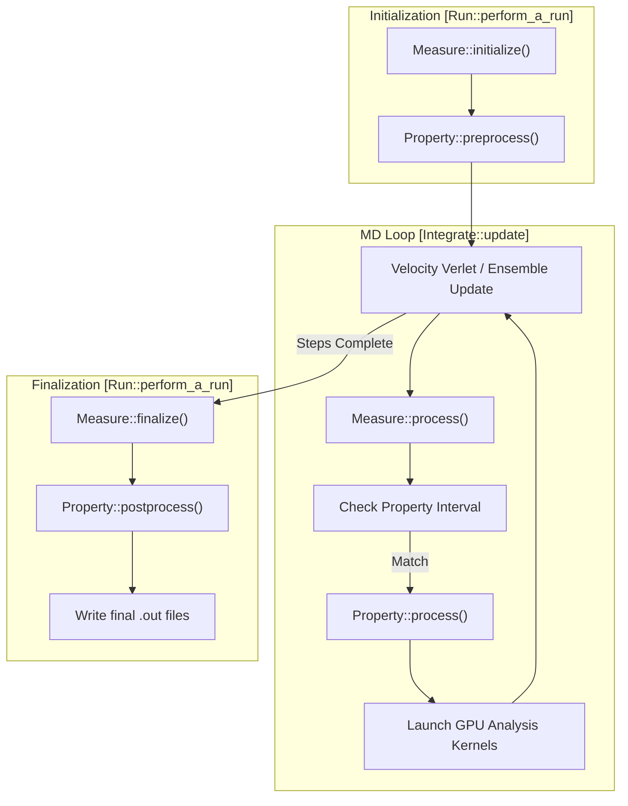

# Measurement and Analysis

<details>
<summary>Relevant source files</summary>

The following files were used as context for generating this wiki page:

- [doc/gpumd/input_parameters/compute.rst](doc/gpumd/input_parameters/compute.rst)
- [doc/gpumd/input_parameters/compute_dos.rst](doc/gpumd/input_parameters/compute_dos.rst)
- [doc/gpumd/input_parameters/compute_hac.rst](doc/gpumd/input_parameters/compute_hac.rst)
- [doc/gpumd/input_parameters/compute_hnemd.rst](doc/gpumd/input_parameters/compute_hnemd.rst)
- [doc/gpumd/input_parameters/compute_shc.rst](doc/gpumd/input_parameters/compute_shc.rst)
- [doc/gpumd/input_parameters/fix.rst](doc/gpumd/input_parameters/fix.rst)
- [doc/gpumd/input_parameters/move.rst](doc/gpumd/input_parameters/move.rst)
- [doc/gpumd/output_files/dos_out.rst](doc/gpumd/output_files/dos_out.rst)
- [doc/gpumd/output_files/shc_out.rst](doc/gpumd/output_files/shc_out.rst)
- [doc/theory/heat_transport.rst](doc/theory/heat_transport.rst)
- [src/force/force.cu](src/force/force.cu)
- [src/force/force.cuh](src/force/force.cuh)
- [src/main_gpumd/run.cu](src/main_gpumd/run.cu)
- [src/measure/adf.cu](src/measure/adf.cu)
- [src/measure/adf.cuh](src/measure/adf.cuh)
- [src/measure/angular_rdf.cu](src/measure/angular_rdf.cu)
- [src/measure/angular_rdf.cuh](src/measure/angular_rdf.cuh)
- [src/measure/compute.cu](src/measure/compute.cu)
- [src/measure/compute.cuh](src/measure/compute.cuh)
- [src/measure/compute_dpdt.cu](src/measure/compute_dpdt.cu)
- [src/measure/compute_dpdt.cuh](src/measure/compute_dpdt.cuh)
- [src/measure/compute_es.cu](src/measure/compute_es.cu)
- [src/measure/compute_es.cuh](src/measure/compute_es.cuh)
- [src/measure/compute_heat.cu](src/measure/compute_heat.cu)
- [src/measure/compute_heat.cuh](src/measure/compute_heat.cuh)
- [src/measure/dos.cu](src/measure/dos.cu)
- [src/measure/dos.cuh](src/measure/dos.cuh)
- [src/measure/dump_dipole.cu](src/measure/dump_dipole.cu)
- [src/measure/dump_dipole.cuh](src/measure/dump_dipole.cuh)
- [src/measure/dump_observer.cu](src/measure/dump_observer.cu)
- [src/measure/dump_observer.cuh](src/measure/dump_observer.cuh)
- [src/measure/dump_polarizability.cu](src/measure/dump_polarizability.cu)
- [src/measure/dump_polarizability.cuh](src/measure/dump_polarizability.cuh)
- [src/measure/hac.cu](src/measure/hac.cu)
- [src/measure/hnemd_kappa.cu](src/measure/hnemd_kappa.cu)
- [src/measure/hnemd_kappa.cuh](src/measure/hnemd_kappa.cuh)
- [src/measure/hnemdec_kappa.cu](src/measure/hnemdec_kappa.cu)
- [src/measure/hnemdec_kappa.cuh](src/measure/hnemdec_kappa.cuh)
- [src/measure/lsqt.cu](src/measure/lsqt.cu)
- [src/measure/lsqt.cuh](src/measure/lsqt.cuh)
- [src/measure/measure.cu](src/measure/measure.cu)
- [src/measure/measure.cuh](src/measure/measure.cuh)
- [src/measure/modal_analysis.cu](src/measure/modal_analysis.cu)
- [src/measure/modal_analysis.cuh](src/measure/modal_analysis.cuh)
- [src/measure/msd.cu](src/measure/msd.cu)
- [src/measure/msd.cuh](src/measure/msd.cuh)
- [src/measure/parse_utilities.cu](src/measure/parse_utilities.cu)
- [src/measure/parse_utilities.cuh](src/measure/parse_utilities.cuh)
- [src/measure/rdf.cu](src/measure/rdf.cu)
- [src/measure/rdf.cuh](src/measure/rdf.cuh)
- [src/measure/sdc.cu](src/measure/sdc.cu)
- [src/measure/sdc.cuh](src/measure/sdc.cuh)
- [src/measure/shc.cu](src/measure/shc.cu)
- [src/measure/shc.cuh](src/measure/shc.cuh)
- [src/measure/viscosity.cu](src/measure/viscosity.cu)
- [src/measure/viscosity.cuh](src/measure/viscosity.cuh)
- [src/utilities/gpu_vector.cuh](src/utilities/gpu_vector.cuh)

</details>


The Measurement and Analysis system in GPUMD enables users to monitor, record, and analyze physical properties during molecular dynamics simulations. This module provides capabilities for measuring thermodynamic quantities, tracking atomic properties, and calculating transport and vibrational phenomena using a standardized `Property` framework.

## Architecture Overview

The measurement system is structured around a common interface that allows different measurement modules to be plugged into the simulation loop. Each measurement property inherits from a base `Property` class and implements methods for preprocessing, processing during simulation steps, and postprocessing.

### Measurement Class Hierarchy



Sources: [src/measure/property.cuh:18-50](), [src/measure/rdf.cuh:24-97](), [src/measure/msd.cuh:38-83](), [src/measure/shc.cuh:30-80](), [src/measure/compute_dpdt.cuh:24-60](), [src/measure/dump_dipole.cuh:23-64]()

## Measurement Integration Flow

The `Measure` driver class manages the lifecycle of all active properties. During the MD loop in `Run::perform_a_run`, the `Measure::process` method is called at every step, which in turn iterates through all registered properties.



Sources: [src/main_gpumd/run.cu:212-215](), [src/measure/measure.cu:26-67](), [src/measure/measure.cu:91-120](), [src/measure/measure.cu:69-89]()

## Core Measurement Modules

### Transport Properties

#### Spectral Heat Current (SHC)
Calculates frequency-resolved heat current using the HNEMD or EMD framework. It correlates atomic virials and velocities to determine the contribution of different phonon modes to thermal conductivity.
- **Kernel**: `gpu_find_k` aggregates spatial correlations across the specified group.
- **Input**: `compute_shc` command in `run.in`.
- **Output**: `shc.out`.

Sources: [src/measure/shc.cu:81-130](), [src/measure/shc.cu:162-202]()

#### Mean-Square Displacement (MSD) & Diffusion
Tracks the displacement of atoms over time to calculate the self-diffusion coefficient (SDC).
- **Implementation**: Uses `gpu_find_msd` or `gpu_find_msd_per_group` to compute $(r(t) - r(0))^2$.
- **Data Flow**: Positions are sampled at `sample_interval` and stored in a correlation buffer.
- **Output**: `msd.out` and `sdc.out`.

Sources: [src/measure/msd.cu:89-149](), [src/measure/msd.cu:151-202]()

### Structural Analysis

#### Radial Distribution Function (RDF)
Calculates the spatial correlation between atom pairs.
- **Optimization**: Uses a cell-list algorithm (`find_cell_list`) to achieve $O(N)$ scaling.
- **Kernel**: `gpu_find_rdf_ON1` computes distances between atoms in neighboring cells and increments histogram bins using `atomicAdd`.
- **Output**: `rdf.out`.

Sources: [src/measure/rdf.cu:37-125](), [src/measure/rdf.cu:128-161]()

### NEP-Specific Measurements

#### Polarization and Dipole (TNEP)
For Neuroevolution Potentials (NEP) trained on tensorial properties, GPUMD can dump dipole moments and their time derivatives.
- **Dipole**: `Dump_Dipole` recomputes forces/virials using the dipole NEP model and aggregates them via `sum_dipole`.
- **dp/dt**: `Compute_dpdt` uses Born Effective Charges (BEC) from the NEP model and atomic velocities to calculate the time derivative of polarization.
- **Kernel**: `gpu_compute_dpdt` performs the matrix-vector product $Z^* \cdot v$.

Sources: [src/measure/dump_dipole.cu:33-68](), [src/measure/compute_dpdt.cu:30-53](), [src/measure/compute_dpdt.cu:130-147]()

## Data Workflow: From GPU to Output

The measurement system minimizes host-device communication by performing reductions on the GPU.

| Property | GPU Data Source | GPU Reduction Kernel | Host Output File |
| :--- | :--- | :--- | :--- |
| **Thermodynamics** | `thermo` vector | `gpu_sum_thermo` | `thermo.out` |
| **RDF** | `position_per_atom` | `gpu_find_rdf_ON1` | `rdf.out` |
| **MSD** | `position_per_atom` | `gpu_find_msd` | `msd.out` |
| **Viscosity** | `virial_per_atom` | `gpu_find_stress_correlation` | `viscosity.out` |
| **Dipole** | `virial_per_atom` | `sum_dipole` | `dipole.out` |

Sources: [src/measure/rdf.cu:144-160](), [src/measure/msd.cu:139-149](), [src/measure/dump_dipole.cu:215-220](), [src/measure/compute_dpdt.cu:146-147]()

## Grouping and Parsing Utilities

Measurements can be restricted to specific subsets of atoms using the `Group` framework. The `parse_group` utility in `src/measure/parse_utilities.cu` standardizes how keywords like `group` are handled across different measurement commands.

```cpp
// Example of how groups are applied in process()
if (grouping_method_ >= 0) {
    gpu_copy_position<<<...>>>(
        num_atoms_, 
        groups[grouping_method_].contents.data(), 
        atom.position_per_atom.data(), ...
    );
}
```

Sources: [src/measure/parse_utilities.cu:51-79](), [src/measure/msd.cu:52-70]()

## Output File Formats

### thermo.out
Contains global quantities sampled at `dump_thermo` intervals.
- **Columns**: Temperature, Kinetic Energy, Potential Energy, 6 Stress components (GPa), 9 Box components (Å).

### movie.xyz
Standard Extended XYZ format.
- **Header**: Number of atoms.
- **Comment Line**: Contains `Lattice="..."`, `Properties=species:S:1:pos:R:3`, and simulation time.

Sources: [src/measure/dump_thermo.cu:62-120](), [src/measure/dump_xyz.cu:105-140]()

---