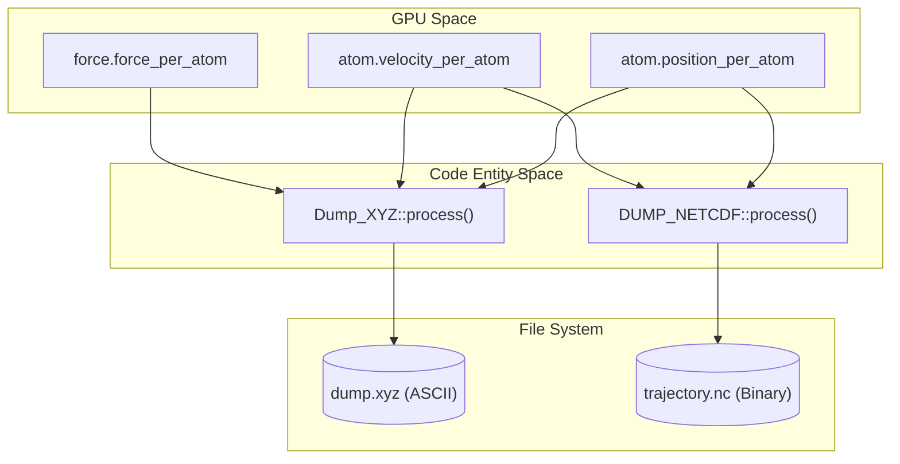

# Output and Dump Commands

Relevant source files

The following files were used as context for generating this wiki page:

- [doc/GPUMD-Manual.pdf](doc/GPUMD-Manual.pdf)
- [doc/bibliography.rst](doc/bibliography.rst)
- [doc/glossary.rst](doc/glossary.rst)
- [doc/gpumd-mdi/README.md](doc/gpumd-mdi/README.md)
- [doc/gpumd/input_files/kpoints_in.rst](doc/gpumd/input_files/kpoints_in.rst)
- [doc/gpumd/input_files/run_in.rst](doc/gpumd/input_files/run_in.rst)
- [doc/gpumd/input_parameters/compute_chunk.rst](doc/gpumd/input_parameters/compute_chunk.rst)
- [doc/gpumd/input_parameters/compute_phonon.rst](doc/gpumd/input_parameters/compute_phonon.rst)
- [doc/gpumd/input_parameters/compute_rdf.rst](doc/gpumd/input_parameters/compute_rdf.rst)
- [doc/gpumd/input_parameters/dump_beads.rst](doc/gpumd/input_parameters/dump_beads.rst)
- [doc/gpumd/input_parameters/dump_netcdf.rst](doc/gpumd/input_parameters/dump_netcdf.rst)
- [doc/gpumd/input_parameters/dump_observer.rst](doc/gpumd/input_parameters/dump_observer.rst)
- [doc/gpumd/input_parameters/dump_xyz.rst](doc/gpumd/input_parameters/dump_xyz.rst)
- [doc/gpumd/input_parameters/ensemble.rst](doc/gpumd/input_parameters/ensemble.rst)
- [doc/gpumd/input_parameters/index.rst](doc/gpumd/input_parameters/index.rst)
- [doc/gpumd/input_parameters/minimize.rst](doc/gpumd/input_parameters/minimize.rst)
- [doc/gpumd/output_files/dump_xyz.rst](doc/gpumd/output_files/dump_xyz.rst)
- [doc/gpumd/output_files/index.rst](doc/gpumd/output_files/index.rst)
- [doc/gpumd/output_files/observer_xyz.rst](doc/gpumd/output_files/observer_xyz.rst)
- [doc/gpumd/output_files/omega2_out.rst](doc/gpumd/output_files/omega2_out.rst)
- [doc/gpumd/output_files/rdf_out.rst](doc/gpumd/output_files/rdf_out.rst)
- [doc/gpumd/output_files/thermo_out.rst](doc/gpumd/output_files/thermo_out.rst)
- [doc/theory/ensembles.rst](doc/theory/ensembles.rst)
- [examples/gpumd_mdi/run.in](examples/gpumd_mdi/run.in)
- [src/main_gpumd/deposition.cu](src/main_gpumd/deposition.cu)
- [src/main_gpumd/deposition.cuh](src/main_gpumd/deposition.cuh)
- [src/main_mdi/run.cu](src/main_mdi/run.cu)
- [src/measure/compute_chunk.cu](src/measure/compute_chunk.cu)
- [src/measure/compute_chunk.cuh](src/measure/compute_chunk.cuh)
- [src/measure/dump_beads.cu](src/measure/dump_beads.cu)
- [src/measure/dump_beads.cuh](src/measure/dump_beads.cuh)
- [src/measure/dump_cg.cu](src/measure/dump_cg.cu)
- [src/measure/dump_cg.cuh](src/measure/dump_cg.cuh)
- [src/measure/dump_netcdf.cu](src/measure/dump_netcdf.cu)
- [src/measure/dump_netcdf.cuh](src/measure/dump_netcdf.cuh)
- [src/measure/dump_restart.cu](src/measure/dump_restart.cu)
- [src/measure/dump_restart.cuh](src/measure/dump_restart.cuh)
- [src/measure/dump_thermo.cu](src/measure/dump_thermo.cu)
- [src/measure/dump_thermo.cuh](src/measure/dump_thermo.cuh)
- [src/measure/dump_xyz.cu](src/measure/dump_xyz.cu)
- [src/measure/dump_xyz.cuh](src/measure/dump_xyz.cuh)
- [tests/gpumd/msd/self_consistent/run.in](tests/gpumd/msd/self_consistent/run.in)
- [tests/gpumd/msd/test_compute_msd.py](tests/gpumd/msd/test_compute_msd.py)
- [tests_pytest/test_io_dump_commands.py](tests_pytest/test_io_dump_commands.py)

The GPUMD codebase provides a flexible and modular system for exporting simulation data, ranging from global thermodynamic properties to per-atom trajectories and specialized machine-learning descriptors. These mechanisms are primarily implemented within the `Measure` framework, where specific "Dump" classes inherit from the `Property` base class to handle data accumulation and file I/O during the MD loop.

## Architecture and Data Flow

All dump commands follow a common lifecycle managed by the `Run` loop. Each command is parsed from `run.in`, initialized, and then called at specified intervals during the simulation.

### The Property Lifecycle
1.  **Parsing**: Parameters (interval, filename, groups) are read in the constructor's `parse()` method [src/measure/dump_xyz.cu:70-188]().
2.  **Preprocess**: Files are opened (usually in append mode) and memory is allocated on the host/device [src/measure/dump_thermo.cu:50-71]().
3.  **Process**: At every $N$ steps, data is copied from GPU memory (via `GPU_Vector`) to the host and written to disk [src/measure/dump_thermo.cu:73-132]().
4.  **Postprocess**: Files are closed and final statistics are calculated [src/measure/dump_thermo.cu:134-143]().

### Entity Mapping: Command to Code
The following diagram maps the `run.in` keywords to their respective implementation classes and primary output files.

| Keyword | Implementation Class | Primary Output File |
| :--- | :--- | :--- |
| `dump_thermo` | `Dump_Thermo` [src/measure/dump_thermo.cuh:25]() | `thermo.out` |
| `dump_xyz` | `Dump_XYZ` [src/measure/dump_xyz.cuh:25]() | `dump.xyz` |
| `dump_netcdf` | `DUMP_NETCDF` [src/measure/dump_netcdf.cuh:43]() | `*.nc` |
| `dump_restart` | `Dump_Restart` [src/measure/dump_restart.cuh:22]() | `restart.xyz` |
| `dump_beads` | `Dump_Beads` [src/measure/dump_beads.cuh:22]() | `beads.xyz` |
| `compute_chunk` | `Compute_Chunk` [src/measure/compute_chunk.cuh:22]() | `chunk.out` |

**Sources:** [doc/gpumd/input_parameters/index.rst:80-91](), [doc/gpumd/output_files/index.rst:7-152]()

---

## Global Thermodynamics: `dump_thermo`

The `dump_thermo` command exports global system properties. It retrieves data from the `gpu_thermo` vector, which is updated during force evaluation and integration.

*   **Implementation**: `Dump_Thermo` class [src/measure/dump_thermo.cu:30-35]().
*   **Data Layout**: Outputs temperature, kinetic energy, potential energy, 6 stress components (Voigt notation: $xx, yy, zz, yz, xz, xy$), and the 9 box matrix elements ($h_{ij}$) [src/measure/dump_thermo.cu:106-130]().
*   **Unit Conversion**: Stress is converted to GPa using `PRESSURE_UNIT_CONVERSION` [src/measure/dump_thermo.cu:112-117]().

**Sources:** [src/measure/dump_thermo.cu:1-143](), [doc/gpumd/output_files/thermo_out.rst:1-20]()

---

## Trajectory Output: `dump_xyz` and `dump_netcdf`

GPUMD supports both the human-readable extended XYZ format and the high-performance binary NetCDF format for trajectories.

### Extended XYZ (`dump_xyz`)
This command is highly customizable, allowing users to select specific properties to dump per atom.
*   **Supported Quantities**: Position, Velocity, Force, Potential, Unwrapped Position, Mass, Charge, Born Effective Charges (BEC), and Virial [src/measure/dump_xyz.cuh:61-71]().
*   **NEP Integration**: If `is_nep_charge` is detected, it can output predicted charges and BECs [src/measure/dump_xyz.cu:156-167]().
*   **Multi-file Output**: Using a wildcard `*` in the filename triggers separated file output for each frame [src/measure/dump_xyz.cu:101-107]().

### NetCDF Trajectory (`dump_netcdf`)
Implemented for large-scale simulations where I/O speed and storage space are critical.
*   **Standards**: Follows AMBER 1.0 trajectory conventions [src/measure/dump_netcdf.cu:16-29]().
*   **Features**: Supports NetCDF4 deflate compression (levels 0-9) and selectable precision (float/double) [src/measure/dump_netcdf.cu:158-183]().

### Trajectory Data Flow

**Sources:** [src/measure/dump_xyz.cu:1-188](), [src/measure/dump_netcdf.cu:81-185]()

---

## Specialized Dumps

### `dump_restart`
Writes the current state of the simulation (positions, velocities, and box dimensions) to `restart.xyz`. This file is overwritten at every interval to ensure only the latest state is kept for crash recovery [doc/gpumd/output_files/index.rst:20-23]().

### `dump_beads`
Used in Path-Integral Molecular Dynamics (PIMD). It dumps the coordinates of all beads in the ring polymer [src/measure/dump_beads.cu:1-50]().

### `dump_cg` (Coarse-Graining)
Dumps training data for NEP-CG (Coarse-Grained Neuroevolution Potentials).
*   **Functionality**: Calculates Center of Mass (COM) positions and total forces for groups of atoms defined as "beads" [src/measure/dump_cg.cu:130-191]().
*   **Output**: Writes to `train.xyz` in a format compatible with NEP training [src/measure/dump_cg.cu:101]().

**Sources:** [src/measure/dump_cg.cu:56-217](), [src/measure/dump_beads.cu:20-55]()

---

## Spatial Analysis: `compute_chunk`

The `compute_chunk` command enables spatial binning of properties. The system is divided into "chunks" (bins) along a specified dimension (x, y, or z).

*   **Implementation**: `Compute_Chunk` class [src/measure/compute_chunk.cuh:22]().
*   **Logic**:
    1.  Assigns atoms to bins based on their coordinates relative to the box dimensions.
    2.  Reduces per-atom properties (e.g., temperature, velocity, density) within each bin.
    3.  Outputs time-averaged profiles.

**Sources:** [doc/gpumd/input_parameters/compute_chunk.rst:1-20](), [src/measure/compute_chunk.cu:1-100]()

---

## Summary Table of Dump Parameters

| Command | Key Parameters | Code Pointer |
| :--- | :--- | :--- |
| `dump_xyz` | `interval`, `filename`, `quantities` | [src/measure/dump_xyz.cu:89-183]() |
| `dump_netcdf` | `grouping_method`, `interval`, `precision`, `compression` | [src/measure/dump_netcdf.cu:101-183]() |
| `dump_thermo` | `interval` | [src/measure/dump_thermo.cu:36-48]() |
| `dump_cg` | `interval`, `grouping_method` | [src/measure/dump_cg.cu:62-90]() |

**Sources:** [src/measure/dump_xyz.cu:89-183](), [src/measure/dump_netcdf.cu:101-183](), [src/measure/dump_thermo.cu:36-48](), [src/measure/dump_cg.cu:62-90]()

---