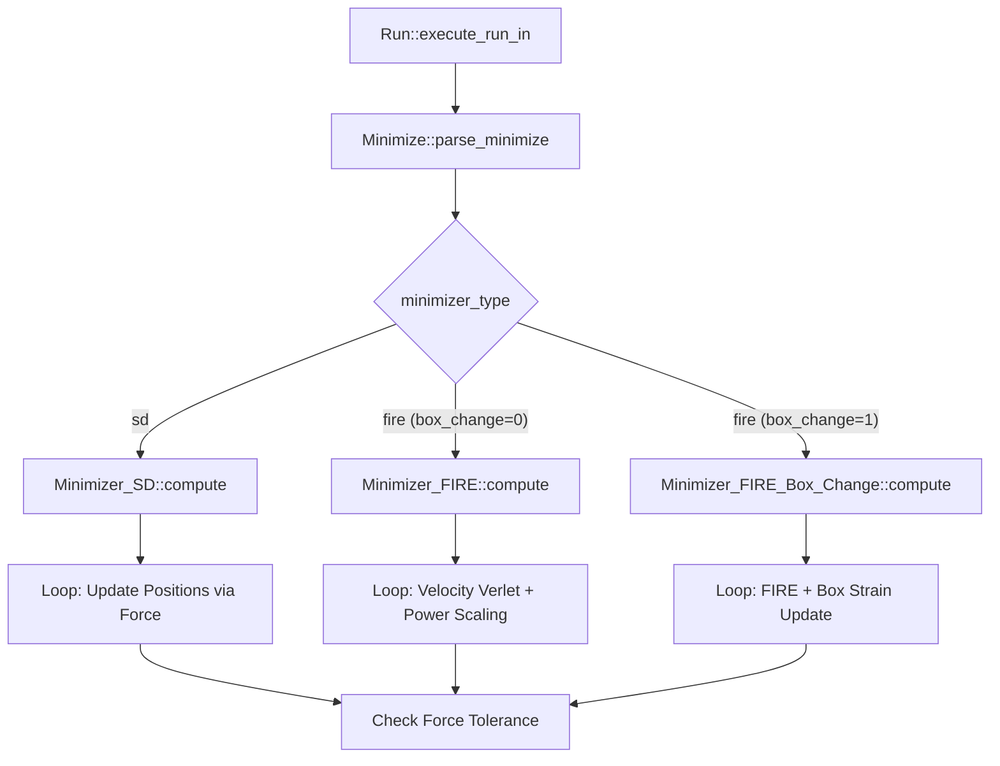
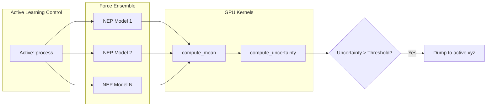

# Special Simulation Modes

Relevant source files

The following files were used as context for generating this wiki page:

- [doc/gpumd/input_parameters/add_spring.rst](doc/gpumd/input_parameters/add_spring.rst)
- [doc/gpumd/input_parameters/dump_xyz.rst](doc/gpumd/input_parameters/dump_xyz.rst)
- [doc/gpumd/input_parameters/minimize.rst](doc/gpumd/input_parameters/minimize.rst)
- [src/integrate/ensemble_ttm.cu](src/integrate/ensemble_ttm.cu)
- [src/integrate/ensemble_ttm.cuh](src/integrate/ensemble_ttm.cuh)
- [src/integrate/ensemble_wall_harmonic.cu](src/integrate/ensemble_wall_harmonic.cu)
- [src/integrate/ensemble_wall_harmonic.cuh](src/integrate/ensemble_wall_harmonic.cuh)
- [src/integrate/ensemble_wall_mirror.cu](src/integrate/ensemble_wall_mirror.cu)
- [src/integrate/ensemble_wall_mirror.cuh](src/integrate/ensemble_wall_mirror.cuh)
- [src/integrate/ensemble_wall_piston.cu](src/integrate/ensemble_wall_piston.cu)
- [src/integrate/ensemble_wall_piston.cuh](src/integrate/ensemble_wall_piston.cuh)
- [src/main_gpumd/add_efield.cu](src/main_gpumd/add_efield.cu)
- [src/main_gpumd/add_efield.cuh](src/main_gpumd/add_efield.cuh)
- [src/main_gpumd/add_force.cu](src/main_gpumd/add_force.cu)
- [src/main_gpumd/add_force.cuh](src/main_gpumd/add_force.cuh)
- [src/main_gpumd/add_spring.cu](src/main_gpumd/add_spring.cu)
- [src/main_gpumd/add_spring.cuh](src/main_gpumd/add_spring.cuh)
- [src/main_gpumd/cohesive.cu](src/main_gpumd/cohesive.cu)
- [src/main_gpumd/deposition.cu](src/main_gpumd/deposition.cu)
- [src/main_gpumd/deposition.cuh](src/main_gpumd/deposition.cuh)
- [src/main_gpumd/electron_stop.cu](src/main_gpumd/electron_stop.cu)
- [src/main_gpumd/electron_stop.cuh](src/main_gpumd/electron_stop.cuh)
- [src/main_gpumd/run.cuh](src/main_gpumd/run.cuh)
- [src/main_gpumd/velocity.cu](src/main_gpumd/velocity.cu)
- [src/main_gpumd/velocity.cuh](src/main_gpumd/velocity.cuh)
- [src/measure/active.cu](src/measure/active.cu)
- [src/measure/active.cuh](src/measure/active.cuh)
- [src/measure/dump_shock_nemd.cu](src/measure/dump_shock_nemd.cu)
- [src/measure/dump_xyz.cu](src/measure/dump_xyz.cu)
- [src/measure/dump_xyz.cuh](src/measure/dump_xyz.cuh)
- [src/measure/plumed.cu](src/measure/plumed.cu)
- [src/measure/plumed.cuh](src/measure/plumed.cuh)
- [src/minimize/minimize.cu](src/minimize/minimize.cu)
- [src/minimize/minimize.cuh](src/minimize/minimize.cuh)
- [src/minimize/minimizer.cu](src/minimize/minimizer.cu)
- [src/minimize/minimizer.cuh](src/minimize/minimizer.cuh)
- [src/minimize/minimizer_fire.cu](src/minimize/minimizer_fire.cu)
- [src/minimize/minimizer_fire.cuh](src/minimize/minimizer_fire.cuh)
- [src/minimize/minimizer_fire_box_change.cu](src/minimize/minimizer_fire_box_change.cu)
- [src/minimize/minimizer_fire_box_change.cuh](src/minimize/minimizer_fire_box_change.cuh)
- [src/minimize/minimizer_sd.cu](src/minimize/minimizer_sd.cu)
- [src/minimize/minimizer_sd.cuh](src/minimize/minimizer_sd.cuh)
- [tests/gpumd/active/dump_observer_no_observer/run.in](tests/gpumd/active/dump_observer_no_observer/run.in)
- [tests/gpumd/active/test_active.py](tests/gpumd/active/test_active.py)
- [tests/gpumd/msd/self_consistent/run.in](tests/gpumd/msd/self_consistent/run.in)
- [tests/gpumd/msd/test_compute_msd.py](tests/gpumd/msd/test_compute_msd.py)

This page details the specialized simulation modes in GPUMD, including structural optimization, deposition, property calculations (cohesive/elastic), and enhanced sampling. These modes are typically triggered via specific keywords in the `run.in` input file and managed by dedicated classes within the `Run` loop.

## Structure Minimization

GPUMD supports structural minimization to find local energy minima. This is handled by the `Minimize` driver class, which abstracts the underlying optimization algorithms [src/minimize/minimize.cu:16-22]().

### Minimization Algorithms
The following algorithms are implemented:
*   **Steepest Descent (SD):** Implemented in `Minimizer_SD`. It moves atoms directly along the force vector [src/minimize/minimizer_sd.cu]().
*   **Fast Inertial Relaxation Engine (FIRE):** Implemented in `Minimizer_FIRE`. It uses a modified velocity Verlet scheme with an adaptive time step and power-based velocity scaling [src/minimize/minimizer_fire.cu]().
*   **FIRE with Box Change:** Implemented in `Minimizer_FIRE_Box_Change`, allowing the simulation box to relax alongside atomic positions to achieve a target pressure (hydrostatic or per-axis) [src/minimize/minimizer_fire_box_change.cu]().

### Minimization Data Flow

The `Minimize::parse_minimize` function reads the `minimize` keyword and instantiates the appropriate `Minimizer` subclass [src/minimize/minimize.cu:32-156]().

**Sources:** [src/minimize/minimize.cu:32-156](), [src/minimize/minimizer_fire.cu](), [src/minimize/minimizer_sd.cu]()

---

## Atom Deposition

The `Deposition` class handles the simulation of thin-film growth or cluster impact by periodically adding atoms to the system [src/main_gpumd/deposition.cuh:16-26](). 

### Implementation Details
*   **Run Splitting:** The `Deposition` class analyzes the `run.in` file and splits the total number of steps into sub-runs based on the `interval` parameter [src/main_gpumd/deposition.cu:196-260]().
*   **Atom Insertion:** Between sub-runs, new atoms are added via `Deposition::deposit`. It generates random positions within a specified height range (`height_min`, `height_max`) and assigns initial velocities [src/main_gpumd/deposition.cu:262-380]().
*   **Modes:** Supports both single atom species (`atom`) and complex clusters/molecules defined in external files (`file`) [src/main_gpumd/deposition.cu:101-177]().

**Sources:** [src/main_gpumd/deposition.cu:16-35](), [src/main_gpumd/deposition.cuh:26-67]()

---

## Cohesive Energy and Elastic Constants

The `Cohesive` class provides automated routines for calculating mechanical properties by applying systematic deformations [src/main_gpumd/cohesive.cu:16-30]().

### Cohesive Energy
Calculates the total potential energy as a function of volume/strain.
*   **Deformation Modes:** Supports uniaxial (x, y, z), biaxial (xy, yz, xz), and triaxial scaling [src/main_gpumd/cohesive.cu:142-146]().
*   **Procedure:** Iterates through `num_points` factors, deforms the box and atom positions using the `deform_position` CUDA kernel, and computes potential energy [src/main_gpumd/cohesive.cu:33-54](), [src/main_gpumd/cohesive.cu:227-260]().

### Elastic Constants
Calculates the elastic stiffness tensor $C_{ij}$.
*   **Strain Application:** Applies 181 specific strain configurations defined in `Cohesive::compute_D` [src/main_gpumd/cohesive.cu:169-224]().
*   **Output:** Generates `elastic.out` containing the strain-energy/stress data required to fit the elastic tensor.

**Sources:** [src/main_gpumd/cohesive.cu:33-108](), [src/main_gpumd/cohesive.cu:182-225]()

---

## Electron Stopping

The `Electron_Stop` class implements electronic friction for high-energy atoms (e.g., radiation damage simulations) [src/main_gpumd/electron_stop.cuh:23-30]().

*   **Mechanism:** Applies a dissipative force $\mathbf{F}_{stop} = -S(E) \frac{\mathbf{v}}{|\mathbf{v}|}$, where $S(E)$ is the stopping power determined by the atom's kinetic energy $E$ [src/main_gpumd/electron_stop.cu:29-77]().
*   **Data Structure:** Stopping power tables are read from a file and interpolated on the GPU (`stopping_power_gpu`) [src/main_gpumd/electron_stop.cu:61-75]().
*   **Integration:** The force is calculated in `find_stopping_force` and added to the atomic forces in the `Electron_Stop::compute` method, which is called every MD step [src/main_gpumd/electron_stop.cu:157-193]().

**Sources:** [src/main_gpumd/electron_stop.cu:29-77](), [src/main_gpumd/electron_stop.cuh:23-41]()

---

## Active Learning Extrapolation

GPUMD implements on-the-fly uncertainty quantification for machine-learned potentials (NEP) to support active learning workflows [src/measure/active.cu:15-30]().

### Procedure
1.  **Multiple Potentials:** Loads multiple NEP models (an ensemble) using `force.set_multiple_potentials_mode("observe")` [src/measure/active.cu:182-183]().
2.  **Uncertainty Calculation:** At specified intervals, forces are calculated for all models. The standard deviation of the forces is computed via the `compute_uncertainty` kernel [src/measure/active.cu:101-110]().
3.  **Threshold Checking:** If the max per-atom force uncertainty exceeds a user-defined `threshold_`, the configuration is dumped to `active.xyz` for further labeling/training [src/measure/active.cu:161-168]().

**Sources:** [src/measure/active.cu:87-110](), [src/measure/active.cu:212-250]()

---

## Two-Temperature Model (TTM)

The TTM describes the energy exchange between the atomic lattice and the electronic subsystem. It is implemented as a specialized ensemble: `Ensemble_TTM`.

*   **Electronic Grid:** The simulation box is divided into a grid. Each cell maintains an electronic temperature $T_e$.
*   **Coupling:** Energy is exchanged via a Langevin-like friction term derived from the electron-phonon coupling constant $G$.
*   **Electronic Heat Diffusion:** Solves the heat diffusion equation for the electronic subsystem on the grid.

**Sources:** [src/integrate/ensemble_ttm.cu](), [src/integrate/ensemble_ttm.cuh]()

---

## PLUMED Enhanced Sampling

GPUMD integrates with the **PLUMED** library to perform enhanced sampling simulations (e.g., Metadynamics, Umbrella Sampling) [src/measure/plumed.cuh:18-25]().

*   **Interface:** The `Plumed` class acts as a wrapper. In `Plumed::process`, atomic positions and box vectors are passed to the PLUMED library [src/measure/plumed.cu:100-150]().
*   **Bias Forces:** PLUMED calculates bias forces based on Collective Variables (CVs). These forces are retrieved and added back to the GPUMD `atom.force_per_atom` array [src/measure/plumed.cu:150-180]().

**Sources:** [src/measure/plumed.cu:100-180](), [src/measure/plumed.cuh:18-35]()

---