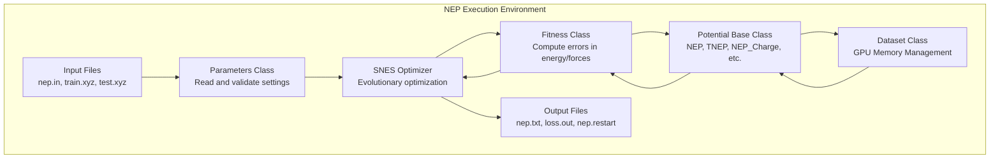
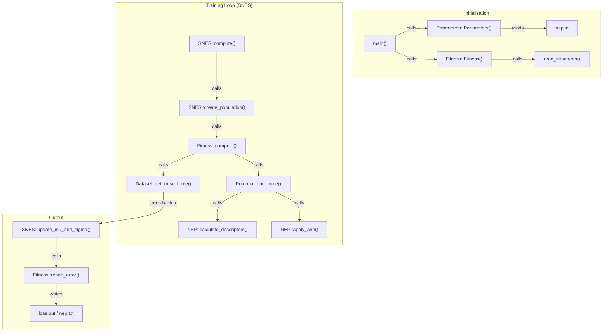

# NEP: Neuroevolution Potentials

Relevant source files

The following files were used as context for generating this wiki page:

- [doc/nep/input_files/nep_in.rst](doc/nep/input_files/nep_in.rst)
- [doc/nep/input_parameters/atomic_v.rst](doc/nep/input_parameters/atomic_v.rst)
- [doc/nep/input_parameters/basis_size.rst](doc/nep/input_parameters/basis_size.rst)
- [doc/nep/input_parameters/l_max.rst](doc/nep/input_parameters/l_max.rst)
- [doc/nep/input_parameters/lambda_1.rst](doc/nep/input_parameters/lambda_1.rst)
- [doc/nep/input_parameters/lambda_2.rst](doc/nep/input_parameters/lambda_2.rst)
- [doc/nep/input_parameters/n_max.rst](doc/nep/input_parameters/n_max.rst)
- [doc/nep/input_parameters/use_typewise_cutoff_zbl.rst](doc/nep/input_parameters/use_typewise_cutoff_zbl.rst)
- [doc/nep/input_parameters/version.rst](doc/nep/input_parameters/version.rst)
- [doc/potentials/nep.rst](doc/potentials/nep.rst)
- [src/main_gnep/main.cu](src/main_gnep/main.cu)
- [src/main_gpumd/main.cu](src/main_gpumd/main.cu)
- [src/main_mdi/main.cu](src/main_mdi/main.cu)
- [src/main_nep/dataset.cu](src/main_nep/dataset.cu)
- [src/main_nep/dataset.cuh](src/main_nep/dataset.cuh)
- [src/main_nep/fitness.cu](src/main_nep/fitness.cu)
- [src/main_nep/fitness.cuh](src/main_nep/fitness.cuh)
- [src/main_nep/main.cu](src/main_nep/main.cu)
- [src/main_nep/parameters.cu](src/main_nep/parameters.cu)
- [src/main_nep/parameters.cuh](src/main_nep/parameters.cuh)
- [src/main_nep/snes.cu](src/main_nep/snes.cu)
- [src/main_nep/snes.cuh](src/main_nep/snes.cuh)
- [src/main_nep/structure.cu](src/main_nep/structure.cu)
- [src/main_nep/structure.cuh](src/main_nep/structure.cuh)

NEP (Neuroevolution Potentials) is a machine learning approach for creating interatomic potentials in molecular dynamics simulations. It combines neural networks with evolutionary optimization to achieve high accuracy and computational efficiency. This page explains the NEP system architecture, training methodology, and how it fits into the GPUMD framework.

## Overview

NEP is one of the core components of GPUMD, serving two primary purposes:

1.  **Standalone Training**: The `nep` and `gnep` executables are used for training machine learning potentials from reference data (typically DFT results).
2.  **MD Force Engine**: The `gpumd` executable uses trained NEP models (via the `nep.txt` file) for high-performance force calculation in molecular dynamics simulations.

The key innovation of NEP is its use of neuroevolution—evolutionary algorithms for neural network optimization—rather than traditional gradient-based backpropagation, although a gradient-based version (`gnep`) is also available.

Sources: [src/main_nep/main.cu:30-83](), [src/main_nep/parameters.cu:34-51](), [src/main_gpumd/main.cu:29-66]()

## NEP System Architecture

The NEP system consists of several interconnected components that handle different aspects of potential training and evaluation.

### High-Level Architecture

Sources: [src/main_nep/main.cu:43-53](), [src/main_nep/parameters.cuh:59-170](), [src/main_nep/snes.cuh:29-81](), [src/main_nep/fitness.cuh:26-71](), [src/main_nep/dataset.cuh:22-116]()

### Core Components

*   **Parameters System**: The `Parameters` class manages configuration from `nep.in`, including hyperparameters like `n_max`, `basis_size`, and loss weights (`lambda_e`, `lambda_f`, `lambda_v`). [src/main_nep/parameters.cu:53-146]()
*   **Dataset Management**: The `Dataset` class handles the transfer of atomic structures from host memory to `GPU_Vector` objects on the device, managing neighbor lists and reference data. [src/main_nep/dataset.cu:158-200]()
*   **Potential Engine**: A polymorphic system where `Potential` is the base class for specific implementations like `NEP` (standard), `TNEP` (tensorial), `NEP_Charge` (electrostatics), and `NEP_VDW`. [src/main_nep/fitness.cu:128-140]()
*   **SNES Optimizer**: Implements the Separable Natural Evolution Strategy for parameter optimization in the `nep` executable. [src/main_nep/snes.cu:44-93]()
*   **Fitness Evaluation**: The `Fitness` class orchestrates the training loop, computing RMSE for energy, force, and virials across training batches. [src/main_nep/fitness.cu:154-243]()

## Sub-Systems and Details

### [NEP Training System](#4.1)
The training system uses the `SNES` (Separable Natural Evolution Strategy) algorithm. It maintains a population of potential parameter sets and evolves them based on a fitness score derived from the Root Mean Square Error (RMSE) of predicted energies, forces, and virials against reference data. For details, see [NEP Training System](#4.1).

### [GNEP: Gradient-Based NEP Training](#4.2)
While standard NEP uses evolutionary strategies, the `gnep` executable provides a gradient-based alternative using the Adam optimizer. This approach uses analytical gradients of the loss function with respect to the neural network parameters to accelerate convergence. For details, see [GNEP: Gradient-Based NEP Training](#4.2).

### [NEP Model Architecture](#4.3)
The NEP model architecture transforms atomic coordinates into descriptors using Chebyshev polynomials and spherical harmonics. These descriptors are then processed by a feed-forward Artificial Neural Network (ANN). The architecture supports multiple versions (NEP3, NEP4) and specialized corrections like ZBL for short-range repulsion. For details, see [NEP Model Architecture](#4.3).

### [Multi-GPU NEP Implementation](#4.4)
To handle large-scale systems or accelerate training, NEP supports multi-GPU execution. During training, the population is distributed across GPUs. In MD simulations, spatial domain decomposition is used to parallelize the force calculation. For details, see [Multi-GPU NEP Implementation](#4.4).

### [NEP-Charge and Tensorial NEP](#4.5)
Extensions to the base NEP model allow for the prediction of dynamic charges (NEP-Charge) and tensorial properties like dipole moments and polarizability (TNEP). These are essential for modeling ionic systems and calculating IR/Raman spectra. For details, see [NEP-Charge and Tensorial NEP](#4.5).

## Configuration: `nep.in`

The `nep.in` file is the primary configuration interface for training. It defines the model complexity and the optimization schedule.

| Keyword | Description | Default |
| :--- | :--- | :--- |
| `version` | NEP version (3 or 4) | 4 |
| `cutoff` | Radial and angular cutoffs | 8.0, 4.0 |
| `n_max` | Maximum order of basis functions | 6, 6 |
| `neuron` | Number of neurons in hidden layer | 30 |
| `lambda_e` | Weight for energy loss | 1.0 |
| `lambda_f` | Weight for force loss | 1.0 |
| `batch` | Batch size for training configurations | 1000 |
| `population` | Population size for SNES | 50 |

Sources: [doc/nep/input_files/nep_in.rst:30-81](), [src/main_nep/parameters.cu:53-146]()

## Data Flow: Code Entity Space

The following diagram bridges the logical training steps to the specific C++ classes and functions responsible for them.

Sources: [src/main_nep/main.cu:43-53](), [src/main_nep/fitness.cu:154-243](), [src/main_nep/snes.cu:92-93](), [src/main_nep/dataset.cu:28-108]()

---