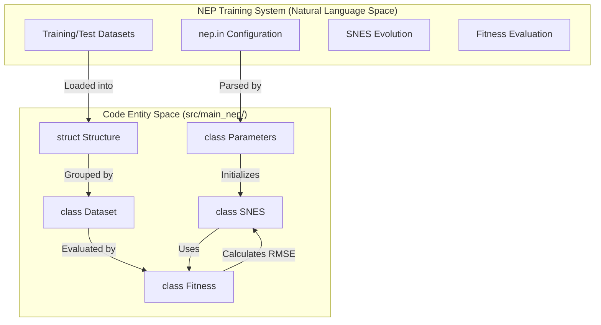
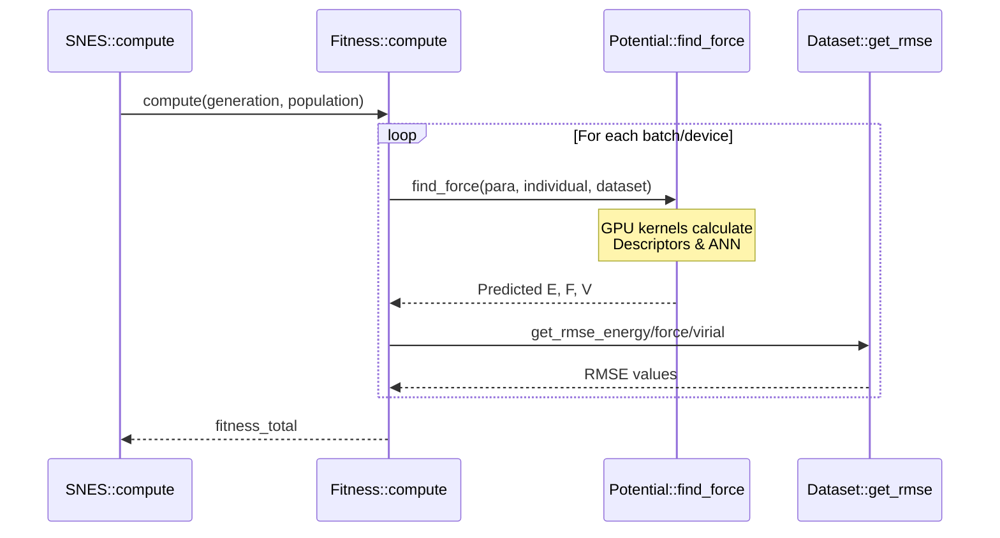

# NEP Training System

Relevant source files

The following files were used as context for generating this wiki page:

- [doc/nep/input_files/nep_in.rst](doc/nep/input_files/nep_in.rst)
- [doc/nep/input_parameters/atomic_v.rst](doc/nep/input_parameters/atomic_v.rst)
- [doc/nep/input_parameters/basis_size.rst](doc/nep/input_parameters/basis_size.rst)
- [doc/nep/input_parameters/cutoff.rst](doc/nep/input_parameters/cutoff.rst)
- [doc/nep/input_parameters/fine_tune.rst](doc/nep/input_parameters/fine_tune.rst)
- [doc/nep/input_parameters/import_q_scaler.rst](doc/nep/input_parameters/import_q_scaler.rst)
- [doc/nep/input_parameters/index.rst](doc/nep/input_parameters/index.rst)
- [doc/nep/input_parameters/l_max.rst](doc/nep/input_parameters/l_max.rst)
- [doc/nep/input_parameters/lambda_1.rst](doc/nep/input_parameters/lambda_1.rst)
- [doc/nep/input_parameters/lambda_2.rst](doc/nep/input_parameters/lambda_2.rst)
- [doc/nep/input_parameters/lambda_q.rst](doc/nep/input_parameters/lambda_q.rst)
- [doc/nep/input_parameters/lambda_z.rst](doc/nep/input_parameters/lambda_z.rst)
- [doc/nep/input_parameters/n_max.rst](doc/nep/input_parameters/n_max.rst)
- [doc/nep/input_parameters/neuron.rst](doc/nep/input_parameters/neuron.rst)
- [doc/nep/input_parameters/output_interval.rst](doc/nep/input_parameters/output_interval.rst)
- [doc/nep/input_parameters/prediction.rst](doc/nep/input_parameters/prediction.rst)
- [doc/nep/input_parameters/type.rst](doc/nep/input_parameters/type.rst)
- [doc/nep/input_parameters/use_typewise_cutoff_zbl.rst](doc/nep/input_parameters/use_typewise_cutoff_zbl.rst)
- [doc/nep/input_parameters/version.rst](doc/nep/input_parameters/version.rst)
- [doc/nep/input_parameters/zbl.rst](doc/nep/input_parameters/zbl.rst)
- [doc/nep/output_files/energy_out.rst](doc/nep/output_files/energy_out.rst)
- [doc/nep/output_files/force_out.rst](doc/nep/output_files/force_out.rst)
- [doc/nep/output_files/loss_out.rst](doc/nep/output_files/loss_out.rst)
- [doc/nep/output_files/nep_restart.rst](doc/nep/output_files/nep_restart.rst)
- [doc/potentials/nep.rst](doc/potentials/nep.rst)
- [potentials/nep/nep89_20250409/nep.in](potentials/nep/nep89_20250409/nep.in)
- [potentials/nep/nep89_20250409/nep89_20250409.restart](potentials/nep/nep89_20250409/nep89_20250409.restart)
- [potentials/nep/nep89_20250409/nep89_20250409.txt](potentials/nep/nep89_20250409/nep89_20250409.txt)
- [src/main_nep/dataset.cu](src/main_nep/dataset.cu)
- [src/main_nep/dataset.cuh](src/main_nep/dataset.cuh)
- [src/main_nep/fitness.cu](src/main_nep/fitness.cu)
- [src/main_nep/fitness.cuh](src/main_nep/fitness.cuh)
- [src/main_nep/parameters.cu](src/main_nep/parameters.cu)
- [src/main_nep/parameters.cuh](src/main_nep/parameters.cuh)
- [src/main_nep/snes.cu](src/main_nep/snes.cu)
- [src/main_nep/snes.cuh](src/main_nep/snes.cuh)
- [src/main_nep/structure.cu](src/main_nep/structure.cu)
- [src/main_nep/structure.cuh](src/main_nep/structure.cuh)

The NEP (Neuroevolution Potential) Training System is the core component of GPUMD responsible for training machine learning interatomic potentials using the neuroevolution approach. This system implements a Separable Natural Evolution Strategy (SNES) optimization algorithm to fit parameters for neural network potentials that accurately predict atomic energies, forces, virials, and other properties.

## System Overview

The NEP training process is managed by the `nep` executable, which orchestrates the interaction between model parameters, training datasets, and the evolutionary optimizer.

Sources: [src/main_nep/parameters.cu:34-51](), [src/main_nep/fitness.cu:40-145](), [src/main_nep/snes.cu:44-93](), [src/main_nep/dataset.cu:27-108]()

## Core Components

### Parameters Class
The `Parameters` class handles the parsing and validation of hyperparameters from `nep.in`. It manages model versions (NEP3/NEP4), descriptor dimensions, and training coefficients.

*   **Initialization**: Sets default values for all keywords, including `population_size` (default 50) and `maximum_generation` (default 100,000) [src/main_nep/parameters.cu:53-146]().
*   **Parsing**: The `read_nep_in()` function processes the input file tokens [src/main_nep/parameters.cu:148-172]().
*   **Calculated Values**: Derived parameters such as the descriptor dimension `dim` and the total `number_of_variables` are calculated based on `n_max`, `basis_size`, and `l_max` [src/main_nep/parameters.cu:189-355]().

Sources: [src/main_nep/parameters.cuh:59-170](), [src/main_nep/parameters.cu:34-146]()

### Dataset and Structure
The `Dataset` class manages a collection of `Structure` objects, handling GPU memory allocation for atomic positions, forces, and reference data.

*   **Batching**: Training data is divided into batches to manage memory and stochasticity during evolution [src/main_nep/fitness.cu:47-77]().
*   **GPU Vectors**: Data such as `energy_ref_gpu`, `force_ref_gpu`, and `virial_ref_gpu` are stored in `GPU_Vector` objects for high-performance evaluation [src/main_nep/dataset.cuh:31-90]().
*   **Neighbor Lists**: The `find_neighbor()` function builds radial and angular neighbor lists required for NEP descriptors [src/main_nep/dataset.cu:115]().

Sources: [src/main_nep/dataset.cuh:22-116](), [src/main_nep/dataset.cu:27-108](), [src/main_nep/structure.cu:98-160]()

### SNES Optimizer
The `SNES` class implements the Separable Natural Evolution Strategy. Unlike gradient-based methods, SNES evolves a multivariate Gaussian distribution of parameters.

*   **Population**: Candidate solutions are sampled using `gpurand_init` and `curand_normal` on the GPU [src/main_nep/snes.cu:36-42](), [src/main_nep/snes.cu:78-81]().
*   **Update Rule**: Parameters (`mu`) and their search steps (`sigma`) are updated based on the ranked fitness of the population [src/main_nep/snes.cuh:78-79]().
*   **Regularization**: Implements L1 and L2 regularization to penalize large weights and prevent overfitting [src/main_nep/snes.cu:64-66]().

Sources: [src/main_nep/snes.cuh:29-81](), [src/main_nep/snes.cu:44-93]()

## Fitness Evaluation Lifecycle

The `Fitness::compute` function is the primary bridge between the optimizer and the potential model. It orchestrates the forward pass (energy/force prediction) and RMSE calculation.

Sources: [src/main_nep/fitness.cu:154-206](), [src/main_nep/dataset.cu:98-108](), [src/main_nep/snes.cu:92]()

### RMSE Calculation
RMSE (Root Mean Square Error) is calculated for each property (energy, force, virial, charge, BEC) within the `Dataset` class:
*   **Energy**: `get_rmse_energy` compares predicted per-atom energies against reference values, optionally applying an energy shift [src/main_nep/dataset.cu:99-104]().
*   **Force**: `get_rmse_force` calculates the deviation of force components [src/main_nep/dataset.cu:98]().
*   **Virial**: `get_rmse_virial` handles the six independent components of the stress tensor [src/main_nep/dataset.cu:105]().

Sources: [src/main_nep/dataset.cu:98-108](), [src/main_nep/fitness.cu:185-190]()

## Transfer Learning and Fine-tuning

The NEP training system supports fine-tuning existing models through the `fine_tune` keyword in `nep.in`.

*   **Foundation Model**: The `initialize_mu_and_sigma_fine_tune` function reads a pre-trained `nep.restart` file [src/main_nep/snes.cu:148-157]().
*   **Element Mapping**: It uses an `element_map` to align parameters from a foundation model (e.g., a large model containing many elements) to the specific elements in the current training set [src/main_nep/snes.cu:151-157]().
*   **Parameter Import**: Only the relevant ANN and descriptor parameters are copied into the `mu` vector, allowing the training to start from a high-quality baseline [src/main_nep/snes.cu:179-208]().

Sources: [src/main_nep/snes.cu:148-208](), [src/main_nep/parameters.cuh:115-118]()

## Multi-GPU Support

Training is parallelized across multiple GPUs by distributing the population of candidate models.

*   **Population Partitioning**: The population is split across available devices. If the `population_size` is not a multiple of the device count, it is automatically adjusted [src/main_nep/parameters.cu:138-145]().
*   **Device Context**: The `Fitness` constructor sets up `train_set` and `test_set` on each device using `gpuSetDevice` [src/main_nep/fitness.cu:72-89]().
*   **Concurrent Execution**: Each GPU evaluates its subset of the population independently during the `compute` phase [src/main_nep/fitness.cu:164-183]().

Sources: [src/main_nep/fitness.cu:42-90](), [src/main_nep/parameters.cu:138-146]()

---