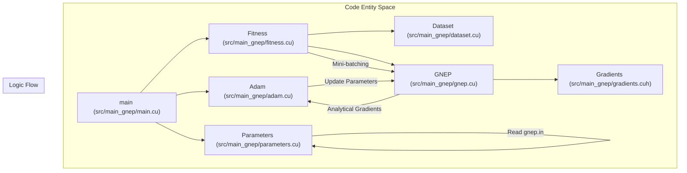
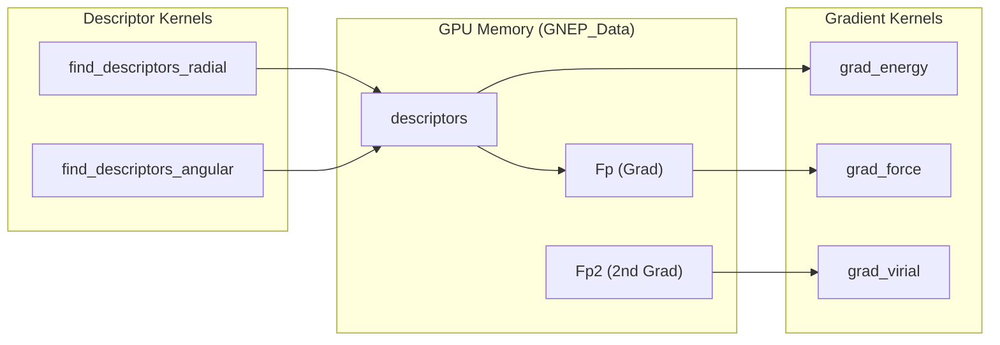

# GNEP: Gradient-Based NEP Training

Relevant source files

The following files were used as context for generating this wiki page:

- [src/main_gnep/adam.cu](src/main_gnep/adam.cu)
- [src/main_gnep/adam.cuh](src/main_gnep/adam.cuh)
- [src/main_gnep/dataset.cu](src/main_gnep/dataset.cu)
- [src/main_gnep/fitness.cu](src/main_gnep/fitness.cu)
- [src/main_gnep/fitness.cuh](src/main_gnep/fitness.cuh)
- [src/main_gnep/gnep.cu](src/main_gnep/gnep.cu)
- [src/main_gnep/gnep.cuh](src/main_gnep/gnep.cuh)
- [src/main_gnep/gradients.cuh](src/main_gnep/gradients.cuh)
- [src/main_gnep/main.cu](src/main_gnep/main.cu)
- [src/main_gnep/parameters.cu](src/main_gnep/parameters.cu)
- [src/main_gnep/parameters.cuh](src/main_gnep/parameters.cuh)
- [src/main_gnep/structure.cu](src/main_gnep/structure.cu)
- [src/main_gpumd/main.cu](src/main_gpumd/main.cu)
- [src/main_mdi/main.cu](src/main_mdi/main.cu)
- [src/main_nep/main.cu](src/main_nep/main.cu)
- [src/utilities/gnep_utilities.cuh](src/utilities/gnep_utilities.cuh)
- [src/utilities/least_square.cuh](src/utilities/least_square.cuh)

The `gnep` executable is a specialized version of the Neuroevolution Potential (NEP) training framework that utilizes analytical gradients and the Adam optimizer to achieve significantly faster convergence compared to the standard SNES-based `nep` executable. While `nep` relies on a derivative-free natural evolution strategy, `gnep` implements backpropagation through the descriptor and neural network layers to compute exact gradients of the loss function with respect to all model parameters.

### GNEP Architecture and Execution Flow

The `gnep` executable follows a structured initialization and training loop, managed primarily by the `Fitness` class and the `Adam` optimizer. Unlike the standard `gpumd` executable which performs molecular dynamics, `gnep` is dedicated to model parameter optimization using a provided dataset of atomic structures.

#### Execution Lifecycle
1.  **Initialization**: The `main` function initializes `Parameters`, `Adam`, and `Fitness` objects [src/main_gnep/main.cu:37-39]().
2.  **Dataset Loading**: The `Fitness` constructor reads training and test structures from `model.xyz` using the `Dataset` class [src/main_gnep/fitness.cu:44-90]().
3.  **Optimization**: The `Fitness::compute` function enters the training loop, iterating through epochs and mini-batches [src/main_gnep/fitness.cu:147-212]().
4.  **Gradient Evaluation**: For each batch, the `GNEP::find_force` function is called with `require_grad = true` to compute analytical gradients [src/main_gnep/fitness.cu:194-206]().

#### GNEP System Architecture
The following diagram illustrates the relationship between the core classes and the execution flow within the `gnep` executable.

**GNEP Component Diagram**

**Sources:** [src/main_gnep/main.cu:27-66](), [src/main_gnep/fitness.cu:31-138](), [src/main_gnep/gnep.cuh:44-111]().

---

### Gradient Computation and GNEP Data Structures

The core of GNEP's efficiency lies in the `GNEP_Data` structure and the specialized CUDA kernels that compute descriptors and their gradients simultaneously.

#### Data Management
The `GNEP_Data` struct holds the necessary GPU memory for neighbor lists and intermediate gradient components:
*   `NN_radial` / `NL_radial`: Radial neighbor lists [src/main_gnep/gnep.cuh:25-26]().
*   `descriptors`: The calculated NEP descriptors ($q_n^i$ and $q_{nl}^i$) [src/main_gnep/gnep.cuh:35]().
*   `Fp` / `Fp2`: First and second gradients of descriptors required for force and virial calculations [src/main_gnep/gnep.cuh:36-37]().
*   `sum_fxyz` ($S_{nlm}$): Intermediate sums for angular descriptors [src/main_gnep/gnep.cuh:38]().

#### Analytical Gradients
GNEP implements analytical gradients for the loss function:
$$L = \lambda_e L_e + \lambda_f L_f + \lambda_v L_v$$
The `GNEP::find_force` kernel computes the partial derivatives of energy, forces, and virials with respect to the weights and biases of the ANN, as well as the descriptor parameters [src/main_gnep/gnep.cu:92-102]().

**Data Flow: Descriptor to Gradient**

**Sources:** [src/main_gnep/gnep.cuh:24-42](), [src/main_gnep/gnep.cu:112-173]().

---

### Comparison: gnep vs. nep

The `gnep` executable is distinct from the `nep` executable in its optimization strategy and input requirements.

| Feature | `nep` (SNES) | `gnep` (Adam) |
| :--- | :--- | :--- |
| **Optimizer** | Separable Natural Evolution Strategy [src/main_nep/main.cu:53]() | Adam / AdamW [src/main_gnep/main.cu:38]() |
| **Gradients** | Derivative-free (Population-based) | Analytical (Backpropagation) |
| **Input File** | `nep.in` | `gnep.in` [src/main_gnep/parameters.cu:35]() |
| **Batching** | Full dataset evaluation | Mini-batch support [src/main_gnep/parameters.cuh:27]() |
| **Initialization** | Random or Restart | Energy-shift biased initialization [src/main_gnep/fitness.cu:161-177]() |
| **Performance** | Slower convergence, robust to local minima | Faster convergence, memory intensive |

#### Biased Initialization
GNEP supports an `energy_shift` mechanism to improve initial training stability. It uses a least-squares solver to determine the average energy per atom type from the training set and initializes the neural network biases to reflect these values [src/main_gnep/fitness.cu:161-177](). The `computeMultiBatchEnergyShiftUniform` function in `least_square.cuh` handles this calculation [src/utilities/least_square.cuh:149-192]().

**Sources:** [src/main_nep/main.cu:30-71](), [src/main_gnep/main.cu:27-66](), [src/main_gnep/parameters.cu:51-118](), [src/utilities/least_square.cuh:149-192]().

---

### Parameters and Optimization (Adam)

The `Parameters` class in GNEP handles specialized keywords for the Adam optimizer and learning rate scheduling [src/main_gnep/parameters.cu:120-144]().

*   **Learning Rate Scheduling**: Supports cosine annealing with warmup restarts (`lr_restart_enable`) [src/main_gnep/parameters.cuh:57-61]().
*   **Weight Decay**: Implements decoupled weight decay (AdamW) via the `weight_decay` parameter [src/main_gnep/parameters.cuh:37]().
*   **Loss Weighting**: Users can tune the importance of energy, force, and virial errors using `lambda_e`, `lambda_f`, and `lambda_v` [src/main_gnep/parameters.cuh:41-43]().

The `Adam` class (defined in `adam.cuh`) manages the first and second moments of the gradients to update the model parameters `w0`, `b0`, `w1`, and descriptor coefficients `c` stored in the `ANN` struct [src/main_gnep/gnep.cuh:65-74]().

**Sources:** [src/main_gnep/parameters.cuh:21-113](), [src/main_gnep/gnep.cuh:65-74](), [src/main_gnep/fitness.cu:31-40]().

---