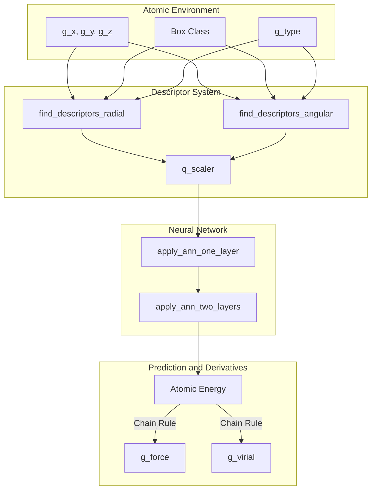
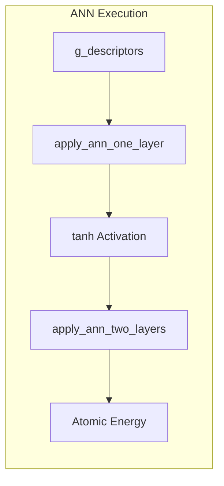

# NEP Model Architecture

Relevant source files

The following files were used as context for generating this wiki page:

- [src/force/neighbor.cu](src/force/neighbor.cu)
- [src/force/neighbor.cuh](src/force/neighbor.cuh)
- [src/force/nep.cu](src/force/nep.cu)
- [src/force/nep.cuh](src/force/nep.cuh)
- [src/force/nep_charge.cu](src/force/nep_charge.cu)
- [src/force/nep_charge.cuh](src/force/nep_charge.cuh)
- [src/force/nep_charge_small_box.cuh](src/force/nep_charge_small_box.cuh)
- [src/force/nep_multigpu.cu](src/force/nep_multigpu.cu)
- [src/force/nep_multigpu.cuh](src/force/nep_multigpu.cuh)
- [src/force/nep_small_box.cuh](src/force/nep_small_box.cuh)
- [src/main_nep/nep.cu](src/main_nep/nep.cu)
- [src/main_nep/nep.cuh](src/main_nep/nep.cuh)
- [src/main_nep/nep_charge.cu](src/main_nep/nep_charge.cu)
- [src/main_nep/nep_charge.cuh](src/main_nep/nep_charge.cuh)
- [src/main_nep/nep_charge_vdw.cu](src/main_nep/nep_charge_vdw.cu)
- [src/main_nep/nep_charge_vdw.cuh](src/main_nep/nep_charge_vdw.cuh)
- [src/main_nep/nep_vdw.cu](src/main_nep/nep_vdw.cu)
- [src/main_nep/nep_vdw.cuh](src/main_nep/nep_vdw.cuh)
- [src/main_nep/nep_vdw_parameters.cuh](src/main_nep/nep_vdw_parameters.cuh)
- [src/main_nep/potential.cuh](src/main_nep/potential.cuh)
- [src/main_nep/tnep.cu](src/main_nep/tnep.cu)
- [src/main_nep/tnep.cuh](src/main_nep/tnep.cuh)
- [src/utilities/nep_utilities.cuh](src/utilities/nep_utilities.cuh)

This document details the architecture of the Neuroevolution Potential (NEP) model in GPUMD. NEP is a machine learning interatomic potential framework that combines descriptors of atomic environments with neural networks to predict energies, forces, and other properties for molecular dynamics simulations. For information about training NEP models, see [NEP Training System](#4.1).

## Architectural Overview

NEP is a machine learning potential that transforms atomic positions into features (descriptors) which are then processed by a neural network to predict atomic energies. The complete NEP architecture consists of several interconnected components:

Sources: [src/main_nep/nep.cu:34-45](), [src/main_nep/nep.cu:90-102](), [src/force/nep.cu:117-123]()

## NEP Model Versions

NEP has evolved through multiple versions, each with significant architectural improvements:

| Version | Key Features | Implementation Details |
|---------|-------------|--------------------------|
| **NEP3** | Single neural network | Shared weights for all atom types; `basis_size` used for radial/angular parts [src/main_nep/nep.cu:200-201](). |
| **NEP4** | Type-specific networks | Separate networks for each atom type; support for `nep4_zbl`, `nep4_dipole`, and `nep4_polarizability` [src/force/nep.cu:113-137](). |
| **NEP5** | Enhanced architecture | Newest version with optimized descriptor structures [src/force/nep.cu:119-122](). |

Sources: [src/main_nep/nep.cu:162-165](), [src/force/nep.cu:113-143]()

## Descriptor System

The descriptor system transforms atomic coordinates into feature vectors. NEP uses a combination of radial and angular descriptors.

### Radial Descriptors
Radial descriptors capture pairwise distance relationships using Chebyshev polynomial basis functions.

- **Basis**: Chebyshev polynomials computed via `find_fn` [src/main_nep/nep.cu:69]().
- **Cutoff**: Smoothly decays to zero using `find_fc` [src/main_nep/nep.cu:66]().
- **Implementation**: The kernel `find_descriptors_radial` iterates over neighbors, calculates distance `d12`, and accumulates the descriptor `gn12` based on type-dependent coefficients `annmb.c` [src/main_nep/nep.cu:34-87]().

### Angular Descriptors
Angular descriptors capture many-body interactions using spherical harmonics.

- **Expansion**: Uses `accumulate_s` to sum spherical harmonics components [src/main_nep/nep.cu:139]().
- **Descriptor Construction**: `find_q` combines the accumulated `s` values into the final angular descriptor `q` [src/main_nep/nep.cu:141]().
- **Complexity**: Supports complex many-body terms like `q_222`, `q_1111`, `q_123`, etc. [src/main_nep/nep.cu:173-197]().

Sources: [src/main_nep/nep.cu:34-154](), [src/utilities/nep_utilities.cuh:19-39](), [src/main_nep/nep.cuh:33-55]()

## Neural Network Architecture

NEP uses an Artificial Neural Network (ANN) to map descriptors to energy.

- **One-Layer Mode**: Used when only one hidden layer is defined. It applies weights `w0` and biases `b0` [src/main_nep/nep_charge.cuh:55-59]().
- **Activation**: Typically uses the `tanh` function for hidden layers.
- **Output**: The final energy is a linear combination of hidden layer outputs plus a bias `b1` [src/force/nep.cuh:81-82]().

Sources: [src/main_nep/nep.cu:378-414](), [src/main_nep/nep.cuh:57-68](), [src/force/nep.cuh:73-90]()

## Force and Virial Calculation

Forces and virials are calculated using analytical derivatives via the chain rule.

1.  **Descriptor Derivatives**: The partial forces `f12x`, `f12y`, `f12z` are computed by differentiating descriptors with respect to atomic coordinates [src/force/nep.cuh:24-26]().
2.  **Backpropagation**: The gradient of energy with respect to descriptors (`Fp`) is computed through the ANN [src/force/nep.cuh:27]().
3.  **Accumulation**: The final forces are accumulated by multiplying `Fp` with the descriptor derivatives [src/force/nep.cu:75-98]().

Sources: [src/force/nep.cuh:23-37](), [src/force/nep.cu:75-98](), [src/main_nep/nep.cu:458-593]()

## Advanced Corrections

### ZBL Correction
The Ziegler-Biersack-Littmark (ZBL) potential provides short-range repulsion.
- **Enabled**: via `zbl.enabled` in the `NEP` class [src/force/nep.cu:115-124]().
- **Parameters**: Uses atomic numbers to calculate the universal screening function [src/force/nep.cu:158-167]().
- **Flexible ZBL**: Allows optimized ZBL parameters via `zbl.flexibled` [src/force/nep.cu:179-180]().

### DFT-D3 Dispersion
GPUMD supports adding DFT-D3 dispersion corrections to NEP models.
- **Initialization**: `initialize_dftd3` reads functional types and cutoffs from `run.in` [src/force/nep.cu:45-73]().
- **Integration**: The dispersion energy and forces are added to the total NEP results during the `compute` call [src/force/nep.cu:182-183]().

Sources: [src/force/nep.cu:45-73](), [src/force/nep.cu:115-132](), [src/force/nep.cuh:92-100]()

## NEP-Charge and Tensorial NEP

### NEP-Charge
Predicts atomic charges and handles long-range electrostatics.
- **Modes**: `charge_mode` 1 (fixed-width Gaussian) or 2 (environment-dependent) [src/force/nep_charge.cu:122-134]().
- **K-Space**: Supports `ewald` or `pppm` for long-range interactions [src/force/nep_charge.cu:46-77]().
- **BEC**: Can predict Born Effective Charges (BEC) for IR spectra [src/force/nep_charge.cuh:47]().

### TNEP (Tensorial NEP)
Predicts tensorial properties like dipoles and polarizabilities.
- **Dipole**: `nep4_dipole` variant [src/force/nep.cu:132-134]().
- **Polarizability**: `nep4_polarizability` variant [src/force/nep.cu:136-138]().

Sources: [src/main_nep/nep_charge.cu:142-206](), [src/force/nep_charge.cuh:25-48](), [src/force/nep.cu:125-138]()

## Internal Data Structures

The `NEP_Data` struct (and `NEP_Charge_Data`) manages the GPU memory for model execution:

| Member | Type | Description |
|--------|------|-------------|
| `descriptors` | `GPU_Vector<float>` | Stored descriptor values for each atom [src/main_nep/nep.cuh:24](). |
| `Fp` | `GPU_Vector<float>` | Partial derivatives ∂E/∂q [src/main_nep/nep.cuh:25](). |
| `NN_radial` / `NL_radial` | `GPU_Vector<int>` | Radial neighbor list counts and indices [src/force/nep.cuh:30-31](). |
| `parameters` | `GPU_Vector<float>` | Optimized ANN weights and biases [src/main_nep/nep.cuh:27](). |

Sources: [src/main_nep/nep.cuh:23-28](), [src/force/nep.cuh:23-37](), [src/main_nep/nep_charge.cuh:63-77]()

---