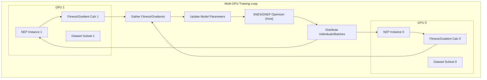
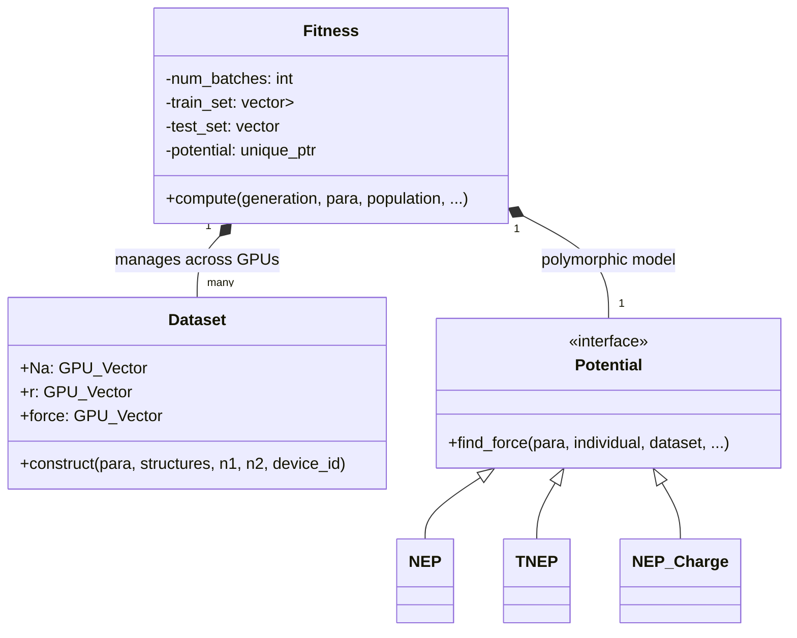

# Multi-GPU NEP Implementation

<details>
<summary>Relevant source files</summary>

The following files were used as context for generating this wiki page:

- [src/force/nep.cuh](src/force/nep.cuh)
- [src/force/nep_charge.cu](src/force/nep_charge.cu)
- [src/force/nep_charge.cuh](src/force/nep_charge.cuh)
- [src/force/nep_charge_small_box.cuh](src/force/nep_charge_small_box.cuh)
- [src/force/nep_multigpu.cu](src/force/nep_multigpu.cu)
- [src/force/nep_multigpu.cuh](src/force/nep_multigpu.cuh)
- [src/force/nep_small_box.cuh](src/force/nep_small_box.cuh)
- [src/main_nep/dataset.cu](src/main_nep/dataset.cu)
- [src/main_nep/dataset.cuh](src/main_nep/dataset.cuh)
- [src/main_nep/fitness.cu](src/main_nep/fitness.cu)
- [src/main_nep/fitness.cuh](src/main_nep/fitness.cuh)
- [src/main_nep/parameters.cu](src/main_nep/parameters.cu)
- [src/main_nep/parameters.cuh](src/main_nep/parameters.cuh)
- [src/main_nep/snes.cu](src/main_nep/snes.cu)
- [src/main_nep/snes.cuh](src/main_nep/snes.cuh)
- [src/main_nep/structure.cu](src/main_nep/structure.cu)
- [src/main_nep/structure.cuh](src/main_nep/structure.cuh)

</details>


This document describes the multi-GPU implementation of Neuroevolution Potentials (NEP) in GPUMD. The implementation primarily focuses on parallelizing the training process (fitness evaluation) across multiple devices to accelerate model optimization.

## Overview

The multi-GPU implementation in GPUMD enables parallelization of NEP training across multiple GPUs. During training, the population of potential candidates (in the SNES optimizer) or the dataset batches (in GNEP) are distributed across available GPUs. This approach significantly reduces the time required for fitness evaluation, which is the most computationally expensive part of the training cycle.



Sources: [src/main_nep/fitness.cu:42-77](), [src/main_nep/snes.cu:164-182]()

## Architecture and Data Flow

The multi-GPU training logic is centered in the `Fitness` class, which manages a collection of `Dataset` objects and a `Potential` instance (e.g., `NEP`, `TNEP`, `NEP_Charge`) across all detected CUDA devices.



Sources: [src/main_nep/fitness.cuh:26-50](), [src/main_nep/dataset.cuh:22-94]()

### Device Initialization and Population Adjustment

During the construction of the `Parameters` class, the system queries the total number of available GPUs using `gpuGetDeviceCount` [src/main_nep/parameters.cu:138-139](). To ensure efficient parallelization in the SNES algorithm, the `population_size` is automatically adjusted to be a multiple of the device count [src/main_nep/parameters.cu:140-145]().

### Data Distribution

The `Fitness` constructor handles the distribution of training structures. It divides the training set into batches and ensures that each batch is constructed on every available GPU [src/main_nep/fitness.cu:56-77]().

1.  **Device Selection**: The code iterates through `deviceCount` and calls `gpuSetDevice(device_id)` before performing any memory allocations or transfers [src/main_nep/fitness.cu:72]().
2.  **Dataset Construction**: The `Dataset::construct` method is called for each device, which initializes `GPU_Vector` objects (like positions `r` and types `type`) specifically in that device's memory space [src/main_nep/dataset.cu:158-186]().
3.  **Batching**: If the dataset is large, it is split into `num_batches`. In each generation, a specific batch is evaluated [src/main_nep/fitness.cu:179]().

## Implementation Details

### Parallel Fitness Evaluation

In the `Fitness::compute` function, the workload is distributed by iterating through the population in chunks equal to the `deviceCount` [src/main_nep/fitness.cu:164-166]().

```cpp
// Logic from src/main_nep/fitness.cu:180-190
for (int n = 0; n < population_iter; ++n) {
  const float* individual = population + deviceCount * n * para.number_of_variables;
  potential->find_force(para, individual, train_set[batch_id], false, deviceCount);
  for (int m = 0; m < deviceCount; ++m) {
    // Extract RMSE results from each device m
    auto rmse_energy_array = train_set[batch_id][m].get_rmse_energy(...);
    // ... other properties
  }
}
```

The `Potential::find_force` method is designed to handle multiple devices internally (if implemented) or is called sequentially for each device within the loop. In the case of `NEP`, the forces, energies, and virials are calculated on the GPU assigned to that specific `Dataset` instance.

### Multi-GPU SNES Optimization

The `SNES` optimizer maintains state on `GPU-0` for global parameter updates [src/main_nep/snes.cu:70](). However, it uses `gpurandState` and CUDA kernels to generate new individuals in the population in parallel [src/main_nep/snes.cu:78-82]().

1.  **Random Sampling**: `initialize_curand_states` sets up random number generators for every variable in the population across the GPU threads [src/main_nep/snes.cu:36-42]().
2.  **Parameter Update**: The `mu` (mean) and `sigma` (step size) vectors are updated based on the fitness results gathered from all GPUs [src/main_nep/snes.cu:144-145]().

## Performance and Scaling

### Batching and Overlap
The implementation supports a `batch_size` parameter in `nep.in` [src/main_nep/parameters.cu:106](). By using smaller batches, the memory footprint on each GPU is reduced, and the `Fitness` evaluator cycles through different subsets of the data across generations [src/main_nep/fitness.cu:179]().

### Peer-to-Peer and Streams
While the current training implementation focuses on distributing independent individuals/batches, the `NEP_Charge` and `PPPM` modules (used in MD simulations) utilize specialized neighbor list logic for large boxes that can be extended for spatial decomposition [src/force/nep_charge.cu:169-175]().

## Usage Guidelines

To use the multi-GPU implementation for training:

1.  **CUDA_VISIBLE_DEVICES**: Set this environment variable to control which GPUs GPUMD can access.
2.  **Population Size**: Ensure `population_size` is sufficiently large to saturate all GPUs. GPUMD will automatically increase it to the nearest multiple of the device count if necessary [src/main_nep/parameters.cu:143-144]().
3.  **Memory Constraints**: When training with many atom types or large descriptors, monitor the VRAM on each GPU, as the `Dataset` (including neighbor lists) is replicated or partitioned across devices [src/main_nep/fitness.cu:73-74]().

| Feature | Implementation | File Reference |
| :--- | :--- | :--- |
| **Device Discovery** | `gpuGetDeviceCount` | [src/main_nep/parameters.cu:139]() |
| **Task Distribution** | Population-based split | [src/main_nep/fitness.cu:166]() |
| **Memory Management** | `GPU_Vector` per device | [src/main_nep/dataset.cu:158]() |
| **Random Generation** | `curand` kernels | [src/main_nep/snes.cu:81]() |

Sources: [src/main_nep/fitness.cu](), [src/main_nep/parameters.cu](), [src/main_nep/snes.cu](), [src/main_nep/dataset.cu]()

---