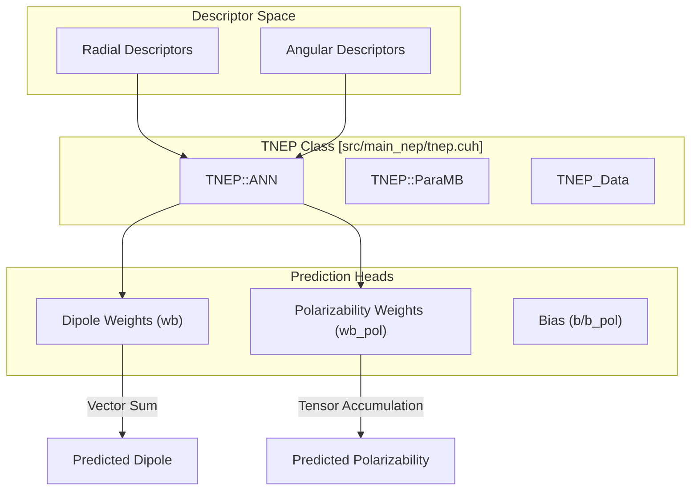
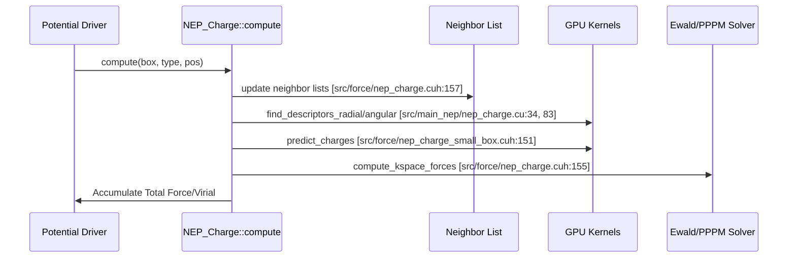

# NEP-Charge and Tensorial NEP

Relevant source files

The following files were used as context for generating this wiki page:

- [doc/gpumd/input_parameters/dump_dipole.rst](doc/gpumd/input_parameters/dump_dipole.rst)
- [doc/gpumd/input_parameters/dump_polarizability.rst](doc/gpumd/input_parameters/dump_polarizability.rst)
- [doc/gpumd/output_files/dipole_out.rst](doc/gpumd/output_files/dipole_out.rst)
- [doc/gpumd/output_files/polarizability_out.rst](doc/gpumd/output_files/polarizability_out.rst)
- [doc/nep/input_files/train_test_xyz.rst](doc/nep/input_files/train_test_xyz.rst)
- [doc/nep/input_parameters/charge_mode.rst](doc/nep/input_parameters/charge_mode.rst)
- [doc/nep/input_parameters/output_descriptor.rst](doc/nep/input_parameters/output_descriptor.rst)
- [doc/nep/output_files/bec_out.rst](doc/nep/output_files/bec_out.rst)
- [doc/nep/output_files/charge_out.rst](doc/nep/output_files/charge_out.rst)
- [doc/nep/output_files/descriptor_out.rst](doc/nep/output_files/descriptor_out.rst)
- [doc/nep/output_files/dipole_out.rst](doc/nep/output_files/dipole_out.rst)
- [doc/nep/output_files/index.rst](doc/nep/output_files/index.rst)
- [doc/nep/output_files/polarizability_out.rst](doc/nep/output_files/polarizability_out.rst)
- [doc/nep/output_files/stress_out.rst](doc/nep/output_files/stress_out.rst)
- [doc/nep/output_files/virial_out.rst](doc/nep/output_files/virial_out.rst)
- [src/force/nep.cuh](src/force/nep.cuh)
- [src/force/nep_charge.cu](src/force/nep_charge.cu)
- [src/force/nep_charge.cuh](src/force/nep_charge.cuh)
- [src/force/nep_charge_small_box.cuh](src/force/nep_charge_small_box.cuh)
- [src/force/nep_multigpu.cu](src/force/nep_multigpu.cu)
- [src/force/nep_multigpu.cuh](src/force/nep_multigpu.cuh)
- [src/force/nep_small_box.cuh](src/force/nep_small_box.cuh)
- [src/main_nep/nep_charge.cu](src/main_nep/nep_charge.cu)
- [src/main_nep/nep_charge.cuh](src/main_nep/nep_charge.cuh)
- [src/main_nep/tnep.cu](src/main_nep/tnep.cu)
- [src/main_nep/tnep.cuh](src/main_nep/tnep.cuh)

This section documents the extensions of the Neuroevolution Potential (NEP) framework for modeling long-range electrostatics and tensorial properties. The **NEP-Charge** model enables simulations with dynamic charge distributions and long-range interactions, while the **Tensorial NEP (TNEP)** model is designed to predict dipoles and polarizabilities for spectroscopic applications.

---

## 1. NEP-Charge Implementation

NEP-Charge extends the standard NEP model by predicting atomic charges as a function of the local environment. These charges are then used to calculate long-range electrostatic interactions using either Ewald summation or Particle-Particle Particle-Mesh (PPPM) methods [src/force/nep_charge.cuh:22-23]().

### Core Architecture
The `NEP_Charge` class inherits from the base `Potential` class [src/force/nep_charge.cuh:50](). It handles both short-range NEP interactions and long-range k-space electrostatics.

| Component | Code Entity | Description |
| :--- | :--- | :--- |
| **Parameters** | `NEP_Charge::ParaMB` | Stores cutoffs, basis sizes, and charge mode [src/force/nep_charge.cuh:57-83](). |
| **Network** | `NEP_Charge::ANN` | Stores weights and biases for the charge prediction network [src/force/nep_charge.cuh:85-97](). |
| **K-Space** | `Ewald`, `PPPM` | Objects managing the long-range force solvers [src/force/nep_charge.cuh:155-156](). |
| **Data** | `NEP_Charge_Data` | GPU vectors for charges, BECs, and k-space components [src/force/nep_charge.cuh:25-48](). |

### Charge Modes
The codebase supports multiple charge modeling approaches defined by `charge_mode` [src/force/nep_charge.cu:122-134]():
1.  **nep4_charge1**: Basic NEP4 charge model.
2.  **nep4_charge2**: Advanced NEP4 charge model (often used for different neural network depths or descriptor variants).
3.  **ZBL variants**: Integrated Ziegler-Biersack-Littmark (ZBL) short-range repulsion for high-energy collisions [src/force/nep_charge.cu:168-192]().

**Sources:** [src/force/nep_charge.cuh:50-158](), [src/force/nep_charge.cu:109-139]()

---

## 2. Tensorial NEP (TNEP)

The `TNEP` class is specialized for predicting atomic/system properties that are not scalars (like energy), specifically dipoles (vectors) and polarizabilities (tensors). These are essential for calculating Infrared (IR) and Raman spectra.

### Data Flow for TNEP Training
TNEP training requires specific keywords in the `train.xyz` file to provide targets for tensorial properties.

**TNEP Property Mapping**
| Property | XYZ Keyword | Description | Code Index |
| :--- | :--- | :--- | :--- |
| Dipole | `dipole` | Vector $(d_x, d_y, d_z)$ | [doc/nep/input_files/train_test_xyz.rst:53]() |
| Polarizability | `pol` | $3 \times 3$ tensor components | [doc/nep/input_files/train_test_xyz.rst:55]() |
| BEC | `bec` | Born Effective Charge tensor | [doc/nep/input_files/train_test_xyz.rst:51]() |

### Code Entity Relationship: TNEP Components
The following diagram illustrates how TNEP maps system descriptors to tensorial outputs through specialized ANN structures.

**TNEP Architecture Diagram**

**Sources:** [src/main_nep/tnep.cuh:30-88](), [doc/nep/input_files/train_test_xyz.rst:46-56]()

---

## 3. Implementation Details: Kernels and Descriptors

Both NEP-Charge and TNEP utilize GPU-accelerated kernels to compute descriptors. These kernels are parallelized over atoms ($N$).

### Descriptor Kernels
The radial and angular descriptors are computed separately to maximize GPU occupancy:
*   `find_descriptors_radial`: Computes Chebyshev-based radial components [src/main_nep/nep_charge.cu:34-45]().
*   `find_descriptors_angular`: Computes angular components using spherical harmonics [src/main_nep/nep_charge.cu:83-95]().

### Electrostatics Engine
For NEP-Charge, the electrostatic potential is integrated into the force loop. The simulation checks the `run.in` file for the `kspace` keyword to decide between Ewald and PPPM [src/force/nep_charge.cu:46-77]().

**NEP-Charge Calculation Sequence**

**Sources:** [src/main_nep/nep_charge.cu:34-140](), [src/force/nep_charge.cu:46-107](), [src/force/nep_charge_small_box.cuh:132-155]()

---

## 4. Input and Output Reference

### Input (nep.txt)
NEP-Charge models identify themselves via the first line of the `nep.txt` file, using strings such as `nep4_charge1` or `nep4_zbl_charge2` [src/force/nep_charge.cu:122-133]().

### Specialized Outputs
When running with TNEP or NEP-Charge, specialized output files are generated for analysis:
*   **bec.out**: Predicted Born Effective Charge tensors [doc/nep/output_files/bec_out.rst]().
*   **charge.out**: Predicted atomic charges per configuration [doc/nep/output_files/charge_out.rst]().
*   **dipole.out**: System dipole moments [doc/nep/output_files/dipole_out.rst]().
*   **polarizability.out**: System polarizability tensors [doc/nep/output_files/polarizability_out.rst]().

**Sources:** [src/force/nep_charge.cu:122-145](), [doc/nep/input_files/train_test_xyz.rst:62-70]()

---