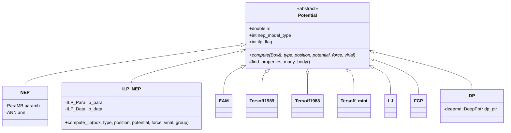
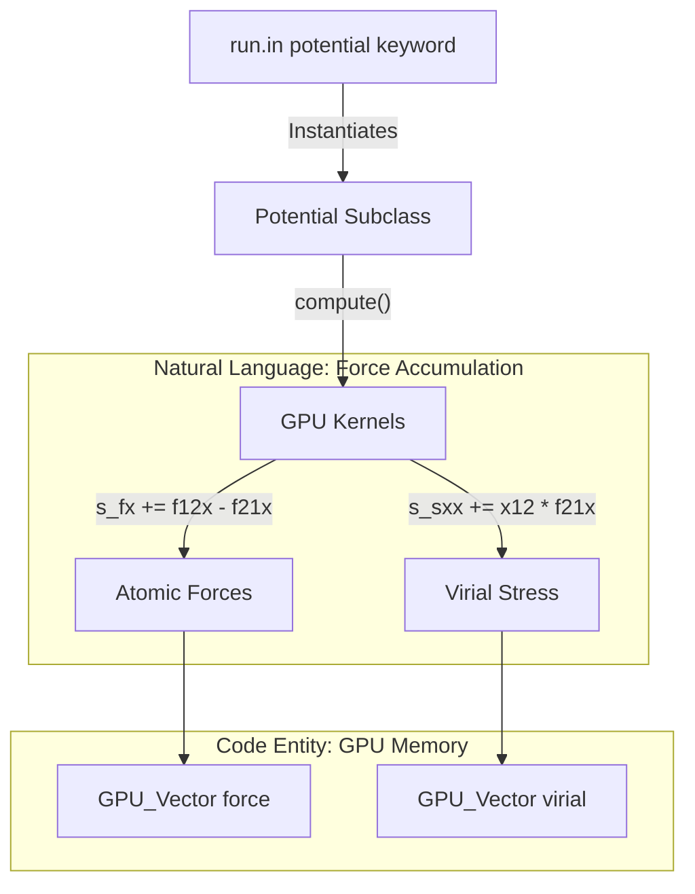

# Interatomic Potentials

Relevant source files

The following files were used as context for generating this wiki page:

- [Dockerfile](Dockerfile)
- [README.md](README.md)
- [developers/readme.md](developers/readme.md)
- [doc/conf.py](doc/conf.py)
- [doc/gpumd/input_parameters/potential.rst](doc/gpumd/input_parameters/potential.rst)
- [doc/gpumd/output_files/heatmode_out.rst](doc/gpumd/output_files/heatmode_out.rst)
- [doc/gpumd/output_files/kappamode_out.rst](doc/gpumd/output_files/kappamode_out.rst)
- [doc/index.rst](doc/index.rst)
- [doc/installation.rst](doc/installation.rst)
- [doc/potentials/index.rst](doc/potentials/index.rst)
- [doc/potentials/nep_ilp.rst](doc/potentials/nep_ilp.rst)
- [doc/potentials/sw_ilp.rst](doc/potentials/sw_ilp.rst)
- [doc/potentials/tersoff_ilp.rst](doc/potentials/tersoff_ilp.rst)
- [doc/publications.bib](doc/publications.bib)
- [doc/publications.rst](doc/publications.rst)
- [src/force/ilp_nep.cu](src/force/ilp_nep.cu)
- [src/force/ilp_nep.cuh](src/force/ilp_nep.cuh)
- [src/force/potential.cu](src/force/potential.cu)
- [src/force/potential.cuh](src/force/potential.cuh)

This page documents the interatomic potential models implemented in GPUMD and their organization within the codebase. Interatomic potentials define how atoms interact with each other, determining the forces that drive molecular dynamics simulations. GPUMD implements a wide range of classical and machine learning potentials, organized with a unified interface for integration with the molecular dynamics engine.

## Potential Framework

GPUMD implements a flexible object-oriented framework for interatomic potentials. All potential models inherit from the abstract `Potential` base class, which provides a common interface and utility functions.

### Code Entity Space: Potential Class Hierarchy

Sources: [src/force/potential.cuh:21-113](), [src/force/ilp_nep.cuh:122-205](), [src/force/potential.cu:28-33]()

### Base Potential Interface

The `Potential` abstract base class defines the common interface that all potential implementations must satisfy. The most important components are:

- `double rc`: Maximum cutoff distance used by the potential [src/force/potential.cuh:32]().
- Virtual `compute()` method: Calculates forces, energies, and virial contributions [src/force/potential.cuh:39-45]().
- Utility methods like `find_properties_many_body()`: Help with force accumulation for many-body potentials by applying the Minimum Image Convention (MIC) and summing partial forces [src/force/potential.cu:35-134]().

This unified interface makes it easy to swap different potential models while keeping the rest of the MD engine unchanged.

Sources: [src/force/potential.cuh:21-113](), [src/force/potential.cu:15-333]()

## Force Calculation Flow

When GPUMD needs to calculate forces for molecular dynamics steps, it follows a structured flow from the high-level MD loop down to specialized GPU kernels.

### System Mapping: MD Loop to Force Kernels

Sources: [src/force/potential.cu:98-112](), [src/force/potential.cu:116-132](), [doc/gpumd/input_parameters/potential.rst:5-35]()

## Supported Potential Categories

GPUMD supports three main categories of potentials, each detailed in their respective child pages.

### 1. Hybrid Potentials
These potentials combine different models to handle complex systems, such as layered 2D materials. A prominent example is `ILP_NEP`, which uses the Neuroevolution Potential (NEP) for intralayer interactions and the Interlayer Potential (ILP) for van der Waals interactions [src/force/ilp_nep.cu:17-26]().
* For details, see [Hybrid Potentials](#5.1).

### 2. Traditional Potentials
This category includes classical empirical potentials:
- **Pairwise**: Lennard-Jones (LJ) [doc/gpumd/input_parameters/potential.rst:18]().
- **Many-Body**: Embedded Atom Method (EAM), Tersoff (1988, 1989, and mini variants), and Stillinger-Weber (SW) [doc/gpumd/input_parameters/potential.rst:13-16]().
- **Harmonic**: Force Constant Potential (FCP) for phonon-related simulations [doc/gpumd/input_parameters/potential.rst:17]().
* For details, see [Traditional Potentials](#5.2).

### 3. External ML Potentials
GPUMD provides interfaces to external machine-learning potential frameworks:
- **DeePMD-kit (DP)**: Support for potentials trained with the DeePMD framework [doc/gpumd/input_parameters/potential.rst:23]().
- **Neuroevolution Potential (NEP)**: The native high-performance ML potential in GPUMD, supporting versions 3, 4, and 5 [src/force/ilp_nep.cu:160-171]().
* For details, see [External ML Potentials](#5.3).

## Implementation Details

### Memory Management
GPUMD extensively uses the `GPU_Vector<T>` template class for device memory management [src/utilities/gpu_vector.cuh](). This ensures that atomic positions, forces, and virial tensors remain on the GPU during the simulation, minimizing costly host-to-device transfers.

### Units
GPUMD uses a consistent set of internal units [developers/readme.md:97-102]():
- **Energy**: eV
- **Length**: Angstrom
- **Mass**: Dalton (amu)
- **Temperature**: K
- **Charge**: e (elementary charge)

Sources: [developers/readme.md:97-102](), [src/force/ilp_nep.cu:112-115]()

---