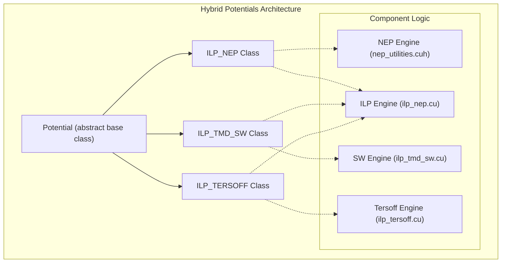
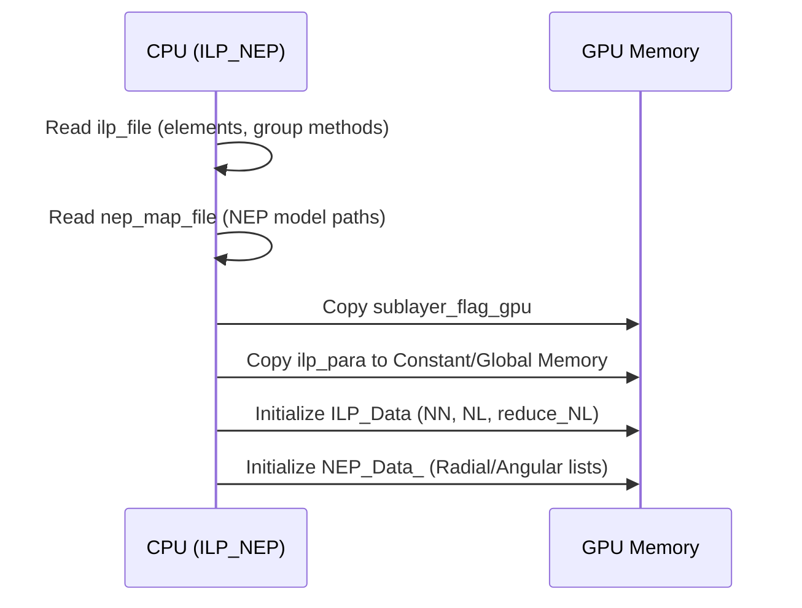

# Hybrid Potentials

<details>
<summary>Relevant source files</summary>

The following files were used as context for generating this wiki page:

- [README.md](README.md)
- [developers/readme.md](developers/readme.md)
- [doc/gpumd/input_parameters/potential.rst](doc/gpumd/input_parameters/potential.rst)
- [doc/potentials/index.rst](doc/potentials/index.rst)
- [doc/potentials/nep_ilp.rst](doc/potentials/nep_ilp.rst)
- [doc/potentials/sw_ilp.rst](doc/potentials/sw_ilp.rst)
- [doc/potentials/tersoff_ilp.rst](doc/potentials/tersoff_ilp.rst)
- [src/force/ilp_nep.cu](src/force/ilp_nep.cu)
- [src/force/ilp_nep.cuh](src/force/ilp_nep.cuh)
- [src/force/ilp_tersoff.cu](src/force/ilp_tersoff.cu)
- [src/force/ilp_tersoff.cuh](src/force/ilp_tersoff.cuh)
- [src/force/ilp_tmd_sw.cu](src/force/ilp_tmd_sw.cu)
- [src/force/ilp_tmd_sw.cuh](src/force/ilp_tmd_sw.cuh)
- [src/force/potential.cu](src/force/potential.cu)
- [src/force/potential.cuh](src/force/potential.cuh)

</details>


Hybrid potentials in GPUMD combine different interatomic potential models to effectively simulate complex materials where different types of interactions are present. These are particularly useful for layered 2D materials (graphene, h-BN, TMDs) where intralayer covalent bonding and interlayer van der Waals interactions have distinct physical characteristics better captured by specialized models.

## Overview of Hybrid Potentials

GPUMD supports several hybrid combinations via specialized classes derived from the `Potential` base class [src/force/potential.cuh:21-113]():

1.  **NEP+ILP**: Neuroevolution Potential (NEP) for intralayer interactions + Anisotropic Interlayer Potential (ILP) [src/force/ilp_nep.cuh:122-202]().
2.  **SW+ILP**: Stillinger-Weber (SW) for intralayer + ILP for interlayer [src/force/ilp_tmd_sw.cuh:79-114]().
3.  **Tersoff+ILP**: Tersoff for intralayer + ILP for interlayer [src/force/ilp_tersoff.cuh:74-96]().


**Sources:** [src/force/ilp_nep.cuh:122-122](), [src/force/ilp_tmd_sw.cuh:79-79](), [src/force/ilp_tersoff.cuh:74-74]().

## The Interlayer Potential (ILP) Component

The ILP component is shared across all hybrid models to handle van der Waals interactions. It includes a repulsive term $U^{\mathrm{rep}}$ (sensitive to local layer normals $\boldsymbol{n}$) and an attractive term $U^{\mathrm{att}}$ [doc/potentials/nep_ilp.rst:18-38]().

### Normal Vector Calculation
For layered materials, ILP requires the calculation of a local normal vector $\boldsymbol{n}_i$ for each atom. This is determined by the positions of nearest neighbors within the same layer.
*   **Graphene/h-BN**: Uses up to 3 neighbors (`MAX_ILP_NEIGHBOR_CBN`) [src/force/ilp_nep.cuh:28]().
*   **TMDs**: Uses up to 6 neighbors (`MAX_ILP_NEIGHBOR_TMD`) [src/force/ilp_nep.cuh:29]().

### Tapering Function
A tapering function `Tap(r)` is used to smoothly zero out the ILP interaction at the cutoff $R_{\mathrm{cut}}$. The coefficients are stored in GPU constant memory:
*   `Tap_coeff_tmd` [src/force/ilp_tmd_sw.cuh:116]().
*   `Tap_coeff_CBN` [src/force/ilp_tersoff.cu:157]().

**Sources:** [doc/potentials/nep_ilp.rst:22-30](), [src/force/ilp_nep.cuh:28-29]().

## NEP+ILP Hybrid Potential

The `ILP_NEP` class manages one or more NEP models for intralayer interactions and an ILP model for interlayer interactions [src/force/ilp_nep.cu:17-26]().

### Data Structures
*   `ILP_Para`: Stores ILP parameters like `C_6`, `epsilon`, and `z0` (beta) in a type-wise matrix [src/force/ilp_nep.cuh:51-63]().
*   `ParaMB` & `ANN`: Store NEP descriptor and neural network parameters [src/force/ilp_nep.cuh:125-158]().
*   `NEP_Data_`: GPU buffers for NEP-specific partial forces and neighbor lists [src/force/ilp_nep.cuh:35-48]().

### Initialization and Type Mapping
The constructor `ILP_NEP::ILP_NEP` reads the ILP parameters and a "NEP map" file. The map file associates different `group_id`s (layers) with specific NEP models [src/force/ilp_nep.cu:58-135]().


**Sources:** [src/force/ilp_nep.cu:58-135](), [src/force/ilp_nep.cuh:65-78]().

## SW+ILP and Tersoff+ILP Potentials

These hybrids use classical many-body potentials for the intralayer component.

### SW+ILP (`ILP_TMD_SW`)
Designed for Transition Metal Dichalcogenides (TMDs) [src/force/ilp_tmd_sw.cu:19-23]().
*   **Intralayer**: Stillinger-Weber 2-body and 3-body terms [src/force/ilp_tmd_sw.cuh:62-67]().
*   **Interlayer**: ILP with TMD-specific neighbor list sizes (`CUDA_MAX_NL_TMD` = 2048) [src/force/ilp_tmd_sw.cuh:23]().

### Tersoff+ILP (`ILP_TERSOFF`)
Commonly used for graphene/h-BN systems.
*   **Intralayer**: Tersoff 1988/1989 implementation [src/force/ilp_tersoff.cu:168-172]().
*   **Neighbor Lists**: Uses `MAX_TERSOFF_NEIGHBOR_NUM` for the intralayer part [src/force/ilp_tersoff.cu:149]().

**Sources:** [src/force/ilp_tmd_sw.cuh:21-27](), [src/force/ilp_tersoff.cu:62-113]().

## Computation Flow

The `compute_ilp` method is the entry point for force evaluation in these hybrid classes [src/force/potential.cuh:57-64]().

1.  **Neighbor List Generation**: The potential maintains its own internal neighbor lists (`ilp_data.NL`) separate from the global GPUMD neighbor list to handle the distinct cutoffs required for interlayer vs. intralayer interactions [src/force/ilp_nep.cuh:66]().
2.  **Layer Identification**: Uses `ilp_group_method` to determine if a pair of atoms is in the same layer (intralayer) or different layers (interlayer) [src/force/ilp_nep.cu:82-88]().
3.  **Force Accumulation**:
    *   If atoms $i, j$ are in the same layer: Apply NEP, SW, or Tersoff.
    *   If atoms $i, j$ are in different layers: Apply ILP.
4.  **Virial Calculation**: Partial forces $f_{12}$ are stored and passed to `find_properties_many_body` to accumulate the total force and virial tensor [src/force/potential.cu:136-168]().

**Sources:** [src/force/ilp_nep.cu:920-942](), [src/force/potential.cu:35-134]().

## Input File Configuration

In `run.in`, the potential is defined by pointing to the ILP parameter file and the NEP mapping file [doc/potentials/nep_ilp.rst:68-70]():

```text
potential C.ilp map.nep
```

### ILP File Format
The ILP file defines the elements, the `group_method` used to identify layers, and the physical parameters [doc/potentials/nep_ilp.rst:79-96]():
*   `group_method for layers`: Identifies which atoms belong to the same physical sheet.
*   `group_method for sublayers`: Used for TMDs (e.g., distinguishing Mo and S sublayers).
*   `rcut1`: Cutoff for calculating normal vectors.
*   `rcut2`: Cutoff for the ILP interaction (typically 16 Å).

### NEP Map File Format
Maps specific layers to specific NEP models [doc/potentials/nep_ilp.rst:98-116]():
*   `number of NEP files`: Total NEP models to load.
*   `NEP_id for group_X`: Assigns a model index to each group defined in the layer `group_method`.

**Sources:** [doc/potentials/nep_ilp.rst:79-116](), [src/force/ilp_nep.cu:82-89]().

---