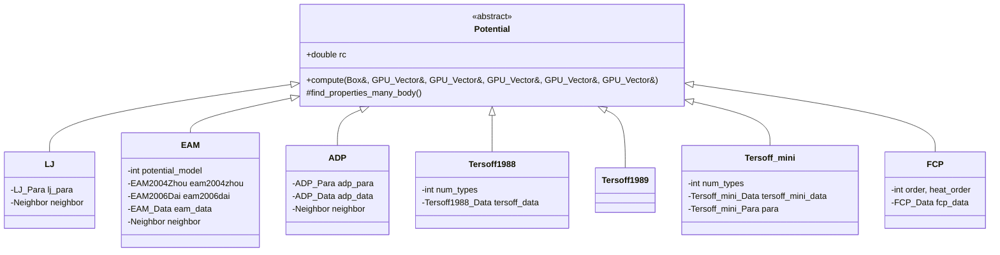
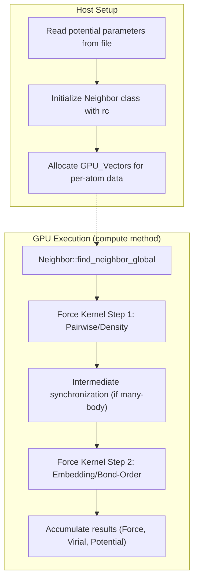
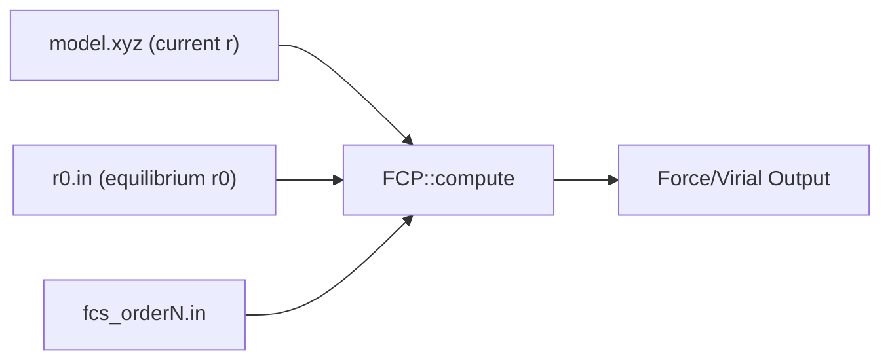

# Traditional Potentials

<details>
<summary>Relevant source files</summary>

The following files were used as context for generating this wiki page:

- [doc/potentials/adp.rst](doc/potentials/adp.rst)
- [doc/potentials/lennard_jones.rst](doc/potentials/lennard_jones.rst)
- [doc/potentials/tersoff_1988.rst](doc/potentials/tersoff_1988.rst)
- [doc/potentials/tersoff_1989.rst](doc/potentials/tersoff_1989.rst)
- [doc/potentials/tersoff_mini.rst](doc/potentials/tersoff_mini.rst)
- [potentials/adp/AlCu.adp.txt](potentials/adp/AlCu.adp.txt)
- [potentials/adp/CuTa_LJ15_2014.adp.txt](potentials/adp/CuTa_LJ15_2014.adp.txt)
- [potentials/adp/Ta.adp.txt](potentials/adp/Ta.adp.txt)
- [potentials/adp/U_Mo.alloy.adp_cor.txt](potentials/adp/U_Mo.alloy.adp_cor.txt)
- [potentials/eam/Cu_Dai_2006.txt](potentials/eam/Cu_Dai_2006.txt)
- [potentials/eam/Cu_Zhou_2004.txt](potentials/eam/Cu_Zhou_2004.txt)
- [potentials/lj/Ar_10A.txt](potentials/lj/Ar_10A.txt)
- [potentials/lj/Ar_20A.txt](potentials/lj/Ar_20A.txt)
- [potentials/tersoff/BN_Lindsay_2011.txt](potentials/tersoff/BN_Lindsay_2011.txt)
- [potentials/tersoff/BN_Sevik_2011.txt](potentials/tersoff/BN_Sevik_2011.txt)
- [potentials/tersoff/GaN_Nord_2003.txt](potentials/tersoff/GaN_Nord_2003.txt)
- [potentials/tersoff/SiO_Munetoh_2007.txt](potentials/tersoff/SiO_Munetoh_2007.txt)
- [potentials/tersoff/Si_Erhart_2005_1.txt](potentials/tersoff/Si_Erhart_2005_1.txt)
- [potentials/tersoff/Si_Erhart_2005_2.txt](potentials/tersoff/Si_Erhart_2005_2.txt)
- [potentials/tersoff/Sn_Cherukara_2016.txt](potentials/tersoff/Sn_Cherukara_2016.txt)
- [potentials/tersoff/readme.md](potentials/tersoff/readme.md)
- [src/force/adp.cu](src/force/adp.cu)
- [src/force/adp.cuh](src/force/adp.cuh)
- [src/force/eam.cu](src/force/eam.cu)
- [src/force/eam.cuh](src/force/eam.cuh)
- [src/force/ewald.cu](src/force/ewald.cu)
- [src/force/ewald.cuh](src/force/ewald.cuh)
- [src/force/fcp.cu](src/force/fcp.cu)
- [src/force/fcp.cuh](src/force/fcp.cuh)
- [src/force/lj.cu](src/force/lj.cu)
- [src/force/lj.cuh](src/force/lj.cuh)
- [src/force/pppm.cu](src/force/pppm.cu)
- [src/force/pppm.cuh](src/force/pppm.cuh)
- [src/force/tersoff1988.cu](src/force/tersoff1988.cu)
- [src/force/tersoff1988.cuh](src/force/tersoff1988.cuh)
- [src/force/tersoff1989.cu](src/force/tersoff1989.cu)
- [src/force/tersoff1989.cuh](src/force/tersoff1989.cuh)
- [src/force/tersoff_mini.cu](src/force/tersoff_mini.cu)
- [src/force/tersoff_mini.cuh](src/force/tersoff_mini.cuh)
- [src/makefile](src/makefile)
- [src/makefile.hip](src/makefile.hip)
- [src/measure/extrapolation.cu](src/measure/extrapolation.cu)
- [src/measure/extrapolation.cuh](src/measure/extrapolation.cuh)
- [src/model/box.cu](src/model/box.cu)
- [src/model/box.cuh](src/model/box.cuh)
- [src/model/group.cu](src/model/group.cu)
- [src/utilities/gpu_macro.cuh](src/utilities/gpu_macro.cuh)
- [src/utilities/read_file.cu](src/utilities/read_file.cu)
- [src/utilities/read_file.cuh](src/utilities/read_file.cuh)

</details>


This page documents the traditional interatomic potentials implemented in GPUMD. These potentials include well-established classical force fields such as Lennard-Jones, Embedded Atom Method (EAM), Angular Dependent Potential (ADP), and Tersoff potentials, as well as long-range electrostatics via Ewald and PPPM methods. For machine-learned potentials, see [NEP: Neuroevolution Potentials](#4), and for hybrid approaches, see [Hybrid Potentials](#5.1).

## Potential Base Class

All interatomic potentials in GPUMD inherit from the abstract `Potential` base class defined in `potential.cuh`. This class provides a common interface for all potential implementations, establishing a consistent method for computing forces, energies, and virials.



Sources: [src/force/potential.cuh:21-101](), [src/force/eam.cuh:60-82](), [src/force/lj.cuh:34-49](), [src/force/adp.cuh:46-68]()

The `Potential` base class defines the critical `compute()` method which all derived classes must implement:

```cpp
virtual void compute(
  Box& box,
  const GPU_Vector<int>& type,
  const GPU_Vector<double>& position,
  GPU_Vector<double>& potential,
  GPU_Vector<double>& force,
  GPU_Vector<double>& virial) = 0;
```

Sources: [src/force/potential.cuh:66-72]()

## Potential Implementation Flow

Traditional potentials generally follow a structured data flow on the GPU to maximize throughput.



Sources: [src/force/lj.cu:184-219](), [src/force/eam.cu:468-580](), [src/force/tersoff_mini.cu:325-400]()

## Lennard-Jones Potential

The Lennard-Jones potential is a pairwise potential implemented in the `LJ` class.

### Implementation

The potential has the form $V(r) = 4\epsilon[(\sigma/r)^{12} - (\sigma/r)^6]$. GPUMD uses a specific parameter structure `LJ_Para` to store pre-calculated values like `s6e4` ($4\epsilon\sigma^6$) and `s12e4` ($4\epsilon\sigma^{12}$) for efficient computation in the `gpu_find_force` kernel.

Sources: [src/force/lj.cu:67-74](), [src/force/lj.cuh:24-32]()

### Parameter Specification

LJ parameters are read in `LJ::LJ(FILE* fid, int num_types, int num_atoms)` and stored in a 2D array within `lj_para` to support multiple atom types.

Sources: [src/force/lj.cu:29-59]()

## Embedded Atom Method (EAM) and ADP

EAM potentials are many-body potentials commonly used for metals. GPUMD supports analytical versions:
1. **EAM2004Zhou**: [src/force/eam.cu:47-95]()
2. **EAM2006Dai**: [src/force/eam.cu:97-123]()
3. **ADP**: The Angular Dependent Potential extends EAM by adding dipole and quadrupole terms to the total energy. [src/force/adp.cu:26-90]()

### Implementation Architecture

EAM/ADP potentials require two passes over the neighbor list. In the first pass (`gpu_find_force_step1`), electron densities (and dipole/quadrupole tensors for ADP) are computed. In the second pass (`gpu_find_force_step2`), the embedding forces and pairwise forces are calculated.

Sources: [src/force/eam.cu:283-466](), [src/force/adp.cu:150-420]()

## Tersoff Potentials

Tersoff potentials include three-body angular terms. GPUMD implements three variants:
1. **Tersoff1988**: [src/force/tersoff1988.cu:57-194]()
2. **Tersoff1989**: [src/force/tersoff1989.cu:31-139]()
3. **Tersoff_mini**: A minimal version for diamond silicon. [src/force/tersoff_mini.cu:34-97]()

### Implementation Strategy

Tersoff potentials utilize a multi-step kernel approach:
- **Step 1**: Calculate bond-order functions $b_{ij}$ and their derivatives. [src/force/tersoff_mini.cu:161-227]()
- **Step 2**: Calculate partial forces using the pre-computed bond orders. [src/force/tersoff_mini.cu:229-324]()

## Force Constant Potential (FCP)

FCP is a Taylor expansion of the potential energy around equilibrium. It supports orders 2 through 6.

### Formulation and Data Flow

FCP reads equilibrium positions from `r0.in` and force constants from `fcs_order[n].in`. The displacements $u = r - r_0$ are calculated on the fly to compute forces.



Sources: [src/force/fcp.cu:26-66](), [src/force/fcp.cu:171-255]()

## Electrostatics: Ewald and PPPM

For systems with charges, GPUMD provides long-range electrostatics.

### Ewald Method
The `Ewald` class implements the standard Ewald summation, splitting the interaction into a real-space part (handled via neighbor lists) and a reciprocal-space part.
Sources: [src/force/ewald.cu:26-55]()

### PPPM (Particle-Particle Particle-Mesh)
The `PPPM` class provides a faster $O(N \log N)$ alternative to Ewald. It maps charges onto a 3D grid, uses Fast Fourier Transforms (FFT) to solve the Poisson equation, and interpolates forces back to atoms.

| Component | Code Entity | File |
| :--- | :--- | :--- |
| **Grid Setup** | `PPPM::find_para` | [src/force/pppm.cu:242-297]() |
| **Charge Mapping** | `find_mesh` kernel | [src/force/pppm.cu:135-183]() |
| **FFT Execution** | `gpufftExecC2C` | [src/force/pppm.cu:348]() |
| **Force Interpolation** | `find_force_from_mesh` kernel | [src/force/pppm.cu:209-240]() |

Sources: [src/force/pppm.cuh:25-73](), [src/force/pppm.cu:30-240]()

## Common Implementation Features

### Neighbor List Utilization
All traditional potentials use the `Neighbor` class to manage spatial decomposition and pair identification.
Sources: [src/force/neighbor.cuh:22-108]()

### Virial Calculation
Virials are accumulated per-atom to support the calculation of the stress tensor and thermal conductivity. The accumulation follows a standard pattern:
```cpp
g_virial[n1 + 0 * number_of_particles] += s_sxx; // xx component
g_virial[n1 + 1 * number_of_particles] += s_syy; // yy component
g_virial[n1 + 2 * number_of_particles] += s_szz; // zz component
```
Sources: [src/force/lj.cu:168-176](), [src/force/eam.cu:453-462]()

---