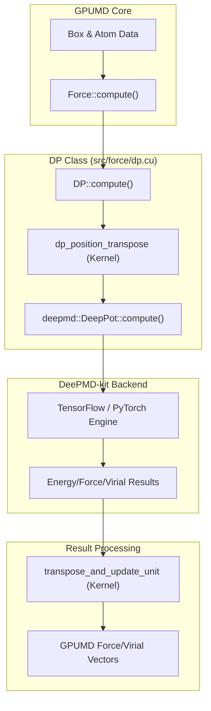
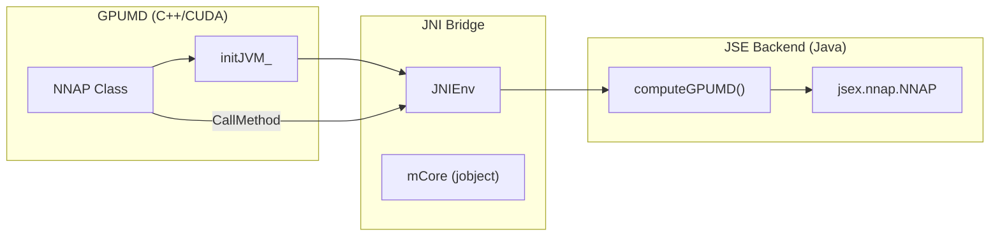

# External ML Potentials

Relevant source files

The following files were used as context for generating this wiki page:

- [.gitignore](.gitignore)
- [CMakeLists.txt](CMakeLists.txt)
- [Dockerfile](Dockerfile)
- [doc/conf.py](doc/conf.py)
- [doc/gpumd/output_files/heatmode_out.rst](doc/gpumd/output_files/heatmode_out.rst)
- [doc/gpumd/output_files/kappamode_out.rst](doc/gpumd/output_files/kappamode_out.rst)
- [doc/index.rst](doc/index.rst)
- [doc/installation.rst](doc/installation.rst)
- [doc/publications.bib](doc/publications.bib)
- [doc/publications.rst](doc/publications.rst)
- [potentials/DP/README.md](potentials/DP/README.md)
- [src/force/dp.cu](src/force/dp.cu)
- [src/force/dp.cuh](src/force/dp.cuh)
- [src/force/eam_alloy.cu](src/force/eam_alloy.cu)
- [src/force/eam_alloy.cuh](src/force/eam_alloy.cuh)
- [src/force/nnap.cu](src/force/nnap.cu)
- [src/force/nnap.cuh](src/force/nnap.cuh)
- [tests_pytest/fixtures/structures/BaTiO3-nat40-rattled.xyz](tests_pytest/fixtures/structures/BaTiO3-nat40-rattled.xyz)
- [tests_pytest/fixtures/structures/BaZrO3-nat40-rattled.xyz](tests_pytest/fixtures/structures/BaZrO3-nat40-rattled.xyz)
- [tests_pytest/fixtures/structures/C-nat16-rattled.xyz](tests_pytest/fixtures/structures/C-nat16-rattled.xyz)
- [tests_pytest/fixtures/structures/water-nat63-from-md.xyz](tests_pytest/fixtures/structures/water-nat63-from-md.xyz)

GPUMD supports external machine-learning (ML) potentials through specialized interfaces that bridge the core C++/CUDA engine with external backends. The primary supported frameworks are **DeePMD-kit (DP)** and **Neural-Network Atomic Potentials (NNAP)**.

## DeePMD-kit (DP) Interface

The DP interface allows GPUMD to utilize models trained with the DeePMD-kit framework, supporting both TensorFlow (`.pb`) and PyTorch (`.pth`/`.pt2`) backends [potentials/DP/README.md:6-7](). The interface is implemented in the `DP` class [src/force/dp.cuh:52-157]().

### Data Flow and Coordination

The `DP` class manages the transformation between GPUMD's internal data structures and the requirements of the `deepmd::DeepPot` object. Because DeePMD-kit often operates on different memory layouts or units, the interface handles transpositions and unit conversions [src/force/dp.cu:109-116]().

**DeePMD Integration Flow**

Sources: [src/force/dp.cu:58-64](), [src/force/dp.cu:119-130](), [src/force/dp.cu:184-200]()

### Key Implementation Details
*   **Neighbor List**: The interface maintains a specialized `DP_NL` structure to match the neighbor list format expected by DeePMD-kit (similar to LAMMPS) [src/force/dp.cuh:34-40]().
*   **Memory Management**: To optimize performance, the class uses pinned host buffers (`type_cpu_pinned_ptr`, etc.) for faster Host-to-Device (H2D) and Device-to-Host (D2H) copies [src/force/dp.cuh:138-154]().
*   **Periodic Boundary Conditions**: The interface handles ghost atoms and periodic images specifically for the DP backend, marking atoms as "dangerous" if they require periodic image atoms within the DP cutoff [src/force/dp.cuh:96-106]().

## Neural-Network Atomic Potentials (NNAP)

The NNAP interface provides a bridge to the **JSE (Java Simulation Engine)** bridge, allowing GPUMD to execute neural network potentials that are implemented or wrapped in Java. This interface is enabled via the `USE_NNAP` preprocessor flag [src/force/nnap.cu:21]().

### JSE Bridge Architecture

The interface utilizes the **Java Native Interface (JNI)** to instantiate a JVM and communicate with the `jsex.nnap.NNAP` class [src/force/nnap.cu:92]().

**NNAP JNI Communication**

Sources: [src/force/nnap.cu:48-78](), [src/force/nnap.cu:135-170](), [src/force/nnap.cuh:56-57]()

### Features and Configuration
*   **ZBL Correction**: The NNAP interface includes an optional Ziegler-Biersack-Littmark (ZBL) short-range repulsion correction [src/force/nnap.cuh:31-39]().
*   **Small-Box Handling**: The interface includes logic to detect if the simulation box is too small relative to the potential cutoff (`rcutMax`), which is critical for maintaining correct periodic images [src/force/nnap.cu:172-189]().
*   **Environment Variables**: The build system relies on `JVM_LIB_PATH` and `JSE_JAR_PATH` to locate the necessary Java libraries and the `jse-all.jar` file [CMakeLists.txt:62-67]().

## Summary Table of External ML Potentials

| Feature | DeePMD-kit (DP) | NNAP (JSE) |
| :--- | :--- | :--- |
| **Backend** | TensorFlow / PyTorch | Java / JSE Bridge |
| **Primary Class** | `DP` [src/force/dp.cuh:52]() | `NNAP` [src/force/nnap.cuh:28]() |
| **Input File** | Potential file + setting file [potentials/DP/README.md:16]() | `nnap.txt` setting file [src/force/nnap.cu:195]() |
| **Language** | C++ / CUDA | C++ / JNI / Java |
| **Short-range** | Optional ZBL in DP model | Integrated `ZBL` struct [src/force/nnap.cuh:31]() |

Sources: [src/force/dp.cuh](), [src/force/nnap.cuh](), [potentials/DP/README.md]()

---